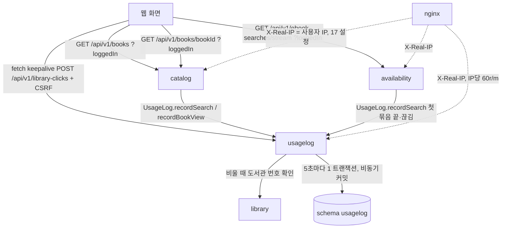
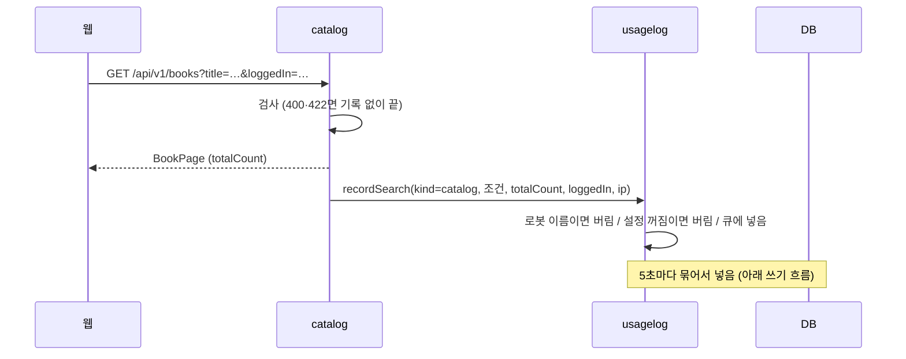
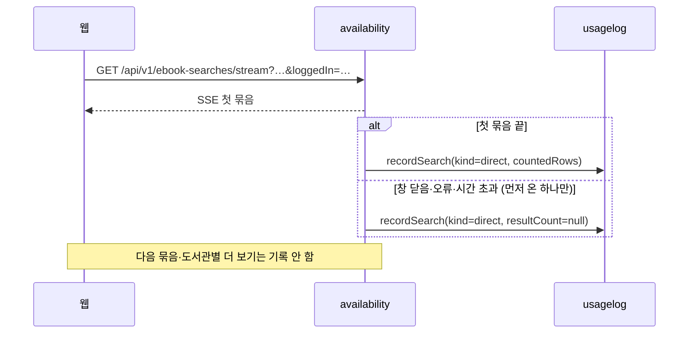
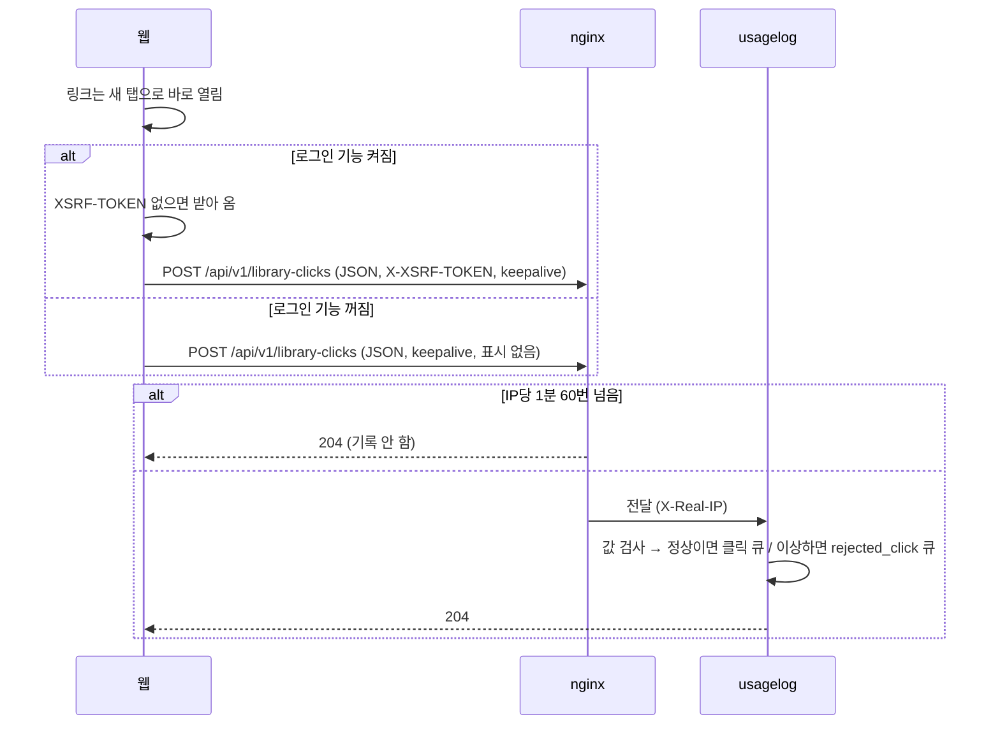
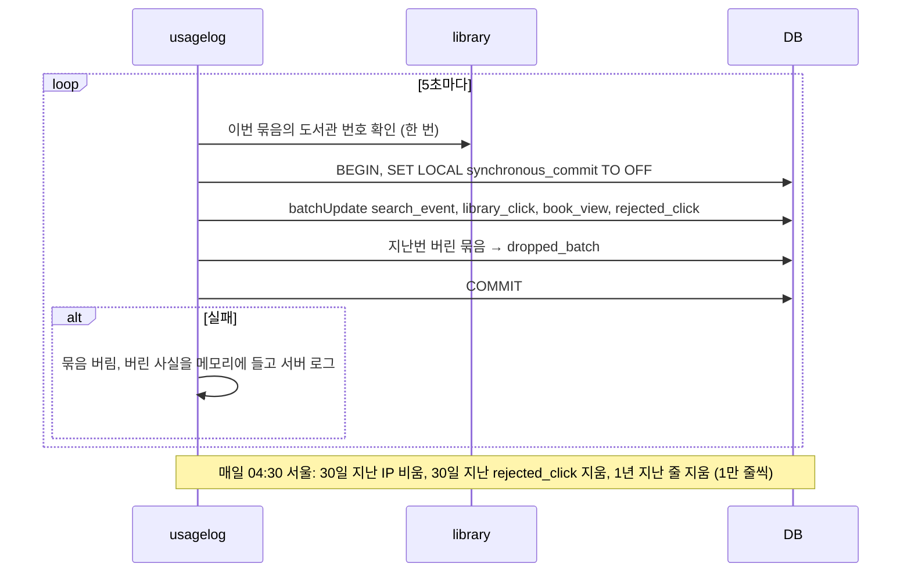
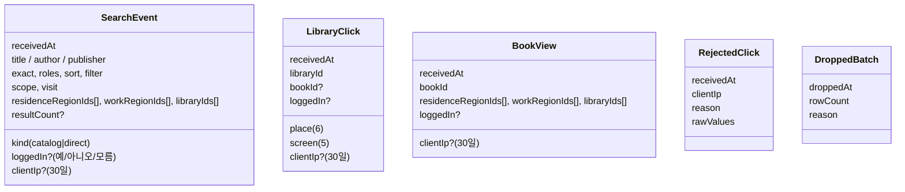
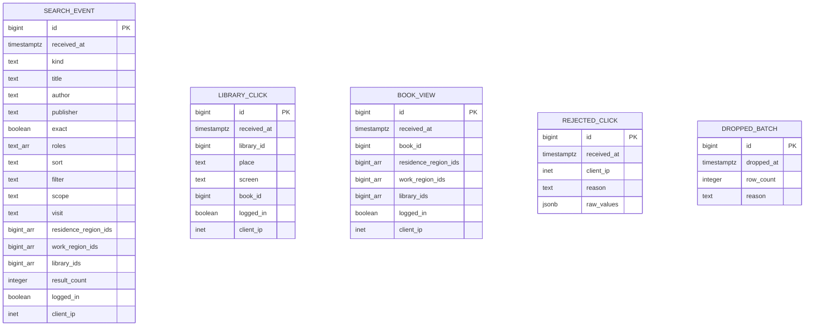

# 설계 변경: 사이클 15 사용자 행동 기록 (검색·책 상세·도서관 클릭)

> **초안 (2026-10-13)**. 방향은 사용자가 정함(`architect-proposal.md` "고른 방향", ADR-0096·0097 Proposed). 12·13·14 회고에서 실제 코드를 본 뒤, 그리고 사이클 17의 nginx `CF-Connecting-IP` 설정을 확인한 뒤 확정합니다 [확정: 순서] (scope). 그때까지 아래 이름·숫자 중 따로 적지 않은 것은 [안]

## 구조 그림

### 모듈 구성도



### 주요 흐름

수집 목록 검색 (첫 쪽)



도서관에서 직접 찾기 (첫 묶음)



도서관 클릭 알림



쓰기와 지우기



### 도메인 모델



- 기록끼리 잇는 관계 없음 (검색·클릭을 잇지 않기로 함, spec R2-6)

## 모듈

| 모듈 | 신규/변경 | 책임 | 공개 API | 발행/구독 이벤트 | 소유 테이블 |
|---|---|---|---|---|---|
| `usagelog` | 신규 | 기록 받기·모으기·5초 넣기·04:30 지우기·클릭 알림 주소, 로봇·설정 꺼짐 거르기 | `UsageLog` (`recordSearch`, `recordBookView`), 공개 record `SearchRecord`·`BookViewRecord` [안] | 없음 | `usagelog.*` 다섯 |
| `catalog` | 변경 | 첫 쪽 검색·책 상세 성공 뒤 `UsageLog` 호출, `loggedIn` 읽기 | 변경 없음 | 없음 | 변경 없음 |
| `availability` | 변경 | 직접 찾기 첫 묶음 끝·끊김에 한 번 `UsageLog` 호출 | 변경 없음 | 없음 | 변경 없음 |
| `library` | 변경 없음 | `usagelog`이 도서관 번호 확인에 쓰는 공개 API (13 회고 뒤 `listAll` 등 어느 것을 쓸지 정함) | 기존 | 없음 | — |

- `usagelog`: `@ApplicationModule(allowedDependencies = { "library" })` [안]. `catalog → usagelog`, `availability → usagelog` 의존이 새로 생김 (순환 없음)
- 기록 설정 값: `chaekcheck.usagelog.enabled` [안], 기본 꺼짐, 공개일에 켬 [확정] (spec)

## 데이터

- 스키마: `usagelog` [확정] (ADR-0097)



| 테이블.컬럼 | 타입 | 제약 | 설명 | 상태 태그 |
|---|---|---|---|---|
| 모든 표 `id` | `bigint GENERATED ALWAYS AS IDENTITY` | PK | 지우기를 나눠 할 때 | [안] (뺄지 프로토타입) |
| `*.received_at` | `timestamptz` | NOT NULL | 서버가 받은 시각 | [확정] (spec) |
| `search_event.kind` | `text` | CHECK (`catalog`,`direct`) | 검색 종류 | [안] 값 이름 |
| `search_event.title/author/publisher` | `text` | 셋 중 하나 이상 | 서버가 다듬은 검색어, 2~50자 | [확정] (spec #1) |
| `search_event.exact`, `roles`, `sort` | `boolean`, `text[]`, `text` | 수집 목록만 | 받은 값, 없으면 기본값 | [확정] |
| `search_event.filter` | `text` | 직접 찾기만 | `all`/`available` | [확정] |
| `search_event.scope`, `visit` | `text` | NOT NULL | 받은 값 | [확정] |
| `*.residence_region_ids`, `work_region_ids`, `library_ids` | `bigint[]` | NOT NULL DEFAULT `'{}'` | 받은 값 그대로 | [확정] (값), [안] (타입) |
| `search_event.result_count` | `integer` | NULL 가능 | 직접 찾기가 첫 묶음 전 끊기면 NULL | [확정] |
| `*.logged_in` | `boolean` | NULL = 모름 | 화면이 보낸 값 | [확정] (#check-results) |
| `*.client_ip` | `inet` | NULL 가능 | `X-Real-IP`, 30일 뒤 NULL | [확정] (값·기간), [안] (타입) |
| `library_click.library_id` | `bigint` | NOT NULL, FK 없음 | 확인된 서비스 도서관 번호 | [확정] |
| `library_click.place` | `text` | CHECK 여섯 값 | `result_card`,`join_link`,`join_guide`,`home_page`,`logo`,`summary_bar` | [안] 값 이름 |
| `library_click.screen` | `text` | CHECK 다섯 값 | `direct_results`,`catalog_results`,`book_page`,`picks`,`my_libraries` | [안] 값 이름 |
| `library_click.book_id`, `book_view.book_id` | `bigint` | FK 없음 | 책 번호 (catalog 번호는 가져오기 때 이어 씀, ADR-0062) | [확정] |
| `rejected_click.reason` | `text` | CHECK | `unknown_library`,`invalid_place`,`invalid_screen`,`invalid_book_id`,`malformed` | [안] |
| `rejected_click.raw_values` | `jsonb` | 크기 상한 [안: 2KB 넘으면 잘라 냄] | 받은 값 | [안] |
| `dropped_batch.reason` | `text` | CHECK | `db_failure`,`buffer_full` | [안] |
| 색인 | BRIN `(received_at)` 각 표, `client_ip IS NOT NULL` 부분 색인 [안] | — | 지우기·기간 조회 | [안] |

- 파티션 없음 [확정: 방향] (ADR-0097)
- 다른 schema로 FK 없음 (모듈 경계, 번호만 남김)
- Liquibase: 새 파일 `db/changelog/usagelog/001-usagelog-schema.yaml`을 master 끝에 [안]. 기존 changeset 수정 없음. 사이클 13·16도 master 끝을 고치므로 병합 순서 확인

## API

| 메서드 | 경로 | 설명 | 요청 | 응답 | 에러 |
|---|---|---|---|---|---|
| POST | `/api/v1/library-clicks` | 도서관 링크 클릭 알림 | JSON (아래) | `204`, 본문 없음 | 로그인 기능 켜짐에서 CSRF 표시 없음·틀림 → `403` (기존 규칙). 값이 틀려도 `204` (rejected_click에 남김). nginx 한도 초과도 `204` |
| GET | `/api/v1/books` | (변경) 쿼리에 `loggedIn` 추가 | `loggedIn=true|false`, 없으면 모름 | 변경 없음 | 변경 없음 |
| GET | `/api/v1/books/{bookId}` | (변경) 같음 | 같음 | 변경 없음 | 변경 없음 |
| GET | `/api/v1/ebook-searches/stream` | (변경) 같음 | 같음 | 변경 없음 | 변경 없음 |

```json
POST /api/v1/library-clicks
{ "libraryId": 12, "place": "result_card", "screen": "picks", "bookId": 345, "loggedIn": false }
```

- 기존 검색 API는 모르는 쿼리 값을 무시하므로 웹을 먼저 고쳐도 깨지지 않음 (`architect-proposal.md` 확인 결과 #8)
- `loggedIn`을 헤더가 아니라 쿼리로: SSE(`EventSource`)는 헤더를 넣을 수 없음 [안]

## 외부 연동

| 대상 | 방식 | 제한·키 관리 | 실패 시 동작 | 상태 태그 |
|---|---|---|---|---|
| 없음 (외부 서비스 호출 없음) | — | — | — | — |
| nginx (배포 설정) | `X-Real-IP`, `location = /api/v1/library-clicks` IP당 60r/m(넘치면 204), 직접 찾기·대출 조회 location에서 bot·crawler·spider UA 403, `public/robots.txt` | 사이클 17 `CF-Connecting-IP` 설정에 기댐 | 설정 없으면 IP가 모두 cloudflared 주소 | [확정] (값), [확인 필요] (17 설정) |

## 결정 기록

- ADR-0096 사용자 행동 기록은 같은 PostgreSQL에, IP 30일·나머지 1년 (Proposed)
- ADR-0097 기록 전용 모듈 `usagelog`, 공개 창구 직접 호출, 5초 묶음·비동기 커밋, fetch keepalive + CSRF (Proposed)

## 확인 필요

| 항목 | 확인 방법 | 막는 단계 |
|---|---|---|
| 12·13·14 뒤 검색·책 상세·결과 줄 코드 위치, 도서관 번호 확인 API(13 `listAll`), master changelog 끝 | 12·13·14 회고 | 설계 확정 |
| 17 nginx가 `CF-Connecting-IP`로 `$remote_addr`를 바꾸는지, realip 모듈이 이미지에 있는지, 터널에서 머리글이 붙는지 | 17 배포 시험 | 설계 확정 |
| `SmartLifecycle` 정지 phase와 Hikari 닫힘 순서 | 프로토타입 | 개발 |
| dev pgjdbc 실제 버전 | 의존성 트리 | 개발 |
| `id` PK·부분 색인을 둘지 (넣기 비용) | 프로토타입, AC-16 측정 | 개발 |
| 광고 차단으로 빠지는 클릭 비율 | 지인 기간 실서버 시험 | 없음 |
