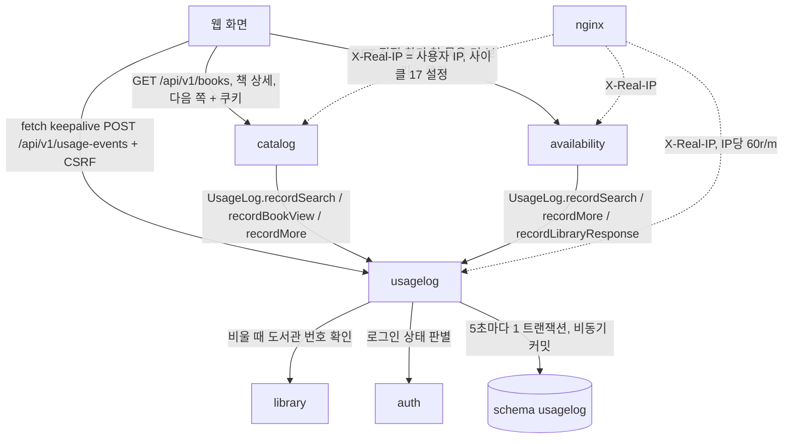
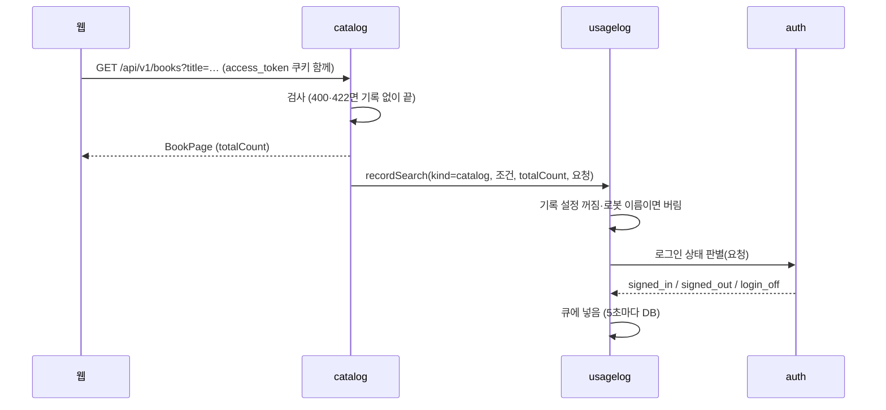
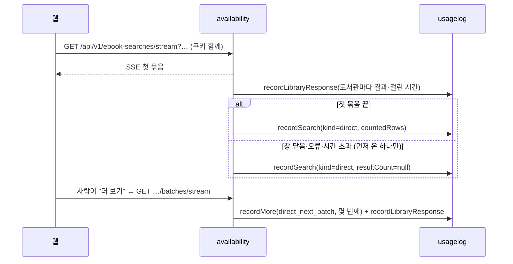
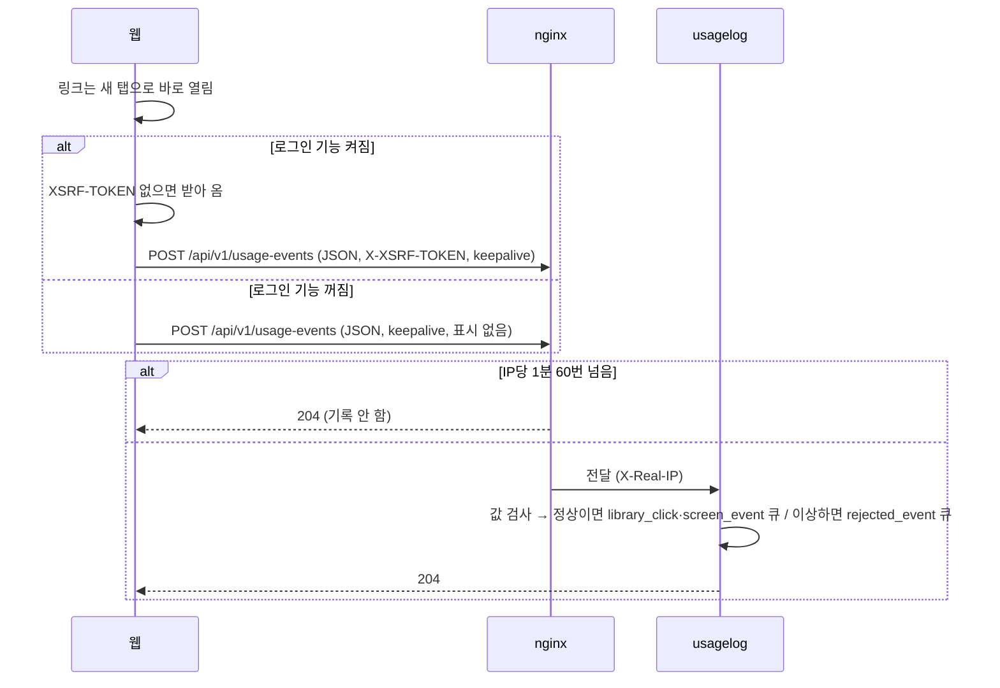
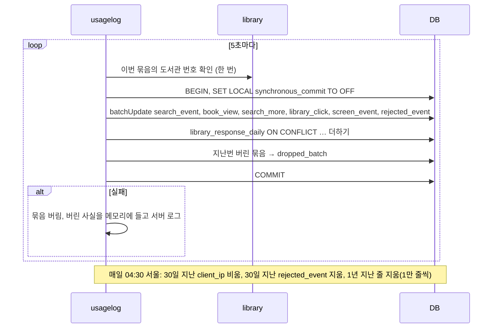
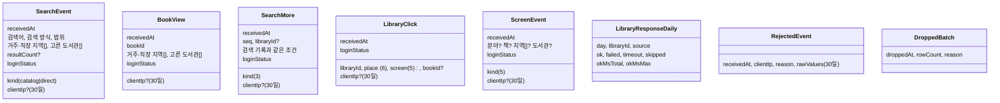
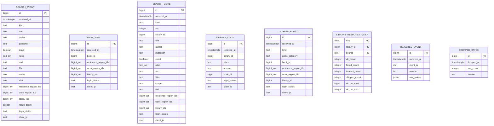

# 설계 변경: 사이클 15 사용자 행동 기록

> **초안 (2026-10-14 정리)**. 방향과 세부는 사용자가 정함([spec.md](spec.md), 결정 페이지는 [easy/README.md](easy/README.md)). 12·13·14 회고에서 실제 코드를 본 뒤 기록을 부를 자리를 맞춰 확정합니다 [확정: 순서] ([scope.md](scope.md)). 대안 비교 기록은 [architect-proposal.md](architect-proposal.md). 그림을 실제 그림으로 본 페이지: [easy/design-delta-original.html](easy/design-delta-original.html)
>
> 줄임: [설계](easy/2026-10-13-design-decisions.html), [늘린 기록 설계](easy/2026-10-13-more-actions-design.html), [요약 방법](easy/2026-10-13-summary-method.html), [남은 제안](easy/2026-10-14-remaining-proposals.html), [로그인 판별](easy/2026-10-14-login-status.html), [검증](easy/2026-10-14-verify-decisions.html)

## 구조 그림

### 모듈 구성도



### 주요 흐름

수집 목록 검색 (첫 쪽)



도서관에서 직접 찾기 (첫 묶음과 "더 보기")



사용 알림 (도서관 클릭·화면 행동)



쓰기와 지우기



### 도메인 모델



- 기록끼리 잇는 칸은 없음 (spec R2-6). 통계에서 같은 IP로 30일 안에서 이어 보는 것은 허용 [확정] ([검증](easy/2026-10-14-verify-decisions.html) #1)

## 모듈

| 모듈 | 신규/변경 | 책임 | 공개 API | 발행/구독 이벤트 | 소유 테이블 |
|---|---|---|---|---|---|
| `usagelog` | 신규 | 기록 받기·모으기·5초 넣기·도서관 응답 집계·04:30 정리·사용 알림 주소, 설정 꺼짐·로봇 거르기 | `UsageLog` (`recordSearch`, `recordBookView`, `recordMore`, `recordLibraryResponse`), 공개 record [안: 이름] | 없음 | `usagelog.*` 여덟 |
| `catalog` | 변경 | 첫 쪽 검색·다음 쪽·책 상세 성공 뒤 `UsageLog` 호출 (로그인은 모름) | 변경 없음 | 없음 | 변경 없음 |
| `availability` | 변경 | 직접 찾기 첫 묶음 끝·끊김에 한 번 `recordSearch`, "더 보기"·도서관별 더 보기에 `recordMore`, 모든 도서관 요청(직접 찾기·대출 수 채우기)마다 `recordLibraryResponse` | 변경 없음 | 없음 | 변경 없음 |
| `auth` | 변경 | 로그인 상태 판별 부품 공개 (켜짐: 쿠키 서명 확인, 만료돼도 로그인함 / 꺼짐: 쿠키를 보지 않고 `login_off`), `access_token` 쿠키 경로 `/api/v1`, 옛 경로 쿠키는 따로 지우지 않음 | `LoginStatusReader` [안: 이름] | 없음 | 변경 없음 |
| `library` | 변경 없음 | `usagelog`이 도서관 번호 확인에 쓰는 공개 API (13 회고 뒤 `listAll` 등 어느 것을 쓸지 정함) | 기존 | 없음 | — |

- `usagelog`: `@ApplicationModule(allowedDependencies = { "library", "auth" })` [확정] ([남은 제안](easy/2026-10-14-remaining-proposals.html) #6, [로그인 판별](easy/2026-10-14-login-status.html) #1). `catalog → usagelog`, `availability → usagelog` 의존이 새로 생김 (순환 없음)
- 기록 설정 값: `chaekcheck.usagelog.enabled` [확정] ([남은 제안](easy/2026-10-14-remaining-proposals.html) #2), 기본 꺼짐, 공개일에 켬 [확정] (spec R3-6)
- 요청 하나하나의 도서관 응답은 서버 로그로만 [확정] (spec R6-4). 로그 형식·레벨 [안: 기존 availability 로그에 도서관·출처·결과·시간을 한 줄로], 보관 기간 [확인 필요: 사이클 17]

## 웹

- 사용 알림 보내기 한 곳(공용 함수)에서 `fetch` keepalive, CSRF 표시 처리(로그인 기능 켜짐일 때만, `/api/v1/me` 404 = 꺼짐) [안: 위치]
- 클릭 알림을 붙일 곳: 결과 줄(`ResultRow.tsx`), 로고(`LibraryLogo.tsx`, 도서관 번호를 넘겨받게), 요약 막대 이름(`LibrarySummaryBar.tsx`). 결과 줄은 어느 화면인지 넘겨받음 (spec R2-2)
- 화면 행동 알림을 붙일 곳: 사서 추천 목록·책 창(사이클 14 `picks` 화면), 지역 설정 저장, 내 도서관 넣기·빼기
- 로그인 여부는 보내지 않음 (서버 판별)

## 데이터

- 스키마: `usagelog` [확정] (사용자 승인, 2026-10-13, [설계](easy/2026-10-13-design-decisions.html) #6)



| 테이블.컬럼 | 타입 | 제약 | 설명 | 상태 태그 |
|---|---|---|---|---|
| `id` (`library_response_daily` 빼고 모든 표) | `bigint GENERATED ALWAYS AS IDENTITY` | PK | 지우기를 나눠 할 때 | [안] (뺄지 프로토타입으로) |
| `*.received_at` | `timestamptz` | NOT NULL | 서버가 받은 시각 | [확정] (spec) |
| `search_event.kind` | `text` | CHECK (`catalog`,`direct`) | 검색 종류 | [확정] ([남은 제안](easy/2026-10-14-remaining-proposals.html) #2) |
| `title`/`author`/`publisher` | `text` | 셋 중 하나 이상 | 서버가 다듬은 검색어, 2~50자 | [확정] (spec) |
| `exact`, `roles`, `sort` | `boolean`, `text[]`, `text` | 수집 목록만 | 받은 값, 없으면 기본값 | [확정] |
| `filter` | `text` | 직접 찾기만 | `all`/`available` | [확정] |
| `scope`, `visit` | `text` | NOT NULL | 받은 값 | [확정] |
| `residence_region_ids`, `work_region_ids`, `library_ids` | `bigint[]` | `search_event`·`book_view`·`search_more`는 NOT NULL DEFAULT `'{}'`, `screen_event`는 종류에 맞지 않으면 NULL | 받은 값 그대로 | [확정] ([남은 제안](easy/2026-10-14-remaining-proposals.html) #3) |
| `search_event.result_count` | `integer` | NULL 가능 | 직접 찾기가 첫 묶음 전 끊기면 NULL | [확정] |
| `*.login_status` | `text` | CHECK (`signed_in`,`signed_out`,`login_off`) | `auth` 판별 부품이 정함 | [확정] ([로그인 판별](easy/2026-10-14-login-status.html) #2), [안] (값 이름) |
| `*.client_ip` | `inet` | NULL 가능 | `X-Real-IP`, 30일 뒤 NULL | [확정] ([남은 제안](easy/2026-10-14-remaining-proposals.html) #3) |
| `search_more.kind` | `text` | CHECK (`direct_next_batch`,`library_more`,`catalog_next_page`) | 더 보기 종류 | [확정] ([남은 제안](easy/2026-10-14-remaining-proposals.html) #2) |
| `search_more.seq`, `library_id` | `integer`, `bigint` | `library_id`는 도서관별 더 보기만 | 묶음·쪽 번호, 도서관 | [안] (칸 이름) |
| `search_more` 조건 칸 | 검색 기록과 같은 조건 칸 전부 | | 더 보기 줄만으로 어떤 검색인지 알게 | [확정] ([늘린 기록 설계](easy/2026-10-13-more-actions-design.html) #4) |
| `library_click.library_id` | `bigint` | NOT NULL, FK 없음 | 확인된 서비스 도서관 번호 | [확정] |
| `library_click.place` | `text` | CHECK | `result_card`,`join_link`,`join_guide`,`home_page`,`logo`,`summary_bar` | [확정] ([남은 제안](easy/2026-10-14-remaining-proposals.html) #2) |
| `library_click.screen` | `text` | CHECK | `direct_results`,`catalog_results`,`book_page`,`picks`,`my_libraries` | [확정] (같음) |
| `*.book_id` | `bigint` | FK 없음 | 책 번호 (가져오기 때 이어 씀, ADR-0062) | [확정] |
| `screen_event.kind` | `text` | CHECK (`picks_list_view`,`picks_book_view`,`region_change`,`my_library_add`,`my_library_remove`) | 화면 행동 | [확정] ([남은 제안](easy/2026-10-14-remaining-proposals.html) #2) |
| `screen_event` 종류별 칸 | `picks_category`, `book_id`, 지역들, `library_id` | 종류에 맞지 않는 칸은 NULL (CHECK) | JSON 칸 없음, 회원 번호 없음 | [확정] ([늘린 기록 설계](easy/2026-10-13-more-actions-design.html) #3) |
| `library_response_daily` | (day, library_id, source) PK, 수 `integer`, 시간 ms | `source` CHECK (`direct_search`,`holding_fill`), `day`는 서울 날짜 | 서비스 메모리에서 세다가 5초 묶음 때 `ON CONFLICT (day, library_id, source) DO UPDATE SET …_count = …_count + EXCLUDED…, ok_ms_total = … + EXCLUDED…, ok_ms_max = GREATEST(…)`. 보관 1년 | [확정] ([요약 방법](easy/2026-10-13-summary-method.html) #1~#3, [남은 제안](easy/2026-10-14-remaining-proposals.html) #2) |
| `rejected_event.reason` | `text` | CHECK | `unknown_library`,`invalid_place`,`invalid_screen`,`invalid_book_id`,`malformed`,`unknown_type`,`invalid_value` | [확정] ([남은 제안](easy/2026-10-14-remaining-proposals.html) #2, [검증](easy/2026-10-14-verify-decisions.html) #2) |
| `rejected_event.raw_values` | `jsonb` | 2KB 넘으면 잘라 냄 | 받은 값 | [확정] ([남은 제안](easy/2026-10-14-remaining-proposals.html) #4) |
| `dropped_batch.reason` | `text` | CHECK (`db_failure`,`buffer_full`) | 버린 이유 | [확정] ([남은 제안](easy/2026-10-14-remaining-proposals.html) #2) |
| 색인 | BRIN `(received_at)` 각 표 | — | 지우기·기간 조회 | [확정] ([남은 제안](easy/2026-10-14-remaining-proposals.html) #3) |
| 부분 색인 | `client_ip IS NOT NULL` | — | 30일 IP 비우기 | [안] |

- 파티션 없음 [확정] ([설계](easy/2026-10-13-design-decisions.html) #2)
- 다른 schema로 FK 없음 (모듈 경계, 번호만 남김)
- Liquibase: 새 파일 `db/changelog/usagelog/001-usagelog-schema.yaml`을 master 끝에 [확정] ([남은 제안](easy/2026-10-14-remaining-proposals.html) #2). 기존 changeset 수정 없음. 사이클 13·16도 master 끝을 고치므로 병합 순서 확인

## API

| 메서드 | 경로 | 설명 | 요청 | 응답 | 에러 |
|---|---|---|---|---|---|
| POST | `/api/v1/usage-events` | 사용 알림 하나로 받음 (`type`으로 구분) [확정] ([늘린 기록 설계](easy/2026-10-13-more-actions-design.html) #1; 처음 [설계](easy/2026-10-13-design-decisions.html) #5의 `/api/v1/library-clicks`를 바꿈) | JSON (아래) | `204`, 본문 없음 | 로그인 기능 켜짐에서 CSRF 표시 없음·틀림 → `403` (기존 규칙). 값이 틀려도 `204` (`rejected_event`). nginx 한도 초과도 `204` |
| GET | `/api/v1/books`, `/api/v1/books/{bookId}`, `/api/v1/ebook-searches/stream`, `…/batches/stream`, `/api/v1/availability/libraries/{id}/ebooks` | 변경 없음 (로그인 여부는 쿠키로, ADR-0102) | — | 변경 없음 | 변경 없음 |

`type` 값과 칸 [안: JSON 칸 이름]:

| `type` | 칸 | 기록 표 |
|---|---|---|
| `library_click` | `libraryId`, `place`, `screen`, `bookId`? | `library_click` |
| `picks_list_view` | `category` | `screen_event` |
| `picks_book_view` | `category`, `bookId` | `screen_event` |
| `region_change` | `residenceRegionIds`, `workRegionIds` | `screen_event` |
| `my_library_add`, `my_library_remove` | `libraryId` | `screen_event` |

```json
{ "type": "library_click", "libraryId": 12, "place": "result_card", "screen": "picks", "bookId": 345 }
{ "type": "region_change", "residenceRegionIds": [1114], "workRegionIds": [1102] }
```

## 외부 연동

| 대상 | 방식 | 제한·키 관리 | 실패 시 동작 | 상태 태그 |
|---|---|---|---|---|
| 외부 서비스 | 없음 | — | — | — |
| nginx (배포 설정) | `X-Real-IP`(사용자 IP: `real_ip_header CF-Connecting-IP`, `set_real_ip_from` = compose 네트워크 범위), `location = /api/v1/usage-events` IP당 60r/m(넘치면 204), 직접 찾기·대출 조회 location에서 `bot`·`crawler`·`spider` UA 거절, `public/robots.txt`(`/api/` 금지) | 사이클 17 설정과 맞춤 ([to-cycle-17.md](to-cycle-17.md)) | 설정 없으면 IP가 모두 cloudflared 주소 | [확정] (한도·거절·robots 금지), [안] (거절 코드 403, robots 파일 위치, 네트워크 범위 값은 17) |

## 결정 기록

- [ADR-0096](../../adr/0096-usage-log-storage-and-fields.md) 사용자 행동 기록은 같은 PostgreSQL에, IP 30일·나머지 1년 (Proposed)
- [ADR-0097](../../adr/0097-usagelog-module-and-write-path.md) 기록 전용 모듈 `usagelog`, 공개 창구 직접 호출, 5초 묶음·비동기 커밋, 사용 알림 fetch keepalive + CSRF, 표 여덟 (Proposed)
- [ADR-0102](../../adr/0102-access-cookie-api-v1-and-login-status-reader.md) 액세스 쿠키 경로 `/api/v1`, 로그인 상태 판별은 `auth` 부품 하나 (Proposed)
- ADR 없이 결정 페이지로만 정한 운영 장치: robots.txt·nginx 로봇 거절, 기록 켜기 설정, 04:30 정리 — 설계 확정 때 ADR로 남길지 함께 봄

## 확인 필요

| 항목 | 확인 방법 | 막는 단계 |
|---|---|---|
| 12·13·14 뒤 검색·책 상세·결과 줄 코드 위치, 도서관 번호 확인 API(13 `listAll`), master changelog 끝, 14 사서 추천 화면 | 12·13·14 회고 | 설계 확정 |
| nginx 이미지의 realip 모듈, compose 네트워크 범위, Cloudflare "Remove visitor IP headers" 꺼짐 | 배포 때 `nginx -V`, 지인 기간 시험에서 기록된 IP 확인 | 없음 (배포 때) |
| 백업·서버 로그 보관 기간 | 사이클 17에 질문 ([to-cycle-17.md](to-cycle-17.md) 4차) | 운영 전 |
| `SmartLifecycle` 정지 phase와 Hikari 닫힘 순서 | 프로토타입 | 개발 |
| dev pgjdbc 실제 버전 | 의존성 트리 | 개발 |
| `id` PK·부분 색인을 둘지 (넣기 비용) | 프로토타입, AC-16 측정 | 개발 |
| 광고 차단으로 빠지는 알림 비율 | 지인 기간 실서버 시험 | 없음 |

- 참고(해결됨): 터널에서 `CF-Connecting-IP`가 붙는지 — Cloudflare 공식 문서로 확인 (spec R5-2). 사이클 17 확정: nginx 접속 기록 14일·쿼리 문자열 뺌, DB 백업 매일 03:00 (04:30 정리와 겹치지 않음)
