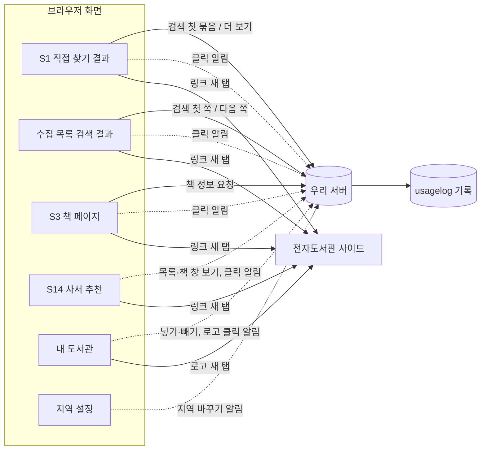

# 화면 흐름: 사용자 행동 기록

- 범위: [scope.md](scope.md) 포함 2·3·7·8, [spec.md](spec.md) R1·R2·R5·R6
- **화면 모양은 바뀌지 않습니다** [확정] (사용자 승인, 2026-10-13, [easy/2026-10-13-flow-decisions.html](easy/2026-10-13-flow-decisions.html) #1). 새 화면·버튼·안내 문구가 없습니다. PC·태블릿·폰 모두 같습니다 [확정] (같은 결정)
- 기록이 생기는 길은 둘입니다: ① 서버가 이미 받는 요청(검색, 책 정보, 더 보기)에서 서버가 남김 ② 서버가 모르는 행동(도서관 링크 누르기, 사서 추천 보기, 지역·내 도서관 바꾸기)은 화면이 `fetch` keepalive로 `POST /api/v1/usage-events`에 알림 (spec R2-1)
- 로그인 여부는 화면이 보내지 않고 서버가 로그인 쿠키로 판별합니다 (spec R1-6, [ADR-0102](../../adr/0102-access-cookie-api-v1-and-login-status-reader.md))
- 화면 이름은 사이클 14 뒤 기준 (14 [flow.md](../14-librarian-picks/flow.md): 인기 도서 → 사서 추천, `/popular` → `/picks`)

## 1. 기록이 생기는 곳

- 실선 = 지금도 있는 요청(검색, 책 정보, 더 보기, 링크), 점선 = 새로 더하는 사용 알림 [확정] (spec R2-1, R6-2, R6-3)
- 검색은 처음 요청만 검색 기록, 다음 쪽·다음 묶음("더 보기")·도서관별 더 보기는 더 보기 기록 (spec R1-1, R6-1). 화면이 사람 손 없이 부르는 대출 수 채우기는 사용 기록이 아니고 도서관 응답 하루 요약에만 들어감 (spec R6-4)

## 2. 화면별 내용

### S1 도서관에서 직접 찾기 결과
- 서버 기록: 검색 1줄(첫 묶음이 끝나거나 끊길 때), "더 보기"(다음 묶음)·도서관별 더 보기마다 더 보기 1줄, 도서관마다 응답 결과는 하루 요약에 더함
- 클릭 알림: 결과 카드, 가입 링크, 가입 안내 보기, 도서관 첫 화면, 로고, 요약 막대 이름 / 책 번호 비움 [확정] (spec R2-2)

### 수집 목록 검색 결과
- 서버 기록: 검색 1줄(첫 쪽), 다음 쪽마다 더 보기 1줄, 대출 수 채우기는 하루 요약에만
- 클릭 알림: 결과 카드, 가입 링크, 가입 안내 보기, 도서관 첫 화면, 로고 / 책 번호 담음

### S3 책 페이지
- 서버 기록: 책 상세 1줄(책 정보 첫 요청, spec R5-1), 대출 수 채우기는 하루 요약에만
- 클릭 알림: 결과 카드, 가입 링크, 가입 안내 보기, 도서관 첫 화면, 로고 / 책 번호 담음

### S14 사서 추천
- 화면 행동 알림: 추천 목록 보기(분야), 추천 책 창 열기(분야·책) [확정] (spec R6-2)
- 클릭 알림: 결과 카드, 가입 링크, 가입 안내 보기, 도서관 첫 화면, 로고 / 책 번호 담음

### 내 도서관
- 화면 행동 알림: 내 도서관 넣기·빼기(도서관) — 로그인 전후 모두 [확정] (spec R6-3)
- 클릭 알림: 로고 / 책 번호 비움

### 지역 설정 (지역을 바꾸는 곳)
- 화면 행동 알림: 지역 바꾸기(거주·직장 지역) — 로그인 전(브라우저에만 저장)·후(서버에도 저장) 모두 [확정] (spec R6-3)

- 요약 막대 이름은 S1에만 있음 (dev `LibrarySummaryBar.tsx`, `DirectResults.tsx:122`)
- 화면별로 실제 보이는 누른 곳·지역을 바꾸는 자리는 12·13·14 회고 뒤 다시 확인 [확인 필요: 회고]

## 3. 화면 상태

| 상태 | 화면에서 보이는 것 |
|---|---|
| 링크를 누름 | 지금처럼 새 탭이 바로 열림. 알림은 보이지 않음 |
| 로그인 기능 켜짐 + 처음 알림 때 CSRF 표시가 없음 | 보이지 않음. 화면이 표시를 받아 온 뒤 알림을 보냄 (spec R2-4) |
| 로그인 기능 꺼짐 (`/api/v1/me` 404) | 보이지 않음. 화면이 표시 없이 알림을 보냄 (spec R2-4) |
| 알림 실패(광고 차단, 서버 오류, 1분 60번 초과) | 아무것도 보이지 않음. 링크는 열림 (spec R2-7) |
| 기록 쓰기 실패 | 아무것도 보이지 않음. 검색 결과·책 페이지 그대로 (spec R3-3) |
| 기록 설정 꺼짐 (첫 배포 ~ 공개일) | 보이지 않음. 알림을 보내도 서버가 남기지 않음 (spec R3-6) |
| 이름 밝힌 검색 로봇이 직접 찾기를 부름 | 사람 화면과 무관. nginx가 거절 (spec R1-8) |

## 수용 기준 대응 ([spec.md](spec.md))

| AC | 화면 |
|---|---|
| AC-1, AC-2, AC-5 | 수집 목록 검색 결과 |
| AC-3, AC-4 | S1 직접 찾기 결과 |
| AC-6, AC-6b | 화면 없음 (API 호출) |
| AC-7 | S1, 수집 목록, S3, S14, 내 도서관 (누른 곳 여섯) |
| AC-8 | S3 (책 번호 있음), S1 (비움) |
| AC-17 | S3 책 페이지 |
| AC-23 | S14 사서 추천, 내 도서관, 지역 설정 |
| AC-9, AC-10, AC-11 | 사용 알림 (화면 없음, API 호출) |
| AC-20, AC-25, AC-26 | 모든 화면 (로그인 켬·끔, 쿠키) |
| AC-12, AC-13, AC-14, AC-15, AC-16, AC-18, AC-19, AC-21, AC-24 | 화면 없음 (표 정의, 테스트, 측정) |

## 확인 필요

| 항목 | 확인 방법 |
|---|---|
| 12·13·14 뒤 화면별 링크·지역 설정 위치 | 12·13·14 회고 |

## 바뀐 이력

- 2026-10-13~14: 처음에는 검색·도서관 클릭만 남기고, 화면이 로그인 여부를 보내고, 사서 추천 목록 보기는 남기지 않았음 → spec R5·R6로 책 상세·더 보기·사서 추천 보기·지역·내 도서관 바꾸기 추가, 로그인 여부는 서버 판별
