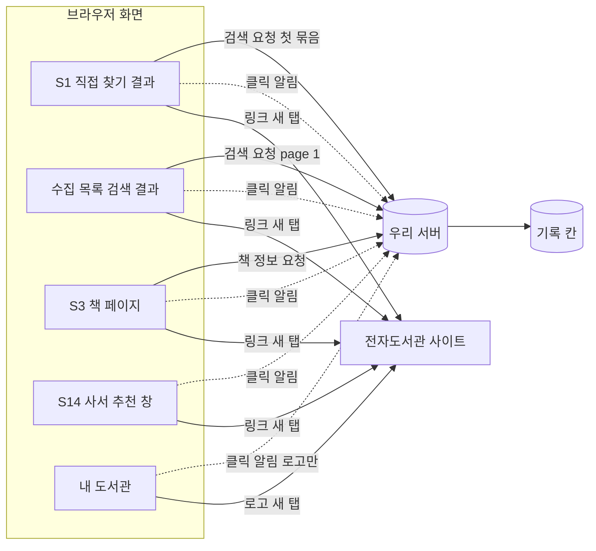

# 화면 흐름: 사용자 행동 기록 (검색·책 상세·도서관 클릭)

- 범위: `scope.md` 포함 2·3, `spec.md` R1·R2·R5
- **화면 모양은 바뀌지 않습니다** [확정] (사용자 승인, 2026-10-13, `easy/2026-10-13-flow-decisions.html` #1). 새 화면·버튼·안내 문구가 없습니다. 기존 링크를 누를 때 화면이 클릭 알림을 하나 더 보낼 뿐이고(spec R2-1, `fetch` keepalive), 검색·책 상세는 서버가 이미 받는 요청에서 기록합니다(spec R1-1, R5-1)
- PC·태블릿·폰 모두 같습니다: 보이는 것이 없으므로 기기별 차이가 없습니다 [확정] (같은 결정)
- 화면 이름은 사이클 14 뒤 기준 (14 `flow.md`: 인기 도서 → 사서 추천, `/popular` → `/picks`)

## 1. 기록이 생기는 곳

- 실선 = 지금도 있는 요청(검색, 책 정보, 링크), 점선 = 새로 더하는 클릭 알림 [확정] (spec R2-1)
- 검색은 처음 요청만, 책 상세는 책 정보 첫 요청만 기록 (spec R1-1, R5-1). 화면이 부르는 다음 묶음·대출 수 채우기·다음 쪽은 기록하지 않음
- 모든 요청에 화면이 로그인 여부를 함께 보냄 (spec R1-6) [확정]

## 2. 화면별 내용

### S1 도서관에서 직접 찾기 결과
- 기록: 검색 1줄(첫 묶음이 끝나거나 끊길 때), 클릭 알림
- 누른 곳: 결과 카드, 가입 링크, 가입 안내 보기, 도서관 첫 화면, 로고, 요약 막대 이름 / 책 번호 비움 [확정] (spec #6)

### 수집 목록 검색 결과
- 기록: 검색 1줄(page 1), 클릭 알림
- 누른 곳: 결과 카드, 가입 링크, 가입 안내 보기, 도서관 첫 화면, 로고 / 책 번호 담음 [확정]

### S3 책 페이지
- 기록: 책 상세 1줄(책 정보 첫 요청, spec R5-1), 클릭 알림
- 누른 곳: 결과 카드, 가입 링크, 가입 안내 보기, 도서관 첫 화면, 로고 / 책 번호 담음 [확정]

### S14 사서 추천 창
- 기록: 클릭 알림 (사서 추천 목록 보기는 기록하지 않음, spec 비목표)
- 누른 곳: 결과 카드, 가입 링크, 가입 안내 보기, 도서관 첫 화면, 로고 / 책 번호 담음 [확정]

### 내 도서관
- 기록: 클릭 알림 (로고만) / 책 번호 비움 [확정]

- 요약 막대 이름은 S1에만 있음 (dev `LibrarySummaryBar.tsx`, `DirectResults.tsx:122`)
- 화면별로 실제 보이는 누른 곳은 12·13·14 회고 뒤 다시 확인 [확인 필요: 회고]

## 3. 화면 상태

| 상태 | 화면에서 보이는 것 |
|---|---|
| 링크를 누름 | 지금처럼 새 탭이 바로 열림. 클릭 알림은 보이지 않음 |
| 처음 누를 때 CSRF 표시가 없음(로그인 기능 켜짐) | 보이지 않음. 화면이 표시를 받아 온 뒤 알림을 보냄 (spec R2-4) |
| 클릭 알림 실패(광고 차단, 서버 오류, 요청 수 초과) | 아무것도 보이지 않음. 링크는 열림 (spec R2-7) |
| 기록 쓰기 실패 | 아무것도 보이지 않음. 검색 결과·책 페이지 그대로 (spec R3-3) |
| 검색 로봇(이름에 bot 등)이 직접 찾기를 부름 | 사람 화면과 무관. nginx가 거절 (spec R1-8) |

## 수용 기준 대응

| AC | 화면 |
|---|---|
| AC-1, AC-2, AC-5 | 수집 목록 검색 결과 |
| AC-3, AC-4 | S1 직접 찾기 결과 |
| AC-6, AC-6b | 화면 없음 (API 호출) |
| AC-7 | S1, 수집 목록, S3, S14, 내 도서관 (누른 곳 여섯) |
| AC-8 | S3 (책 번호 있음), S1 (비움) |
| AC-9, AC-10, AC-11 | 클릭 알림 (화면 없음, API 호출) |
| AC-12, AC-13, AC-14, AC-15, AC-16, AC-18, AC-19 | 화면 없음 (표 정의, 테스트, 측정) |
| AC-17 | S3 책 페이지 |

## 확인 필요

| 항목 | 확인 방법 |
|---|---|
| 12·13·14 뒤 화면별 링크 위치 | 12·13·14 회고 |
