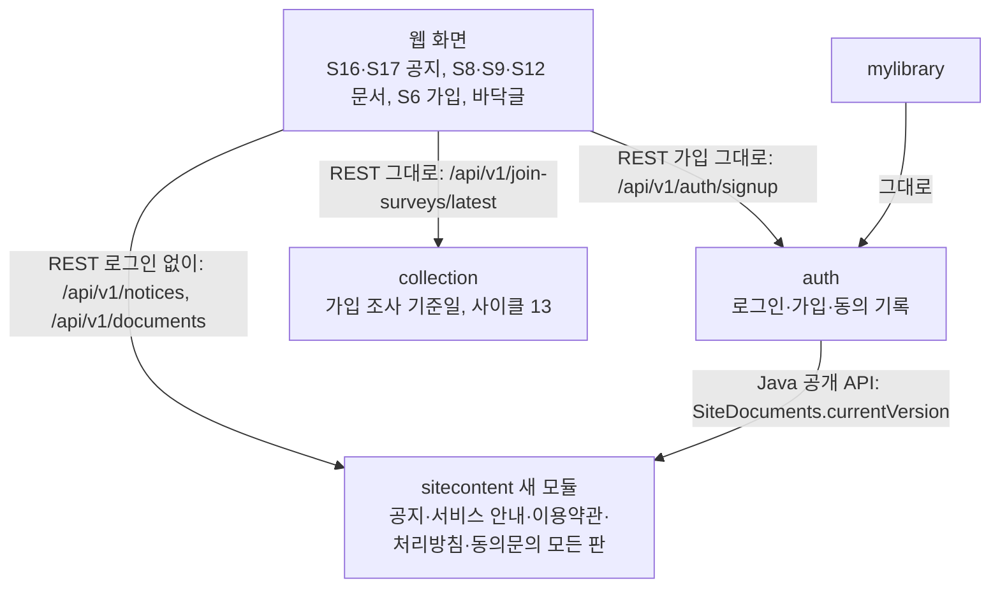
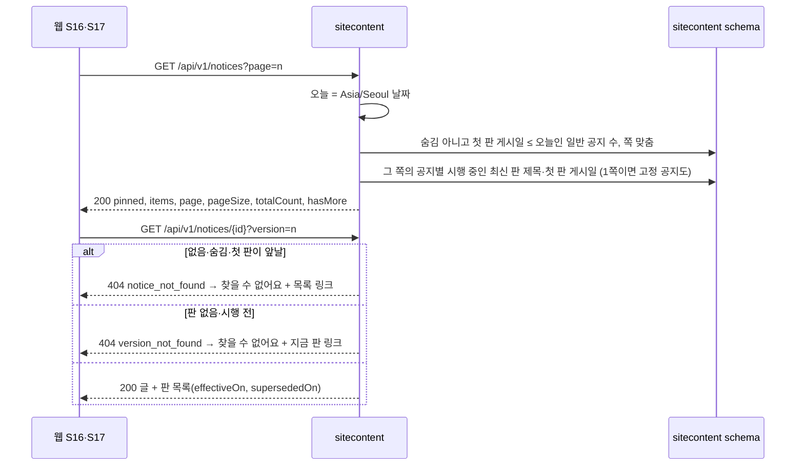
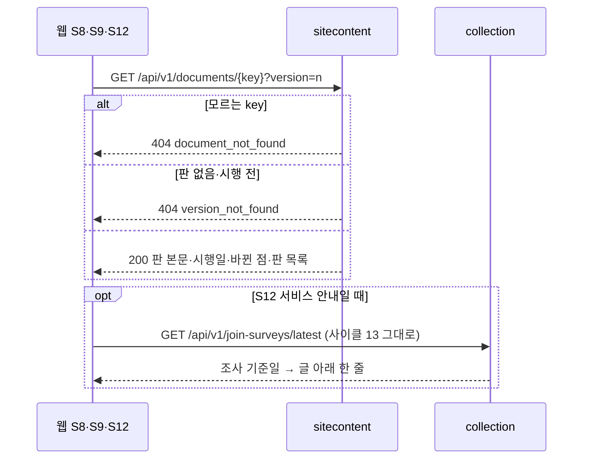
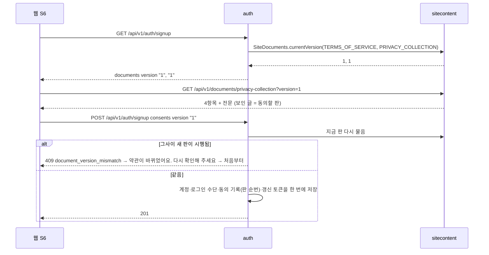
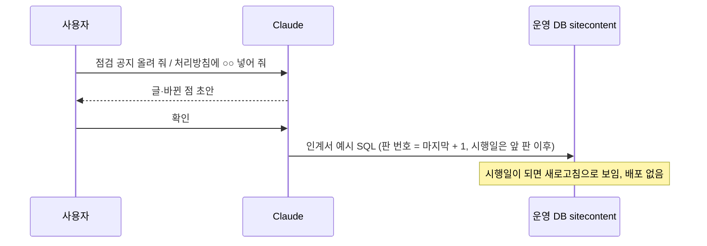
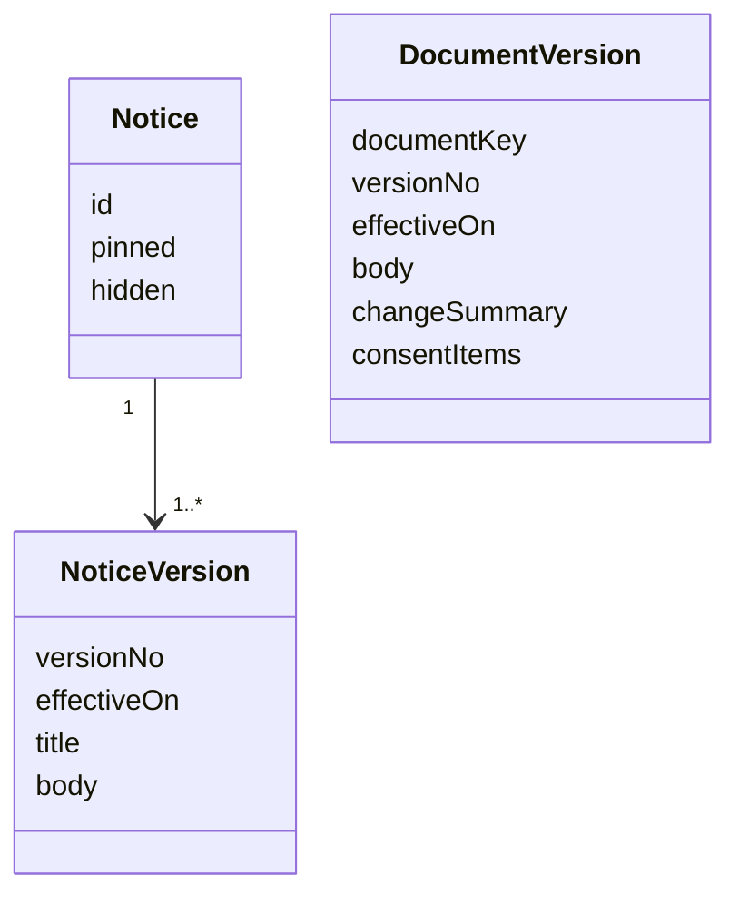
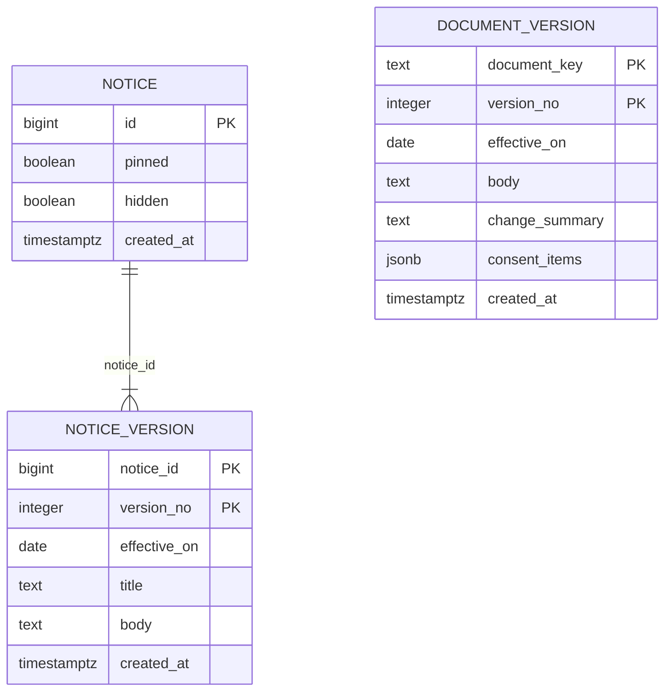

# 설계 변경: 사이클 16 공지사항과 안내·약관 페이지를 DB로

근거: [scope.md](scope.md), [spec.md](spec.md), [flow.md](flow.md), [architect-proposal.md](architect-proposal.md)(결정 결과 표), [research.md](research.md), [privacy-inputs.md](privacy-inputs.md) (2026-10-13). 설계 대안 결정 페이지 [easy/2026-10-13-design-decisions.html](easy/2026-10-13-design-decisions.html), [easy/2026-10-13-drop-decisions.html](easy/2026-10-13-drop-decisions.html), 정리·ADR [easy/2026-10-13-design-adr-decisions.html](easy/2026-10-13-design-adr-decisions.html). 그림 원본 [easy/design-delta-original.html](easy/design-delta-original.html)

**설계 확정은 사이클 12·13·14 회고 뒤** [확정] (scope). 이 문서는 그때 dev 코드(특히 13·14가 바꾼 `/about`)와 맞춰 보고 확정한다. `docs/current/`는 cycle-close에서 고친다.

## 구조 그림

### 모듈 구성도



### 주요 흐름

공지 목록·공지 글



문서(서비스 안내·이용약관·처리방침)



가입



운영자가 글을 넣을 때



### 도메인 모델



## 모듈

| 모듈 | 신규/변경 | 책임 | 공개 API | 발행/구독 이벤트 | 소유 테이블 |
|---|---|---|---|---|---|
| `sitecontent` | 신규 [확정] (사용자 승인, 2026-10-13) | 공지와 네 문서(서비스 안내, 이용약관, 처리방침, 동의문)의 모든 판을 갖고, 로그인 없이 읽게 함 | REST 아래 표. Java `SiteDocuments.currentVersion(ConsentDocument) → int`, 공개 enum `ConsentDocument { TERMS_OF_SERVICE, PRIVACY_COLLECTION }` [안: 이름은 dev가 정해도 됨] | 없음 | `sitecontent.notice`, `sitecontent.notice_version`, `sitecontent.document_version` |
| `auth` | 변경 | 가입 화면의 문서 버전을 서버 설정 대신 `SiteDocuments`에서 받음. `AuthProperties.Documents`·`chaekcheck.auth.documents` 설정·`documentVersions.json` 비교 테스트를 지움(사이클 05 제약 27 폐기). 409 동작 그대로 | 그대로 | 그대로 | `auth.account_consent` 데이터·CHECK만 |
| 웹 | 변경 | S16·S17 새로. S8·S9·S12·S6이 API를 읽고 `react-markdown`으로 그림. 제목 아래 날짜 고르기 칸. 바닥글 링크 한 줄, "문의: 준비 중" 지움. `/privacy`의 `LoginOnly` 지움. `legalText.ts`·`documentVersions.json`·`NOT_REVIEWED` 지움 | — | — | — |

- 새 의존은 `auth → sitecontent` 하나. `sitecontent`는 어떤 모듈에도 의존하지 않음. `auth/package-info.java`의 "depends on no other module (AC-18)"이 바뀜 → ADR
- 가입은 동기 읽기가 필요해 이벤트를 쓰지 않음
- 이용약관 REST는 로그인 기능이 꺼져도 열어 두고, 웹 경로 `/terms`만 숨김 [확정] (사용자 승인, 2026-10-13) — `sitecontent`가 `auth` 설정을 알면 `sitecontent → auth`가 생겨 서로 의존하게 됨

## 데이터

- 스키마: `sitecontent` (새) [확정]



태그 읽는 법: 표 구조·칸·규칙은 사용자 승인(2026-10-13)으로 [확정]. 제약·PK·색인의 **이름**과 CHECK 식의 글자 모양은 [안: dev가 postgres-patterns 규칙에 맞게 정해도 됨].

| 테이블.컬럼 | 타입 | 제약 | 설명 | 상태 태그 |
|---|---|---|---|---|
| notice.id | bigint | PK `notice_pkey`, GENERATED BY DEFAULT AS IDENTITY | 공지 번호, 주소 `/notices/{id}` | [확정] |
| notice.pinned | boolean | NOT NULL DEFAULT false | 고정 공지 — 1쪽 맨 위에만, 10개 셈·총 개수에서 뺌 | [확정] (사용자 승인, 2026-10-13; "고정 빼기"는 미승인 "보기 어려워") |
| notice.hidden | boolean | NOT NULL DEFAULT false | 숨긴 공지는 목록·주소 모두 404. 지우지 않고 DB에 남김 | [확정] (사용자: "이전에 기록을 봤으면 해", 2026-10-13; "숨김 빼기"는 미승인) |
| notice.created_at | timestamptz | NOT NULL DEFAULT now() | 넣은 때 | [확정] |
| notice_version.notice_id | bigint | NOT NULL, FK `notice_version_notice_id_fkey` → `sitecontent.notice(id)` (같은 모듈) | | [확정] |
| notice_version.version_no | integer | NOT NULL, CHECK `notice_version_version_no_check (version_no >= 1)` | 판 순번, 주소 `?version=` | [확정] (사용자 제안, 2026-10-13) |
| notice_version.effective_on | date | NOT NULL | 판 1 = 게시일, 그 뒤 = 고친 날. 앞날이면 그날부터 보임 | [확정] |
| notice_version.title | text | NOT NULL, CHECK `notice_version_title_check (btrim(title) <> '')` | 그 판의 제목 | [확정] |
| notice_version.body | text | NOT NULL, CHECK `notice_version_body_check (btrim(body) <> '')` | 제한된 마크다운 | [확정] |
| notice_version.created_at | timestamptz | NOT NULL DEFAULT now() | | [확정] |
| (PK) | | `notice_version_pkey (notice_id, version_no)` | 색인을 더 두지 않음. 공지가 많아지면 `WHERE NOT hidden` 부분 색인을 그때 질의 계획을 보고 더함 | [확정] |
| document_version.document_key | text | NOT NULL, CHECK `document_version_document_key_check (document_key IN ('ABOUT','TERMS_OF_SERVICE','PRIVACY_POLICY','PRIVACY_COLLECTION'))` | | [확정] |
| document_version.version_no | integer | NOT NULL, CHECK `>= 1` | 판 순번 | [확정] |
| document_version.effective_on | date | NOT NULL | 시행일(서비스 안내는 게시일) | [확정] |
| document_version.body | text | NOT NULL, CHECK `btrim(body) <> ''` | 제한된 마크다운 | [확정] |
| document_version.change_summary | text | NULL, CHECK `document_version_change_summary_check (document_key <> 'ABOUT' OR change_summary IS NULL)` | 바뀐 점(사람이 씀) | [확정] |
| document_version.consent_items | jsonb | NULL, CHECK `document_version_consent_items_check ((document_key = 'PRIVACY_COLLECTION') = (consent_items IS NOT NULL))`, CHECK `(consent_items IS NULL OR (jsonb_typeof(consent_items) = 'array' AND jsonb_array_length(consent_items) = 4))` | 동의문 4항목(목적·항목·보유 기간·거부할 권리 — 문구는 [drafts/privacy-collection.md](drafts/privacy-collection.md)) | [확정] |
| document_version.created_at | timestamptz | NOT NULL DEFAULT now() | | [확정] |
| (PK) | | `document_version_pkey (document_key, version_no)` | | [확정] |
| auth.account_consent.document_version | text (그대로) | 새 CHECK `account_consent_document_version_format_check (document_version IS NULL OR document_version ~ '^[1-9][0-9]*$')` | 판 순번 글자. 테스트 계정 기록 `'2026-10-04'` → `'1'` | [확정] (사용자 승인, 2026-10-13) |

- "다시 동의 필요" 칸은 두지 않음 — 다시 동의 화면을 만들 때 함께 더함 [확정] (사용자 승인, 2026-10-13)
- `updated_at` 없음: 판은 고치지 않고 새로 넣음. 다른 모듈과 FK·JOIN 없음(auth는 판 순번 값만 기억)
- Liquibase: 새 changelog 파일로 추가 (기존 changeset 수정 없음)
  - `sitecontent/001-sitecontent-schema.yaml` (표·CHECK는 `sql` changeset)
  - `sitecontent/002-sitecontent-seed.yaml`: 개발 DB 첫 판 = 지금 웹 코드의 글을 마크다운으로(이용약관·동의문·처리방침·서비스 안내, 공지는 없음). `sql` + `$$` + `splitStatements: false` [안: dev 적용 시험]. 개발 DB 시행일은 `2026-10-04`(지금 동의 기록과 이어짐). 동의문·처리방침의 로그인 수단은 카카오만 [확정] (사용자, 2026-10-13). 서비스 안내 첫 판은 사이클 13·14가 더한 문장까지(회고 때 확인)
  - `auth/002-consent-version-number.yaml`: 테스트 계정 동의 기록 값 바꾸기 + 형식 CHECK
  - master 끝에 추가. 사이클 13·14·15(`usagelog`)도 master 끝줄을 고치므로 병합 순서 확인
- **운영 첫 판**: 운영 DB는 검토한 글([drafts/](drafts/), 승인 2026-10-13)부터 시작하고, 첫 판의 시행일은 **모르는 사람에게도 공개하는 날**(첫 배포일 아님). 그 전에 seed를 검토한 글·공개일로 바꾸고 개발 DB는 초기화, 테스트 계정은 다시 가입 [확정] (사용자 승인·제안, 2026-10-13). 사이클 17 체크리스트에 전함

## API

로그인 없음, 캐시 없음, 쓰기 API 없음 [확정]. 오늘 = `Asia/Seoul` 날짜, 지금 판 = 시행일 ≤ 오늘인 판 중 순번 최대 [확정].

| 메서드 | 경로 | 설명 | 요청 | 응답 | 에러 |
|---|---|---|---|---|---|
| GET | `/api/v1/notices` | 공지 목록 10개씩, 최신 게시일순(같으면 번호 큰 순). 1쪽이면 고정 공지를 `pinned`에. 없는 쪽은 마지막 쪽으로 맞춤 | `page` (정수 ≥ 1, 기본 1) | 200 | 400 `validation_error` |
| GET | `/api/v1/notices/{noticeId}` | 공지 글. 고친 공지면 `editedOn` | `version` (정수 ≥ 1, 없으면 지금 판) | 200 | 404 `notice_not_found`, 404 `version_not_found`, 400 `validation_error` |
| GET | `/api/v1/documents/{documentKey}` | 문서 글. key = `about`, `terms-of-service`, `privacy-policy`, `privacy-collection` | `version` | 200 | 404 `document_not_found`, 404 `version_not_found`, 400 `validation_error` |
| GET | `/api/v1/auth/signup` | 그대로. `documents[].version`이 `"1"` 같은 판 순번 글자 | — | 200 | 그대로 |
| POST | `/api/v1/auth/signup` | 그대로 | `consents[].version` = 판 순번 글자 | 201 | 409 `document_version_mismatch` 그대로 |

목록 (`?page=99`, 일반 공지 23개 → 3쪽으로)

```json
{ "pinned": [],
  "items": [ { "id": 3, "title": "도서관 12곳을 더했어요", "postedOn": "2026-10-20" } ],
  "page": 3, "pageSize": 10, "totalCount": 23, "hasMore": false }
```

공지 글

```json
{ "id": 7, "title": "점검 안내(시간 바뀜)", "postedOn": "2026-11-03", "editedOn": "2026-11-04",
  "version": { "number": 2, "effectiveOn": "2026-11-04", "current": true, "body": "…" },
  "versions": [ { "number": 2, "effectiveOn": "2026-11-04", "supersededOn": null },
                { "number": 1, "effectiveOn": "2026-11-03", "supersededOn": "2026-11-04" } ] }
```

문서 (`/api/v1/documents/privacy-collection?version=1`)

```json
{ "key": "privacy-collection",
  "version": { "number": 1, "effectiveOn": "2026-10-04", "current": true, "body": "…", "changeSummary": null,
               "consentItems": [ { "label": "목적", "text": "…" }, { "label": "항목", "text": "카카오 회원 식별 번호, …" },
                                 { "label": "보유 기간", "text": "탈퇴 또는 마지막 로그인 뒤 1년" },
                                 { "label": "거부할 권리", "text": "…" } ] },
  "versions": [ { "number": 1, "effectiveOn": "2026-10-04", "supersededOn": null } ] }
```

오류

```json
{ "type": "about:blank", "title": "Not Found", "status": 404, "detail": "No such version",
  "instance": "/api/v1/documents/terms-of-service", "code": "version_not_found" }
```

- `versions`에는 시행 중이거나 지난 판만(앞날 판 빠짐). 웹의 날짜 고르기 칸 문구: 지난 판 "A ~ (B-1일) 적용", 같은 날 바뀐 판 "A 적용 (같은 날 바뀜)", 지금 판 "A ~ 지금" [확정] (사용자 승인, 2026-10-13)
- 숨긴 공지·첫 판이 앞날인 공지는 목록과 주소 모두 404

## 외부 연동

없음. (처리방침에 적을 바깥 업체 — AWS 위탁, Cloudflare 위탁·국외 이전 — 는 문구의 일이고 이 설계의 연동이 아님, `privacy-inputs.md`)

## 인계서에 넣을 운영 예시 SQL (실행 문장은 인계서에서 확정)

- 새 공지: `notice` INSERT RETURNING id → `notice_version` 판 1 INSERT, 한 트랜잭션
- 공지 고치기: 판 = 마지막 + 1, 조건 새 날짜 ≥ 마지막 판 날짜(0줄이면 확인)
- 숨기기·고정: `UPDATE sitecontent.notice SET hidden = … / pinned = …`
- 문서 새 판: `INSERT … SELECT :key, max+1, :date, $$본문$$, $$바뀐 점$$ … WHERE :date >= max(effective_on)`. 동의문은 4항목 필수. 약관·동의문을 바꿀 때 공지도 함께(R7-1). 중요하거나 불리한 변경은 다시 동의 화면이 생기기 전에는 넣지 않음(R7-3)

## 결정 기록

- [ADR-0098](../../adr/0098-sitecontent-module-versioned-documents.md) 공지·서비스 안내·약관 글을 새 모듈 `sitecontent`가 DB에 판으로 둔다
- [ADR-0099](../../adr/0099-signup-document-version-from-sitecontent.md) 가입 문서 버전의 원본을 `sitecontent`로, 동의 기록 = 판 순번, `auth → sitecontent` (사이클 05 제약 27 폐기, AC-18 변경)
- [ADR-0100](../../adr/0100-privacy-policy-public-regardless-of-login.md) 처리방침은 로그인 기능과 상관없이 공개 (사이클 05 제약 35 일부 변경)
- [ADR-0101](../../adr/0101-terms-change-notice-or-reconsent.md) 약관이 바뀔 때: 가벼우면 공지 + 시행일, 중요하면 다음 로그인 때 다시 동의 (화면은 나중)
- 네 ADR 모두 초안 승인(사용자, 2026-10-13), 상태 Proposed. 설계 확정(12·13·14 회고 뒤) 때 Accepted로 바꿈
- 다음 단계: 여기서 멈추고, 설계 확정·cycle-close·인계서는 12·13·14 회고 뒤 [확정] (사용자 승인, 2026-10-13). 그 사이 처리방침·약관 초안을 먼저 씀

## 확인 필요

| # | 항목 | 확인 방법 | 막는 단계 |
|---|---|---|---|
| 1 | 서비스 안내 첫 판 본문(사이클 13·14가 더한 문장) | 13·14 회고 때 dev `AboutPage.tsx` | 설계 확정 |
| 2 | `react-markdown@10`과 dev의 React 판, 묶음 크기 | dev 설치 시험 | 개발 |
| 3 | 정수가 아닌 `?version`·`?page` 400이 `ApiExceptionHandler`에 이미 있는지 | dev 코드 | 개발 |
| 4 | seed 본문의 세미콜론·`$$` 처리 | dev 적용 시험 | 개발 |
| 5 | 사이클 15와 Liquibase master 끝줄 병합 순서 | 병합 때 | 개발 |
| 6 | 날짜 고르기 칸이 폰에서 어떤 고르기 화면으로 열리는지 | dev 구현 때 프로토타입 | 개발 |
| 7 | 운영 첫 판([drafts/](drafts/))의 공개 전 값: 보호 담당 표기(실명 대신 "책첵 운영자" [안]), AWS 계약 법인, Cloudflare 연락처·보유 기간·쿠키 여부, 공개일 | 사용자에게 질문(성명·공개일), 사이클 17 배포 때 계정·계약서(나머지) | 공개 전 |
