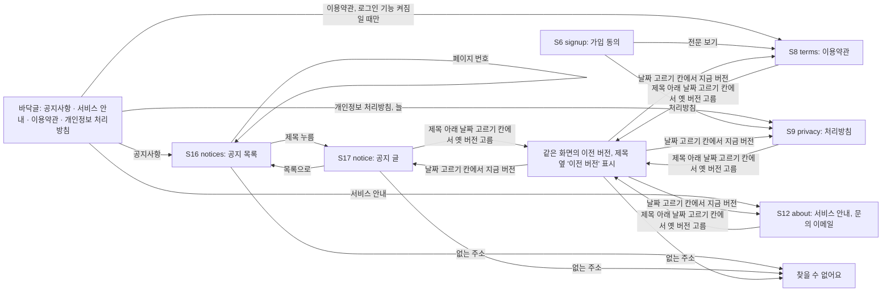

# 화면 흐름: 공지사항과 안내·약관 페이지를 DB로 (사이클 16)

근거: `scope.md`, `spec.md` (2026-10-12). 공지 게시판 조사: `research.md` 3절. 새 화면은 S16·S17이고, 나머지는 있는 화면(S6·S8·S9·S12, 바닥글)을 바꿉니다. 지금 화면은 dev 코드로 확인(`AppLayout.tsx`, `Footer.tsx`, `LegalPage.tsx`, `AboutPage.tsx`, 2026-10-12). 화면 폭 기준은 dev와 같이 640px 이하 = 폰, 그 위 = PC·태블릿(태블릿 768은 PC 배치) [확정] (dev `Footer.module.css`, `AppLayout.module.css`).

결정 기록: `easy/2026-10-13-flow-pc.html` (2026-10-13, 10개 중 승인 4, 사용자 제안 6). 색: 새 화면 요소에 노랑 바탕을 쓰지 않음 — "노랑은 이 테마에 안 맞아" (사용자, 2026-10-13) [확정]

## 공통 규칙

- 들어오는 길: 공지사항은 **바닥글 링크로만** 들어옴. 머리말에는 두지 않음 [확정] (사용자 승인, 2026-10-13)
- 주소: 공지 목록 `/notices`(페이지는 `?page=2`), 공지 글 `/notices/{번호}`. 이전 버전은 각 주소 뒤에 **글마다 붙는 버전 순번** `?version=2`(예: `/terms?version=1`, `/notices/3?version=2`) [확정] (사용자 제안, 2026-10-13: "하루에 여러 공지가 날 수 있는데 이상한데 그냥 그 자체의 순번으로 하면 안돼?". 제안 "`?version=YYYY-MM-DD`"는 미승인). 같은 글을 하루에 여러 번 고쳐도 버전이 구분됨. 이 결정으로 spec R2-2의 "버전 이름 = 시행일, 같은 날 두 버전 없음"이 바뀜 → spec 고침. 가입 동의 기록에 무엇을 남길지(순번 / 시행일)는 `/design-delta`
- 머리말: S16·S17·S12는 평소 머리말(로고, 사서추천도서, 로그인). S8·S9는 지금처럼 로그인 버튼·머리 링크를 숨김 [확정] (사이클 10, dev `AppLayout.tsx`)
- 글 본문은 마크다운(제목·문단·목록·굵게·링크)으로 그림 [확정] (spec R1-2)

## 화면별 내용

### 바닥글 (모든 화면, 바뀜)
- 보이는 요소: 링크 한 줄 "공지사항 · 서비스 안내 · 이용약관 · 개인정보 처리방침" [확정] (spec R6-1). 맨 위 수량 안내 문장은 그대로
- **연락처는 바닥글에 두지 않고 서비스 안내 글 안에 넣음**. 지금의 "문의: 준비 중"은 없앰 [확정] (사용자 제안, 2026-10-13: "서비스 안내 안에 이메일을 넣자 너무 길어". 제안 "링크 아래 연락처 한 줄"은 미승인). 이 결정으로 spec R6-3(바닥글 연락처를 DB에서 읽음)이 바뀜 → spec 고침
- 이용약관은 로그인 기능이 꺼져 있으면 빠짐, 처리방침은 늘 보임 [확정] (spec R6-2)
- PC·태블릿: 왼쪽 수량 안내, 오른쪽 링크 줄 / 폰: 위아래로 쌓고 링크는 줄바꿈 (지금 배치 그대로) [확정] (지금 dev 배치)

### S16 notices `/notices` (새 화면)
- 목적: 공지를 최신순으로 봄
- 보이는 요소: 제목 "공지사항", 공지 줄들, 페이지 번호
  - 한 줄 = 제목 + 게시일. 고정 공지는 맨 위에 "고정" 표시. **목록에는 "고침"을 보이지 않음** [확정] (사용자 제안, 2026-10-13: "고침은 보여주지 말자 고침은 글 클릭하면 언제 고쳤는지 보이게 해주자". 제안 "목록에 고침 날짜"는 미승인)
  - 고정 공지 표시의 바탕색은 노랑을 쓰지 않음 [확정] (위 색 결정). 색은 dev 테마 안에서
  - 분류, N 표시, 조회수, 검색 없음 [확정] (spec 비목표)
- 나누기: 10개씩, 숫자 페이지(PC·태블릿 1~10, 폰은 ‹ ›와 숫자 5개). 고정 공지는 1쪽에만. 없는 쪽 번호(`?page=99`)는 마지막 쪽 [확정] (사용자 승인, 2026-10-13)
- 사용자 동작: 줄 누름 → S17, 페이지 번호 누름 → 같은 화면 다음 쪽
- PC·태블릿: 가운데 한 열(지금 S12 흰 카드 폭), 줄마다 제목 왼쪽·날짜 오른쪽 / 폰: 제목 한두 줄, 그 아래 날짜 [확정] (사용자 제안과 함께 정함, 2026-10-13)
- 상태
  - 기본
  - 로딩: 줄 자리에 회색 줄 [확정] (spec 상태별 동작)
  - 공지 없음: "아직 공지가 없어요" [확정]
  - 오류: "글을 불러오지 못했어요" + 다시 시도 [확정]
- 호출하는 API: 공지 목록

### S17 notice `/notices/{번호}` (새 화면)
- 목적: 공지 하나를 읽음
- 보이는 요소: 제목, 게시일, **고친 공지는 언제 고쳤는지**(예: "2026-11-03 · 고침 2026-11-04"), 본문, 맨 아래 "목록으로". 고친 공지는 제목 아래 날짜 고르기 칸(아래 "이전 버전" 공통). 이전글·다음글은 두지 않음 [확정] (사용자 승인, 2026-10-13; 고친 날 표시는 위 사용자 제안)
- 사용자 동작: 목록으로 → S16(보던 쪽)
- PC·태블릿·폰 모두 한 열 흰 카드, 폰은 옆 여백만 좁게 [확정] (사용자 승인, 2026-10-13)
- 상태: 기본 / 로딩(회색 줄) / 숨긴 공지·없는 번호: "찾을 수 없어요" + 공지 목록 링크 [확정] / 오류 [확정]
- 호출하는 API: 공지 하나

### S12 about `/about` (바뀜)
- 보이는 요소: 제목 "서비스 안내", 제목 아래 "2026-10-12 고침", DB의 지금 글(**문의 이메일 `chaekcheck9104@gmail.com` 포함**, 누르면 메일 쓰기), 그 바로 아래 사이클 13의 기준일 한 줄(자동) [확정] (spec R5-1, 위 연락처 결정)
- 날짜 표시는 제목 아래 하나 [확정] (사용자 승인, 2026-10-13)
- 상태: 기본 / 로딩 / 오류. 글이 없을 일은 없음 [확정] (spec 상태별 동작)
- 호출하는 API: 서비스 안내 글, 가입 조사 기준일(사이클 13, 그대로)

### S8 terms `/terms`, S9 privacy `/privacy` (바뀜)
- 보이는 요소: 제목, 그 아래 "시행 2026-10-04"(지금의 "버전 X · 시행일 X"를 시행일 하나로) [확정] (사용자 승인, 2026-10-13), 같은 줄의 날짜 고르기 칸(아래 공통), "바뀐 점"이 있는 버전은 제목 아래 **접힌 한 줄 "바뀐 점 보기 ▾"**, 누르면 그 자리에서 펼침. 노랑 상자는 쓰지 않음 [확정] (사용자 제안, 2026-10-13: "접힌 한 줄로 노랑은 이 테마에 안 맞아". 제안 "펼친 노란 상자"는 미승인), 본문
- "검토 전 문구" 표시 없음 [확정] (spec R8-4)
- S9는 로그인 기능과 상관없이 열림 [확정] (spec R6-2). S8은 로그인 기능이 꺼져 있으면 없는 경로 [확정]
- 상태: 기본 / 로딩 / 오류 / 없는 버전 주소 "찾을 수 없어요" + 지금 버전 링크 [확정]
- 호출하는 API: 이용약관 글 / 처리방침 글

### 이전 버전 고르기와 이전 버전 보기 (S8·S9·S12·S17 공통)
- 자리와 모양: **제목 아래 날짜 고르기 칸**. 칸에는 지금 버전의 날짜가 보이고, 열면 버전마다 적용 기간("2026-10-04 ~ 2026-10-19 적용")이 나옴. 하나를 고르면 그 버전 글로 바뀜(주소 `?version=순번`). 버전이 하나뿐이면 칸이 없음 [확정] (사용자 제안, 2026-10-13: "제목 아래 날짜 고르기 칸". 제안 "글 끝 접힌 목록"은 미승인). 이 결정으로 spec R3-1의 "글 화면 아래 목록"과 범위 결정 "페이지 아래 이전 버전 목록"이 "제목 아래"로 바뀜 → spec·scope 고침. 적용 기간을 보이라는 작성지침 83쪽은 칸 안의 항목으로 지킴
- 이전 버전 보기: 같은 화면에 그 버전 글. 제목 옆에 **작은 "이전 버전" 표시**, 지금 버전으로는 같은 날짜 고르기 칸에서 돌아감. 큰 띠는 두지 않음 [확정] (사용자 제안, 2026-10-13: "작은 표시". 제안 "노란 띠"는 미승인). 이 결정으로 spec R3-2의 "위에 '이전 버전입니다'와 '지금 버전 보기'"가 바뀜 → spec 고침
- 폰: 같은 모양. 날짜 고르기 칸이 폰에서 어떤 고르기 화면으로 열리는지 [확인 필요: dev 구현 때 프로토타입]

### S6 signup (바뀜, 모양은 그대로)
- 동의 표(목적·항목·보유 기간·거부할 권리)와 전문을 DB의 동의문 지금 버전으로 보임 [확정] (spec R1-1). 화면 배치는 그대로
- "검토 전 문구" 표시 없음 [확정]
- 상태: 기본 / 로딩(지금과 같이) / 버전이 바뀜(`409`) "약관이 바뀌었어요. 다시 확인해 주세요" [확정] (사이클 05 제약 24)

## 수용 기준 대응

| AC | 화면 |
|---|---|
| AC-1 공지를 넣으면 배포 없이 맨 위(고정 다음)에 | S16 |
| AC-2 안내 새 버전, 이전 버전 적용 기간·열기 | S12, 날짜 고르기 칸·이전 버전 보기 |
| AC-3 약관 새 버전으로 가입하면 동의 기록 | S6 (API 호출 시험) |
| AC-4 앞날 시행일은 그날 전까지 안 보임 | S8, S9, S6 |
| AC-5 숨긴 공지는 목록에서 빠지고 주소는 "찾을 수 없어요" | S16, S17 |
| AC-6 HTML·`javascript:` 링크가 실행되지 않음 | S8, S9, S12, S17 (본문) |
| AC-7 바닥글 링크, 로그인 꺼지면 이용약관만 빠짐 | 바닥글 |
| AC-8 "검토 전 문구" 없음 | S8, S9, S6 |
| AC-9 없는 버전 주소 "찾을 수 없어요" | S8, S9, S12, S17 |
| AC-10 기준일 한 줄이 안내 글 아래 | S12 |
| AC-11 "바뀐 점"을 펼쳐 볼 수 있음 | S8, S9 |
| AC-12 서비스 안내에 문의 이메일이 보임 | S12 |

상태별 동작(spec) 대응: 로딩·오류 = S16·S17·S12·S8·S9, 공지 없음 = S16, 찾을 수 없어요 = S16(없는 쪽은 마지막 쪽)·S17·이전 버전 보기, 로그인 꺼짐 = 바닥글·S8.
