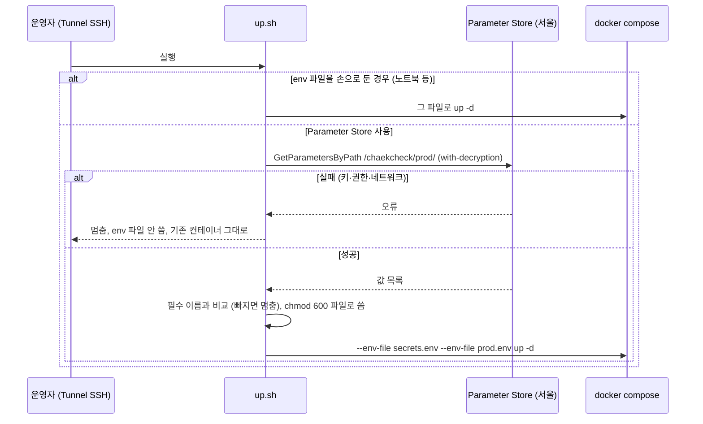
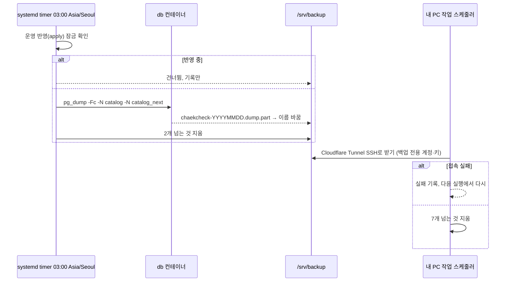
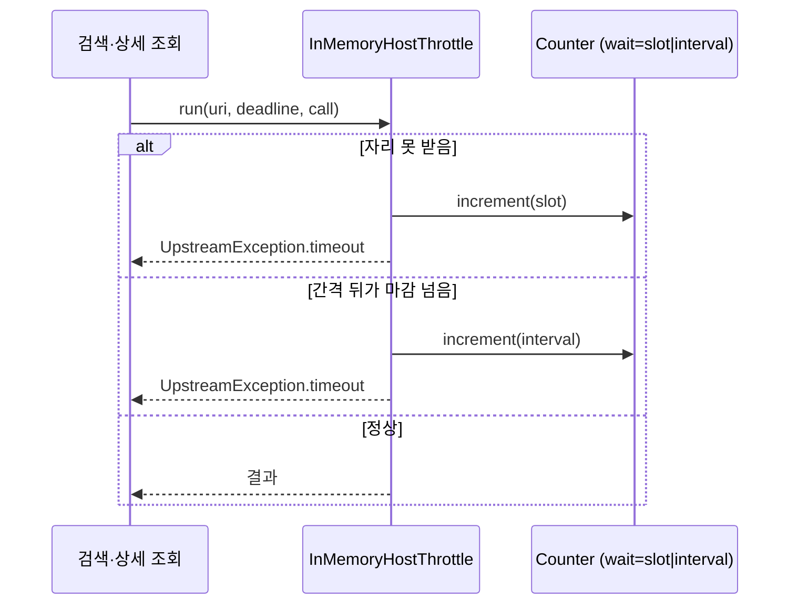

# 설계 변경: 사이클 17 첫 배포 (배포 부분)

- 근거: [`architect-proposal.md`](architect-proposal.md)(결정 1~8, 사용자 결정 2026-10-13~14), [`spec.md`](spec.md), [`flow.md`](flow.md), [`research.md`](research.md)
- 이번 슬라이스는 서비스의 모듈 경계·공개 API·표를 바꾸지 않음. 바뀌는 것은 `availability` 안쪽 지표, 운영 프로필, 배포 파일

## 구조 그림

### 모듈 구성도 (운영 서버 안)

```mermaid
flowchart TB
  User((사용자·운영자)) -->|HTTPS| CFE[Cloudflare]
  CFE --> CF
  subgraph edge["network edge (고정 subnet, 10.x)"]
    CF[cloudflared]
    NG[nginx + web dist]
    GF[grafana]
  end
  subgraph app["network app (internal)"]
    BE["backend :8080 서비스 / :8081 지표"]
    DB[(postgres + pg_bigm)]
    PR[prometheus]
    NE[node_exporter]
    CA[cadvisor]
    LX[nginx 접속 기록 exporter]
    FS[fetch-service 꺼 둠]
  end
  CF -->|chaekcheck.com| NG
  CF -->|grafana.chaekcheck.com| GF
  CF -.->|SSH 길 (운영자·백업)| HOST[서버 SSH]
  NG -->|/api/| BE
  BE --> DB
  PR -->|:8081/actuator/prometheus| BE
  PR --> NE
  PR --> CA
  PR --> LX
  LX -.->|접속 기록 읽기| NG
  GF --> PR
```

### 주요 흐름: 띄우기



### 주요 흐름: 백업



### 주요 흐름: 도서관 호출 포기 횟수



도메인 모델과 상태 규칙은 바뀌지 않아 classDiagram·stateDiagram은 두지 않음.

## 모듈

| 모듈 | 신규/변경 | 책임 | 공개 API | 발행/구독 이벤트 | 소유 테이블 |
|---|---|---|---|---|---|
| `availability` | 변경 (안쪽만) | `InMemoryHostThrottle`가 포기 두 경로에서 카운터를 올림(`chaekcheck.availability.throttle.timeouts`, 태그 `wait=slot\|interval`, 호스트 태그 없음), 경로 (2)에도 `log.info`. `availability.user-agent` 값에 서비스 주소·연락처(`chaekcheck/<버전> (+https://chaekcheck.com; chaekcheck9104@gmail.com)`) | 변경 없음 | 없음 | 변경 없음 |
| 앱 설정 | 변경 | 운영 프로필(이름 [안] `prod`): DB 주소 `db`, Liquibase contexts에서 `test-data` 뺌, `management.server.port: 8081`, 노출 `health,prometheus`, 15 기록 스위치 꺼짐, `AUTH_PUBLIC_BASE_URL=https://chaekcheck.com`, `AUTH_PROVIDERS=kakao` | — | — | — |
| `fetch-service` | 변경 없음 | compose에 `profiles: [fetch]`로 꺼 둠 | — | — | — |

- 의존성: `backend/build.gradle`에 Actuator와 Prometheus 레지스트리 (Spring Boot 4.1 좌표 [확인 필요: 공식 문서])
- 결정 근거: architect-proposal 결정 2(카운터), 결정 3(관리 포트), 결정 7(조회 서버 꺼 둠)

## 데이터

- 표·schema·Liquibase 변경 없음 [확정] (architect 확인, 사용자 승인 흐름에서 이견 없음). 사이클 15·16의 Liquibase 병합 순서에 17은 끼지 않음
- 백업 범위: `pg_dump -Fc -N catalog -N catalog_next` [확정] (#7). 수집 목록은 PC의 마지막 반영 파일이 백업(ADR-0078). 복원은 덤프 → 반영 `apply` 두 단계
- 운영 DB에 Claude가 SQL을 넣는 길(사이클 16 요청): Tunnel SSH → `docker exec db psql`, `sitecontent` schema 쓰기만 있는 DB 계정, 사용자가 승인한 SQL만 [확정] (사용자 승인, 2026-10-14, `easy/2026-10-14-design-delta-review.html` #3)

## API

- 제품 REST API 변경 없음 [확정]
- nginx가 새로 돌려주는 429(일반 `/api/`, IP마다 5r/s burst 30)는 지금 도서관 호출 429와 같은 Problem Details(`code: too_many_requests`), `Retry-After: 1` [안]
- 운영 전용, 바깥 없음: `GET :8081/actuator/prometheus`, `GET :8081/actuator/health` (compose 안 Prometheus·헬스체크만)

## 배포 파일 (dev, 새 파일, 이름 [안])

| 파일 | 하는 일 | 근거 |
|---|---|---|
| `deploy/prod/compose.yaml` | edge·app 네트워크(edge subnet 10.x 고정), 모든 컨테이너 `ports:` 없음, `mem_limit`, `restart: unless-stopped`, fetch-service는 `profiles: [fetch]` | #1, #9 |
| `deploy/prod/prod.env` | 비밀이 아닌 설정 (git) | #2 |
| `deploy/prod/bin/up.sh` | Parameter Store `/chaekcheck/prod/` → `chmod 600` env 파일 → compose up. env 파일이 이미 있으면 그것을 씀 | #2, 노트북 대비 |
| `deploy/prod/nginx/prod.conf` | `real_ip_header CF-Connecting-IP; set_real_ip_from <edge subnet>;`, http → https, 일반 `/api/` zone `chaekcheck_api` 5r/s burst 30 nodelay, 클릭 알림 정확 일치 location은 제외, 도서관 호출 zone 그대로 | spec R2·R3 |
| 접속 기록 `log_format` + 호스트 `logrotate` | `$remote_addr`, 시각, 메서드, 경로(`$request_uri`의 `?` 앞, `map`), `$status`, `$body_bytes_sent`, `$request_time`. daily·rotate 14·maxage 14 | spec R11 (경로 방식은 시험으로 확인) |
| `deploy/monitoring/` | prometheus.yml(backend:8081, node_exporter, cadvisor, 접속 기록 exporter), Grafana 프로비저닝(대시보드 네 묶음), `GF_AUTH_ANONYMOUS_ENABLED=false`, `GF_SERVER_ROOT_URL=https://grafana.chaekcheck.com` | #4, #5, #6, flow F5 |
| `deploy/backup/` | 서버 systemd 타이머·스크립트, PC 작업 스케줄러 스크립트(Tunnel SSH로 받기, 7개 넘으면 지움) | #7, #8 |
| backend·nginx `Dockerfile` | PC에서 빌드 → `docker save` → Tunnel SSH → `docker load` | #10 |
| 운영 문서 | 띄우기·백업 되살리기·노트북으로 옮기기(flow F4-1) 순서, 공개일 체크리스트(research 8절) | flow F4-1, research 8절 |

## 외부 연동

| 대상 | 방식 | 제한·키 관리 | 실패 시 동작 | 상태 태그 |
|---|---|---|---|---|
| AWS Parameter Store (서울) | `up.sh`가 띄울 때 한 번 읽음 | 읽기 전용 IAM 사용자 접근 키 한 쌍(경로 하나만), Standard 무료. 넣는 값: DB 비밀번호, JWT 키, 카카오 키 3개, 터널 토큰, Grafana 관리자 비밀번호(조회 서버 토큰은 꺼 둬서 이번엔 안 넣음). 이름 끝 = 환경 변수 이름(`/chaekcheck/prod/DB_PASSWORD` → `DB_PASSWORD`) | 멈추고 기존 컨테이너 유지 | [확정] (사용자 승인, 2026-10-14, #1) |
| Cloudflare Tunnel | `cloudflared` 컨테이너, `chaekcheck.com`·`grafana.chaekcheck.com`·SSH 길 | 터널 토큰은 Parameter Store | Error 1033 / 502·504 (flow F4) | [확정] / SSH 길 설정·무료 범위 [확인 필요] |
| 카카오 로그인 | 지금 그대로, 운영 Redirect URI 등록 | 키는 Parameter Store | 카카오 화면 오류 | [확정] (spec R6) |

## 결정 기록

- ADR-0103 운영 서버 구성 (초안, 이 문서와 함께 검토)
- 앞선 것: ADR-0094·ADR-0095(제안됨, 이번 설계 밖), ADR-0078(가져오기는 PC), ADR-0010·0011(호출 간격)

## 확인 필요

| 항목 | 확인 방법 |
|---|---|
| 접속 기록 경로를 `$request_uri`의 `?` 앞으로 자를 때 실제 기록 | 프로토타입(nginx 컨테이너에서 `/search?q=x` 요청 뒤 기록 확인) |
| Spring Boot 4.1 Actuator·Prometheus 의존성 좌표 | 공식 문서 |
| 별도 관리 포트에 Spring Security 필터가 걸리는지 | 프로토타입 |
| 접속 기록 exporter 관리 상태·라이선스·라벨 | 공식 GitHub |
| cAdvisor 메모리·CPU | 서버에서 측정 |
| 덤프 크기·시간 | 프로토타입 |
| Cloudflare Tunnel로 SSH 거는 방법과 무료 범위 | 공식 문서 |
| systemd `OnCalendar`의 `Asia/Seoul` | 서버에서 `systemd-analyze calendar` |
| Lightsail 사설망 대역과 edge subnet | 서버에서 `ip addr`, `docker network inspect` |
| 컨테이너별 `mem_limit` 합이 4GB 안인지 | 서버에서 측정 |
