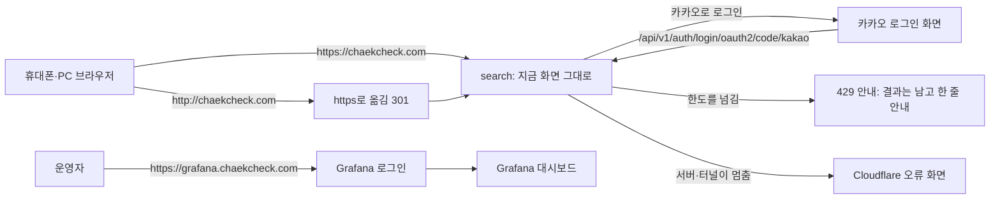

# 화면 흐름: 첫 배포 (배포 부분)

- 범위: [`spec.md`](spec.md). 서비스 화면은 바뀌지 않음. 이 문서는 사용자가 공개 주소로 들어와 만나는 흐름과, 배포 때문에 새로 생기는 상태(한도, 서버 멈춤), 운영자가 보는 Grafana만 다룸
- dev 화면 확인 2026-10-13 (dev main, `web/src`)

## 화면별 내용

### F1 공개 주소로 들어오기
- 목적: 집 PC가 꺼져 있어도 `https://chaekcheck.com`에서 지금 서비스가 열림
- 동작: `http://`로 오면 nginx가 `https://`로 301 이동(spec R2, dev `tunnel-test.conf`와 같은 규칙). 그 뒤 화면은 지금과 같음 [확정]
- 상태: 기본만 (화면 변화 없음)

### F2 카카오 로그인 (지금 흐름, 주소만 운영으로)
- 목적: 운영 주소에서 카카오로 로그인
- 동작: 지금 로그인 창 → 카카오 → `https://chaekcheck.com/api/v1/auth/login/oauth2/code/kakao`로 돌아옴 → 원래 화면(spec R6)
- 상태: 성공 / 카카오 쪽 오류(`KOE006` 등 돌아올 주소가 등록과 다를 때)는 카카오 화면에 나옴 [확정] (research 2절)

### F3 한도를 넘었을 때 (429)
- 지금 있는 것 (dev `web/src/features/search/blocked.ts`, 사이클 08): 수집 목록 검색(`BookList`), 바로 결과(`InstantResults`), 직접 찾기(`DirectResults`), 대출 현황 묶음·더 보기는 429를 받으면 받은 결과를 그대로 두고 위에 노란 한 줄 "검색을 너무 자주 했어요. 1분쯤 뒤에 다시 해 주세요."를 보임. 다시 시도 버튼은 없음 [확정] (사이클 08)
- 새로 한도가 걸리는 나머지 API(도서관 목록, 지역 목록, 사서 추천, 내 정보·내 도서관 저장, 로그인 시작)는 429를 받았을 때 화면이 어떻게 보이는지 정한 것이 없음: 이 화면들이 오류를 어떻게 보여 주는지는 확인 못 함 [확인 필요: dev 코드]
- 제안: 나머지 API가 429를 받으면 그 자리의 지금 오류 표시를 그대로 쓰고, 새 문구는 만들지 않음 [안]. 보통 사람은 1초에 5번·몰아서 30번에 닿지 않으므로(spec R3), 이 상태는 스크립트가 주로 만남

### F4 서버나 터널이 멈췄을 때
- 보이는 것: 우리 화면이 아니라 Cloudflare가 보여 주는 오류 화면(예: 터널이 끊겨 원 서버에 닿지 못함). 문구는 Cloudflare가 정함 [확인 필요: 배포 시험으로 어떤 화면인지 봄]
- 우리 쪽에서 할 일: Grafana·서버 재시작(spec R1 자동 재시작). 사용자 화면은 만들지 않고 Cloudflare 기본 오류 화면을 씀 [안]

### F5 Grafana (운영자만)
- 들어가는 곳: `https://grafana.chaekcheck.com` (터널에 주소 하나 더함) → Grafana 로그인(익명 끔) [확정] (spec R9)
- 대시보드에 보이는 것 [안]:
  - 서버: CPU, 메모리, 디스크 남은 양 (node_exporter)
  - 서비스: 요청 수, 응답 시간, 오류 수(429·5xx 포함), Java 메모리 (Spring Actuator)
  - 도서관 호출: 차례를 못 받아 포기한 횟수 (`throttle timeout`)
  - DB 컨테이너 메모리
- 휴대폰에서도 열림. 네 묶음을 대시보드 하나에 두고 배치는 Grafana 기본을 씀, 알림은 두지 않음 [안]

## 상태별 동작 대응

| spec 상태 | 화면 |
|---|---|
| 로딩·결과 없음·입력 오류 | 지금 화면 그대로 |
| 서버·터널이 멈춤 | F4 |
| 도서관 사이트 오류·지연 | 지금 화면 그대로("확인 못 함") |

## 수용 기준 대응

| AC | 화면 |
|---|---|
| AC-1 공개 주소에서 검색·대출 현황 | F1 |
| AC-2 카카오 로그인·내 도서관 저장 | F2 |
| AC-3 한도 넘으면 429, 다른 IP는 영향 없음 | F3 |
| AC-4 Grafana 숫자 | F5 |
| AC-5 전날 백업 파일 | 화면 없음 (내 PC 폴더) |
| AC-6 접속 기록 쿼리 문자열 없음·14일 | 화면 없음 (서버 파일) |
| AC-7 접속 기록에 휴대폰 IP | 화면 없음 (서버 파일) |
