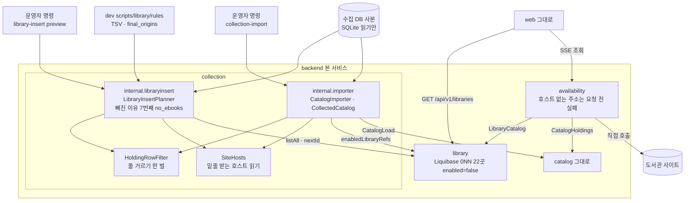
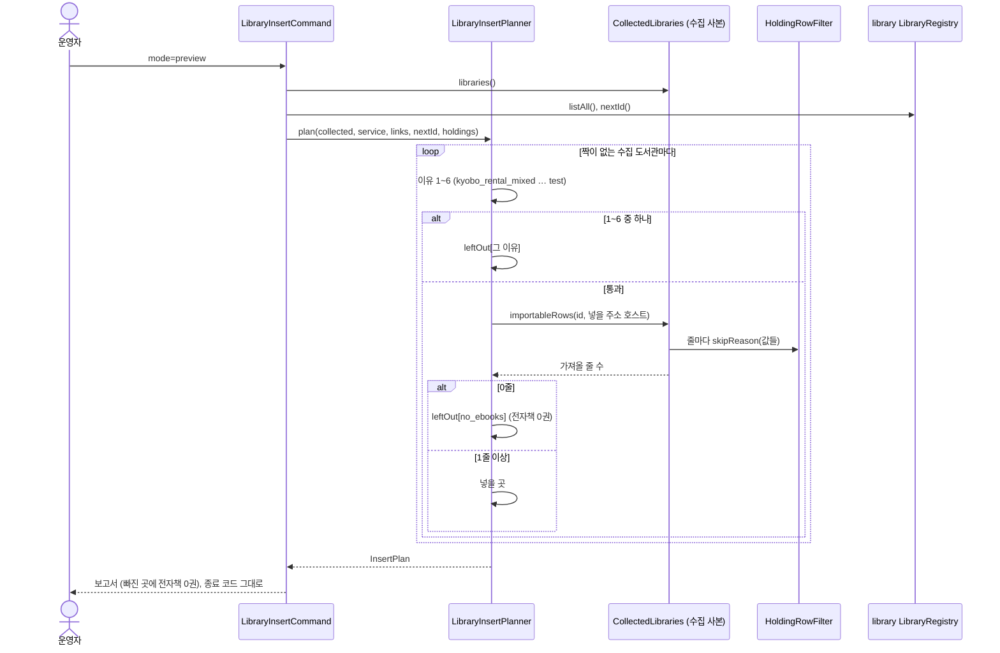
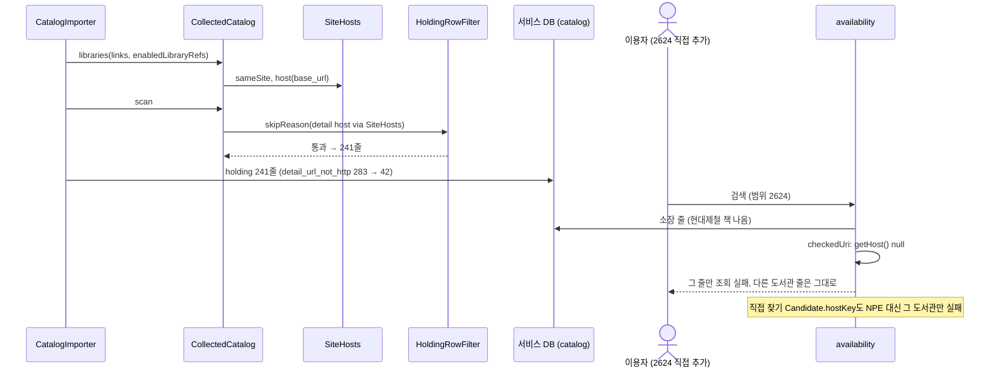
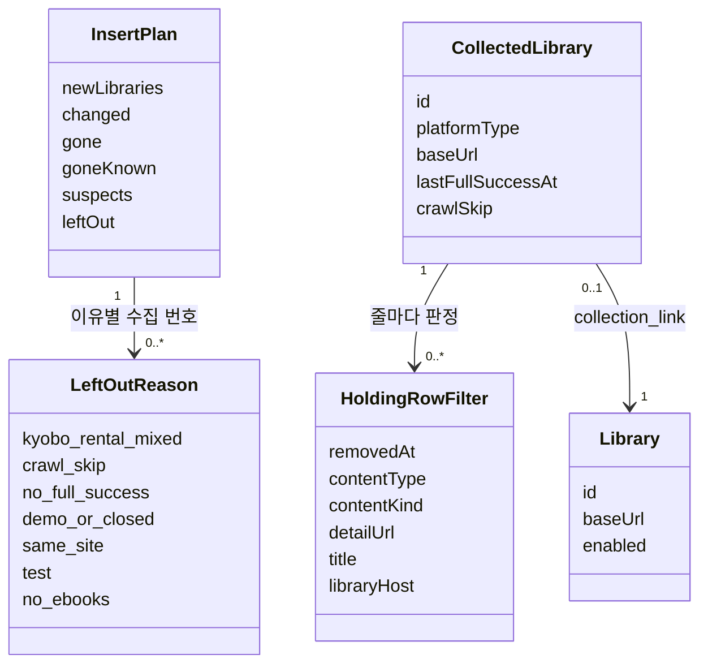

# 설계 제안: 사이클 18 소장이 비었거나 덜 모인 도서관

- 작성: 2026-10-14, `architect` 서브에이전트 (dev 코드 읽기만). 근거: 이 폴더 scope·spec·flow·research, `docs/cycles/13-crawler-to-dev/design-delta.md`, `docs/current/module-map.md`
- 이름은 모두 [안]이며 dev가 바꿔도 됩니다 (사이클 13 방식)
- 결정 페이지: [easy/2026-10-14-design-decisions.html](easy/2026-10-14-design-decisions.html)

**먼저 알릴 것 (새로 찾은 사실, AC-4에 걸림)**: 대출 조회는 Java 기본 HTTP 클라이언트(`java.net.http`)로 요청합니다. 이 클라이언트는 호스트를 읽을 수 없는 주소면 요청을 만들 때 바로 거절합니다(`HttpRequest.newBuilder` → `checkURI` → `IllegalArgumentException("unsupported URI …")`). 현대제철 주소 `https://hs_partners.yes24library.com`은 밑줄 때문에 `getHost()`가 null이라, 호스트 읽기만 고쳐서는 요청을 보낼 수 없습니다 (결정 2).

## 현재 상태

- 모듈: `library`(도서관 표, `enabled`), `collection`(가져오기 `internal.importer`, 넣기 명령 `internal.libraryinsert`), `availability`(대출 조회·직접 찾기), `catalog`. 의존 방향 `collection → catalog, library`, `availability → catalog, library`는 바꾸지 않음
- 도서관 끄기의 지금 방식
  - 사이클 07: Liquibase `library/010-library-disabled.yaml` (`UPDATE library.library SET enabled=false, updated_at=now() WHERE id IN (…)`)
  - dev `library-maintenance.md` 6-2: "운영 중에는 SQL로 바로 끈다. 오래 꺼 둘 곳은 배포 후 새 changeset"
  - `list_left_out.py`는 서비스 표 내보내기의 `enabled`와 `scripts/library/disabled_reasons.tsv`를 읽음
- 운영 반영: `apply`는 같은 앱 판으로 돎(dev `3-import.md` 160행). 운영 DB에 붙으면 그 판의 Liquibase가 먼저 적용됨
  - 반영 비교(`DatabaseFingerprint`)는 켜진 도서관의 `id·baseUrl·platformType` 해시를 비교 → 끄기가 내 PC와 운영 DB에 같게 들어가지 않으면 `mismatch`로 멈춤
- 반영 파일 `libraryPart`(사이클 13)는 새 도서관 더하기만 옮김. 끄기를 실어 나르는 길 없음
- 넣기 명령 `LibraryInsertPlanner.leftOutReason`: `kyobo_rental_mixed`, `crawl_skip`, `no_full_success`, `demo_or_closed`, `same_site`, `test` 순서. 수집 사본은 `CollectedLibraries`로 읽음
- 가져오기 줄 거르기 `CollectedCatalog.skipReason`(private static, `ResultSet` 열 번호): removed → kind_* → kind_sound_video → no_detail_url → detail_url_not_http → detail_host_mismatch → no_title
- 밑줄 호스트(`getHost()` null)를 쓰는 곳
  - `collection`: `CollectedCatalog.httpHostOf`(지금 `detail_url_not_http`), `hostOf(ref.baseUrl())`(위만 고치면 `detail_host_mismatch`), `sameSite`(`library_base_url_mismatch`). `LibraryInsertPlanner.host`는 이미 손으로 나눠 읽어 밑줄을 받음
  - `availability`: `HostThrottle.key`(null이면 NPE, `Candidate.hostKey`가 부름), `DetailPageFetcher.checkedUri`(null → 그 소장 줄만 요청 없이 실패), `DirectSiteFetcher.fetch`(`HttpRequest.newBuilder(uri)`의 IAE를 잡지 않음), 어댑터의 `UriComponentsBuilder…toUri()` [확인 필요]
  - 현대제철 2624는 `MEMBERS_ONLY` → 이용자가 직접 추가했을 때만 조회 계획에 들어감 (module-map 117행)
- 표·API: 새 표·칸·API 없음

## 요구 대응

| 요구/수용 기준 | 설계에서 필요한 것 |
|---|---|
| R1, AC-1·2·3 | 22곳 `enabled=false`를 내 PC DB에. 화면·API 코드 변경 없음 |
| R1, AC-8 | 같은 끄기가 운영 DB에도 들어가고 반영 비교가 맞기 |
| R1-3, AC-7 | `disabled_reasons.tsv` 22줄 + `library-site-issues.md`·`library-maintenance.md` 6-2 표. `gone_known.tsv`의 44·261·269 정리 |
| R2-1·2, AC-6 | 넣기 명령이 새 곳마다 "가져올 줄 수"를 `skipReason`과 같은 규칙으로 셈. 맨 마지막 이유 (종료 코드 그대로) |
| R3-1, AC-5 | 가져오기의 호스트 읽기 세 곳이 밑줄을 받음 → 241줄 (283 → 42) |
| R3-2, AC-4 | 대출 조회·직접 찾기가 NPE 없이 동작. 실제 요청 가능 여부는 결정 2 |

## 결정 1: 이미 켜진 22곳을 내 PC와 운영 서버에서 어떻게 끄는가

- **A안 새 Liquibase changeset** (사이클 07 `010`과 같은 방식) [안] 추천
  - `library/0NN-library-disabled-cycle18.yaml` 하나, `UPDATE … SET enabled=false, updated_at=now() WHERE id IN (22곳)`, 주석에 원인 묶음과 `library-site-issues.md` 절
  - 장점: 코드 변경 0. 앱을 띄우면 내 PC에, 운영 `apply`(같은 앱 판)를 돌리면 운영 DB에 비교 전에 자동으로 들어가 켜진 도서관 해시가 양쪽에서 같아짐. dev 6-2 규칙과 같고 git 이력이 남음
  - 단점: 다시 켤 때도 changeset 하나(교보 구독형 4곳, R1-4). 끄기만 하려 해도 앱 판을 올려야 함
  - 순서: 내 PC에서 새 판으로 띄움(끄기 적용) → 가져오기·내보내기 → 운영에 같은 판 배포 → `apply`. 끄기 전 판으로 내보내면 `mismatch`로 멈춤(절차 문서에 한 줄)
- B안 규칙 파일을 넣기 명령이 읽고 `libraryPart`로 운영에 옮김: `LibraryRegistry.disable(ids)` 공개 API, 실행 기록 모양·반영 순서 변경. 넣기 명령의 "새 곳만" 성격과 어긋나고 사이클 13 코드를 다시 건드림
- C안 SQL을 손으로 두 번: 빠뜨리면 `mismatch`, 새로 만드는 DB에는 안 들어감, git 이력 없음
- 추천 이유(설계 판단): 반영 비교가 켜진 도서관을 보므로 "같은 앱 판 = 같은 Liquibase"가 가장 단순하고 빠뜨릴 수 없음. 사용자가 밝힌 이유는 없음 [이유 미확인]

## 결정 2 (새로 찾음): 밑줄 호스트(현대제철)의 대출 조회 요청

[확정] 근거
- Java 21 `java.net.URI`: 서버 형식으로 읽히지 않는 authority는 registry-based, host가 정해지지 않음. 여러 인자 생성자는 `parseServerAuthority()`로 `URISyntaxException`을 낼 수 있음. https://docs.oracle.com/en/java/javase/21/docs/api/java.base/java/net/URI.html (확인 2026-10-14)
- JDK 21 `HttpRequestBuilderImpl.checkURI`: `if (uri.getHost() == null) throw newIAE("unsupported URI %s", uri)`. https://github.com/openjdk/jdk21u/blob/master/src/java.net.http/share/classes/jdk/internal/net/http/HttpRequestBuilderImpl.java (확인 2026-10-14)
- OpenJDK는 이 동작을 버그로 보지 않음 (JDK-8180809 "Not an Issue"). https://bugs.openjdk.org/browse/JDK-8180809 (확인 2026-10-14)

- **A안 그 도서관만 실패로 가둠 (요청 안 함)** [안] 추천
  - `availability`에서 호스트가 없는 주소는 요청 전에 실패. `Candidate.hostKey`·`HostThrottle.key`의 NPE를 없애고 `DirectSiteFetcher`·주소 만들기의 IAE를 `UpstreamException.error`로
  - 결과: 241권은 검색에 나오고, 그 줄의 대출 조회는 실패 표시, 책 줄의 도서관 링크로 사이트를 열 수 있음
  - 장점: 작은 수정, 새 의존성 없음. 지금 숨은 NPE(현대제철을 직접 추가한 사람의 직접 찾기)도 없어짐
  - 단점: **AC-4 "대출 조회가 '확인 불가'가 아닌 값"을 만족하지 못함 → AC-4를 고쳐야 함**
- B안 밑줄 호스트만 다른 HTTP 클라이언트(Apache HttpClient 5 등)로 요청: AC-4 그대로. 241권 한 곳을 위해 의존성 하나, TLS 설정 두 벌. JSSE SNI·인증서 이름 검사가 밑줄을 받는지, 조회 서버 모드에서 어떻게 되는지 [확인 필요: 프로토타입]
- C안 현대제철을 끄고 가져오기만 고침: 조사 결정 #3과 어긋남, 비교용
- 추천 이유(설계 판단): 구성원 전용 한 곳(직접 추가했을 때만 조회)을 위해 HTTP 클라이언트를 하나 더 두는 것은 큼. B안은 backlog 후보

## 결정 3: 밑줄을 받는 호스트 읽기를 어디에 두는가

- **A안 모듈마다 자기 것** [안] 추천
  - `collection`: `LibraryInsertPlanner.host`(이미 밑줄을 받음)를 모듈 안 내부 클래스(예: `collection.internal.SiteHosts`)로 옮겨 `CollectedCatalog.httpHostOf`·`hostOf`·`sameSite`와 넣기 명령이 함께 씀
  - `availability`: 결정 2 A안이면 "호스트 없음 = 요청 안 함"만 하면 되어 파서가 필요 없음
  - 장점: 모듈 사이 새 의존·공용 모듈 없음
- B안 `library` 공개 API에 `host()` 또는 공개 도우미: 책 상세 주소 호스트는 도서관 데이터가 아니라 결국 각 모듈이 다시 읽음, `library`가 URL 도구 모음이 됨
- 공용 `shared`/`common` 모듈은 dev `spring-modulith` 규칙("generic shared module 금지")에 걸려 뺌

## 결정 4: 넣기 명령이 새 곳의 "가져올 줄 수"를 어떻게 세는가

- **A안 가져오기 거르기 규칙을 한 벌로 꺼내 함께 씀** [안] 추천
  - `CollectedCatalog.skipReason`을 값으로 받는 함수로 꺼냄 (예: `collection.internal.importer.HoldingRowFilter.skipReason(removedAt, contentType, contentKind, detailUrl, title, libraryHost)`, 모듈 안 공개 클래스). 가져오기와 `CollectedLibraries`가 같이 씀
  - `CollectedLibraries`는 앞 6개 이유를 통과한 새 곳만 `holding` 줄을 읽어 셈. 도서관 호스트는 넣을 때 쓸 주소(`final_origins.tsv` 값, 없으면 수집 주소)의 호스트
  - 장점: spec R2-1 "가져오기와 같은 규칙"이 코드로 보장, 규칙이 바뀌어도 한 곳
  - 단점: 가져오기 클래스를 조금 다시 짬(사이클 12 코드와 같은 파일). 새 곳이 많으면 느려질 수 있음 [확인 필요]
- B안 SQL 한 번으로 셈: 규칙이 Java·SQL 두 벌, 상세 주소 호스트 비교를 SQL로 하기 어려움
- 추천 이유: 사용자가 승인한 R2-1(명세 결정 #3)

## 모듈·데이터·API 초안 (추천안 기준)

### 모듈 구성도

### 흐름 1: 넣기 미리 보기와 새 이유 "전자책 0권"

### 흐름 2: 밑줄 호스트의 가져오기와 대출 조회

### 도메인 모델

### 모듈

| 모듈 | 신규/변경 | 공개 API | 이벤트 | 소유 표 |
|---|---|---|---|---|
| `library` | 변경 (Liquibase만) | 그대로 | 없음 | `library.library` (칸 변경 없음, 22줄 `enabled=false`) |
| `collection` | 변경 (내부만) | 그대로. 내부 `HoldingRowFilter`, `SiteHosts`, `Holdings.importableRows`, 빠진 이유 키 `no_ebooks` [안] | 없음 | 변경 없음 |
| `availability` | 변경 (내부만) | 그대로. 호스트 없는 주소는 요청 전 `UpstreamException.error` | 없음 | 없음 |
| `catalog`, web | 변경 없음 | — | — | — |

- `ModularityTests`: 모듈 사이 의존이 바뀌지 않아 그대로 통과해야 함

### 데이터

- 새 표·칸 없음
- Liquibase `library/0NN-library-disabled-cycle18.yaml` [안], 대상 22곳 [확정] (spec R1)
- dev git 데이터 파일
  - `scripts/library/disabled_reasons.tsv`: 22줄 더함
  - `rules/gone_known.tsv`: 44·261·269를 지움 [안] (끈 곳은 `compare()`가 건너뛰어 쓰이지 않고, "켜 둠"이라는 뜻이 틀려짐)
  - `library-maintenance.md` 6-2 "꺼 둔 도서관" 표에도 더함

### API

- 바뀌는 API 없음

## 확인 필요

| 항목 | 방법 |
|---|---|
| Liquibase 파일 번호 (사이클 15·16·17이 `library/`에 파일을 더하는지) | dev 작업 때 마지막 번호 확인 |
| 어댑터의 `UriComponentsBuilder…toUri()`가 밑줄 호스트에서 예외를 내는지 | 프로토타입 (dev 시험, 2624 주소) |
| IAE가 조회 묶음 전체를 깨는지, 그 도서관만 깨는지 | 프로토타입 (dev 시험) |
| (결정 2 B안일 때) JSSE 기반 클라이언트의 SNI·인증서 이름 검사, 조회 서버 쪽 구현 | 프로토타입 |
| 브라우저(서비스 링크)가 `hs_partners` 주소를 여는지 | 사이트 열어 보기 (앱 안 브라우저로는 열림, research.md) |
| ~~새 곳의 넣을 주소 호스트가 상세 주소 호스트와 달라 0줄이 되면 "전자책 0권"으로 나오는 문제~~ | 결정됨: 그대로 두고 시험을 넣음 [확정] (사용자 제안, 2026-10-14: "이거 넣으면서 테스트해야 하는 거 아니야?"). 자동 시험(호스트 다른 새 곳·오디오북만 있는 곳·밑줄 주소인데 책 있는 곳을 시험 사본에 두고 미리 보기 → 보고서 확인)과 넣기 절차 한 줄("전자책 0권" 목록에서 넣을 주소가 바뀐 곳은 사이트 확인). 지금 서비스·수집 DB에서 이런 곳 0곳 (research.md 5절) |
| 새 곳이 많을 때 줄 세기 시간 | 프로토타입 (2026-10-12 사본) |

## backlog 후보

- 밑줄 호스트 도서관의 대출 조회를 다른 HTTP 클라이언트로 (결정 2 B안)
- 넣기 명령의 빠진 이유를 "전자책 0권"과 "주소 호스트 다름"으로 나누기
