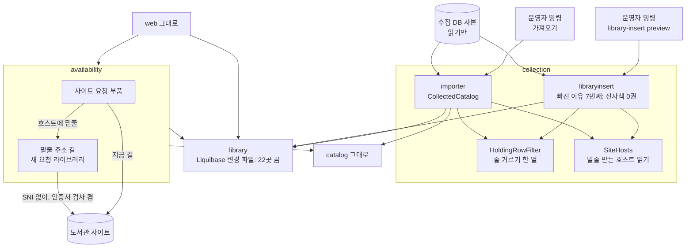
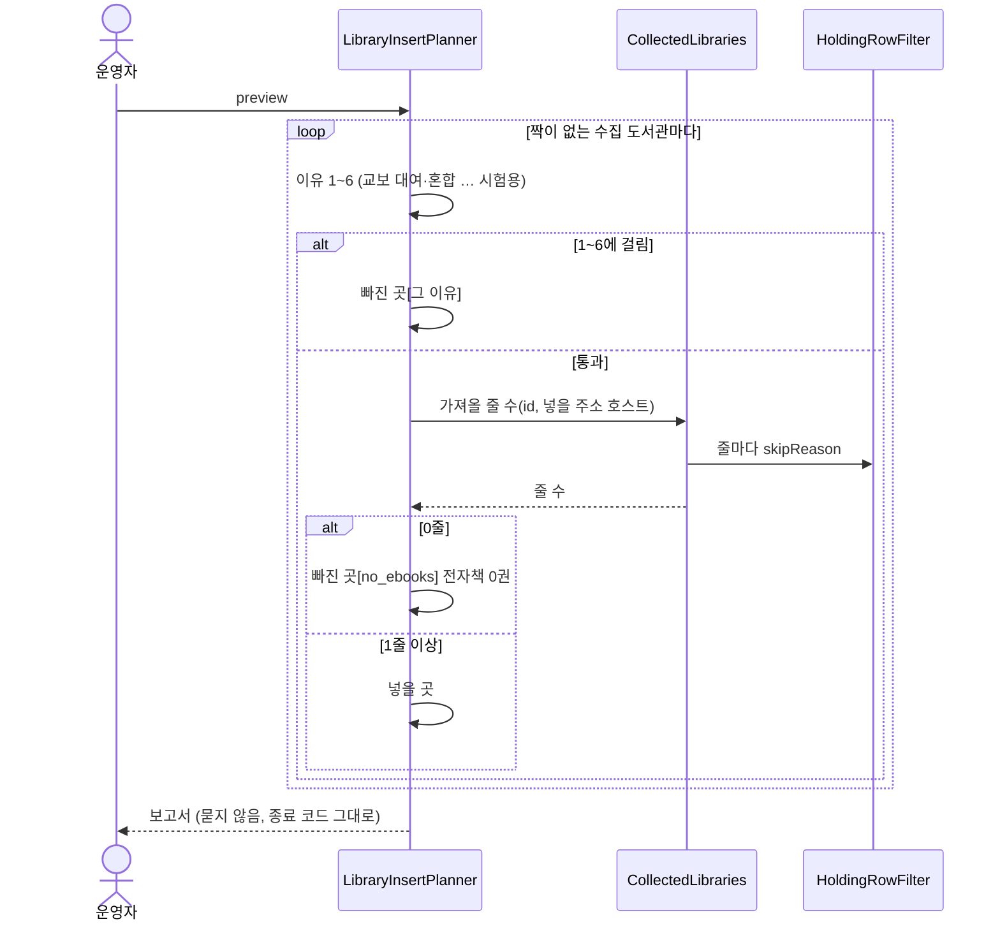
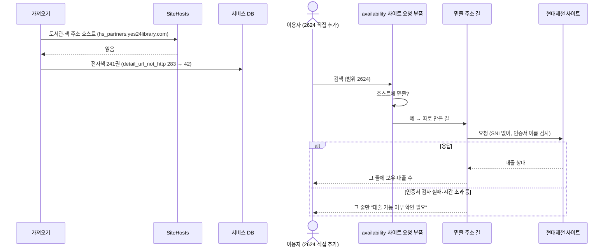
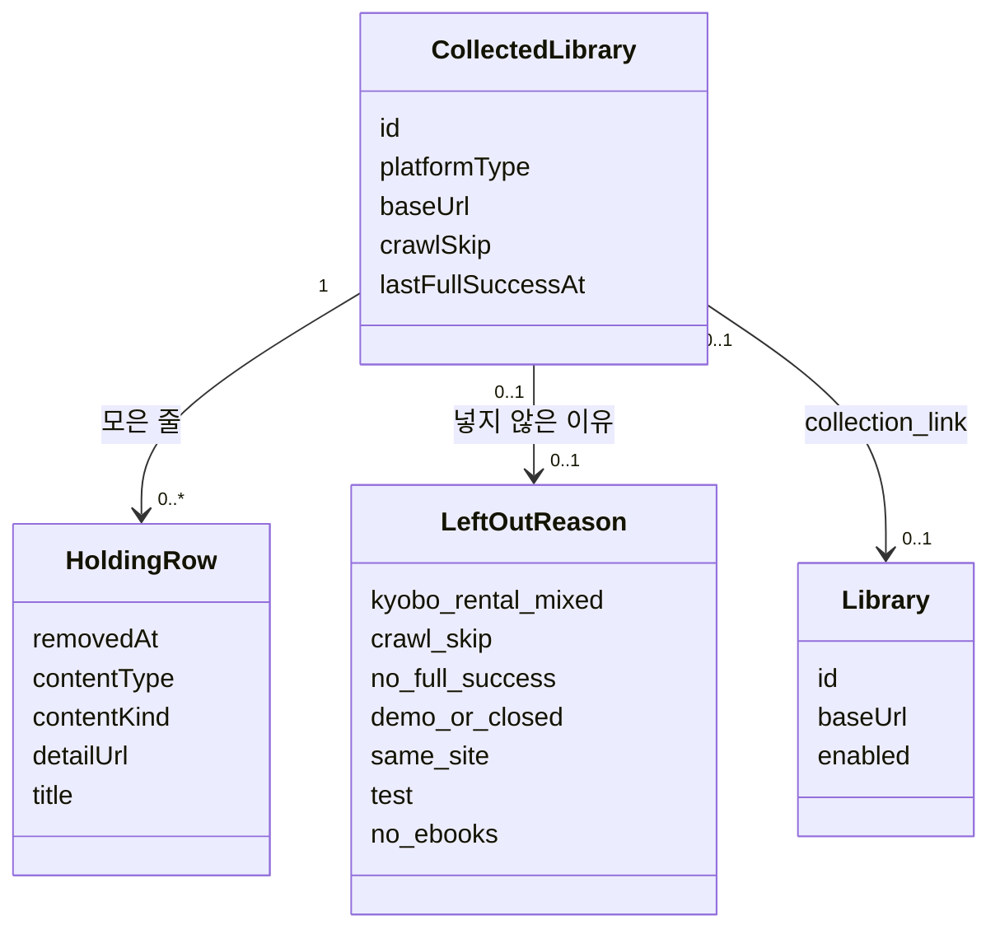

# 설계 변경: 사이클 18 소장이 비었거나 덜 모인 도서관

- 근거: [scope.md](scope.md), [spec.md](spec.md), [flow.md](flow.md), [research.md](research.md), [architect-proposal.md](architect-proposal.md)와 결정 페이지 `easy/2026-10-14-design-decisions.html`·`easy/2026-10-14-design-followup-decisions.html` (모두 사용자 결정, 2026-10-14)
- 검토: [easy/2026-10-14-design-delta-review.html](easy/2026-10-14-design-delta-review.html) 5개 모두 승인 (2026-10-14)
- 새 표·새 칸·새 API·새 화면 없음. 코드 이름은 모두 [안]이며 dev가 바꿔도 됨 [확정] (설계 결정 #7)
- 개발 순서 [확정]
  - 언제든: 22곳 끄기, 밑줄 호스트 요청 길(`availability`, 사이클 17과 순서 상관없음, 설계 후속 #5)
  - 사이클 19가 main에 들어간 뒤: `SiteHosts`·`HoldingRowFilter` 꺼내기(가져오기 고침), 넣기 "전자책 0권"(`HoldingRowFilter`를 씀), 옛 설정 이름 바꾸기, 내 PC 가져오기 (설계 후속 #6, 사용자 "19뒤에 하자")
  - 사이클 17 첫 배포 뒤: 운영 반영 (범위 결정 #8)
  - spec AC-1(켜진 0권 0곳)은 22곳 끄기와 현대제철 가져오기가 둘 다 끝나야 맞음

## 구조 그림

### 모듈 구성도

### 주요 흐름 1: 새 도서관 넣기 미리 보기

### 주요 흐름 2: 밑줄 주소 도서관의 가져오기와 대출 조회

### 도메인 모델

## 모듈

| 모듈 | 신규/변경 | 책임 | 공개 API | 발행/구독 이벤트 | 소유 테이블 |
|---|---|---|---|---|---|
| `library` | 변경 (Liquibase만) | 22곳 `enabled=false` | 그대로 | 없음 | `library.library` (칸 변경 없음) |
| `collection` | 변경 (내부만) | ① `SiteHosts` [안]: 밑줄을 받는 호스트 읽기(지금 `LibraryInsertPlanner.host`를 옮김), `CollectedCatalog.httpHostOf`·`hostOf`·`sameSite`가 씀 ② `HoldingRowFilter` [안]: `skipReason`을 값으로 받는 함수로 꺼내 가져오기와 넣기 명령이 같이 씀 ③ 넣기 명령 빠진 이유 `no_ebooks` [안](보고서 "전자책 0권"), 이유 1~6 다음 ④ 사이클 12 시험용 설정 `exclude-candidate-libraries`(Java `excludeCandidateLibraries`, 옛 "후보" 용어) 이름 바꿈, 새 이름 dev가 정함 [확정] (12·13·14 회고 결정 #14, 사용자 승인 2026-10-14, `docs/backlog.md`) | 그대로 | 없음 | 변경 없음 |
| `availability` | 변경 (내부만) | 사이트 요청 부품에서 호스트에 밑줄이 있으면 새 요청 라이브러리로 보냄(대출 조회·직접 찾기 둘 다). SNI 없이, 인증서 이름 검사 켬, 지금 길과 같은 시간 제한·응답 크기 제한·`LibrarySiteTls`. 실패하면 그 도서관만 실패. `HostThrottle.key`·`Candidate.hostKey`가 밑줄 호스트에서 NPE를 내지 않게 | 그대로 | 없음 | 없음 |
| `catalog`, web | 변경 없음 | — | — | — | — |

- 모듈 사이 의존은 바뀌지 않음 (`ModularityTests` 그대로 통과) [확정: 설계 결정 #4 "collection 안"]
- 공용 모듈 없음 (dev `spring-modulith` "generic shared module 금지")
- 요청 라이브러리는 dev가 시제품으로 고름 [확정] (설계 후속 #2). 조건: ① 밑줄 호스트로 실제 요청이 됨 ② 지금 길과 같은 시간 제한·응답 크기 제한·도서관 사이트 인증서 설정(`LibrarySiteTls`) ③ 새 라이브러리는 하나 ④ 인증서 이름 검사를 끄지 않음. 첫 후보 Apache HttpClient 5 [확인 필요: 시제품]
- 호스트 읽기를 `collection` 안에 둔 것: `library` 공개 API로 올리는 안은 책 상세 주소가 도서관 정보가 아니라 결국 각 모듈이 다시 읽어 뺐고, 공용 모듈은 dev 규칙("generic shared module 금지")으로 뺌 [확정] (설계 결정 #4)
- 사이클 17이 같은 사이트 요청 부품에 나가는 길 고르기·IP별 셈·User-Agent를 넣음(ADR-0095). 순서는 상관없고, 나중에 합치는 쪽이 맞춤 [확정] (설계 후속 #5). 밑줄 길도 17이 정한 User-Agent·셈·멈춤 규칙을 따름 [확정] (사용자 승인, 2026-10-14, design-delta 검토 #1)

## 데이터

- 스키마: 변경 없음 (erDiagram 변경 없음)
- Liquibase: `library/0NN-library-disabled-cycle18.yaml` [안] 새 파일 하나, 기존 changeset 수정 없음
  - `UPDATE library.library SET enabled = false, updated_at = now() WHERE id IN (44, 112, 168, 261, 269, 305, 318, 323, 378, 425, 455, 514, 537, 622, 623, 625, 626, 721, 1045, 1131, 1620, 2023)` — 22곳 [확정] (spec R1)
  - 주석에 원인 묶음과 dev `library-site-issues.md` 절 [안]
  - 번호 0NN은 dev 작업 때 마지막 파일 다음 (다른 사이클이 `library/`에 더할 수 있음)
- dev git의 규칙·기록 파일 (코드 아님)
  - `scripts/library/disabled_reasons.tsv`: 22줄 [확정] (spec R1-3)
  - `scripts/library/rules/gone_known.tsv`: 44·261·269 줄 지움 [확정] (설계 결정 #2)
  - `docs/library-site-issues.md`: 22곳 원인·원문·확인일 [확정] (범위 결정 #4)
  - `docs/library-maintenance.md` 6-2 "꺼 둔 도서관" 표 [확정] (사용자 승인, 2026-10-14, design-delta 검토 #2)
  - `docs/maintenance/1-libraries.md` 넣기 절차에 한 줄: "보고서의 전자책 0권 목록에서 넣을 주소가 바뀐 곳은 사이트를 열어 확인" [확정] (설계 결정 #6 사용자 제안)
  - `docs/maintenance/3-import.md` 반영 절차에 한 줄: "끄기 변경 파일이 든 판으로 내 PC를 띄운 뒤 내보내기. 끄기 전 판으로 내보내면 반영 비교가 mismatch로 멈춤" [확정] (사용자 승인, 2026-10-14, design-delta 검토 #2)

## API

- 바뀌는 API 없음
- `GET /api/v1/libraries`: 끈 22곳을 돌려주지 않음 (지금 동작). "내 도서관"에 이미 있는 곳은 "쓸 수 없는 도서관" (지금 동작)

## 외부 연동

| 대상 | 방식 | 제한·키 관리 | 실패 시 동작 | 상태 태그 |
|---|---|---|---|---|
| 밑줄 호스트 도서관 사이트 (지금 현대제철 `https://hs_partners.yes24library.com`) | 새 요청 라이브러리, SNI 없이, 인증서 이름 검사 켬 | 지금 길과 같은 시간 제한·응답 크기 제한·호스트별 간격. 키 없음 | 그 줄만 "대출 가능 여부 확인 필요" | [확정] 방식 (설계 후속 #1~#4) / 라이브러리 [확인 필요: 시제품] |

## 시험 (dev)

| 시험 | 확인 | 근거 |
|---|---|---|
| 넣기 미리 보기: 시험 수집 사본에 ① 오디오북만 있는 새 곳 ② 넣을 주소와 책 주소 호스트가 다른 새 곳 ③ 밑줄 주소인데 전자책이 있는 새 곳 | ①② 보고서 "전자책 0권"·넣기 뒤 서비스에 없음, ③ 넣음 | 설계 결정 #6 사용자 제안, spec AC-6 |
| 가져오기: 밑줄 호스트 도서관 | 전자책 줄이 들어감, `detail_url_not_http`로 빠지지 않음 | spec AC-5 |
| `HoldingRowFilter`: 지금 `skipReason`과 같은 판정 | 바꾸기 전후 같은 사본으로 가져오기 기록 같음(밑줄 줄 빼고) | spec R2-1 |
| 대출 조회·직접 찾기: 밑줄 호스트 | NPE 없음, 응답이면 값, 실패면 그 줄만 실패, 다른 도서관 영향 없음 | spec AC-4, 설계 후속 #4 |
| 시제품: 고른 라이브러리로 현대제철에 실제 요청 | 응답 받음, 인증서 이름 검사 통과 | 설계 후속 #2·#3 |
| 22곳 끄기 | 변경 파일 적용 뒤 목록 API에 22곳 없음 (켜진 0권 0곳은 현대제철 가져오기 뒤) | spec AC-1·2 |
| 끄기 전에 22곳 중 하나를 "내 도서관"에 넣어 둔 계정 | 끈 뒤 "쓸 수 없는 도서관"으로 보임 (지금 동작, 회귀 확인) | spec AC-3 |
| dev 문서 | `library-site-issues.md`에 22곳 원인·원문·확인일 (문서 확인) | spec AC-7 |

## 결정 기록

- [ADR-0109](../../adr/0109-disable-libraries-by-liquibase.md) (Accepted, 사용자 승인 2026-10-14) 이미 켜진 도서관을 끌 때는 Liquibase 변경 파일로 (내 PC·운영 같은 판) — 사이클 07 방식을 규칙으로
- [ADR-0110](../../adr/0110-library-insert-skips-zero-ebook-sites.md) (Accepted, 사용자 승인 2026-10-14) 새 도서관 넣기에서 전자책 0권인 곳을 뺌 (가져오기와 같은 거르기 규칙, 맨 마지막 이유, 묻지 않음) — ADR-0107(넣기 명령 보탬)에 이어
- [ADR-0111](../../adr/0111-underscore-host-separate-request-path.md) (Accepted, 사용자 승인 2026-10-14) 호스트에 밑줄이 있는 도서관 주소: 가져오기는 직접 읽고, 대출 조회는 따로 만든 요청 길로 (SNI 없이, 인증서 검사 켬)

## 확인 필요

| 항목 | 방법 | 막는 단계 |
|---|---|---|
| 요청 라이브러리가 밑줄 호스트로 실제 요청하는지, Java 인증서 이름 검사가 `*.yes24library.com`으로 통과하는지 | 시제품 (dev) | 개발 |
| 어댑터의 `UriComponentsBuilder…toUri()`가 밑줄 호스트에서 예외를 내는지 | 시제품 (dev) | 개발 |
| Liquibase `library/` 마지막 번호 | dev 작업 때 확인 | 개발 |
| 새 곳이 많을 때 줄 세기 시간 | 시제품 (2026-10-12 사본) | 개발 |
| 사이클 19가 `CollectedCatalog`를 어떻게 바꿨는지 | 19 main 합친 뒤 dev 코드 읽기 | 18 가져오기 고침 시작 |
| `list_left_out.py`가 새 이유 `no_ebooks`와 끈 22곳을 그대로 보이는지 (`disabled_reasons.tsv`만으로 되는지) | dev 코드 읽기·실행 | 개발 |
