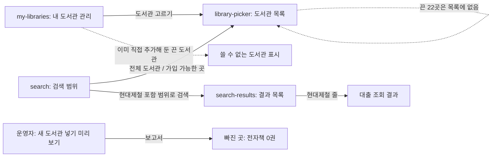

# 화면 흐름: 소장이 비었거나 덜 모인 도서관

- 범위·명세: [scope.md](scope.md), [spec.md](spec.md). 이 흐름 문서는 사용자 승인 (2026-10-14, [easy/2026-10-14-flow-decisions.html](easy/2026-10-14-flow-decisions.html)). 이 사이클은 **새 화면도, 바뀌는 화면도 없음** [확정] (범위 결정 #5 "화면은 바꾸지 않음", 사용자 승인 2026-10-14)
- 아래는 이미 있는 화면에서 이 사이클의 결과가 어디에 보이는지만 적습니다. 화면 모양은 지금 dev 화면 그대로입니다

## 화면별 내용

### my-libraries / library-picker (지금 화면)
- 도서관 목록은 `GET /api/v1/libraries`에서 옴. 끈 22곳은 이 응답에 없으므로 목록·범위 고르기에 나오지 않음 (지금 꺼진 도서관과 같은 동작)
- 이미 "내 도서관"에 직접 추가해 둔 끈 도서관은 지금처럼 "쓸 수 없는 도서관"으로 보임. 지울 때까지 20곳 상한에 셈 (`docs/current/api.md` 271행)
- 상태: 지금 그대로

### search / search-results (지금 화면)
- 현대제철(2624)을 범위에 넣고 검색하면 그 도서관 책이 결과에 나옴. 그 줄의 대출 조회가 다른 도서관과 같은 모양으로 보임
- 상태: 대출 조회 실패는 지금처럼 그 도서관 줄만 실패로 보임

### 운영자: 새 도서관 넣기 (화면 아님, 명령)
- 사이클 13의 `library-insert` 미리 보기 보고서에 빠진 이유 "전자책 0권"이 더해짐. 사용자에게 따로 묻지 않음 (spec R2-2, 상태별 동작)

## 수용 기준 대응

| AC | 화면 |
|---|---|
| AC-1 | 화면 없음 (DB에서 SQL) |
| AC-2 | library-picker (목록에 22곳 없음) |
| AC-3 | my-libraries ("쓸 수 없는 도서관") |
| AC-4 | search → search-results → 대출 조회 결과 |
| AC-5 | 화면 없음 (가져오기 기록) |
| AC-6 | 운영자 넣기 보고서 |
| AC-7 | 화면 없음 (dev 문서) |
| AC-8 | 화면 없음 (운영 DB에서 SQL) |
