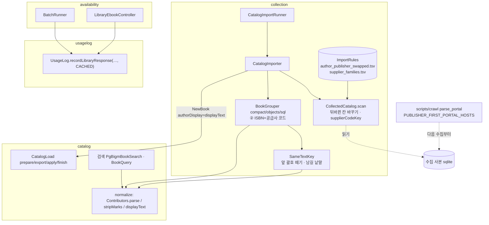
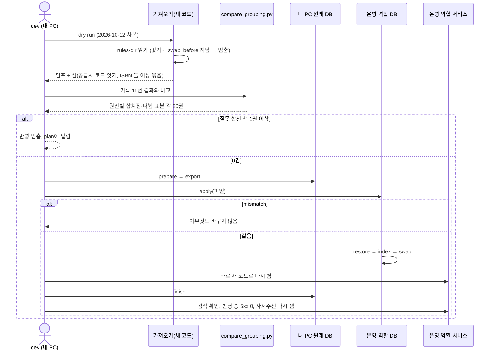
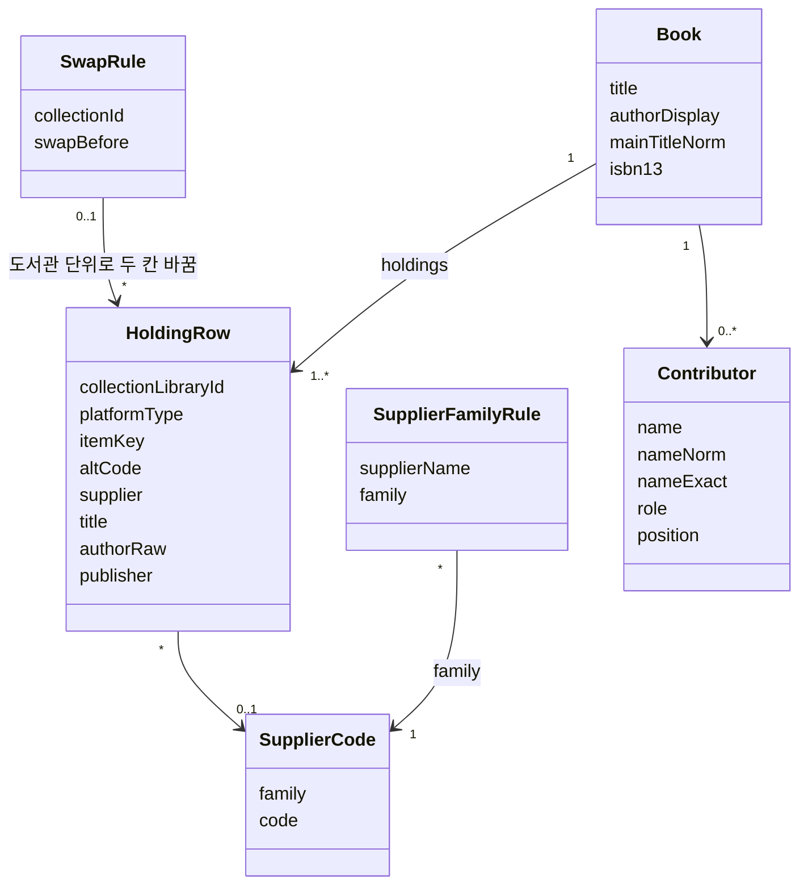

# 설계 제안: 사이클 19 같은 책을 갈라 놓는 저자·제목 표기 정리

- 작성: 2026-10-15, `architect` 서브에이전트 (dev main `0a75f7a` 읽기만). 근거: 이 폴더 scope·spec·flow·research·handoff-notes, ADR-0069·0079·0105·0106
- spec의 [확정]은 다시 열지 않음. 새로 정하는 것은 모두 [안]이며 이름은 dev가 바꿔도 됨
- 결정 페이지: [easy/2026-10-15-design-decisions.html](easy/2026-10-15-design-decisions.html)

## 결정 결과 (2026-10-15, [설계 결정](easy/2026-10-15-design-decisions.html))

| # | 결정 | 결과 |
|---|---|---|
| 1 | 공급사 코드 잇기를 ② 단계에 함께 (A안), ISBN 둘 이상 묶음 수를 세어 0이 아니면 plan에 물음 | [확정] (사용자 승인) |
| 2 | 목록에 없는 공급사 이름은 다듬은 이름 그대로 한 묶음 | [확정] (사용자 승인) |
| 3 | 세 도서관 뒤바뀜은 줄을 읽을 때 바꿈 (2-1 A안) | [확정] (사용자 승인) |
| 4 | 규칙 파일 두 개 + `rules-dir` 설정 + `ImportRules` (2-2) | [확정] (사용자 승인) |
| 5 | 잊음 막는 장치 (`swap_before` 뒤 사본이면 멈춤) — 덧붙임: 멈췄을 때 그냥 줄을 지우지 말고 **그 새 사본에서 세 도서관이 아직 뒤바뀌어 있는지 다시 검증**(research.md 실험 (d) 방법: 이름이 다른 도서관에서 저자로 쓰이는 비율과 출판사로 쓰이는 비율)한 뒤, 바르게 들어왔으면 줄을 지우고 아직 뒤바뀌었으면 수집기를 다시 봄 | [확정] (사용자: "잊지 않게 막되 다음에도 이 규칙이 맞는가 검증은 해야 해 지금이 뜻하는 데이터 가공 방향으로", 2026-10-15) |
| 6 | `Contributors.stripMarks`·`displayText`를 `catalog.normalize`에 (3 A안) | [확정] (사용자 승인) |
| 7 | 남길 낱말 목록을 코드 상수로 (DB·규칙 파일보다 코드 상수, 질문 "이거 db에 정보 두는 건 이상하나"에 답한 뒤) | [확정] (사용자 승인) |
| 8 | `ResponseResult.CACHED` (5-1 A안) | [확정] (사용자 승인) |
| 9 | 새 변경 파일 `usagelog/002-library-response-cached-count.yaml` | [확정] (사용자 승인) |
| 10 | 수집기 상수 `PUBLISHER_FIRST_PORTAL_HOSTS` — 덧붙임: **수집 문서에 적어 다음 수집 때 이 규칙이 아직 맞는지(포털 칸 순서) 확인**하게 함: dev `docs/maintenance/2-crawl.md`·`platforms.md`의 통합 포털 절과 수집 전 점검 목록, plan `docs/research/ebook-catalog/platforms.md` | [확정] (사용자: "이거 md에서 기록해놔서 다음에 수집할 때 고려가 되어야하는지 잘 체크하게 해줘", 2026-10-15) |
| 11 | 반영 직후 짧은 틈 받아들임 | 질문 답함, 기다림 |

## 현재 상태 (요약)

- 모듈 의존은 바뀌지 않음: `collection → catalog, catalog :: normalize, library`, `availability → usagelog`
- 저자 정리 `Contributors.parse`는 `<>`를 다루지 않고 붙은 역할 낱말을 나누지 않음. 검색은 `PgBigmBookSearch`(정확 일치 `nameExact(검색어)`, 단어 `BookQuery.authorWords`)
- 대표 저자 표기는 세 묶는 방식이 묶음 안 가장 많은 원문을 고르고(`BookGrouping` 354, `CompactGrouping` 577, `SqlGrouping` 440), `CatalogImporter` 173행에서 `NewBook`이 됨
- 묶기 단계: ① 화면 번호, ② `kyoboIsbn`(item_key, 없으면 alt_code)으로 ISBN 잇기, ③ 국가서지 키, ④ `SameTextKey`. 세 방식 같은 결과(ADR-0079·0105)
- 가져오기는 규칙 폴더를 읽지 않음(`rules-dir`는 `library-insert`만). 도서관 단위 설정 선례는 `placeholder-date-libraries`(yml, 수집 번호)
- `holding.author_raw`·`publisher_raw`는 책 화면 소장 채우기(`BatchRunner` 281행)에서 씀
- 캐시 답은 `BatchRunner.answered` 336행, `LibraryEbookController.fetch` 96행에서 그냥 빠짐. master 끝은 `usagelog/001`
- 수집기 `parse_portal`(692~720행)은 `info[0]` 저자, `info[1]` 출판사. 호스트별 값은 모듈 상수(`PAGE_SIZE_BY_HOST`, `SHARED_HOSTS`)
- API·화면 구성은 바뀌지 않음

## 결정 1: 공급사 상품 코드 잇기(R2-3)의 자리

- **A안 (추천) [안]**: ② 단계를 넓혀 ISBN과 공급사 코드 키로 함께 잇기. `CollectedCatalog.scan`이 `Row.supplierCodeKey`(공급사 묶음 + 코드)를 채움 — `BOOKCUBE_FX`는 `alt_code`, `KYOBO_V1`·`KYOBO_SUBSCRIPTION_V1`·`YES24_V1~V3`는 `item_key`, 나머지는 없음. 세 방식은 이 키를 ISBN과 같은 "표"로 셈(`compact` 새 필드, `objects` `Unit.codes`, `sql` `grp_vote` 새 kind). 셈 `ImportReport.supplierCodeJoins`
  - 장점: 새 단계 없음, 코드 계산이 Java 한 곳이라 세 방식이 어긋날 틈이 없음. 단점: ISBN이 다른 두 묶음이 코드로 이어지면 가장 많은 ISBN만 남음(드물 것으로 보나 재지 않음) → dry run에서 "코드로 이었는데 ISBN이 둘 이상인 묶음" 수를 세어 0이 아니면 plan에 물음
- B안: ②와 ③ 사이 새 단계, ISBN이 다른 묶음은 잇지 않음 — 안전하지만 세 방식에 새 단계, `sql`이 가장 복잡, 공개일 일정에 부담
- 세부 [안]: 목록에 없는 공급사 이름은 다듬은 이름(NFKC·소문자·`(주)` 등·공백 제거) 그대로 한 묶음. 규칙 파일은 "다른 이름 → 같은 묶음"만 적음 (추천) / 대안: 목록에 있는 공급사만 코드로 이음
- 확인 (plan, 수집 DB 2026-10-12): 「김근아 저자」 줄(목원대 북큐브)의 공급사는 「Y2Books 전자책」, 같은 코드 1210492004114의 교보 화면 줄은 명지대 「와이투북스」·부천 「영풍문고」 → **이름 묶음 목록에 「Y2Books 전자책」 = 「와이투북스」가 있어야 AC-2가 통과** [확정] (research.md "공급사 코드 모양"). 전주 북큐브 108608605(「예스24」)와 YES24 줄(「YES24」·「예스이십사」)도 같은 묶음이어야 함

## 결정 2: 저자·출판사 뒤바뀜(R2-4)

- 2-1 **A안 (추천) [안]**: 줄을 읽을 때 바꿈. `CollectedCatalog.Library.authorPublisherSwapped`, 두 번 읽기 모두에서 `authorRaw`↔`publisher` → 묶기·대표 표기·`holding` 원문까지 바른 값(책 화면 소장 채우기도 바름). 단점: 세 도서관 `holding`의 "수집 원문 그대로"가 깨짐 → Javadoc·data-model에 적음 / B안: 묶기·책 만들기에서만 바꿈 — 고칠 곳이 늘고 소장 채우기는 계속 뒤바뀜
- 2-2 [안]: 파일 `scripts/library/rules/author_publisher_swapped.tsv`(칸 `collection_id, name, decided_on, swap_before, note`, 11·12·15), 공급사 묶음 파일 `scripts/library/rules/supplier_families.tsv`(칸 `supplier, family, decided_on, note`, 내용은 dev가 수집 DB 공급사 이름으로 만들어 보고). 가져오기 설정 `chaekcheck.collection.import.rules-dir`(기본 `../scripts/library/rules`, 파일 없으면 멈춤), 읽는 클래스 `ImportRules`(`collection/internal/importer`). README 표에 두 줄
- 잊음 막는 장치 [안]: `swap_before`(고친 수집기를 합친 날) 뒤에 받은 사본이면 가져오기가 "규칙 줄을 지우세요"로 멈춤 / 대안: 장치 없이 dev 절차 문서에 한 줄

## 결정 3: 책 표 저자 칸 정리(R1-5)

- **A안 (추천) [안]**: `catalog.normalize`에 공개 함수 `Contributors.stripMarks(String)`(기호만 뗌, `parse`가 맨 처음 부르고 저자 검색어에도 씀), `Contributors.displayText(String)`(기호 떼기 + 붙은 역할 낱말 뒤 띄우기, 보호 장치면 그대로). `CatalogImporter` 173행에서 `NewBook`을 만들 때 `displayText(book.authorDisplay())`. 세 방식은 고치지 않음. `CatalogText.norm`은 그대로
- B안: `JdbcCatalogLoad.addBook`이 정리 — `CatalogLoad` 계약의 뜻이 바뀜

## 결정 4: 제목 앞 괄호의 떼지 않을 낱말 목록(R2-2)

- **A안 (추천) [안]**: `SameTextKey`의 Java 상수 `LEADING_NOTE_KEEP_WORDS`(`EDITION_WORDS`·`TAILS` 옆). `comparisonTitle`에서 앞 시리즈 표시를 뗀 뒤 맨 앞 `(…)` 하나를 뗌. 권 표시·부제는 지금처럼 전체 제목에서 읽음. ADR-0069 "목록은 상수, 바꾸면 다시 가져오기" 관례
- B안: 규칙 파일 — 묶기 규칙의 원본이 둘로 나뉨

## 결정 5: "캐시 답" 수(R5)

- 5-1 **A안 (추천) [안]**: `UsageLog.ResponseResult`에 `CACHED`를 더함. `BatchRunner.answered`·`LibraryEbookController.fetch`가 캐시 답이면 `recordLibraryResponse(id, source, CACHED, 0)`(로그 줄은 안 씀), `UsageBuffer`·`UsageLogWriter`가 `cached_count`로 셈. 공개 API는 enum 값 하나 / B안: 새 메서드 `recordCachedAnswer` / C안: `boolean cached` 인자
- 5-2 [안]: 새 파일 `db/changelog/usagelog/002-library-response-cached-count.yaml`, changeset id `usagelog-002-cached-count`, master 끝에 `# cycle 19`. `ALTER TABLE usagelog.library_response_daily ADD COLUMN cached_count integer NOT NULL DEFAULT 0 CONSTRAINT library_response_daily_cached_count_check CHECK (cached_count >= 0)`. 상수 기본값이라 표를 다시 쓰지 않음 [확정] (PostgreSQL 18 ALTER TABLE Notes, https://www.postgresql.org/docs/current/sql-altertable.html, 확인 2026-10-15). 대안: `usagelog/001`에 접어 넣기 — 이미 적용된 내 PC DB의 checksum이 깨져 권하지 않음

## 결정 6: 수집기 포털 목록(R3-1)

- [안]: `crawl_catalog.py` 모듈 상수 `PUBLISHER_FIRST_PORTAL_HOSTS = {"lib.goe.go.kr", "library.daegu.go.kr", "lib.jbe.go.kr"}`(호스트 [확정]), `parse_portal`이 `base`의 호스트로 판정해 `info[1]` 저자, `info[0]` 출판사. 대안(규칙 파일)은 수집기에 파일 읽기가 새로 생김

## 결정 7: 다시 켜기 전의 짧은 틈

- [안]: 운영 역할 DB에서 바꿔 끼운 뒤 서비스를 새 코드로 다시 켜기 전까지 옛 서비스는 옛 검색어 정리를 씀. 저장된 이름은 이미 깨끗해서 "김정은" 검색은 맞고, 기호를 넣은 검색어만 잠깐 못 찾음 → 감수 (ADR-0069 "바꿔 끼우자마자 서비스 다시 켬" 그대로)

## 구조 그림 (추천안 기준)

## 확인 필요

| 항목 | 방법 | 막는 단계 |
|---|---|---|
| `KYOBO_SUBSCRIPTION_V1`의 `item_key`가 교보 상품 번호와 같은 번호 공간인지, 코드 다듬기(공백·앞의 0) | dev 수집 DB | dev |
| 코드로 이었는데 ISBN이 둘 이상인 묶음 수 | dry run 셈 | 반영 전 |
| `swap_before` 날짜 | 고친 수집기를 합친 날 | dev |
| 공급사 묶음 목록 내용 | dev가 수집 DB 공급사 이름으로 만들어 plan에 보고 | dev |
