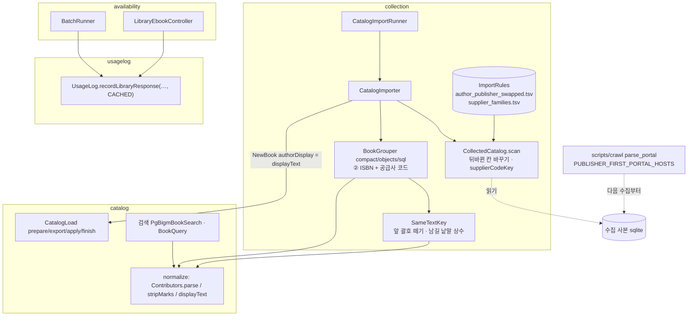
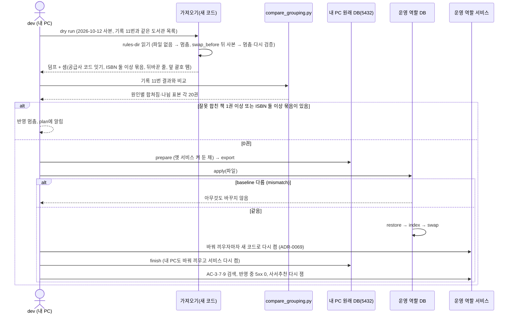
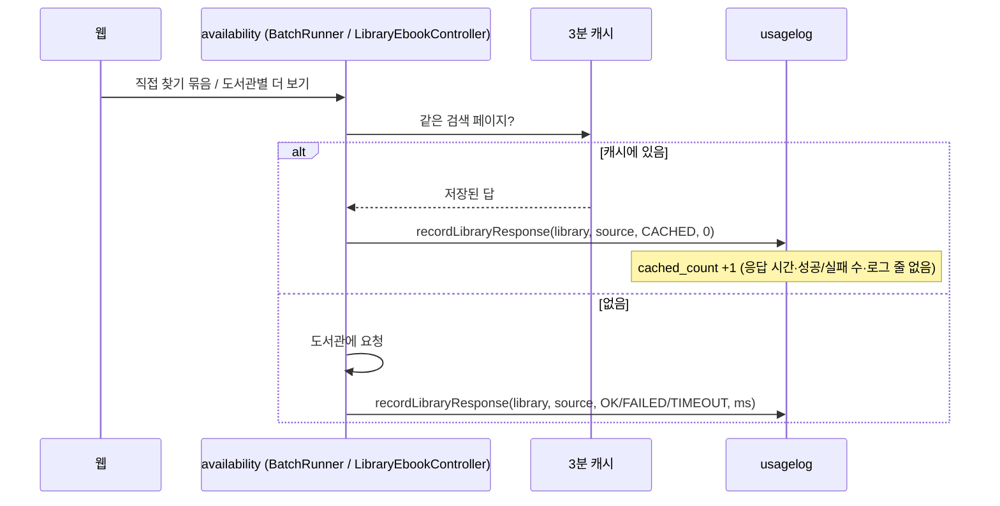
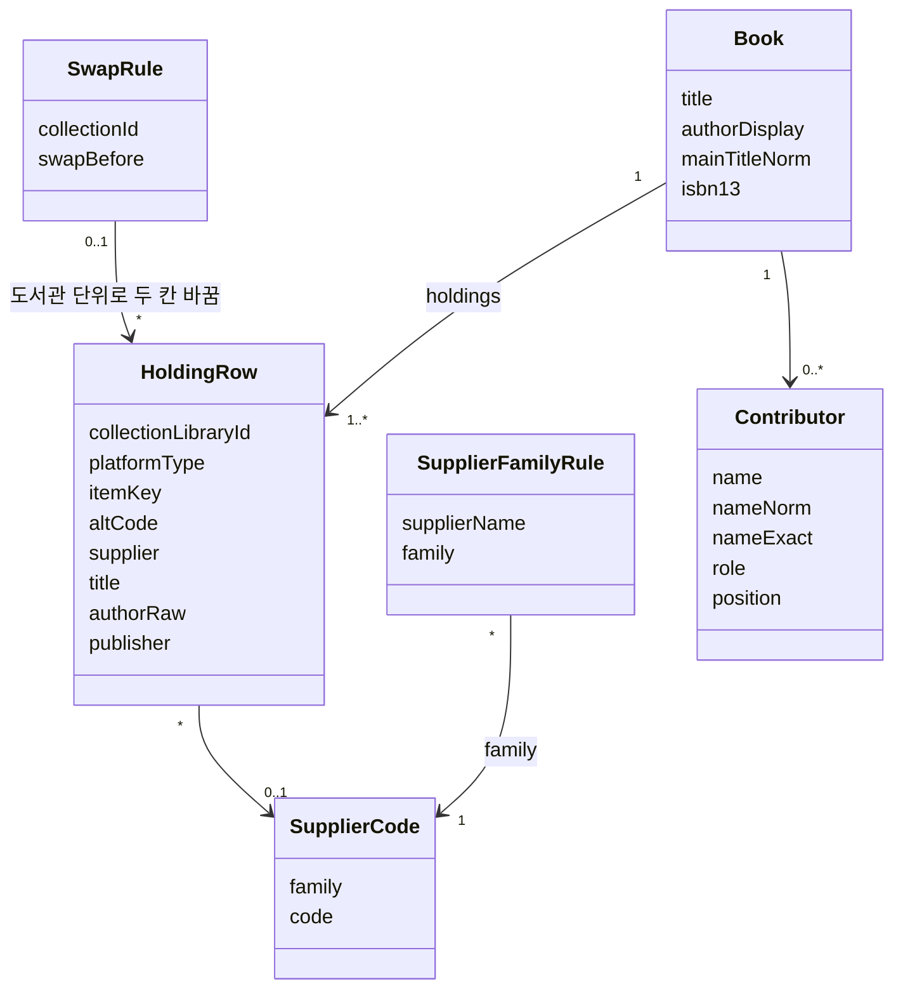
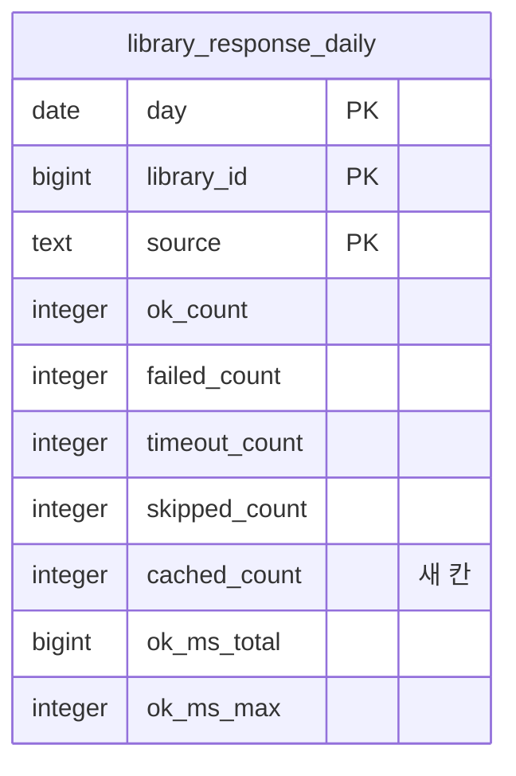

# 설계 변경: 사이클 19 같은 책을 갈라 놓는 저자·제목 표기 정리

- 작성: 2026-10-15. 근거: [spec.md](spec.md), [flow.md](flow.md), [architect-proposal.md](architect-proposal.md)(결정 결과 표), dev main `0a75f7a`(읽기만)
- 설계 결정 11개 모두 사용자 결정 (2026-10-15, [설계 결정](easy/2026-10-15-design-decisions.html)). 클래스·설정·파일 이름은 dev가 바꿔도 됨 [안: 이름]
- `docs/current/`는 아직 고치지 않음 (`/cycle-close`에서 합침)

## 구조 그림

### 모듈 구성도



### 주요 흐름: 다시 가져오기 → 비교 → 반영 → 다시 켜기



### 주요 흐름: 캐시 답 세기



### 도메인 모델



## 모듈

| 모듈 | 신규/변경 | 책임 | 공개 API | 발행/구독 이벤트 | 소유 테이블 |
|---|---|---|---|---|---|
| `catalog` | 변경 | 저자 정리(기호 떼기, 붙은 역할 나누기·띄우기), 저자 검색어 정리 | `catalog :: normalize`: `Contributors.stripMarks(String)`, `Contributors.displayText(String)` 더함, `parse` 동작 바뀜 [확정: 설계 결정 #6, 이름 안] | 없음 | 그대로 (`book`, `book_contributor`, `holding`, `catalog_library_snapshot`) — 구조 그대로, 값만 바뀜 |
| `collection` | 변경 | 가져오기: 규칙 파일 읽기, 뒤바뀐 칸 바꾸기, 공급사 코드 잇기, 앞 괄호 떼기 | 없음 (안쪽만): `ImportRules`, `CatalogImportRunner.Settings.rulesDir`, `CollectedCatalog.Library.authorPublisherSwapped`, `Row.supplierCodeKey`, 세 grouping의 ②, `SameTextKey.comparisonTitle`·`LEADING_NOTE_KEEP_WORDS`, `ImportReport` 셈 `supplierCodeJoins`·`codeJoinedIsbnConflicts`·`authorPublisherSwappedRows`·`leadingNoteCut` [안: 이름] | 없음 | 그대로 |
| `availability` | 변경 | 캐시 답을 사용 기록에 알림(두 곳) | 없음 | 없음 | 없음 |
| `usagelog` | 변경 | 캐시 답 셈 | `UsageLog.ResponseResult.CACHED` 더함 [확정: 설계 결정 #8] | 없음 | `library_response_daily.cached_count` |
| 수집기 (`scripts/crawl`) | 변경 | 통합 포털 세 곳 칸 순서 | `PUBLISHER_FIRST_PORTAL_HOSTS` 상수 [확정: 설계 결정 #10] | — | 수집 DB(그대로) |

- 모듈 의존은 바뀌지 않음: `collection → catalog, catalog :: normalize, library`, `availability → usagelog` [확정]
- 세 묶는 방식은 같은 결과여야 함 (ADR-0079·0105): 공급사 코드는 `CollectedCatalog`에서 한 번 계산하고, 세 방식은 그 키를 ISBN과 같은 "값마다 잇기"로 셈 [확정: 설계 결정 #1]

## 데이터

- `catalog` 스키마: 표·칸 변경 없음 [확정]. 값의 뜻만 바뀜
  - `book.author_display`: 묶음에서 가장 많은 원문 표기를 고른 뒤 기호를 떼고 붙은 역할 뒤를 띄운 글 [확정: 명세 결정 #4, 화면 흐름 #1]
  - `book_contributor`: 사람·역할 줄이 늘거나 바뀜(붙은 역할 나눔, 기호 뗌)
  - 세 도서관(수집 11·12·15)의 `holding.author_raw`·`publisher_raw`는 두 칸을 바꾼 값 — "수집 원문 그대로"의 예외 [확정: 설계 결정 #3]
- `usagelog` 스키마:



| 테이블.컬럼 | 타입 | 제약 | 설명 | 상태 태그 |
|---|---|---|---|---|
| `usagelog.library_response_daily.cached_count` | `integer` | NOT NULL DEFAULT 0, CHECK `library_response_daily_cached_count_check (cached_count >= 0)` | 그 날·도서관·갈래에서 3분 캐시로 답한 수 | [확정] (명세 결정 #10, 설계 결정 #9) |

- Liquibase: 새 파일 `db/changelog/usagelog/002-library-response-cached-count.yaml`, changeset id `usagelog-002-cached-count`, master 끝(`usagelog/001` 뒤)에 `# cycle 19` 주석과 include. 기존 changeset 수정 없음 [확정: 설계 결정 #9, 이름 안]
  ```sql
  ALTER TABLE usagelog.library_response_daily
    ADD COLUMN cached_count integer NOT NULL DEFAULT 0
    CONSTRAINT library_response_daily_cached_count_check CHECK (cached_count >= 0);
  ```
  상수 기본값이라 표를 다시 쓰지 않음 [확정] (PostgreSQL 18 ALTER TABLE Notes, https://www.postgresql.org/docs/current/sql-altertable.html, 확인 2026-10-15). CHECK 확인을 위한 표 읽기는 한 번 있음(작은 표)
- dev 규칙 파일 (`scripts/library/rules/`, ADR-0085 꼴) [확정: 설계 결정 #4, 이름·칸 안]

| 파일 | 칸 | 내용 |
|---|---|---|
| `author_publisher_swapped.tsv` | `collection_id, name, decided_on, swap_before, note` | 11 대구전자도서관, 12 경기도교육청 전자도서관, 15 전북특별자치도교육청 전자도서관. `swap_before` = 고친 수집기를 합친 날 |
| `supplier_families.tsv` | `supplier, family, decided_on, note` | 같은 공급사의 다른 이름 → 같은 묶음. 적어도 「Y2Books 전자책」 = 「와이투북스」, 「YES24」·「예스이십사」·「예스24」·「YES24 전자책」, 「교보문고」·「교보 전자책」·「교보문고 전자책」·「(주)교보문고」. 내용은 dev가 수집 DB 공급사 이름으로 만들어 보고 |

- 가져오기 설정: `chaekcheck.collection.import.rules-dir` (기본 `../scripts/library/rules`, `application-collection-import.yml`), 파일이 없으면 읽기 전에 멈춤 [확정: 설계 결정 #4, 이름 안]

## API

- 바뀌지 않음. `GET /api/v1/books`, `GET /api/v1/books/{bookId}` 모양 그대로, 값만 바뀜. 합쳐져 사라진 번호는 404 `book_not_found` (ADR-0062) [확정]

## 규칙 세부 (spec 구현 위치)

| 명세 | 자리 | 세부 |
|---|---|---|
| R1-1·R1-2 | `Contributors.stripMarks` | `<`·`>` 모두 뺌(NFKC 뒤 `＜＞`도), `〈〉「」《》` 표시만 뺌, `[ ]` 그대로. 기호만 있어 비면 사람 없음 |
| R1-3 | `Contributors.parse` | 좁은 규칙 + 셋째 역할 + 보호 장치(붙은 낱말 앞에 역할 낱말이 이미 따로 있으면 자르지 않음) |
| R1-4 | `catalog/internal/search` (`BookQuery` 저자 값, `PgBigmBookSearch` 정확 일치) | 저자 검색어에 `stripMarks` |
| R1-5 | `CatalogImporter` 173행 | `NewBook`의 `authorDisplay = Contributors.displayText(대표 원문)`. 세 묶는 방식의 대표 고르기는 그대로 |
| R2-2 | `SameTextKey.comparisonTitle` | 앞 시리즈 표시를 뗀 뒤 맨 앞 `( … )` 하나를 뗌. 괄호 안(공백 무시)이 `LEADING_NOTE_KEEP_WORDS`에 있거나 "…판"으로 끝나거나 EDITION이 들어 있으면 남김. 다 떼면 빈 제목이면 그대로. 권 표시·부제는 전체 제목에서 |
| R2-3 | `CollectedCatalog.scan` → `Row.supplierCodeKey` | `BOOKCUBE_FX`는 `alt_code`, `KYOBO_V1`·`KYOBO_SUBSCRIPTION_V1`·`YES24_V1~V3`는 `item_key`, 그 밖은 없음. 공급사 이름은 다듬은 뒤 묶음 파일로 바꿈, 비면 키 없음 |
| R2-4 | `CollectedCatalog.scan` | 두 번 읽기 모두에서 `authorRaw`↔`publisher` |
| R3-1 | `crawl_catalog.py` `parse_portal` | `base` 호스트가 상수에 있으면 `info[1]` 저자, `info[0]` 출판사 |
| R5 | `BatchRunner.answered`, `LibraryEbookController.fetch`, `UsageBuffer`, `UsageLogWriter` | 캐시 답이면 `CACHED`(로그 줄 없음), upsert에 `cached_count` |

## 외부 연동

| 대상 | 방식 | 제한·키 관리 | 실패 시 동작 | 상태 태그 |
|---|---|---|---|---|
| 통합 포털 세 곳 (수집) | 지금 수집기 그대로, 칸 순서만 | 지금 수집 규칙(간격·User-Agent) 그대로. 이번 사이클에는 다시 수집하지 않음 | — | [확정] |
| 도서관 사이트 (실제 확인) | 확인이 필요하면 도서관 하나만 부르는 주소 `/availability/libraries/{id}/ebooks`로 | 지역 없는 검색 스트림은 쓰지 않음 | — | [확정] (사이클 18 회고 결정 #11) |

## 시험 (AC별)

| AC | 시험 |
|---|---|
| 3·4·5·7·8 | `ContributorsTests`: 꺾쇠·짝 없는 꺾쇠·`＜＞`·〈〉「」《》·`[ ]` 그대로·「<>」→ 사람 없음·「루이스 캐럴 저이소연 역」·「마키타 겐지 저전선영 역강재헌 감수」·「발터 글라소프 글/…」, `displayText` 예. 검색: "<김정은>"·"김정은" 정확 일치·단어 |
| 6 | `SameTextKeyTests`: (만화)·(개정판)·(속)·(3판)·(제2판)·(2nd EDITION) 남김, (부를 끌어 당기는) 뗌, 빈 제목 그대로 |
| 2 | 세 묶는 방식 같은 결과 시험(ADR-0079)에 공급사 코드 줄: 북큐브 alt_code = 교보 item_key(같은 묶음), 같은 9자리라도 다른 공급사면 따로, 공급사 빈 줄 따로 |
| 9 | `CollectedCatalog` 시험(뒤바뀐 칸), `ImportRules` 시험(파일 없음, `swap_before` 뒤 사본 → 멈춤) |
| 10 | 수집기 단위 시험(세 포털 + 부산 저장 HTML 한 쪽씩) |
| 11·12·14 | dry run과 반영 보고 |
| 13 | 사이클 11 방식 반영 중 검색 탐침 |
| 15 | `UsageBuffer`·`UsageLogWriter` 시험, `BatchRunner`·`LibraryEbookController` 캐시 경로 시험 |
| 공통 | Modulith `verify`, `compact` 2GB 안에서 다시 가져오기(키 칸이 늘어남) |

## 결정 기록

- [ADR-0113](../../adr/0113-author-marks-and-glued-roles-in-normalize.md) 저자 정리: 기호 떼기·붙은 역할 나누기·저자 칸 정리 (Accepted)
- [ADR-0114](../../adr/0114-grouping-supplier-codes-and-leading-notes.md) 같은 책 묶기: 같은 공급사 코드·제목 앞 괄호 (Accepted)
- [ADR-0115](../../adr/0115-swapped-author-publisher-portals.md) 저자·출판사가 뒤바뀐 세 포털 (Accepted)
- [ADR-0116](../../adr/0116-usagelog-cached-answer-count.md) 사용 기록 캐시 답 수 (Accepted)
- 그대로 따름: ADR-0069(정리 규칙을 바꿀 때, 바꿔 끼우자마자 다시 켬 — 짧은 틈 받아들임, 설계 결정 #11), ADR-0078(내 PC 가져오기 → 운영 반영), ADR-0079·0105(세 묶는 방식 같은 결과), ADR-0085(사람이 정한 규칙은 dev git TSV)

## 확인 필요

| 항목 | 방법 | 막는 단계 |
|---|---|---|
| 공급사 묶음 목록 내용 | dev가 수집 DB의 공급사 이름 전체를 보고 만들어 plan에 보고 | dev (반영 전) |
| `KYOBO_SUBSCRIPTION_V1`의 `item_key`가 교보 상품 번호와 같은 번호 공간인지, 코드 다듬기(공백·앞의 0) | dev 수집 DB | dev |
| 코드로 이었는데 ISBN이 둘 이상인 묶음 수 | dry run 셈. 0이 아니면 plan에 물음(ADR-0114) | 반영 전 |
| `swap_before` 날짜 | 고친 수집기를 합친 날 | dev |
| 다시 가져오기·반영 시간과 공개일(2026-10-18) | dev 진행 (늦으면 공개일을 19 반영 다음 날로, spec "일정") | 일정 |
