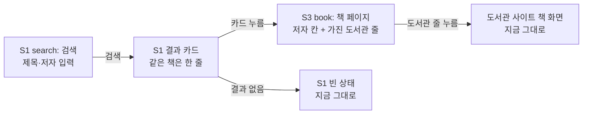

# 화면 흐름: 사이클 19 — 같은 책을 갈라 놓는 저자·제목 표기 정리

- 작성: 2026-10-15. 근거: [spec.md](spec.md), [scope.md](scope.md)
- 새 화면·새 이동 없음. 지금 화면 그대로이고 **보이는 글과 모이는 줄 수만 바뀜** [확정] (scope 제외 "화면 바꾸기: 없음", 범위 결정 #4)
- 화면 번호는 지금 이름 그대로: S1 검색(결과 카드), S3 책 페이지 `/books/{bookId}` (`docs/current/flows.md`)

## 화면별 내용

### S1 search (검색과 결과 카드)
- 목적: 제목·저자로 찾아 책을 고름
- 바뀌는 것
  - 같은 책이 한 카드로 모임 → 카드 수가 줄고, 한 카드의 "가진 도서관" 수가 늘어남 (AC-1·2·5)
  - 카드의 저자 글에서 꺾쇠 `< >`·`＜ ＞`와 `〈 〉`·`「 」`·`《 》` 표시가 빠짐. `[ ]`는 그대로 (AC-4)
  - 저자 검색(단어·정확히 일치·역할 옮긴이)이 꺾쇠·괄호·붙은 역할 낱말 표기 책도 찾음. 검색어에 기호를 넣어도 같음 (AC-3·7)
  - 저자·출판사가 뒤바뀌었던 세 도서관의 책이 저자 칸에 사람 이름으로 보임 (AC-9)
- 바뀌지 않는 것: 입력 칸, 정렬·거르기, 카드 모양, 로고, 빈 결과·로딩·오류 상태, 쪽 넘김
- 호출 API: `GET /api/v1/books` (모양 그대로, 결과 값만 바뀜)
- 붙은 역할 낱말 표기(R1-3에 걸린 것, 보호 장치로 빠진 것 제외)는 저자 칸에서 역할 낱말 뒤를 띄어 보임: 「루이스 캐럴 저이소연 역」 → 「루이스 캐럴 저 이소연 역」, 「밥 프록터 저이재경 역조성희 감수」 → 「밥 프록터 저 이재경 역 조성희 감수」 [확정] (사용자: "고쳐 주는게 좋지 않을까? 이거 추가하는 것도 그렇게 어렵지 않아 보이는데", 2026-10-15, [화면 흐름 결정](easy/2026-10-15-flow-decisions.html) #1 미승인)
- 데스크톱·태블릿·폰 배치: 지금 그대로 [확정]

### S3 book (책 페이지)
- 목적: 한 책을 가진 도서관을 보고 넘어감
- 바뀌는 것
  - 저자 칸: 대표 표기(가장 많은 도서관이 쓴 표기)에서 기호를 뗀 글 (AC-4, 명세 결정 #4)
  - 가진 도서관 줄: 합쳐진 책은 줄이 늘어남 (예: 「백만장자 마인드」에 김근아 줄·「(부를 끌어 당기는)…」 줄·대구·경기도교육청 줄의 도서관이 더해짐) (AC-2)
  - 옛 책 번호로 들어오면: 합쳐지며 사라진 번호는 지금처럼 "찾을 수 없음"(404 `book_not_found`, ADR-0062) [확정]
- 바뀌지 않는 것: 화면 구성, 도서관 줄 모양, 대출 조회
- 호출 API: `GET /api/v1/books/{bookId}` (모양 그대로)

### 사서추천 화면(S13)·운영 쪽
- 화면은 그대로. 우리 책과 맞춘 수만 달라질 수 있음 (AC-14, dev가 잼)
- "캐시 답" 수(R5)는 화면이 없음 — DB로만 확인 (AC-15)

## 상태별 동작 대응

| 명세 상태 | 화면 상태 |
|---|---|
| 로딩 / 결과 없음 / 외부 오류 | S1·S3 지금 그대로 |
| 가져오기 실패 | 화면 변화 없음 (옛 목록 그대로) |
| 운영 반영 `mismatch` | 화면 변화 없음 |
| 기호만 있던 저자 칸이 비면 | S1 카드·S3 저자 칸이 저자 없는 책과 같게 보임(지금 저자 빈 책 모양) |

## 수용 기준 대응

| AC | 화면 |
|---|---|
| AC-1 꺾쇠 표기 책 한 줄 | S1 결과 카드 |
| AC-2 「백만장자 마인드」 모임 | S1 결과 카드, S3 도서관 줄 |
| AC-3 저자 "김정은" 검색 | S1 (단어·정확히 일치) |
| AC-4 저자 칸 기호 없음, `[ ]` 그대로 | S1 카드, S3 저자 칸 |
| AC-5 「슈퍼차이나」 한 줄 | S1 결과 카드 |
| AC-6 판·종류 괄호 책은 따로 | S1 결과 카드 |
| AC-7 "루이스 캐럴"·옮긴이 "이소연" 검색 | S1 |
| AC-8 보호 장치 | 화면 없음 (dev 단위 시험 + 표본) |
| AC-9 세 도서관 저자 칸 | S1 카드, S3 저자 칸 |
| AC-10 수집기 | 화면 없음 (수집기 시험) |
| AC-11 현대제철 241권 | S1에서 2624를 고른 검색 (또는 DB) |
| AC-12 잘못 합침 표본 | 화면 없음 (dev 비교 보고) |
| AC-13 반영 중 검색 실패 0 | S1 (반영 중 검색) |
| AC-14 사서추천 맞춘 수 | S13 (dev가 잼) |
| AC-15 캐시 답 수 | 화면 없음 (DB) |
| AC-16 dev 문서 | 화면 없음 (파일) |

## 이 흐름대로 설계로 넘어감

- 새 화면이 없으므로 이 흐름대로 `/design-delta`로 넘어감 [확정] (사용자 승인, 2026-10-15, [화면 흐름 결정](easy/2026-10-15-flow-decisions.html) #2)
