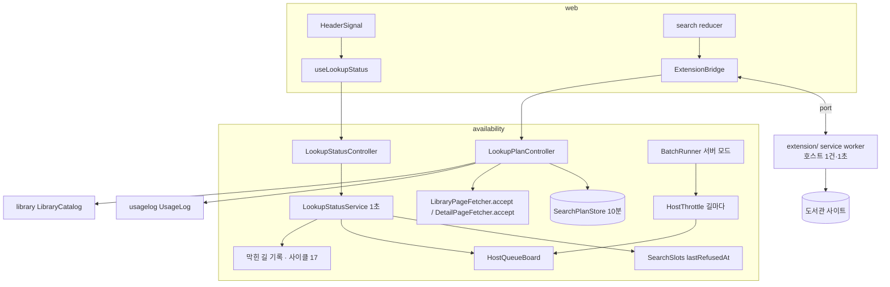
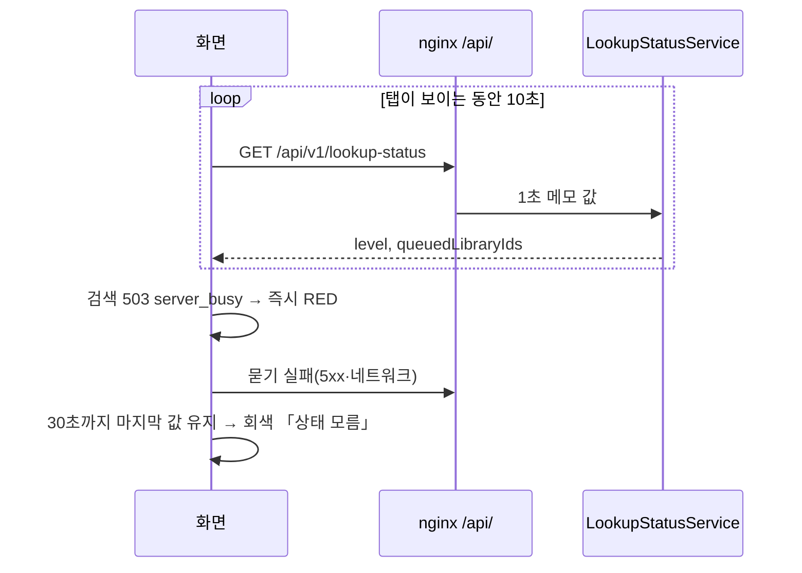
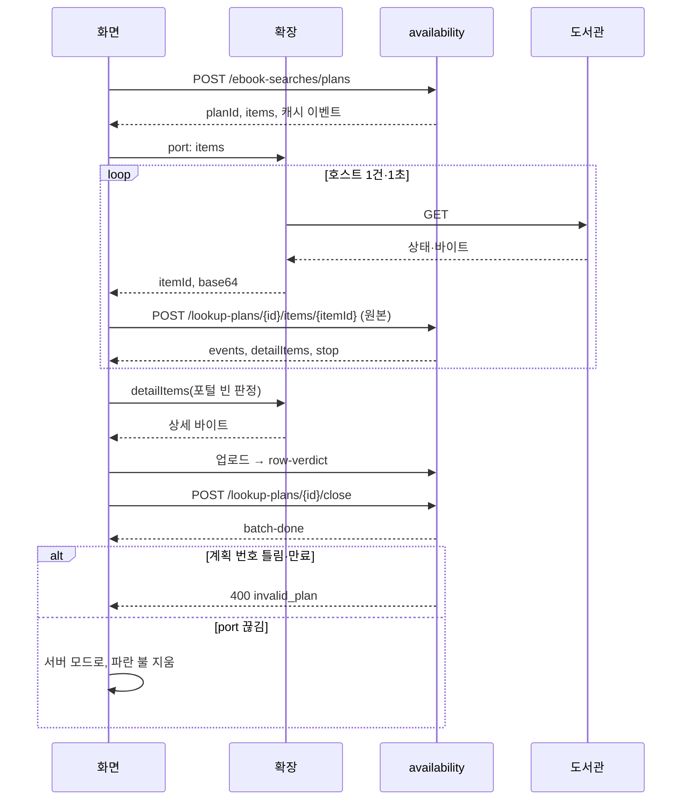
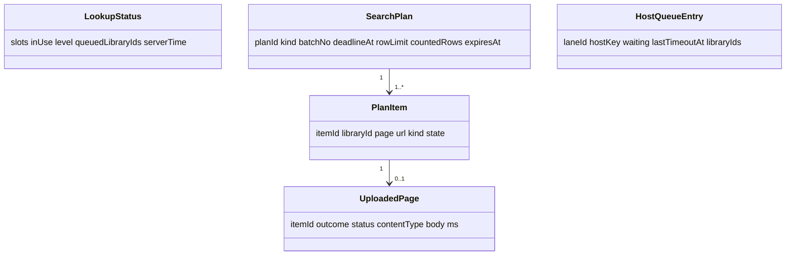

# 설계 대안: 사이클 20 조회 상태 신호와 브라우저 확장 조회

- 2026-10-15, `architect` 서브에이전트 제안을 그대로 옮김(이름·한도·경로 중 새로 지은 값은 모두 [안]). 결정 페이지: [`easy/2026-10-15-design-decisions.html`](easy/2026-10-15-design-decisions.html). 그림 원본: [`easy/architect-proposal-original.html`](easy/architect-proposal-original.html)
- 읽은 것: 이 사이클 scope·spec·flow·research, 사이클 17 design-delta·`from-cycle-20-blocked-ip-resume.md`, dev `availability.internal.{search,fetch,resolve,web}`, `application.yml`, nginx conf, `web/src/api/searchStream.ts`, `AppLayout.tsx` (2026-10-15)

## 먼저 알려 드릴 것 (dev 코드에서 찾음)

1. **확장 모드에도 두 번째 단계가 필요하다.** 통합 포털 줄의 판정이 비어 있으면 서버가 책 상세 페이지를 직접 부른다(`DetailLookupResolver`·`DetailPageFetcher`) → `row-verdict`. 소장 묶음(책 화면)은 처음부터 상세 페이지만 부른다(`BatchRunner.startHolding`). "주소 → 바이트 → 해석" 한 바퀴로는 AC-9(서버 로그에 도서관 요청 없음)와 AC-10(서버 모드와 같은 판정)을 함께 맞출 수 없어, 해석 응답이 **상세 주소를 더 달라고 하는 단계**가 있어야 한다.
2. **캐시가 오염될 수 있다.** 계획은 누구나 받을 수 있으므로 계획 번호만으로는 "계획을 받은 사람이 가짜 바이트를 올리는 것"을 막지 못한다. 결과는 3분 동안 공유 캐시에 남는다(R9의 한계). 줄이는 방법은 2-4.
3. **이름이 겹친다.** dev에 `fetch.FetchedPage`(해석된 페이지 캐시 값)가 이미 있어, 올라온 원본은 `UploadedPage` [안].
4. **nginx 기본 본문 상한 1m.** 넘으면 413이고 본문은 HTML — https://nginx.org/en/docs/http/ngx_http_core_module.html (확인 2026-10-15). 올리는 경로에 `client_max_body_size 4m`와 413용 Problem Details 응답 필요.
5. **확장 메시지는 JSON만.** 바이너리는 base64로, 메시지 하나 최대 64MiB — https://developer.chrome.com/docs/extensions/develop/concepts/messaging (확인 2026-10-15).
6. **나가는 길(lane)은 아직 dev에 없다.** 사이클 17(ADR-0095)이 넘기는 "길마다 따로 세는 throttle"과 "막힌 길 기록"을 R4가 읽으므로 17이 먼저 들어간다는 전제.

## 1. 상태 엔드포인트

### 1-1 경로와 nginx 자리
- A안: `GET /api/v1/availability/status` + nginx `location = …` 정확 일치 블록. 범위 문서의 이름 그대로이지만, 운영 conf에서 이 블록이 빠지면 도서관 호출 한도(30r/m)에 걸려 429.
- B안: `GET /api/v1/lookup-status`. `/api/` 구역에 저절로 들어가 nginx 변경 없음. availability의 다른 경로(`ebook-searches` 등)도 `/availability/` 아래가 아님.
- 추천: **B안** [안].

### 1-2 응답 (선택 없음)
```json
{"slots":20,"inUse":12,"level":"YELLOW","queuedLibraryIds":[1215,3301],"serverTime":"2026-10-20T03:00:00Z"}
```
- 서버 메모리에 1초 보관(`AtomicReference` + 계산 시각) [안], `Cache-Control: no-cache` [안]. 로그인·CSRF 없음.
- 최근 503 시각: `SearchSlots`에 `lastRefusedAt`, `acquire` 실패 때 기록 [안].

### 1-3 "줄이 선 호스트" 상태를 둘 곳
- A안: `InMemoryHostThrottle`에 넣음(대기 수 `Semaphore.getQueueLength`, 마지막 시간 초과 시각, 도서관 번호, `snapshot()`). 클래스가 늘지 않으나 사이클 17이 같은 파일을 길마다 세도록 고치므로 겹침.
- B안: 새 `HostQueueBoard` [안] (`availability.internal.fetch`). throttle은 대기 시작·끝·시간 초과 때 `(laneId, hostKey, libraryId)`로 알리기만, 보드가 길마다 대기 수·`lastTimeoutAt`·호스트별 도서관 묶음을 듦. `LookupStatusService` [안]가 보드 + 17의 막힌 길 기록으로 R4 판정.
- 추천: **B안** [안].
- 공통 한계: `LibraryCatalog`에 호스트→도서관 공개 API가 없어 보드가 요청을 보면서 배움. 재시작 뒤 한 번도 불리지 않은 포털 소속 도서관은 목록에서 빠질 수 있음(결과 줄도 없어 화면 차이 없을 것으로 봄) [확인 필요].

## 2. 확장 모드 API

### 2-1 바이트를 서버에 올리는 주체
- A안: **화면이 중계.** 확장은 도서관 GET만 하고 `{itemId, status, contentType, base64, ms}`를 port로 화면에 돌려주고 화면이 서버에 올림. 확장은 우리 API를 모르는 "사용자 쪽 조회 서버"(ADR-0015 조회 서버와 같은 역할) → 서버·웹 API가 바뀌어도 **웹스토어 재심사 불필요**, CSRF·CORS 예외 불필요. 단점: base64로 33% 커짐(실제 최대 약 322KB), 화면 메모리에 한 쪽씩 머묾.
- B안: 확장이 직접 서버에 올림. 바이트가 메시지를 거치지 않지만 확장이 API 경로·버전에 묶여 바꿀 때마다 재심사, CSRF 예외·확장 origin CORS 확인 필요.
- 추천: **A안** [안].

### 2-2 입구 모양
- A안: **새 JSON 엔드포인트**, 업로드 한 번마다 JSON 응답. 연결을 붙들지 않음(메모리 걱정과 맞음). 웹에 받는 길 하나 늘어남.
- B안: 지금 SSE 스트림에 `mode=extension` + 옆 경로 업로드를 SSE로 밀어 줌. 웹 이벤트 처리는 그대로이나 검색마다 연결·`SseEmitter`를 최대 35초 붙들고, 스트림 경로라 nginx 도서관 호출 정규식에 걸림.
- C안: 묶음 하나를 POST 한 번에 올리고 SSE로 답. 다 받아야 올려 순서대로 뜨지 않고 본문이 50×4MB까지.
- 추천: **A안** [안]. 응답에 지금 SSE와 같은 이름·데이터의 `events[]`를 담아 웹은 같은 reducer로 처리.

### 2-3 추천안 기준 초안 (모두 [안])
- `POST /api/v1/ebook-searches/plans` — 요청: 지금 스트림과 같은 조건(첫 묶음); 다음 묶음은 `batchNo`·`candidates`. 응답 201: `planId`(추측 불가, 10분), `batchNo`, `deadlineMs:8000`, `rowLimit:20`, `targets`(첫 묶음만), `items[{itemId,libraryId,page,url}]`, `events[]`. **3분 캐시에 있는 쪽은 `items`에서 빼고 `events`의 `library-result`로 바로 답함.** SearchSlots 쓰지 않음(AC-12).
- `POST /api/v1/book-availabilities/plans` — 같은 모양, items는 상세 주소.
- `POST /api/v1/lookup-plans/{planId}/items/{itemId}` — 본문 `application/octet-stream` 원본 그대로; 쿼리 `status`, `ms`, `outcome=RESPONDED|TIMEOUT|ERROR`, `contentType`(EUC-KR 판정용). URL은 받지 않음(계획의 URL 사용). item 하나는 한 번만. 응답 200: `events[]`(`library-result`·`library-failed`·`row-verdict`), `detailItems[]`(포털 빈 판정 줄의 상세 주소, 같은 계획에 추가), `stop`.
- `POST /api/v1/lookup-plans/{planId}/close` — 본문 `{notSent:[itemId]}`, 응답 `batch-done`; 이때 usagelog SKIPPED·`recordSearch`. `done`은 상세 단계가 끝나거나 30초가 지나면 화면이 만듦.
- 오류: 400 `invalid_plan`(없음·만료·소진된 item 포함), 413 `payload_too_large`(nginx·Spring 양쪽 Problem Details).
- 계획 저장: Caffeine, 쓴 뒤 10분 만료, 최대 2,000개 [안]. 계획 하나 수 KB.
- nginx: 업로드 경로 `client_max_body_size 4m`. 쪽마다 한 번이면 초당 약 5번으로 `chaekcheck_api` 5r/s burst 30에 가까움 → 업로드 별도 zone(20r/s burst 60 [안]). 사이클 17 `prod.conf`와 맞출 것.

### 2-4 캐시 오염 줄이기 (사용자 결정)
- (가) 그대로(3분이면 사라짐) / (나) **확장 결과는 캐시가 빈 칸일 때만 채움** [안 추천] (서버가 받은 값을 덮지 않음) / (다) 확장 결과는 그 사람에게만(AC-10 뒷부분과 충돌).

## 3. ADR-0015 SiteFetcher와의 관계
- A안: 기다리는 `UploadedSiteFetcher`. 서버 throttle 줄에 확장 사용자가 서게 되어 사용자 IP와 서버 길이 섞이고, 스레드를 붙들며 밀어주기 통로가 필요.
- B안: **`SiteResponse` 입구.** `LibraryPageFetcher`·`DetailPageFetcher`에 `accept(target, query|uri, SiteResponse)`(`via="extension"`). 해석→캐시→`toPage`·resolver 판정은 같은 코드, throttle·SiteFetcher만 건너뜀. `SiteListResolver`의 상세 조회는 "상세 주소 목록"과 "받은 상세로 판정" 두 단계로 나눔(소장 쪽은 이미 `resolvers.decideDetail`로 나뉨). `BatchSession`은 계획 저장소에, 이벤트는 모아서 응답으로 돌려주는 `EventSink` 구현 [확인 필요: dev 코드].
- C안: 고정 응답 SiteFetcher + 빈 throttle로 `LibraryPageFetcher`를 하나 더. 상세 resolver가 여전히 서버 fetcher를 불러 결국 B 필요.
- 추천: **B안** [안]. 확장 모드는 SearchSlots도 서버 throttle도 쓰지 않아 "줄이 선 도서관" 판정에 끼지 않음.

## 4. usagelog source
- A안: 새 changeset으로 CHECK를 지우고 `'direct_search','holding_fill','extension'`으로 다시 검. 공개 enum `UsageLog.ResponseSource`에 `EXTENSION`. 지금 CHECK는 이름 없이 걸림(`001-usagelog-schema.yaml:216`) → 실제 제약 이름 dev 확인 [확인 필요]. 확장의 검색과 소장이 한 값으로 합쳐짐.
- 다른 길(`via` 칸, `extension_search`·`extension_holding`)은 spec R11 [확정]과 달라 제안하지 않음.

## 5. 웹
- 확장 감지(선택 없음): `web/src/features/extension/` [안]. `window.chrome?.runtime?.sendMessage`가 없으면 서버 모드. 있으면 `VITE_EXTENSION_ID` [안]로 인사, 500ms [안] 안에 답 없으면 서버 모드. 받아오는 동안 `runtime.connect` port로 쪽마다 하나씩. port 끊기면 R6대로.
- 상태 묻기: TanStack Query `refetchInterval:10_000`(탭 숨김 멈춤·복귀 재요청 기본 동작 = R3). 503이면 덮어쓰는 값으로 즉시 빨강, 30초 뒤 회색. `AppLayout` Provider에 두어 머리말·결과 줄이 같은 값 [안].
- 머리말: `legal` 분기 삭제(대안 없음). ADR.
- 「확인하지 못한 도서관」 묶음: A안 요청 실패 줄(`failed`·`library-failed`)만 / B안 A + 상세 시간 초과 등 판정 `UNKNOWN` 줄도. 추천 **B안** [안].

## 6. 확장 패키지
- A안: **빌드 없이 `extension/`** — `manifest.json`(MV3, `key`, `host_permissions` http·https 전체, `externally_connectable` 운영·개발 주소), `background.js`(`type: module`), 호스트 throttle 모듈, 시험 `node --test` [안]. 압축 풀어 바로 로드, 타입 검사 없음.
- B안: Vite·TS 빌드. 타입 있음, 빌드 결과물 로드·설정 증가.
- 추천: **A안** [안].
- throttle: 호스트마다 동시 1건, 이전 요청 끝 + 1초 뒤 다음(서버 `lastEnd + 1s`와 같음). 동시 수는 서버와 같은 5 [안, spec에 없음]. `redirect:'manual'`, `credentials:'omit'`.
- 시간 제한: 브라우저 `fetch`는 연결·읽기 시간을 따로 못 잼 → "머리까지 10초 [안], 본문은 묶음 마감까지".
- dev CLAUDE.md: `fetch-service/`처럼 "`extension/` — 크롬 확장, Spring 앱 아님, Gradle 없음, 압축 해제 확장으로 로드" 한 줄(인계서). "backend/는 Spring Boot 앱 하나" 규칙 그대로.

## 그림









## 확인 필요 / 사용자 결정 필요
- 1-1 경로 B, 1-3 보드 B, 2-1 화면 중계 A, 2-2 JSON A, 3 `SiteResponse` 입구 B, 6 빌드 없음 A — 각각 승인 여부
- 캐시 오염 대응(2-4)
- 「확인하지 못한 도서관」에 `UNKNOWN` 줄 포함 여부(5)
- 확장의 동시 수 5와 시간 제한 맞추기(6)
- 확장 모드에서 「더 보기」(`/api/v1/availability/libraries/{id}/ebooks`)를 서버 모드로 둘지(슬롯 사용) 확장으로 할지 — spec에 없음
- 업로드 경로의 nginx zone·`client_max_body_size`를 사이클 17 `prod.conf`와 맞추기
- Spring 요청 본문 기본 한도 [확인 필요: 공식 문서]; 원본 그대로 받으면 컨트롤러에서 4MB 직접 검사
- MV3 service worker 수명 [확인 필요: 프로토타입]; usagelog CHECK 제약 이름 [확인 필요: dev]

## backlog 후보
- 웹스토어에 올린 뒤 확장과 서버 API 사이의 버전 확인(인사 답의 판 번호로 최소 판 검사)

## 결정 (2026-10-15, 설계 결정 페이지)
- #1 상태 주소 `GET /api/v1/lookup-status` [확정] (사용자 승인)
- #2 `HostQueueBoard` 새 부품 [확정] (사용자 승인)
- #3 바이트는 화면이 올림(확장은 우리 API 모름) [확정] (사용자 승인; 조건 "그런데 조작되지 않도록 보안에 신경써줘" → 계획 번호·item 1회·서버 URL만·4MB·해석 검사·캐시 빈 칸만)
- #4 새 JSON 입구 셋(계획 → 쪽 올리기(상세 2단계) → 닫기), 캐시에 있는 도서관은 결과로 바로 [확정] (사용자 승인)
- #7 「더 보기」도 확장 모드에서는 계획 입구로 [확정] (사용자 승인)
- #8 확장 동시 5·응답 머리까지 10초·본문은 묶음 마감까지, redirect 안 따름, 쿠키 없음 [확정] (사용자 승인)
- #5 `accept` 입구: 사용자 질문 "이해 안 가는데 그림이랑 같이" → 결정 페이지에 길 그림 추가, 결정 기다림
- #6 캐시 오염: 사용자 질문 "3분 안이면 캐시로 하니까 의미 없지 않나" → 답: 거의 맞음(캐시 hit는 확장에 주소를 안 보내므로 "빈 칸만"은 몇 초 경쟁에서만 작동). 다시 제안 (나′) 빈 칸만 + 올라온 바이트 해석 검사(adapter 해석 실패·200 아님·item 재사용·4MB 초과 → 400, 캐시 안 넣음), 3분 노출은 받아들임 [안]
- #9 usagelog `source` CHECK 다시 걸고 `extension` 추가 [확정] (사용자 승인, 2026-10-16)
- #10 「확인하지 못한 도서관」 묶음에 `UNKNOWN` 줄 포함 [확정] (사용자 승인, 2026-10-16)
- #11 `extension/` 빌드 없음 [확정] (사용자 승인, 2026-10-16)
- #12 nginx 올리기 경로: 사용자 질문 "무엇을 어디에 올리는 경로인지 그림과 함께" → 결정 페이지에 그림 추가, 결정 기다림
- #5 `accept` 입구(해석·캐시·판정은 같은 코드, 포털 상세 조회 2단계) [확정] (사용자 승인, 2026-10-16, 그림 설명 뒤)
- (2026-10-16, 사용자 채팅) 올리기 바이트 상한은 상수가 아니라 설정: `chaekcheck.availability.max-body-size`(이미 4MB 설정)를 그대로 쓰고 nginx `client_max_body_size`는 배포 설정 변수로 같은 값 [확정] (사용자: "이거 상수인데 옵션으로 빼서 옵션으로도 가능하게 해주라"). 충분한지: 서버 모드가 같은 상한으로 운영해 옴, 표본 페이지 42~220KB(2026-10-16 측정: 강남 220,146B, 전주 48,494B, 서울교육청 42,548B)
- (2026-10-16, 사용자 채팅) "브라우저(확장)에게 해석 부담을 넘길 수 없을까" → 결정 페이지 #13으로 비교(가 서버 해석 / 나 확장 해석 / 다 조각만 올림), 추천 (가) 유지 [안]
- #13 (가) 서버가 해석 유지 [확정] (사용자 승인, 2026-10-16)
- #6 (나′) 빈 칸만 + 올라온 바이트 검사 ①②③④ [확정] (사용자 승인, 2026-10-16; 조건 "보안적으로 막을 수 있는 방법 있으면 넣어줘" → 더함: ⑤ 계획 번호를 만든 IP에 묶음 ⑥ Origin/Referer가 책첵 주소가 아니면 거절 ⑦ IP별 계획 만들기 한도(1분 20개 [안]) ⑧ 캐시 값에 출처 `via=extension`·시각, 운영 명령으로 확장 출처 칸 비우기 ⑨ 검사 실패를 usagelog rejected_event에 IP별로 세고 1분 30번 [안] 넘으면 그 IP 계획 만들기 잠시 막음 ⑩ 해석 adapter는 계획의 URL로만 결정)
- #12 질문 "한 변수로 nginx까지?" → 답: `deploy/prod/prod.env`의 `LOOKUP_MAX_BODY_MB` 하나를 compose가 Spring 환경 변수와 nginx 템플릿(공식 이미지 envsubst, https://hub.docker.com/_/nginx 확인 2026-10-16)에 넘김. 결정 기다림
- #12 올리기 경로 nginx: 본문 상한은 `prod.env` 변수 하나(`LOOKUP_MAX_BODY_MB`)로 Spring·nginx 템플릿 양쪽에, 요청 수 별도 zone 20r/s burst 60 [확정] (사용자: "이걸로 해줘", 2026-10-16)
- **설계 결정 13개 모두 확정 (2026-10-16)** → ADR·design-delta로
- (2026-10-16, design-delta 결정 #9) 확장 모드는 서버 캐시를 읽지 않고 넣기만 함 [확정] (사용자 제안 → 승인). #4의 "캐시에 있는 도서관은 결과로 바로"를 바꿈. 확장 모드 사용 기록에는 `CACHED` 없음
