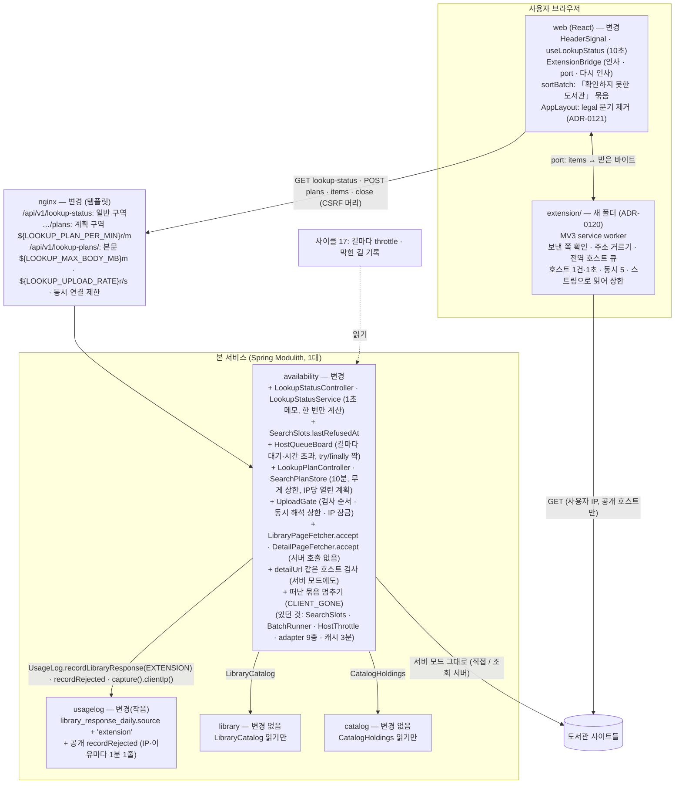
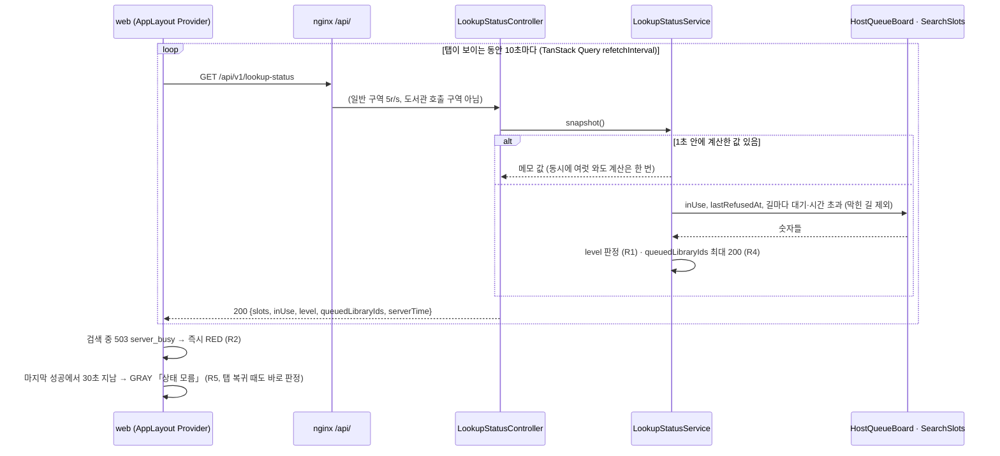
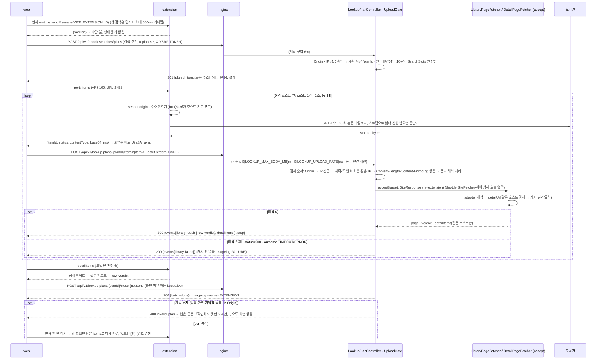
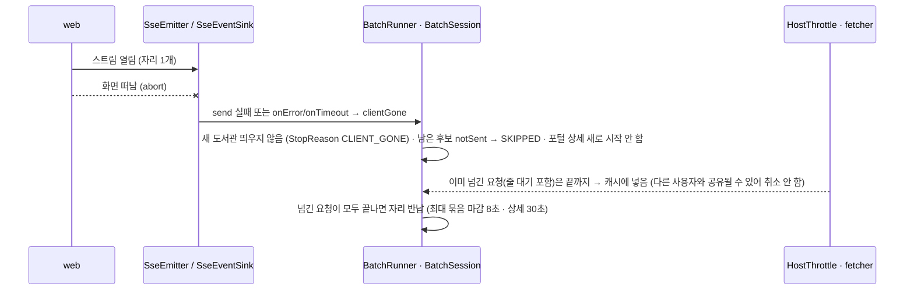
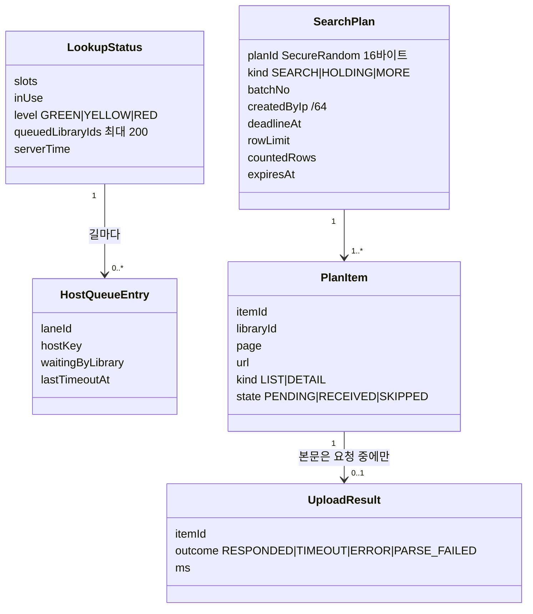
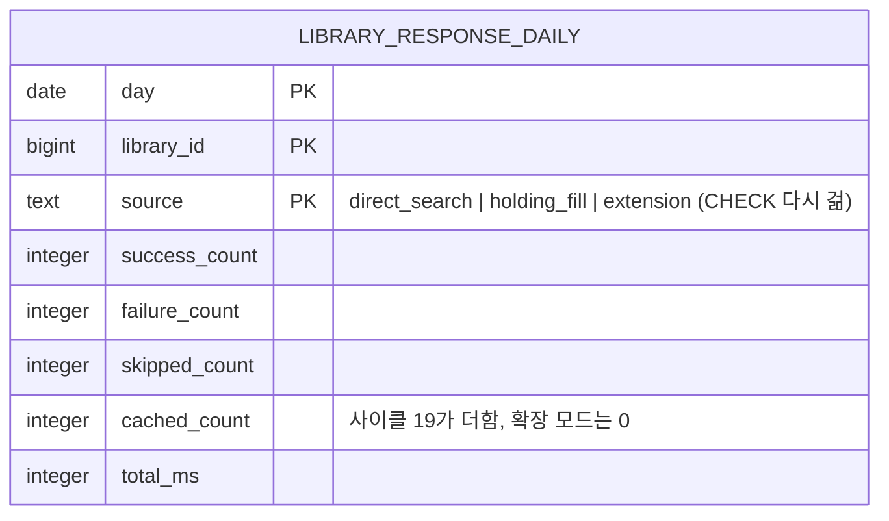

# 설계 변경: 사이클 20 조회 상태 신호와 브라우저 확장 조회

- 바탕: [`scope.md`](scope.md)(범위 8개 확정), [`spec.md`](spec.md)(R1~R14, AC-1~20), [`flow.md`](flow.md), [`architect-proposal.md`](architect-proposal.md)(설계 결정 13개 확정, 2026-10-16), ADR-0118~0121(Proposed)
- 전제: **사이클 17**(나가는 길·막힌 길 기록·운영 nginx·Actuator)과 **사이클 21**(머리말 메뉴)이 먼저 dev에 들어감. 20은 그 위에 얹음. 사이클 19·21과 겹치는 usagelog changeset은 번호로 나눔(19 = `002`, 21 = `003`, 20 = `004`, 사이클 21 설계 검토 #4 [확정] 2026-10-16), 나중에 합치는 쪽이 include를 master 맨 끝으로
- 상태: **초안** — `docs/current/` 반영과 인계는 사이클 17 회고 뒤(`CLAUDE.md`). `[안]`은 결정 페이지 [`easy/2026-10-16-design-delta-decisions.html`](easy/2026-10-16-design-delta-decisions.html)·[`easy/2026-10-16-review-decisions.html`](easy/2026-10-16-review-decisions.html)에서 정함
- **세 관점 검토 반영 (2026-10-16)**: 사용자 요청("사용자적 관점과 서버 리소스 적인 관점 그리고 전체적인 보안과 안정성적인 관점에서 검토를 한 번 구체적이고 꼼꼼하게 하고 수정할 거 있으면 수정하고")으로 세 관점 검토를 돌려 고칠 것은 이 문서에 바로 고쳤고(아래 "검토로 고친 것" 표시 ◆), 사용자가 고를 것만 [`easy/2026-10-16-review-decisions.html`](easy/2026-10-16-review-decisions.html)에 [안]으로 남김
- 그림 원본: [`easy/design-delta-original.html`](easy/design-delta-original.html)

## 구조 그림

### 모듈 구성도 (이 사이클이 더하거나 바꾸는 것만)



### 주요 흐름 1: 상태 묻기 (spec R1~R5)



### 주요 흐름 2: 확장 모드 검색 (spec R6~R11, ADR-0119)



### 주요 흐름 3: 떠난 묶음 멈추기 (서버 모드, 검토 결정 #14 [안])



### 도메인 모델 (새 개념만)



## 모듈

| 모듈 | 신규/변경 | 책임 | 공개 API | 발행/구독 이벤트 | 소유 테이블 |
|---|---|---|---|---|---|
| `availability` | 변경 | 상태 신호(`LookupStatusService`, 1초 메모, `AtomicReference` + 한 번만 계산); 줄 선 호스트(`HostQueueBoard`: throttle의 acquire를 감싼 try/finally에서 대기 시작·끝을 짝으로, 시간 초과, `(laneId, hostKey, libraryId)`별 대기 수, 0이면 지움, 줄 자체는 호스트 수로 상한이라 지우지 않음); 확장 모드 계획(`SearchPlanStore` [안] 검토 #8)과 올리기 입구(`LookupPlanController` + `UploadGate`: 검사 순서·동시 해석 상한 [안] 검토 #7·IP 잠금); 받은 응답 입구 `LibraryPageFetcher.accept`·`DetailPageFetcher.accept`(`via=extension`, throttle·SiteFetcher·`detailPages.fetch`를 부르지 않음, 이를 지키는 단위 시험) ◆; 포털 상세 조회 2단계 분리(`SiteListResolver`: 상세 주소 뽑기 / 받은 상세로 판정); 해석 결과의 `detailUrl`·`detailItems`는 `DetailPageFetcher.checkedUri`(http(s)·도서관과 같은 호스트) 통과한 것만, 아니면 null — **서버 모드 `DetailLookupResolver.lookup`에도 같은 검사**(지금 구멍) ◆; 캐시 값에 `via`·`storedAt`, 진행 중인 서버 로드는 덮지 않음 ◆; 떠난 묶음 멈추기 [안] 검토 #14 | REST만. 다른 모듈에 새 공개 타입 없음 | 없음 | 없음(메모리) |
| `usagelog` | 변경(작음) | `library_response_daily.source`에 `extension` 허용, 공개 enum `UsageLog.ResponseSource.EXTENSION`; **새 공개 메서드 `UsageLog.recordRejected(UsageRequest, String reason)`**(지금 없음, dev 2026-10-16 확인) — 원본 값 없이 이유만, availability가 IP·이유마다 1분 1줄로 모아 부름 ◆ | `UsageLog` + enum 값 + `recordRejected` | 없음 | `usagelog.library_response_daily`(CHECK 변경) |
| `library`·`catalog` | 변경 없음 | `LibraryCatalog`·`CatalogHoldings` 읽기만 | — | — | — |
| web | 변경 | 아래 "웹 (화면)" | — | — | — |
| `extension/` | 신규(본 서비스 밖, dev 저장소 맨 위) | 아래 "확장 꾸러미" | 웹 ↔ 확장 메시지 | — | — |
| nginx (deploy) | 변경 | 아래 "외부 연동 · nginx" | — | — | — |

- 모듈 의존 방향은 그대로(`availability → catalog, library, usagelog`), 새 모듈·새 이벤트 없음. `ModularityTests`·`DocumentationTests` 변경 없음
- 사이클 17 의존: `HostQueueBoard`는 17의 길(lane) 개념과 막힌 길 기록을 읽음. 17이 먼저 들어가지 않으면 길은 하나(직접)로 두고 막힌 길은 빈 목록 [확정] (전제)
- IP: 모든 IP 판정(⑤ 계획 묶기·⑦ 계획 한도·⑨ 잠금)은 `UsageLog.capture(request).clientIp()`(= nginx `X-Real-IP` = Cloudflare `CF-Connecting-IP`, 사이클 17 R3-1)로 읽음. `getRemoteAddr()`는 nginx 컨테이너 주소라 쓰지 않음. IPv6는 앞 /64로 비교·셈 ◆

## 데이터

- 스키마: `usagelog` (새 표 없음, `availability`는 메모리만)



| 테이블.컬럼 | 타입 | 제약 | 설명 | 상태 태그 |
|---|---|---|---|---|
| `usagelog.library_response_daily.source` | `text` (기존) | CHECK를 지우고 `IN ('direct_search','holding_fill','extension')`로 다시 검 | 확장 모드의 도서관 응답(검색·소장·더 보기 모두)은 `extension` | [확정] (설계 #9). 제약 이름은 dev가 확인(지금 이름 없이 걸림) [확인 필요] |
| `usagelog.rejected_event` (기존 표) | — | — | 종류 `invalid_plan` 줄은 IP·이유마다 1분 1줄, `raw_values`에 본문 없음(planId·itemId·이유만) ◆ | [확정] (검토 반영) / 종류 이름 [확정] (설계 결정 #6 이름 표) |
| (메모리) `SearchPlan`·`PlanItem` | Caffeine | 쓴 뒤 10분 만료, 상한 [안] 검토 #8, 받은 본문은 보관 안 함 ◆ | 계획 번호 `SecureRandom` 16바이트 base64url ◆. 계획 하나 = item당 약 400B(도서관 200곳이면 약 80KB) | [확정] (명세 #11) / 상한 [안] |
| (메모리) 캐시 값 `FetchedPage` | 기존 | + `via` (`server`\|`extension`), `storedAt`. 해석 값만(원본 바이트 없음) ◆ | 확장 출처 칸을 비우는 방법은 서비스 재시작 | [확정] (설계 결정 #4) / 확장 칸 분리·만료 [안] 검토 #9·#10 |
| (메모리) IP 잠금·실패 카운터 | Caffeine | 쓴 뒤 1분(카운터)·10분(잠금), `maximumSize` 50,000 [안] ◆ | ⑨ | 구조 [확정] (검토 반영) / 값 [안] |

- Liquibase: `usagelog/004-library-response-source-extension.yaml` 새 changeset(기존 changeset 수정 없음). 번호: 19 = `002`, 21 = `003`, 20 = `004` [확정] (사이클 21 설계 검토 #4, 사용자 승인 2026-10-16; 이름 [확정] 설계 결정 #6). 나중에 main에 합치는 쪽이 include를 master 맨 끝으로
- 확장 모드의 사용 기록 [확정] (설계 결정 #5·#9, 2026-10-16): 확장 모드는 서버 캐시를 보지 않으므로 캐시 답(`CACHED`) 없음. 해석됨 `SUCCESS`, 해석 실패·status≠200·TIMEOUT·ERROR `FAILURE`, 보내지 못한 것 `SKIPPED`(close의 `notSent`), 출처는 모두 `extension`

## API

| 메서드 | 경로 | 설명 | 요청 | 응답 | 에러 |
|---|---|---|---|---|---|
| GET | `/api/v1/lookup-status` | 상태 신호 값. 도서관을 부르지 않음. nginx 일반 구역. 서버 1초 메모 | 없음 | 200 `{slots, inUse, level, queuedLibraryIds[≤200], serverTime}`, `Cache-Control: no-cache` | — |
| POST | `/api/v1/ebook-searches/plans` | 확장 모드 검색 묶음 계획(자리 안 잡음). 첫 묶음은 지금 `ebook-searches/stream`과 같은 조건, 다음 묶음은 `batchNo`·`candidates` 추가. **캐시를 보지 않고 모든 도서관 주소를 줌** [확정] (설계 결정 #9) | JSON `{title\|author\|publisher, residenceRegionIds, workRegionIds, filter, scope, visit, libraryIds, batchNo?, candidates?, replaces?[planId]}` (replaces [안] 검토 #18) | 201 `{planId, batchNo, deadlineMs:8000, rowLimit:20, targets?(첫 묶음), items[{itemId, libraryId, page, url}]}` | 400 검증(지금과 같음), 403 `csrf_invalid` ◆, 429(계획 구역) |
| POST | `/api/v1/book-availabilities/plans` | 책 화면(소장) 계획. items는 상세 주소. S14 사서추천 창은 `holdingLimit=3`을 함께 보냄 ◆ | `{bookIds, …, holdingLimit?, batchNo?, candidates?(holdingId), replaces?}` | 같은 모양(이벤트는 `holding-*`) | 같음 |
| POST | `/api/v1/availability/libraries/{libraryId}/ebooks/plans` [확정] (이름, 설계 결정 #6) | 「더 보기」 계획(설계 #7). nginx 자리 [안] 검토 #13 | `{title\|…, page}` | `{planId, items[1]}` | 같음 |
| POST | `/api/v1/lookup-plans/{planId}/items/{itemId}` | 받아온 원본 올리기 | 본문 `application/octet-stream`(원본 그대로, `Content-Encoding` 있으면 거절); 쿼리 `status`, `ms`, `outcome=RESPONDED\|TIMEOUT\|ERROR`, `contentType`. URL은 받지 않음 | 200 `{events[library-result\|library-failed\|row-verdict\|holding-*], detailItems[{itemId, libraryId, url, kind:DETAIL}], stop}` — **해석 실패·status≠200·outcome TIMEOUT/ERROR도 200 `library-failed`**(캐시 안 넣음) ◆ | 400 `invalid_plan`(계획 없음·만료·지워짐·쪽 번호 없음·이미 받음·IP 다름·Origin 다름만) ◆, 403 `csrf_invalid`, 413 `payload_too_large`, 415(Content-Encoding), 429, 503 `server_busy`(동시 해석 자리 없음 [안] 검토 #7) |
| POST | `/api/v1/lookup-plans/{planId}/close` | 묶음 끝·화면 떠남 | `{notSent:[itemId]}` | 200 `{events:[batch-done]}` (usagelog SKIPPED·recordSearch는 여기서) | 400 `invalid_plan`, 403 `csrf_invalid` |

- **확장 모드는 서버 캐시를 읽지 않고 넣기만 함** [확정] (설계 결정 #9): 넣는 규칙 = 빈 칸이면 넣음, 서버 출처 값·진행 중인 서버 로드는 덮지 않음 ◆, 확장 출처 값을 다시 넣을 때의 만료 [안] 검토 #10
- **CSRF** ◆: 세 POST는 로그인 기능이 켜지면 `csrf.spa()`가 `X-XSRF-TOKEN`을 요구함(dev `SecurityConfiguration.java:75`, Spring 문서 https://docs.spring.io/spring-security/reference/servlet/exploits/csrf.html 확인 2026-10-16). 웹은 `usageEvents.ts`와 같은 방식(쿠키 없으면 `/api/v1/auth/csrf-token`, `csrf_invalid`면 한 번 다시)
- **올리기 검사 순서** ◆ (본문을 읽기 전에 거절): ⑥ `Origin`(없으면 `Referer`)을 설정의 허용 origin과 대조(요청 Host가 아니라; 둘 다 없으면 거절) → ⑨ IP 잠금 → ①⑤ 계획 있음·쪽 번호·처음 받음·만든 IP(/64)와 같음 → ② `Content-Length` ≤ 상한·`Content-Encoding` 없음 → 동시 해석 자리 [안] 검토 #7 → 여기서 본문을 상한까지만 읽는 스트림으로 읽음(`@RequestBody byte[]` 아님; dev에서 nginx 없이 돌 때도 지킴) → ② `status` 200 → ③ adapter 해석(⑩ adapter는 계획 URL 호스트로만) → ⑪ `detailUrl`·`detailItems` 같은 호스트 검사 → ④ 캐시 넣기 규칙
- ⑦ 계획 만들기 한도는 nginx 계획 구역 [안] 검토 #15(값), ⑨ 잠금에 세는 것 [안] 검토 #11
- 이벤트 이름·데이터는 지금 SSE(`docs/current/api.md` 스트림 절)와 같음. `done`은 상세 단계가 끝나거나 30초가 지나면 화면이 만듦 [확정] (architect 2-3)
- 요청/응답 예시

```json
// GET /api/v1/lookup-status → 200
{"slots":20,"inUse":12,"level":"YELLOW","queuedLibraryIds":[1215,3301],"serverTime":"2026-10-20T03:00:00Z"}

// POST /api/v1/ebook-searches/plans → 201
{"planId":"Qm9v…","batchNo":1,"deadlineMs":8000,"rowLimit":20,
 "targets":{"libraries":[…]},
 "items":[{"itemId":1,"libraryId":1215,"page":1,"url":"https://…/searchList.ink?schTxt=…"}]}

// POST /api/v1/lookup-plans/Qm9v…/items/1?status=200&ms=812&outcome=RESPONDED&contentType=text%2Fhtml%3Bcharset%3DEUC-KR → 200
{"events":[{"event":"library-result","data":{…}},{"event":"row-verdict","data":{…}}],
 "detailItems":[{"itemId":7,"libraryId":1215,"url":"https://…/detail?…","kind":"DETAIL"}],"stop":false}

// 도서관이 바뀐 화면을 줘서 해석 실패 → 200
{"events":[{"event":"library-failed","data":{"libraryId":1215,"page":1,"problem":{"code":"parse_failed"}}}],"detailItems":[],"stop":false}

// 400 (계획 문제만)
{"type":"about:blank","title":"Bad Request","status":400,"code":"invalid_plan","detail":"plan expired or item already received"}
```

## 외부 연동

| 대상 | 방식 | 제한·키 관리 | 실패 시 동작 | 상태 태그 |
|---|---|---|---|---|
| 도서관 사이트 (확장 모드) | 확장 service worker `fetch()` GET, `host_permissions` http·https 전체, `credentials:'omit'`, `redirect:'manual'`(돌아오는 `opaqueredirect`·status 0은 `ERROR`) ◆, User-Agent는 브라우저 것 | 전역 호스트 큐(모든 탭·port 공유) 호스트마다 동시 1건·앞 요청 끝 +1초 ◆, 동시 5, 응답 머리 10초, 본문은 `body.getReader()`로 세며 읽다가 상한 넘으면 abort(gzip 폭탄 방지) ◆, 묶음 마감에 맞춰 abort | `outcome=TIMEOUT\|ERROR`로 올림 → 그 줄 "확인하지 못한 도서관", 서버가 다시 부르지 않음 | [확정] (명세 #7·#10, 설계 #8) / 검토 반영 ◆ |
| 웹 ↔ 확장 | `externally_connectable.matches`: **운영 manifest는 `https://chaekcheck.com/*`만**, `http://localhost:5173/*`는 개발 manifest에만 ◆; 인사 `sendMessage(VITE_EXTENSION_ID, {type:'hello'})` → `{version}`; 조회 `connect(id)` port `{type:'fetch', items}` ↔ `{type:'page', itemId, status, contentType, base64, ms}`; 확장은 `sender.origin`을 허용 목록과 다시 대조 ◆ | 확장 ID는 manifest `key`로 고정. 메시지 64MiB 한도. items 한 메시지 100개·URL 2KB 상한 ◆. 주소 거르기 ◆: http(s)·GET만, IP 리터럴·`localhost`·`.local`·사설·루프백·링크 로컬 거절, 기본 포트만(예외 목록: 전주 `:8095` 등) | 첫 검색은 인사 답을 최대 500ms 기다림, 인사 결과는 앱 전체에 보관 ◆. port 끊김 → 인사 한 번 다시(MV3 service worker는 30초 쉬면 멈춤, https://developer.chrome.com/docs/extensions/develop/concepts/service-workers/lifecycle 확인 2026-10-16) ◆ → 답 있으면 남은 items로 다시 연결, 없으면 [안] 검토 #4 | [확정] (이름, 설계 결정 #6) / 검토 반영 ◆ / 서명 호스트 목록 [안] 검토 #12 |
| nginx | 템플릿 `lookup-plans.conf.template`: `location /api/v1/lookup-plans/`에 `client_max_body_size ${LOOKUP_MAX_BODY_MB}m`, `limit_req zone=chaekcheck_lookup_uploads` `${LOOKUP_UPLOAD_RATE}`r/s burst `${LOOKUP_UPLOAD_BURST}`, `limit_conn` IP당 `${LOOKUP_UPLOAD_CONN}` [안] 검토 #7, `proxy_request_buffering on`(느린 올리기가 Tomcat 스레드를 잡지 않음), `client_body_buffer_size 512k`, `client_body_timeout 10s` ◆; 세 `…/plans` 경로는 정규식 location으로 계획 구역 `chaekcheck_lookup_plans` [안] 검토 #13·#15. 413·429는 Problem Details JSON. 값은 `prod.env` → compose → Spring(`CHAEKCHECK_AVAILABILITY_MAX_BODY_SIZE=${LOOKUP_MAX_BODY_MB}MB`)과 nginx 양쪽 | 공식 nginx 이미지 envsubst(`/etc/nginx/templates` → `conf.d`, https://hub.docker.com/_/nginx 확인 2026-10-16), 켤 때 한 번 채워 요청마다 비용 없음 | 413·429 JSON | [확정] (설계 #12, 결정 #2 "같은 변수 방식으로하고") / 검토 반영 ◆ |
| 사이클 17 막힌 길 기록·길마다 throttle | `HostQueueBoard`가 읽음 | 17 인계(`from-cycle-20-blocked-ip-resume.md`) | 17 없으면 길 하나·막힌 길 없음 | 전제 [확정] |

## 웹 (화면)

- 머리말: 사이클 21 메뉴 위에 점+글(`HeaderSignal`), 「로그인」 왼쪽, 폰은 점만·☰ 왼쪽·팝오버 설명. 상태: 빈 자리(첫 응답 전) / GREEN·YELLOW·RED / GRAY(마지막 성공에서 30초) / BLUE(확장 모드, 묻지 않음). 움직임 없음 (flow #1·#2·#4, ADR-0121). 폰 팝오버 둘째 줄은 색마다: 초록 「지금 바로 찾을 수 있어요」, 노랑 「찾는 사람이 늘고 있어요. 조금 느릴 수 있어요」, 빨강 「지금 찾는 사람이 많아 검색이 거절될 수 있어요」, 회색 「조회 상태를 받아오지 못했어요」, 파랑 「확장 프로그램이 도서관을 직접 조회해요」 [확정] (사용자 승인, 2026-10-16, 세 관점 검토 #6). PC 마우스 올림 [안] 검토 #20
- 접근성 ◆: 점 버튼 `aria-label="조회 상태: 원활"`(색마다), 글을 담은 `role="status"`(polite)는 단계가 **바뀔 때만** 글을 바꿈(같은 값이면 다시 읽지 않음), 점·글 색 대비 4.5:1 이상
- 결과 카드: 줄이 선 도서관 글(PC 이름 옆, 폰 이름 아래, 붙이는 줄·고정 여부 [안] 검토 #5). 빨강에도 카드 변화 없음. 네 번째 묶음 「확인하지 못한 도서관」: `failed` + `UNKNOWN`(설계 결정 #10), 계획 순서, 두 거름 모두; **묶음은 "지금 빌릴 수 있는 책만" 거름 대상에서 빼고, 빈 결과 문구는 묶음을 뺀 수로 세되 "N곳은 확인하지 못했어요"를 덧붙임** ◆; 묶음은 **모든 묶음의 확인 못 한 줄을 모아 목록 맨 아래, 「더 보기」 바로 위에 하나로** [확정] (사용자 승인, 2026-10-16, 세 관점 검토 #2). `gone` 줄(목록에서 빠짐)은 이 묶음에 넣지 않고 지금처럼 예약 묶음 맨 아래 「이 도서관 목록에서 빠졌어요」, 묶음 안 실패·모름 줄은 같은 글 [확정] (사용자 승인, 2026-10-16, 세 관점 검토 #3). **직접 찾기**에서 실패한 도서관은 도서관 하나를 한 줄(책 제목 없이 「○○도서관 · 대출 정보를 확인하지 못했어요」, 누르면 그 도서관 검색 페이지)로 이 묶음에 넣고, "없습니다" 문구는 실패를 뺀 곳만 센 뒤 "N곳은 확인하지 못했어요" [확정] (사용자 승인, 2026-10-16, 세 관점 검토 #1). 줄 글 「대출 정보를 확인하지 못했어요」(지금 「확인 실패」를 바꿈)
- S14 사서추천 창 ◆: 줄 글만 바뀜(묶음 제목 없음, 배지 없음, 지금처럼 실패 줄은 3줄 안에서 맨 뒤), 확장 모드에서는 `holdingLimit=3`을 계획 요청에 넘김
- 확장 모드: `features/extension/` — 감지(첫 검색은 인사 답까지 최대 500ms) ◆, port, 업로드(받은 base64는 바로 `Uint8Array`로 바꿔 올리고 reducer 상태에 두지 않음) ◆, 이벤트를 기존 reducer(`useSearch`·`useHoldings`)에 넣음. 「더 보기」도 계획 입구. **지금 계획 번호가 아닌 응답은 버림**(앞 검색의 늦은 응답) ◆. 묶음 도중 400이면 남은 줄은 「확인하지 못한 도서관」으로 두고 close, 오류 화면 없음 ◆. 업로드 429면 남은 도서관을 `notSent`로 닫고 지금 429 안내 줄 ◆. 화면을 떠나면(`pagehide`) 마지막 계획을 `fetch(…, {keepalive:true})`로 close ◆. 같은 검색어 엔터를 1초 안에 다시 받으면 무시 [안] 검토 #15
- 설정: `VITE_EXTENSION_ID` [확정] (설계 결정 #6)

## 확장 꾸러미 (`extension/`)

- `manifest.json`: `manifest_version: 3`, `key`(ID 고정), `host_permissions: ["http://*/*","https://*/*"]`, `externally_connectable: {matches: ["https://chaekcheck.com/*"]}`(개발 manifest는 `http://localhost:5173/*` 더함) ◆, `background: {service_worker: "background.js", type: "module"}`, `version`
- `background.js`: `onMessageExternal` 인사 → `{version}`(`sender.origin` 대조) ◆; `onConnectExternal` port → items 검증(개수·길이·주소 거르기) ◆ → **service worker 전역 호스트 큐**(동시 1·+1초, 모든 port 공유) ◆와 전체 동시 5로 `fetch` → 스트림으로 읽어 상한에서 abort ◆ → base64 → `{itemId,status,contentType,base64,ms}`; status 0 = `ERROR` ◆
- `config.js`: 확장 상수 한 파일(동시 5, 1초, 머리 10초, 본문 상한, items 상한, 포트 예외 목록) — 설정값 목록 문서 [안] 검토 #17
- `throttle.js`·`url-filter.js` + `node --test` 시험. README: 개발자 모드 설치 방법, `key` 얻는 방법(https://developer.chrome.com/docs/extensions/reference/manifest/key)
- dev `CLAUDE.md` 한 줄 추가(인계서): "`extension/` — 크롬 확장(MV3), Spring 앱 아님, Gradle 없음, 압축 해제 확장으로 로드"

## 결정 기록

- [ADR-0118](../../adr/0118-lookup-status-polling-and-host-queue-board.md) 상태 신호 10초 묻기·`HostQueueBoard`·`/api/v1/lookup-status`
- [ADR-0119](../../adr/0119-extension-as-user-side-fetcher-server-parses-and-checks.md) 확장은 사용자 쪽 조회 서버, 화면이 올림, 서버 `accept` 해석·검사·보안, 상한 설정 하나, 확장 모드는 캐시를 읽지 않음
- [ADR-0120](../../adr/0120-extension-folder-no-build-chrome-first-dev-mode.md) `extension/` 빌드 없음·크롬만·개발자 모드
- [ADR-0121](../../adr/0121-same-header-on-every-screen.md) 머리말 모든 화면 같게
- 막힌 IP 풀림 규칙은 사이클 17 인계([`../17-first-deploy/from-cycle-20-blocked-ip-resume.md`](../17-first-deploy/from-cycle-20-blocked-ip-resume.md), 상한 1주일)

## 확인 필요

| 항목 | 왜 필요한가 | 확인 방법 | 막는 단계 |
|---|---|---|---|
| 확장 service worker에서 `http://` 도서관(전주)·중간 인증서 빠진 도서관·리다이렉트하는 도서관이 열리는지, 받은 바이트(EUC-KR)가 adapter로 해석되는지 | AC-9·AC-10 | dev 프로토타입(사이트 3곳+, 1초 간격) | 인계 |
| 전체 도서관 호스트 CORS 일괄 확인 | 설치 없는 직접 조회 불가 확정 | dev 호출 시험 1초 간격 | 없음(참고) |
| `library_response_daily.source` CHECK 제약의 실제 이름 | changeset | dev DB 확인 | 인계 |
| nginx를 거친 SSE에서 클라이언트가 끊겼을 때 Spring이 send 실패·onError로 알아채는 시점 | 떠난 묶음 멈추기 | dev 시험 | 인계 |
| 4MB 쪽 하나 해석의 힙 최대치(문자열·Jsoup DOM) | 동시 해석 상한 값의 근거 | dev 측정 | 인계 |
| 확장 service worker 요청에 크롬 Private Network Access가 적용되는지 | 주소 거르기의 보조 | 공식 문서(확인 못 함, 2026-10-16) — 거르기는 확장 코드로 하므로 막지 않음 | 없음(참고) |
| Tomcat이 요청 `Content-Encoding`을 푸는지 | 압축 본문 거절 | 공식 문서·시험(확인 못 함) — 헤더가 있으면 415로 거절하므로 막지 않음 | 없음(참고) |
| `HostQueueBoard`가 호스트→도서관을 배우는 한계(재시작 뒤 포털 소속 도서관) | R4 | dev 확인 | 없음(참고) |
| 사이클 17 `prod.conf`에 템플릿 조각을 넣는 방법(17이 템플릿을 쓰는지) | nginx | 17 인계서 확인 | 인계 |
| 처리방침에 "확장 모드에서 도서관 페이지 원본을 받아 해석, 올린 IP를 거절 기록에 30일"을 더할지 | 개인정보 | 사이클 16 처리방침과 대조 — backlog 후보 | 없음(공개 전 확인) |
