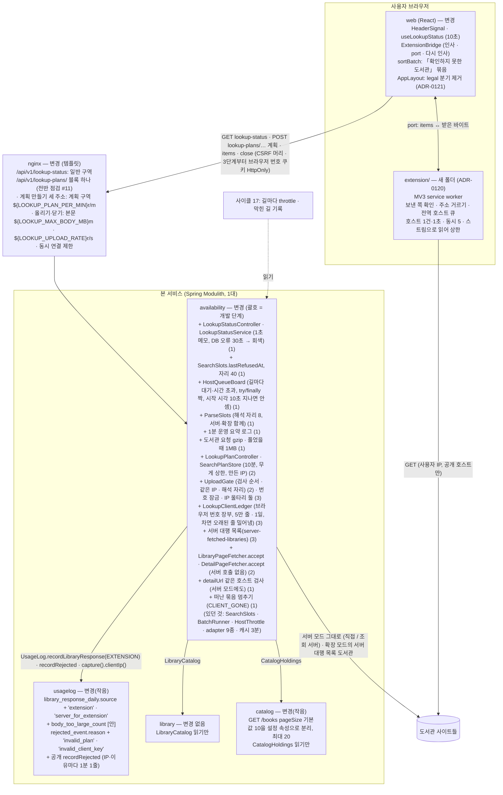
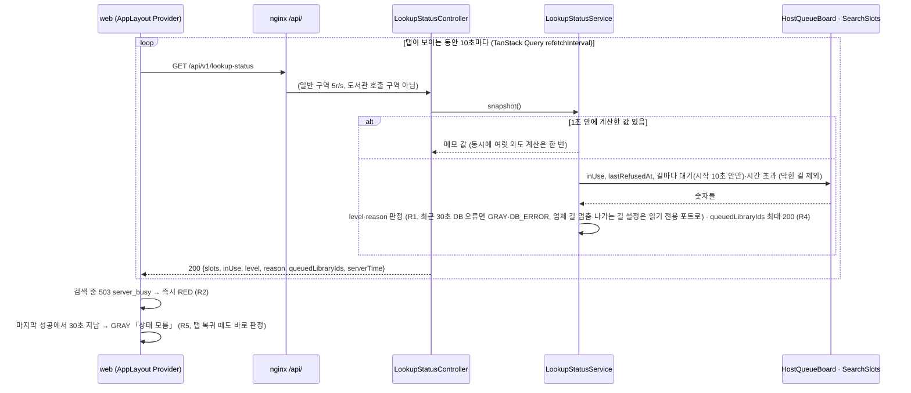
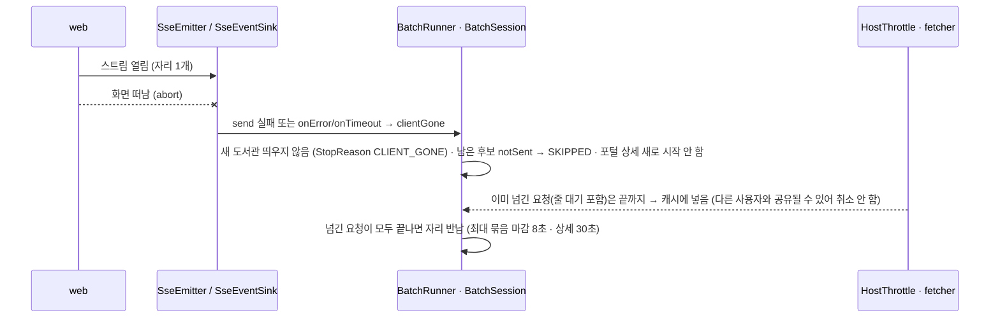
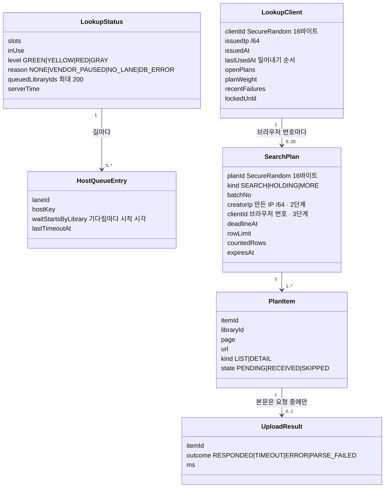
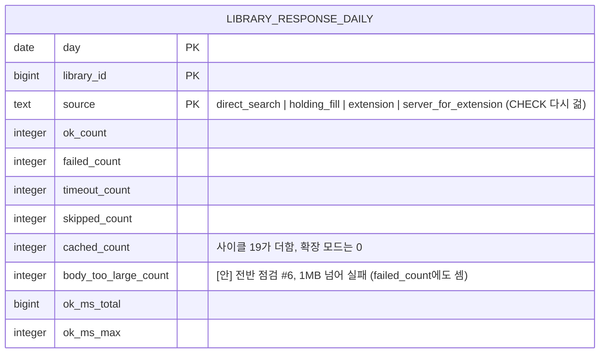

# 설계 변경: 사이클 20 조회 상태 신호와 브라우저 확장 조회

- 바탕: [`scope.md`](scope.md)(범위 8개 확정), [`spec.md`](spec.md)(R1~R16·R15-1, AC-1~40·AC-10a), [`flow.md`](flow.md), [`architect-proposal.md`](architect-proposal.md)(설계 결정 13개 확정, 2026-10-16), ADR-0118~0121·0131(Proposed)
- 전제: **사이클 17**(나가는 길·막힌 길 기록·운영 nginx·Actuator)과 **사이클 21**(머리말 메뉴)이 먼저 dev에 들어감. 20은 그 위에 얹음. 사이클 19·21과 겹치는 usagelog changeset은 번호로 나눔(19 = `002`, 21 = `003`, 20 = `004`, 사이클 21 설계 검토 #4 [확정] 2026-10-16), 나중에 합치는 쪽이 include를 master 맨 끝으로
- 상태: **초안** — `docs/current/` 반영과 인계는 사이클 17 회고 뒤(`CLAUDE.md`). `[안]`은 결정 페이지 [`easy/2026-10-16-design-delta-decisions.html`](easy/2026-10-16-design-delta-decisions.html)·[`easy/2026-10-16-review-decisions.html`](easy/2026-10-16-review-decisions.html)에서 정함
- **세 관점 검토 반영 (2026-10-16)**: 사용자 요청("사용자적 관점과 서버 리소스 적인 관점 그리고 전체적인 보안과 안정성적인 관점에서 검토를 한 번 구체적이고 꼼꼼하게 하고 수정할 거 있으면 수정하고")으로 세 관점 검토를 돌려 고칠 것은 이 문서에 바로 고쳤고(아래 "검토로 고친 것" 표시 ◆), 사용자가 고를 것만 [`easy/2026-10-16-review-decisions.html`](easy/2026-10-16-review-decisions.html)에 [안]으로 남김. #1~#33 모두 2026-10-16 승인(#27·#31·#32·#33 = 서버가 주는 브라우저 번호·장부·HttpOnly 쿠키·공인 IP 울타리, 2026-10-16 함께 반영)
- ◆는 태그가 아니라 "검토로 고친 곳" 표시다. ◆만 있고 다른 태그가 없는 값·구조는 [안](검토가 고쳤고 사용자가 따로 고르지 않음)으로 읽는다
- 그림 원본: [`easy/design-delta-original.html`](easy/design-delta-original.html)
- **임계값은 모두 [`../../settings-index.md`](../../settings-index.md)가 색인**(사이클 밖 설정값 목록): 시간·용량·동시 수·한도·잠금·울타리 숫자마다 지금 값, 근거(계산 포함), 정한 결정 번호(결정 원문은 결정 페이지 #NN), 날짜, 태그, 환경 변수(8절)를 적음. 이 문서의 숫자를 바꾸면 그 표도 함께 고침 (사용자: "전반적으로 이런 임계값 숫자 이런 것은 계획대로 관리하도록 하고 다른 ai가 맥락을 잘 파악하도록 링크 문서화 해야 해", 2026-10-16)
- **실제 운영 서버는 2GB** (사이클 17이 무료 플랜 제약으로 시드니 t4g.small 2GB에 만듦, 앱 전 이미 약 0.97GiB 사용 — `../17-first-deploy/research.md` 17절, 2026-10-15~16). 이번 사이클이 힙에 더하는 메모리 상한(페이지 상한·동시 해석·계획 보관함·확장 캐시·카운터)은 2GB 기준으로 [확정] (세 관점 검토 #7·#8·#9 승인 2026-10-16)
- **전반 점검 반영 (2026-10-17)**: 사용자 요청("안정적인 서비스의 저비용 운영을 위해서 이런 설계가 맞는가 … 큰 맥락은 유지하되 다양한 측면에서 분석해")으로 네 방향 점검을 돌려 13개를 결정 페이지 [`easy/2026-10-17-overall-review.html`](easy/2026-10-17-overall-review.html)에 냈고, 13개 모두 정함 (2026-10-17). 아래 "개발 단계"와 "전반 점검으로 바뀐 것" 절에 모으고, 본문의 같은 값·주소도 함께 고침. 표기 "전반 점검 #N"은 이 페이지의 번호(세 관점 검토 #N과 다름)

## 개발 단계 (전반 점검 #1)

[확정] (사용자 승인 2026-10-17, 전반 점검 #1: "세 단계로 인계(설계·결정 그대로, dev 순서만). 3단계 장치는 웹스토어에 올릴 때 또는 사용 기록에 남용이 보일 때"). 한 사이클 안에서 dev 순서만 나눔. 이미 승인한 결정(세 관점 검토 #22·#27·#31~#33 등)은 지우지 않고 **언제 만들지**만 정함. 앞 단계는 뒤 단계 부품에 기대지 않음(아래 "기대는 곳" 칸).

| 단계 | 언제 | 만드는 것 | 기대는 곳 |
|---|---|---|---|
| 1단계 | 사이클 17 공개 직후 | 결과 10(R15, `batch.row-limit`·`/books` `pageSize`) · 책 화면 이어 부르기 최대 3묶음 뒤 「더 보기」(R15-1, 전반 점검 #7) · 떠나면 멈춤(ADR-0131) · 상태 불(`GET /api/v1/lookup-status`, `LookupStatusService` 1초 메모, `SearchSlots.lastRefusedAt`, `reason` `VENDOR_PAUSED`·`NO_LANE`, DB 오류 회색(전반 점검 #9)) · `HostQueueBoard`와 `queuedLibraryIds`·「지금 이 도서관 조회가 밀려요」(전반 점검 #3, 스스로 낫는 구조) · 「확인하지 못한 도서관」 묶음(직접 찾기 실패 줄 포함) · 모든 화면 같은 머리말(ADR-0121) · 1분 운영 요약 로그(전반 점검 #5, 앱 쪽) · 해석 자리 8(`ParseSlots`, 1단계에서는 서버 모드만 씀, 전반 점검 #4) · 도서관 요청 gzip + 풀었을 때 1MB 상한 + 1MB 넘음 기록(전반 점검 #6) · 본문 상한 4MB → 1MB(세 관점 검토 #7) · 서버 모드 `detailUrl` 같은 호스트 검사(◆) · 동시 검색 상한 40(전반 점검 #13) · `usagelog/004` changeset(아래 "데이터") | 사이클 17(길·막힌 길 기록·nginx·운영 compose)·21(머리말 메뉴). 17 길이 없으면 길 하나·막힌 길 없음, 나가는 길 포트가 없으면 `reason=NONE` |
| 2단계 | 1단계 뒤 (확장 최소판) | `extension/` 폴더(MV3, 전역 호스트 큐, 주소 거르기, 스트림으로 읽어 상한) · 웹 `ExtensionBridge`(인사·port·다시 인사 3번)·파란 불 · **확장 약속 판 번호 확인**(최소 판보다 낮으면 서버 모드 + 「확장을 새로 깔아 주세요」, 전반 점검 #8) · 계획·올리기·닫기 주소 모두 `/api/v1/lookup-plans` 밑(전반 점검 #11) · `SearchPlanStore`(무게 25,000·10분·가득이면 503 → 그 검색만 서버 모드) · **계획 번호를 만든 IP(/64)에 묶음**: 계획에 만든 IP를 적고 올리기·닫기·`replaces`는 같은 IP일 때만(다르면 400 `client_ip_changed` → 화면이 남은 도서관만 다시 계획) · `UploadGate`(Origin·계획·`Content-Length`·`Content-Encoding` 검사, 해석 자리 8을 서버 모드와 함께 씀) · `accept` 입구·포털 상세 2단계 · 사용 기록 `source=extension`, 거절 기록 `invalid_plan`(IP·이유마다 1분 1줄) · **확장 결과 공유 캐시**(따로 둔 500칸·처음 넣은 시각 + 3분 고정, 서버 모드는 서버 칸 → 확장 칸 차례로 봄; 전반 점검 #2에서 "나누지 않음" 제안 미승인 → 세 관점 검토 #9·#10 그대로 2단계부터) · nginx `/api/v1/lookup-plans/` 한 블록 · CSRF 머리 · S14 `holdingLimit` | 1단계(해석 자리·`reason`·결과 10). **장부·쿠키 없음**: 사람을 가리키는 것은 계획 번호 + 만든 IP. 확장이 못 여는 도서관은 그 도서관만 「확인하지 못한 도서관」(서버 대행 목록은 3단계) |
| 3단계 | 웹스토어에 올릴 때, 또는 거절 기록(`rejected_event`)에 남용이 보일 때 | 브라우저 번호 장부(`LookupClientLedger`, 5만 줄·1일, 차면 가장 오래 안 쓴 줄 밀어냄 — 전반 점검 #10) · HttpOnly 번호 쿠키(`Path=/api/v1/lookup-plans` 하나, 전반 점검 #11) · 2단계의 "만든 IP" 검사를 "장부의 받은 IP = 지금 IP"로 바꿈 · 번호마다 열린 계획 20·번호 잠금(1분 30번 → 10분) · 공인 IP 울타리 둘((1) 무게 20% (2) 새 번호 1분 30개; (3)은 전반 점검 #12로 뺌) · 400 `invalid_client_key`·거절 기록 `invalid_client_key` · 서버 대행 목록(`server-fetched-libraries`)과 `server_for_extension` 기록 | 2단계 |

- 1단계의 `queuedLibraryIds`·「밀려요」는 처음 제안에서 3단계였으나 전반 점검 #3(바뀐 제안 "지금 가자")으로 1단계 [확정]
- 2단계에 사람(브라우저)마다 세기가 없는 동안: 같은 공인 IP 뒤의 사람끼리는 nginx 계획 구역(공인 IP당 1분 300·몰아서 100)만 함께 받음, 열린 계획 수 상한은 보관함 전체(25,000)만 [안] — 확장 사용자가 운영자·지인 몇 명인 동안(전반 점검 #1 근거)
- 인계서는 단계별로 나눠 씀(이 절이 원문) [안]

## 전반 점검으로 바뀐 것 (2026-10-17)

결정 원문은 [`easy/2026-10-17-overall-review.html`](easy/2026-10-17-overall-review.html) 각 카드의 "정함" 칸. 숫자 색인은 [`../../settings-index.md`](../../settings-index.md) 3·6·6-1절.

- **#2 확장 결과 나누기** [확정] (사용자: "나눔 (#9·#10 그대로) 이걸로 해", 2026-10-17): 확장 결과는 2단계부터 따로 둔 캐시(500칸, 처음 넣은 시각 + 3분 고정)에 넣고 서버 모드 사용자도 봄. 세 관점 검토 #9·#10 내용은 바뀌지 않음
- **#3 `HostQueueBoard` 1단계, 스스로 낫는 구조** [확정] (사용자: "지금 가자", 2026-10-17): ① 기다림 시작(+1)과 끝(−1)을 throttle `acquire`를 감싼 한 곳의 try/finally로 짝 맞춤 ② 기다림마다 **기다리기 시작한 시각**을 함께 적고, 상태를 계산할 때 시작한 지 **10초**(묶음 마감 8초 + 여유 2초)가 지난 기다림은 세지 않음 → −1이 빠져도 10초 뒤 「밀려요」가 저절로 사라짐 ③ dev 단위 시험 둘: 기다리는 중 오류를 던져도 수가 0으로 돌아옴 / 10초 지난 항목이 빠짐 ④ 0이 되면 줄을 지움(메모리: 길 21 × 실제로 기다리는 사이트만). 10초는 설정 [안: 이름 dev]. 상세 페이지(마감 30초) 기다림도 10초 뒤에는 세지 않아 「밀려요」가 일찍 사라질 수 있음 — 감수 [안]
- **#4 해석 자리 하나 + 메모리 바닥나면 다시 켜기** [확정] (사용자 승인 + "이 변수 통합적으로 관리하도록 하고 AI가 읽기 쉽도록 잘 문서화", 2026-10-17): 도서관 페이지 해석 자리(`ParseSlots`, 이름 [안])를 **서버 모드·확장 모드가 함께 쓰는 하나, 8**(설정)로 둠. 세 관점 검토 #7의 "확장 올리기 동시 해석 4"를 이것으로 바꿈. 자리가 없으면 최대 **2초** 기다림(세 관점 검토 #7 값 그대로) → 그래도 없으면 그 도서관만 실패: 서버 모드는 `library-failed`(사용 기록 FAILURE, 캐시 안 넣음) [안], 확장 모드는 올리기 503 `server_busy` → 「확인하지 못한 도서관」. 서버 모드는 받은 본문(최대 1MB)을 든 채 기다리므로 최악은 진행 중 요청 수 × 1MB + 해석 8 × 약 8MB. 지금 서버 모드는 상한 없이 최대 100건(검색 자리 20 × 묶음 5, 상한 40이면 200건)을 동시에 해석해 1MB 쪽이면 힙 512MB를 넘을 수 있음(dev `FetchServiceSiteFetcher`, 실측 1MB 쪽 해석 7.4MB). 메모리가 바닥나면 JVM `-XX:+ExitOnOutOfMemoryError` + 컨테이너 `restart: unless-stopped`로 끝내고 다시 켬 — 사이클 17 몫, 공유 파일 [`../17-first-deploy/from-cycle-20-observability.md`](../17-first-deploy/from-cycle-20-observability.md) 4번
- **#5 1분 운영 요약 로그 (앱 쪽, 1단계)** [확정] (사용자 승인, 2026-10-17): 앱이 1분마다 로그 한 줄: 검색 자리 사용 수(최대·지금), 503 수, 힙 사용량, 멈춘 길 수, 1MB 넘음 n건(#6), 최근 DB 오류 수(#9), 확장/서버 도서관 요청 수, 계획 무게 합(2단계부터), 장부 크기(3단계부터). 필드 이름·모양 [안: dev가 정함, CloudWatch 지표 필터로 읽기 쉬운 `key=value`]. CloudWatch 쪽(요약 줄 5분 없음·힙 85%·503 급증 경보, 메모리 90% 경보, 스왑, PostgreSQL 상한, graceful 종료, cloudflared 재시작)은 사이클 17 몫 — [`../17-first-deploy/from-cycle-20-observability.md`](../17-first-deploy/from-cycle-20-observability.md)
- **#6 도서관 요청에 압축(gzip), 1MB 넘음 기록** [확정] (사용자 승인 + "1MB 넘는 거 잘 기록하고", 2026-10-17): 서버 모드 도서관 요청(직접·조회 서버 경유)에 `Accept-Encoding: gzip`을 보내고, 풀면서 세어 **풀었을 때도 1MB(`LOOKUP_MAX_BODY_MB`) 상한**(압축 폭탄 막기), 넘으면 그 자리에서 끊고 그 도서관만 실패. 1MB를 넘어 실패하면 ① 서버 로그 한 줄(도서관 번호·주소·받은 크기·시각) ② 사용 기록에 남김 — 지금 `usagelog.library_response_daily`에는 실패 이유 칸이 없음(칸: `ok_count`·`failed_count`·`timeout_count`·`skipped_count`·`cached_count`·`ok_ms_*`, dev `usagelog/001`·`002` 2026-10-17 읽음). 그래서 `failed_count`에 더하고, 도서관별 하루 수를 따로 보려고 `usagelog/004`에서 새 칸 `body_too_large_count`(integer, 0 이상, 기본 0)를 더함 [안: 칸 이름·더할지 사용자 확인 필요] ③ 1분 요약 로그에 "1MB 넘음 n건" → 기준을 올릴지 판단할 근거. 압축률은 dev가 도서관 몇 곳에서 재서 기록 [확인 필요: dev 측정]. 확장 모드는 브라우저가 압축을 알아서 풀고 확장이 스트림으로 세어 끊으므로 바뀌지 않음
- **#7 책 화면 이어 부르기 최대 3묶음** [확정] (사용자 승인, 2026-10-17): 책 기준 검색 결과(책 10권)의 대출 상태 조회에서, 첫 묶음 뒤 화면이 자동으로 다음 묶음(`…/batches/stream`, 확장 모드는 다음 계획)을 부르는 것은 **첫 묶음 포함 최대 3묶음**(약 24초)까지, 그 뒤 남은 상태는 「더 보기」를 누르면 이어서 부름. 값은 설정(웹 `VITE_*`, 이름 [안: dev]). S14·추천도서 책 창의 조회 넓히기(`holdingLimit` 3 → 6 → 10 → 20, 사이클 21 [확정])는 이와 별개 단계이며, 넓힌 한 번 안에서 이어 부르기가 생기면 같은 3묶음 상한을 씀 [안]
- **#8 확장 약속 판 번호** [확정] (사용자 승인, 2026-10-17): 인사 답의 약속 판 번호(`{version}`과 별도의 정수 `protocol`, 이름 [안])가 웹이 요구하는 최소 판(웹 설정 `VITE_EXTENSION_MIN_PROTOCOL`, 이름 [안])보다 낮으면 확장 모드로 가지 않고 서버 모드(상태 묻기 시작) + 한 줄 안내 「확장을 새로 깔아 주세요」(자리 [안]: 머리말 말풍선 둘째 줄과 검색 결과 판 위 안내 줄 한 번). 2단계
- **#9 DB 오류면 상태 회색** [확정] (사용자 승인, 2026-10-17): 최근 **30초** 안에 DB 오류(예: `DataAccessException`·연결 얻기 실패, 잡는 지점 [안: dev])가 있었으면 상태 응답 `level=GRAY`, `reason=DB_ERROR`(값 이름 [안]) → 화면은 회색 점, 말풍선 둘째 줄 「상태를 확인할 수 없어요」. 다른 단계보다 우선 [안]. 30초는 설정 [안: 이름 dev]. 1단계
- **#10 장부가 차면 오래된 줄 밀어내기** [확정] (사용자: "가. 오래된 줄 밀어내기 … 이걸로 가자", 2026-10-17): 장부 5만 줄이 차면 가장 오래 안 쓴 줄을 지우고 새 번호를 넣음(503 아님). 밀려난 사람의 다음 올리기·닫기는 400 `invalid_client_key` → 화면이 조용히 새 번호를 받고 남은 도서관만 다시 계획(서버 재시작과 같은 흐름). 3단계. Caffeine 크기 상한의 밀어내기 순서가 정확히 "가장 오래 안 쓴 것"인지는 [확인 필요: Caffeine 공식 문서 확인 — 다르면 dev가 접근 시각 기준으로 맞춤]
- **#11 계획 주소를 모두 `/api/v1/lookup-plans` 밑으로** [확정] (사용자 승인, 2026-10-17): 「더 보기」 계획을 `POST /api/v1/lookup-plans/more`(도서관 번호는 본문)로, 검색·책 화면 계획도 같은 밑으로(아래 API 표, 이름 [안: dev가 맞춤]). 설계 결정 #6의 계획 주소 이름(`…/ebook-searches/plans`·`…/book-availabilities/plans`·`…/availability/libraries/{libraryId}/ebooks/plans`)을 바꿈. 번호 쿠키 `Path`는 `/api/v1/lookup-plans` 하나(3단계), nginx는 `/api/v1/lookup-plans/` 블록 하나. 근거: MDN Set-Cookie `Path`는 그 경로 아래 전부에 보냄, nginx는 `^~` 접두가 맞으면 정규식 location을 보지 않음 (결정 페이지 #11, 2026-10-17 확인)
- **#12 IP 울타리 (3) 뺌** [확정] (사용자 승인, 2026-10-17): "그 IP의 잠긴 번호 5개 이상 → IP 10분 거절"을 뺌. 남용은 (1) 무게 20%·(2) 새 번호 1분 30개·번호 잠금과 거절 기록으로 봄. 3단계
- **#13 동시 검색 상한 40** [확정] (사용자 승인, 2026-10-17; 사용자: "이걸 올리는 게 나을 것 같은데 사이클 20에게 알려줘"): `max-concurrent-searches` 20 → 40(설정, `CHAEKCHECK_AVAILABILITY_MAXCONCURRENTSEARCHES`), #4와 함께. 상태 불은 R1대로 20 노랑·40 빨강. 배포 뒤 1분 요약 로그(힙·503)로 60까지 올릴지 정함. 근거(어림): [`../../research/deploy/multi-source-ip.md`](../../research/deploy/multi-source-ip.md) 10절, `../../research/deploy/easy/2026-10-17-load-memory-sim.html` 6번 카드

## 구조 그림

### 모듈 구성도 (이 사이클이 더하거나 바꾸는 것만)



### 주요 흐름 1: 상태 묻기 (spec R1~R5)



### 주요 흐름 2: 확장 모드 검색 (spec R6~R11, ADR-0119)

- 아래 그림은 3단계까지 들어간 모습. 2단계에는 번호 쿠키·장부·잠금·IP 울타리가 없고, 계획에 적은 "만든 IP(/64)"와 지금 IP를 대조(다르면 400 `client_ip_changed`)함 (전반 점검 #1)

```mermaid
sequenceDiagram
  participant W as web
  participant X as extension
  participant N as nginx
  participant P as LookupPlanController · UploadGate
  participant F as LibraryPageFetcher / DetailPageFetcher (accept)
  participant L as 도서관
  W->>X: 인사 runtime.sendMessage(VITE_EXTENSION_ID) (첫 검색은 답까지 최대 500ms 기다림)
  X-->>W: {version, protocol} → protocol이 최소 판 이상이면 파란 불, 상태 묻기 없음 (낮으면 서버 모드 + 「확장을 새로 깔아 주세요」, 전반 점검 #8)
  W->>N: POST /api/v1/lookup-plans/searches (검색 조건, replaces?, X-XSRF-TOKEN; 브라우저가 번호 쿠키를 알아서 붙임)
  N->>P: (/api/v1/lookup-plans/ 블록 안 계획 구역 r/m)
  P->>P: Origin → 울타리(무게 20%·새 번호 1분 30) → 번호 쿠키가 장부에 있고 받은 IP = 지금 IP인가 (아니면·없으면 새 번호를 장부에 적음, 장부가 차면 가장 오래 안 쓴 줄을 밀어냄) → 번호 잠금 → 계획 저장 (planId · 브라우저 번호 · 10분) · SearchSlots 안 잡음(서버 대행 목록 도서관이 있을 때만 자리 1개)
  alt IP 울타리에 걸림 (검토 #31, (3)은 전반 점검 #12로 뺌)
    P-->>W: 429 → 화면 「잠시 후 다시」(서버 모드로 넘기지 않음, 다음 검색은 다시 확장 모드)
  else 보관함 전체가 참 (검토 #8)
    P-->>W: 503 → 그 검색 한 번만 서버 모드
  end
  P-->>W: 201 {planId, items[서버 대행 목록 밖 모든 주소]} + (새 번호면) Set-Cookie 브라우저 번호 (HttpOnly · Secure · SameSite=Strict · Path=/api/v1/lookup-plans · 1일) (캐시 안 봄, 설계 #9; 서버 대행 도서관 결과는 같은 응답의 events로)
  W->>X: port: items (최대 100, URL 2KB)
  loop 전역 호스트 큐: 호스트 1건 · 1초, 동시 5
    X->>X: sender.origin · 주소 거르기 (http(s)·공개 호스트·기본 포트)
    X->>L: GET (머리 10초, 본문 마감까지, 스트림으로 읽다 상한 넘으면 중단)
    L-->>X: status · bytes
    X-->>W: {itemId, status, contentType, base64, ms} → 화면은 바로 Uint8Array로
    W->>N: POST /api/v1/lookup-plans/{planId}/items/{itemId} (octet-stream, CSRF, 번호 쿠키)
    N->>P: (본문 ≤ ${LOOKUP_MAX_BODY_MB}m · ${LOOKUP_UPLOAD_RATE}r/s · 동시 연결 제한)
    P->>P: 검사 순서: Origin → 번호가 장부에 있나 → 받은 IP = 지금 IP → 번호 잠금 → 계획·쪽 번호·처음·계획을 만든 번호와 같음 → Content-Length·Content-Encoding 없음 → 해석 자리(8, 서버 모드와 함께)
    P->>F: accept(target, SiteResponse via=extension) (throttle·SiteFetcher·서버 상세 호출 없음)
    F->>F: adapter 해석 → detailUrl 같은 호스트 검사 → 캐시 넣기(규칙)
    alt 해석됨
      F-->>P: page · verdict · detailItems(같은 호스트만)
      P-->>W: 200 {events[library-result | row-verdict], detailItems[], stop}
    else 해석 실패 · status≠200 · outcome TIMEOUT/ERROR
      P-->>W: 200 {events[library-failed]} (캐시 안 넣음, usagelog FAILURE)
    end
  end
  W->>X: detailItems (포털 빈 판정 줄)
  X-->>W: 상세 바이트 → 같은 업로드 → row-verdict
  W->>N: POST /api/v1/lookup-plans/{planId}/close {notSent} (번호 쿠키, 화면 떠날 때는 keepalive)
  P-->>W: 200 {batch-done} · usagelog source=EXTENSION
  alt 계획 문제 (없음·만료·지워짐·중복·번호 다름·Origin)
    P-->>W: 400 invalid_plan → 남은 줄은 「확인하지 못한 도서관」, 오류 화면 없음
  else 번호 쿠키 없음·장부에 없음 (서버 재시작·장부에서 밀려남 포함)
    P-->>W: 400 invalid_client_key → 화면이 남은 도서관만 다시 계획(새 번호 받음, 사용자 조작 없음, 1번)
  else 받은 IP와 지금 IP가 다름 (폰 와이파이↔LTE)
    P-->>W: 400 client_ip_changed → 화면이 남은 도서관만 다시 계획(새 번호 받음, 사용자 조작 없음, 잠금에 안 셈)
  else port 끊김
    W->>X: 인사 최대 3번(바로·1초·2초) → 답 있으면 확장이 남은 items를 다시 요청, 셋 다 없으면 남은 것 notSent → 「확인하지 못한 도서관」, 다음 검색부터 서버 모드 (검토 #4 확정)
  end
```

### 주요 흐름 3: 떠난 묶음 멈추기 (서버 모드, 검토 결정 #14 [확정] 승인 2026-10-16, ADR-0131)



### 도메인 모델 (새 개념만)



## 모듈

| 모듈 | 신규/변경 | 책임 | 공개 API | 발행/구독 이벤트 | 소유 테이블 |
|---|---|---|---|---|---|
| `availability` | 변경 | (단계는 위 "개발 단계" 표) 상태 신호(`LookupStatusService`, 1초 메모, `AtomicReference` + 한 번만 계산, 최근 30초 DB 오류면 회색 `DB_ERROR` [확정] 전반 점검 #9); 줄 선 호스트(`HostQueueBoard`, 1단계 [확정] 전반 점검 #3: throttle의 acquire를 감싼 try/finally에서 대기 시작·끝을 짝으로, 기다림마다 시작 시각을 적고 10초 지난 기다림은 세지 않음, 시간 초과, `(laneId, hostKey, libraryId)`별 대기, 0이면 지움, 줄 자체는 호스트 수로 상한이라 지우지 않음); 해석 자리(`ParseSlots`, 이름 [안]: 서버 모드·확장 모드 함께 8, 기다림 최대 2초 → 그 도서관만 실패 [확정] 전반 점검 #4); 1분 운영 요약 로그 [확정] 전반 점검 #5; 서버 모드 도서관 요청 gzip·풀었을 때 1MB·넘음 기록 [확정] 전반 점검 #6; 확장 모드 계획(`SearchPlanStore`: 무게(주소 수) 25,000(약 10MB), 2단계는 계획에 만든 IP(/64)를 적어 대조 [확정] 전반 점검 #1, 3단계부터 브라우저 번호당 열린 계획 20(넘으면 그 번호의 가장 오래된 것만 지움) [확정] (검토 #22), 보관함 전체가 차면 다른 사람 계획을 밀어내지 않고 새 계획 요청 503 → 화면은 그 한 번의 검색을 서버 모드로, 닫힌 계획(close·replaces)은 바로 지움 [확정] (검토 #8 승인 2026-10-16))과 올리기 입구(`LookupPlanController` + `UploadGate`: 검사 순서·해석 자리(위 8, 서버 모드와 함께)·기다림 2초 [확정] (검토 #7 승인 2026-10-16, 자리 수는 전반 점검 #4)·브라우저 번호 장부 대조 + 같은 IP·번호 잠금 [확정] (검토 #22·#32, 3단계)); 브라우저 번호 장부(`LookupClientLedger`, 이름 [안]: 번호 → 받은 IP(/64)·받은 시각·마지막 쓴 시각·열린 계획 수·계획 무게 합·최근 실패, 5만 줄·1일, 차면 가장 오래 안 쓴 줄을 밀어냄 [확정] 전반 점검 #10, 번호는 HttpOnly 쿠키로 줌, 공인 IP 울타리 둘을 이 장부로 셈) [확정] (검토 #27·#31·#32·#33, 전반 점검 #12, 아래 "사람(브라우저)마다 세기", 3단계); 받은 응답 입구 `LibraryPageFetcher.accept`·`DetailPageFetcher.accept`(`via=extension`, throttle·SiteFetcher·`detailPages.fetch`를 부르지 않음, 이를 지키는 단위 시험) ◆; 포털 상세 조회 2단계 분리(`SiteListResolver`: 상세 주소 뽑기 / 받은 상세로 판정); 해석 결과의 `detailUrl`·`detailItems`는 `DetailPageFetcher.checkedUri`(http(s)·도서관과 같은 호스트) 통과한 것만, 아니면 null — **서버 모드 `DetailLookupResolver.lookup`에도 같은 검사**(지금 구멍) ◆; 캐시 값에 `via`·`storedAt`, 진행 중인 서버 로드는 덮지 않음 ◆; 떠난 묶음 멈추기(새 도서관·포털 상세를 띄우지 않음, 넘긴 요청은 끝까지 받아 캐시, 책 화면도 같음) [확정] (검토 #14 승인 2026-10-16, ADR-0131); 상태 응답의 `reason`(아래 "상태 불이 읽는 나가는 길 값") [확정] 검토 #28 승인 2026-10-16; 확장 모드 계획에서 서버 대행 목록(`server-fetched-libraries`) 도서관만 서버가 불러 줌(목록이 비어 있지 않을 때만 서버 자리 1개, 출처 `server_for_extension`) [확정] (검토 #16, 3단계 전반 점검 #1) | REST만. 다른 모듈에 새 공개 타입 없음 | 없음 | 없음(메모리) |
| `usagelog` | 변경(작음) | `library_response_daily.source`에 `extension`·`server_for_extension` 허용, 공개 enum `UsageLog.ResponseSource.EXTENSION`·`SERVER_FOR_EXTENSION`(값 이름 [안] 검토 #16); `rejected_event.reason`에 `invalid_plan`·`invalid_client_key`(이름 [안]) 허용(`client_ip_changed`는 폰 회선이 바뀌는 정상 경우라 거절 기록에 남기지 않음 [안]); **새 공개 메서드 `UsageLog.recordRejected(UsageRequest, String reason)`**(지금 없음, dev 2026-10-16 확인) — 원본 값 없이 이유만, availability가 IP·이유마다 1분 1줄 [안]로 모아 부름 ◆; 1MB 넘어 실패한 도서관 응답(전반 점검 #6)은 `failed_count`에 더하고 새 칸 `body_too_large_count`에도 셈 [안] — `ResponseResult`에 값 하나(예: `BODY_TOO_LARGE`, 이름 [안]) | `UsageLog` + enum 값 + `recordRejected` | 없음 | `usagelog.library_response_daily`·`usagelog.rejected_event`(CHECK 변경, 칸 하나 더함 [안]) |
| `library` | 변경 없음 | `LibraryCatalog` 읽기만 | — | — | — |
| `catalog` | 변경(작음) | `GET /api/v1/books` `pageSize` 기본값 10을 설정 속성으로 분리, 최대 20(지금 dev `BookParams.MAX_PAGE_SIZE = 20` 하나가 기본값·최대를 함께 맡음, 2026-10-16 읽음) [확정] (검토 #23); 값은 서버 설정 속성 하나에서 정함 [확정] (검토 #30 승인 2026-10-16: 서버 설정 속성 하나, 웹은 `pageSize`를 보내지 않음). `CatalogHoldings` 읽기만 | — | — | — |
| web | 변경 | 아래 "웹 (화면)" | — | — | — |
| `extension/` | 신규(본 서비스 밖, dev 저장소 맨 위) | 아래 "확장 꾸러미" | 웹 ↔ 확장 메시지 | — | — |
| nginx (deploy) | 변경 | 아래 "외부 연동 · nginx" | — | — | — |

- 모듈 의존 방향은 그대로(`availability → catalog, library, usagelog`), 새 모듈·새 이벤트 없음. 상태 불이 읽는 나가는 길 값은 사이클 17/22의 나가는 길 코드가 주는 읽기 전용 포트(같은 `availability` 안, 아래)라 의존 방향을 바꾸지 않음. `ModularityTests`·`DocumentationTests` 변경 없음
- 사이클 17 의존: `HostQueueBoard`는 17의 길(lane) 개념과 막힌 길 기록을 읽음. 17이 먼저 들어가지 않으면 길은 하나(직접)로 두고 막힌 길은 빈 목록 [확정] (전제)
- **사람(브라우저)마다 세기** [확정] (세 관점 검토 #22 승인 2026-10-16; 사용자: "아이피로만 하면 같은 공인아이피의 다른 상대가 피해가 갈 것 같은데 각각 클라이언트를 보호할 방법은?"): 계획·잠금을 사람(브라우저)마다 세고, 공인 IP는 울타리로만 씀. 그 "사람"을 가리키는 것이 **브라우저 번호**다. **이 절 전체가 3단계** [확정] (전반 점검 #1, 2026-10-17: 웹스토어에 올릴 때 또는 거절 기록에 남용이 보일 때). 2단계에서는 계획에 만든 IP(/64)를 적어 올리기·닫기·`replaces`를 같은 IP일 때만 받음(다르면 400 `client_ip_changed`, 아래와 같은 화면 처리)
  - **번호는 서버가 줌** [확정] (검토 #27, 사용자: "이걸로 해줘", 2026-10-16): 웹이 번호를 만들지 않음. 서버가 `SecureRandom` 16바이트(base64url [안])를 만들어 장부에 적고 쿠키로 줌. 처음 안의 "웹이 탭마다 만드는 열쇠"(#22)와 "서명(HMAC)"(#27 처음 안)은 쓰지 않음
  - **브라우저 번호 장부** [확정] (검토 #32, 사용자: "브라우저 번호랑 아이피랑 합쳐서 서버에서 관리하면 되겠다", 2026-10-16): 서버 메모리(Caffeine, 이름 `LookupClientLedger` [안])에 번호 → 받은 공인 IP(/64)·받은 시각·열린 계획 수·계획 무게 합·최근 실패 수(+ 잠긴 때까지). **서명 없음**: 장부에 없는 번호는 서버가 준 적 없는 번호라 거절. **요청마다 "장부에 있나 + 받은 IP = 지금 IP"**를 봄. 상한 5만 줄(약 5MB [안: 어림, 줄 하나 약 100B]), 받은 지 1일 지나면 지움 — 값은 설정 [확정] (#32). 계획 요청인데 번호가 없거나 장부에 없거나 IP가 다르면 새 번호를 장부에 적고 쿠키로 줌(그 IP의 "새 번호 1분 30개" 울타리에 셈). 올리기·닫기에서 번호가 없거나 장부에 없으면 400 `invalid_client_key`, IP가 다르면 400 `client_ip_changed`(코드 이름 [안]) → 웹이 남은 도서관만 조용히 다시 계획(새 번호를 받음), 잠금에 세지 않음 [확정] (#32). 서버를 다시 켜면 장부가 비고 → 다음 계획 요청에서 새 번호가 자동으로 나감 [확정] (#32). **장부가 5만 줄로 차면 가장 오래 안 쓴 줄을 밀어내고 새 번호를 넣음**(503으로 거절하지 않음): 밀려난 사람의 다음 올리기·닫기는 400 `invalid_client_key` → 화면이 조용히 새 번호를 받고 남은 도서관만 다시 계획 [확정] (전반 점검 #10, 사용자: "가. 오래된 줄 밀어내기 … 이걸로 가자", 2026-10-17; 이유: 거절하면 IPv6 /64 묶음 수백 개로 장부를 채우는 공격 한 번에 모두의 확장 모드가 꺼짐 — 결정 페이지 #10 설명, 사용자 승인)
  - **쿠키로 줌, 자바스크립트는 못 봄** [확정] (검토 #33, 사용자: "브라우저 번호 이거 xss로 뭐 오염되지 않도록 조심해야 해", 2026-10-16): `Set-Cookie`에 `HttpOnly`·`Secure`·`SameSite=Strict`, `Path=/api/v1/lookup-plans` 하나(계획 만들기·올리기·닫기가 모두 이 밑, [확정] 전반 점검 #11), 수명 1일(`Max-Age` 86400, 설정). 근거: MDN Set-Cookie — `HttpOnly`는 자바스크립트가 쿠키에 접근하지 못하게 해 XSS 피해를 줄이고, `SameSite=Strict`는 같은 사이트에서 시작한 요청에만 쿠키를 보냄 (https://developer.mozilla.org/en-US/docs/Web/HTTP/Reference/Headers/Set-Cookie , 2026-10-16 확인) [확정]. 쿠키 이름 [안] (예: `lookup_client`). 처음 안의 "경로 앞부분 넷에 같은 쿠키를 따로 줌"은 넷째 경로(`/api/v1/availability/libraries`)가 서버 모드 「더 보기」 GET에도 쿠키를 붙여서 전반 점검 #11로 없앰. 머리글 `X-Lookup-Client`는 **없앰**(쿠키로 바뀜). CORS는 열지 않음(기본 거절) [확정] (#33). POST의 CSRF 머리(`X-XSRF-TOKEN`, 더블 서브밋 쿠키)는 그대로 — CSRF는 그것이, 번호 훔치기는 HttpOnly가 막음
  - **번호마다 셈** [확정] (검토 #22·#11): ① 계획에 만든 번호(`clientId`)를 함께 저장, 올리기·닫기·`replaces`는 같은 번호일 때만 ② 열린 계획 20(넘으면 그 번호의 가장 오래된 것만 지움) ③ ⑨ 잠금: 1분에 실패 30번(검토 #11의 세 가지) → 그 번호 10분 잠금
  - **공인 IP 울타리 둘** [확정] (검토 #31, 2026-10-16; 전반 점검 #12로 (3) 뺌, 2026-10-17; 장부에서 그 IP에 준 번호들을 모아 셈): (1) 그 IP에 준 번호들의 계획 무게 합이 보관함의 20%(주소 25,000 중 5,000)를 넘음 (2) 한 IP에 새 번호가 1분에 30개를 넘음. (처음의 (3) "그 IP의 잠긴 번호 5개 이상 → 그 IP 10분 거절"은 (1)·(2)·번호 잠금과 겹치고 같은 IP의 정상 사용자까지 막을 수 있어 뺌 — 결정 페이지 #12 설명, 사용자 승인. 남용은 (1)·(2)·번호 잠금과 거절 기록으로 봄.) **둘 다 그 IP의 새 계획 요청만 거절하고 화면은 「잠시 후 다시」, 서버 모드로 넘기지 않음**(넘기면 확장으로 덜어 낸 부담을 그 IP가 서버에 다시 지움). 다음 검색은 다시 확장 모드로 시도. 응답 429, 코드 이름 [안] (예: `lookup_ip_limited`, `detail`에 둘 중 어느 것인지). IP 단위 잠금은 없으므로 올리기는 IP 때문에 429가 되지 않음(nginx 올리기 한도만). #22의 "공인 IP당 열린 계획 200"은 (1)로 바뀜. **보관함 전체가 찬 경우(#8)만 그대로 그 검색 한 번 서버 모드(503)** — 한 곳 탓이 아니라 여러 곳의 사람이 많은 경우. 숫자의 근거(계산)는 [`../../settings-index.md`](../../settings-index.md) 6절. 메모리: 장부 줄에 함께 둠 + IP별 합계 줄(무게 합·1분 새 번호 수, 장부와 같은 상한 안 [안])
  - nginx는 번호를 모르고 IP 한도만(검토 #15)
- IP: 모든 IP 판정(2단계 계획의 만든 IP·장부의 받은 IP·같은 IP 검사(#32)·⑦ 계획 한도·IP 울타리 둘(#31·전반 점검 #12))은 `UsageLog.capture(request).clientIp()`(= nginx `X-Real-IP` = Cloudflare `CF-Connecting-IP`, 사이클 17 R3-1)로 읽음. `getRemoteAddr()`는 nginx 컨테이너 주소라 쓰지 않음. IPv6는 앞 /64로 비교·셈 ◆

- **검색 결과 수 10** [확정] (세 관점 검토 #23 승인 2026-10-16, 명세 R15): `availability` 설정 `batch.row-limit` 20 → 10(서버·확장 모드), `catalog` `GET /api/v1/books` `pageSize` 기본 20 → 10(최대 20 그대로; 지금 한 상수 `MAX_PAGE_SIZE`가 기본값·최대를 함께 맡아 기본값을 설정 속성으로 분리하는 작은 변경). 값을 정하는 곳 [확정] 검토 #30 승인 2026-10-16 (제안: 서버 설정 속성 하나, 웹은 `pageSize`를 보내지 않음). `batch.row-limit`이 책 화면 대출 상태 조회에도 걸리는 것은 [확정] 검토 #26 (책 화면은 줄 상한 없이 보이는 10권 모두)

- **운영 숫자는 변수로 한 곳에서** [확정] (세 관점 검토 #25 승인 2026-10-16; 사용자: "이런 개수 말이야 변수로 통합적으로 관리 가능하도록"; 전반 점검 #4에서 다시: "이 변수 통합적으로 관리하도록 하고 AI가 읽기 쉽도록 잘 문서화", 2026-10-17): 이 사이클이 더하거나 바꾸는 숫자(해석 자리·검색 자리 40·이어 부르기 3묶음·계획 보관함·확장 캐시·잠금·결과 10·기다림 10초·DB 오류 30초 등)는 모두 설정 속성으로 두고 운영은 `prod.env`의 "대출 조회 숫자" 묶음에서 Spring 환경 변수로 덮어씀(이름 규칙·목록 `../../settings-index.md` 8절). nginx와 함께 쓰는 값만 `LOOKUP_*`, 화면 `VITE_*`, 확장 `extension/config.js`. dev 설정값 목록(#17)에 환경 변수 칸. 사이클 17 `prod.env` 견본은 `../17-first-deploy/from-cycle-20-prod-env-numbers.md`

- **상태 불이 읽는 나가는 길 값** [확정] 검토 #28 승인 2026-10-16: R1 덧붙임(#21)·덧붙임 2(#24)를 판정하려면 `LookupStatusService`가 사이클 22의 "업체(Webshare) 길 멈춤" 여부와 사이클 17/22의 나가는 길 설정(`모두`/`프록시만`/`직접만`, ADR-0130)을 읽어야 한다. 이 값은 사이클 17/22의 나가는 길 코드가 주는 **읽기 전용 포트(인터페이스)** 하나로 읽음(예: `vendorLanesPaused()`·`egressMode()`, 이름 [안]). 상태 응답에 `reason`(`NONE` \| `VENDOR_PAUSED` \| `NO_LANE`)을 더해 화면이 둘째 줄을 고름: 업체 길이 멈췄으면 단계 최소 `YELLOW` + `VENDOR_PAUSED`, `프록시만`이고 업체 길이 모두 멈췄으면 `RED` + `NO_LANE`(빨강 우선). 포트가 없으면(17/22 코드가 아직 없음) `reason`은 `NONE`이고 R1 기본 규칙만 씀. **덧붙임 (전반 점검 #9)**: 최근 30초 안에 DB 오류가 있었으면 `level=GRAY`·`reason=DB_ERROR`(값 이름 [안])가 다른 판정보다 앞섬 [확정] (판정) / 우선순위 [안]. DB 오류 시각은 "마지막 DB 오류 시각" 값 하나로 둠. 잡는 곳·두는 곳 [안: dev — 검색·책 찾기(`catalog`)의 DB 오류도 세야 하므로 모듈 경계를 넘지 않게 공통 오류 처리(예: 전역 예외 처리기)가 시각을 남기고 `LookupStatusService`가 읽기 전용으로 읽음; 새 모듈·이벤트는 만들지 않음]

- **책 화면 대출 상태 조회는 줄 상한 없이 보이는 10권 모두** [확정] (사용자: "책 기준 검색 말이야 이거 5개 고대로 안 가져가고 그냥 한 번에 보여지는 10개대로 하는 게 맞지 않아?", 세 관점 검토 #26 승인 2026-10-16): `BatchRunner.startHoldings`(dev 201~223행)의 `HoldingSession`에 `row-limit`을 넘기지 않음(또는 "제한 없음") — 바로 검색(`start`)만 `row-limit` 10. 동시 5곳·8초 마감·마감 3초 전 새 출발 멈춤은 그대로. 마감 때 남은 holding은 지금처럼 `notSent`로 돌려주고, 웹은 남은 것이 있으면 `…/book-availabilities/batches/stream`을 바로 다시 부름(사용자 조작 없이, 10권 범위 안에서만). **자동으로 이어 부르는 것은 첫 묶음 포함 최대 3묶음(약 24초)까지, 그 뒤 남은 상태는 「더 보기」** [확정] (전반 점검 #7 승인 2026-10-17; 값은 설정, 위 "전반 점검으로 바뀐 것" #7). 확장 모드 계획(`/api/v1/lookup-plans/holdings`, 전반 점검 #11)도 같은 규칙

## 데이터

- 스키마: `usagelog` (새 표 없음, `availability`는 메모리만)



| 테이블.컬럼 | 타입 | 제약 | 설명 | 상태 태그 |
|---|---|---|---|---|
| `usagelog.library_response_daily.source` | `text` (기존) | CHECK `library_response_daily_source_check`(dev `usagelog/001-usagelog-schema.yaml` 215~216행, 2026-10-16 읽음)를 지우고 `IN ('direct_search','holding_fill','extension','server_for_extension')`로 같은 이름으로 다시 검 | 확장 모드의 도서관 응답(검색·소장·더 보기 모두)은 `extension`, 확장 모드 중 서버 대행 목록 도서관을 서버가 부른 것은 `server_for_extension` | `extension` [확정] (설계 #9) / `server_for_extension` 기록 [확정] (검토 #16), 값 이름 [안] |
| `usagelog.library_response_daily.body_too_large_count` (새 칸) | `integer` | `NOT NULL DEFAULT 0`, CHECK `library_response_daily_body_too_large_count_check (body_too_large_count >= 0)` | 서버 모드 도서관 응답이 본문 상한(풀었을 때 포함 1MB)을 넘어 실패한 수. 같은 건이 `failed_count`에도 들어감. 지금 표에는 실패 이유 칸이 없어서(dev `usagelog/001` 210~230행·`002`, 2026-10-17 읽음) 도서관별 하루 수를 따로 보려면 칸이 필요함 | [안] (전반 점검 #6 "사용 기록의 실패 이유 `body_too_large`(도서관별 하루 집계에 셈)"을 칸으로 옮긴 모양 — 칸 이름·더할지 [확인 필요: 사용자에게 질문]) |
| `usagelog.rejected_event.reason` (기존 표·컬럼) | `text` (기존) | CHECK `rejected_event_reason_check`(dev 같은 파일 247~248행: `unknown_library`, `invalid_place`, `invalid_screen`, `invalid_book_id`, `malformed`, `unknown_type`, `invalid_value`, 2026-10-16 읽음)를 지우고 같은 이름으로 그 7개 + `invalid_plan`·`invalid_client_key`로 다시 검 | `invalid_plan`·`invalid_client_key` 줄은 IP·이유마다 1분 1줄 [안], `raw_values`에 본문 없음(planId·itemId·이유만) ◆ | 구조 [안] (검토 반영 ◆) / `invalid_plan` 이름 [확정] (설계 결정 #6 이름 표) / `invalid_client_key` 이름 [안] |
| (메모리) `SearchPlan`·`PlanItem` | Caffeine | `SearchPlan`에 `planId`와, 2단계는 만든 IP(/64) `creatorIp`, 3단계는 `clientId`(서버가 준 브라우저 번호, 검토 #27·#32 [확정]; 그때 만든 IP는 장부에 있어 계획에서 뺌) 함께 저장 [확정] (전반 점검 #1), 쓴 뒤 10분 만료, 무게(주소 수) 25,000(약 10MB), 브라우저 번호당 열린 계획 20(넘으면 그 번호의 가장 오래된 것만 지움, 3단계) [확정] (검토 #22), 공인 IP 울타리 둘(무게 20% = 5,000·새 번호 1분 30, 걸리면 429 「잠시 후 다시」, 3단계) [확정] (검토 #31·전반 점검 #12), 보관함 전체가 차면 다른 사람 계획을 밀어내지 않고 새 계획 요청 503 → 화면은 그 한 번의 검색을 서버 모드로, 닫힌 계획(close·replaces)은 바로 지움 [확정] (검토 #8 승인 2026-10-16), 받은 본문은 보관 안 함 ◆ | 계획 번호 `SecureRandom` 16바이트 base64url [안] ◆. 계획 하나 = item당 약 400B(도서관 200곳이면 약 80KB) | [확정] (명세 #11) / 상한 [확정] (검토 #8) |
| (메모리) 캐시 값 `FetchedPage` | 기존 | + `via` (`server`\|`extension`), `storedAt`. 해석 값만(원본 바이트 없음) ◆ | 확장 출처 칸을 비우는 방법은 서비스 재시작 | [확정] (설계 결정 #4) / 확장 칸 분리(따로 둔 캐시 500칸, 서버 모드는 서버 칸 → 확장 칸 차례로 봄)·만료(처음 넣은 시각 + 3분 고정, 값마다 만료 시각) [확정] (검토 #9·#10 승인 2026-10-16) / 2단계부터 [확정] (전반 점검 #2: "나누지 않음" 제안 미승인, "나눔 (#9·#10 그대로) 이걸로 해") |
| (메모리) `HostQueueBoard` 기다림 | `ConcurrentHashMap` [안] | `(laneId, hostKey, libraryId)` → 기다림마다 시작 시각 + 최근 시간 초과 시각. 끝나면(try/finally) 지움, 시작한 지 10초 지난 기다림은 세지 않음, 비면 줄 지움 | 길 21 × 실제로 기다리는 사이트만 → 작음 | [확정] (전반 점검 #3) / 자료 구조 [안] |
| (메모리) 브라우저 번호 장부 `LookupClientLedger` (이름 [안]) | Caffeine | 번호(`SecureRandom` 16바이트) → 받은 공인 IP(/64)·받은 시각·마지막 쓴 시각·열린 계획 수·계획 무게 합·최근 실패 수(1분)·잠긴 때까지(10분). 상한 5만 줄, 받은 지 1일 지나면 지움, **차면 가장 오래 안 쓴 줄을 밀어냄**(전반 점검 #10), 값은 설정. 서명 없음 — 장부에 없는 번호는 거절. 3단계 | 번호는 HttpOnly 쿠키로만 오감(#33). 서버 재시작 = 장부 비움 → 새 번호 자동. 줄 하나 약 100B → 5만 줄 약 5MB | 장부·같은 IP·재시작 [확정] (검토 #32) / 5만 줄·1일 [확정] (#32) / 차면 밀어내기 [확정] (전반 점검 #10) / 약 5MB [안: 어림] / 번호마다 세기 [확정] (검토 #22) / 1분 30번·10분 [확정] (검토 #11) |
| (메모리) 공인 IP별 합계 | Caffeine | IP(/64) → 그 IP 번호들의 계획 무게 합·1분 새 번호 수. 장부와 같은 상한 안 [안]. 3단계 | 울타리 둘(#31, (3)은 전반 점검 #12로 뺌 → 잠긴 번호 수·IP 거절 때까지 칸 없음) | 울타리 값 [확정] (검토 #31·전반 점검 #12) / 구조 [안] |

- Liquibase: `usagelog/004-library-response-source-extension.yaml` 새 changeset(기존 changeset 수정 없음). 이 changeset 하나에서 CHECK 두 개를 같은 이름으로 다시 검: ① `library_response_daily_source_check`에 `extension`·`server_for_extension` ② `rejected_event_reason_check`에 `invalid_plan`·`invalid_client_key`(지금 7개 값은 그대로) ③ `library_response_daily`에 `body_too_large_count` 칸 [안] (전반 점검 #6, 위 표). 이 changeset은 1단계에 한 번에 넣고 2·3단계 값은 미리 허용해 둠 [안] (단계마다 changeset을 나누면 CHECK를 세 번 다시 걺). 번호: 19 = `002`, 21 = `003`, 20 = `004` [확정] (사이클 21 설계 검토 #4, 사용자 승인 2026-10-16; 이름 [확정] 설계 결정 #6). 나중에 main에 합치는 쪽이 include를 master 맨 끝으로
- 확장 모드의 사용 기록 [확정] (설계 결정 #5·#9, 2026-10-16): 확장 모드는 서버 캐시를 보지 않으므로 캐시 답(`CACHED`) 없음. 해석됨 `SUCCESS`, 해석 실패·status≠200·TIMEOUT·ERROR `FAILURE`, 보내지 못한 것 `SKIPPED`(close의 `notSent`), 출처는 `extension`(서버 대행 목록 도서관만 `server_for_extension`, 검토 #16)
- **확장이 못 여는 도서관은 그 도서관만 서버가 대신** [확정] (세 관점 검토 #16 승인 2026-10-16, 조건부; 3단계 — 2단계에서는 그 도서관이 「확인하지 못한 도서관」으로 남음, 전반 점검 #1): 인계 전 프로토타입(아래 확인 필요 표)에서 확장이 `http://` 도서관(전주 등)·중간 인증서 빠진 도서관·리다이렉트하는 도서관을 열지 못하면, 그 도서관들을 설정 목록(`chaekcheck.availability.extension.server-fetched-libraries`, 이름 [안])에 넣는다. 계획을 만들 때 목록에 있는 도서관은 확장 주소에서 빼고 서버가 직접 불러(그때만 서버 자리 1개) 같은 응답에 함께 돌려준다. 그 도서관들에 쓸 서버 자리가 모두 찼을 때 [확정] (검토 #29 승인 2026-10-16: 그 도서관만 「확인하지 못한 도서관」, 나머지는 확장으로 계속). 모두 열리면 목록은 비우고 이 규칙은 쓰지 않는다. 명세 "서버가 대신 다시 불러 주기(실패한 도서관 되살리기) 하지 않음"(명세 결정 #10)과는 다름 — 이것은 처음부터 정해 둔 도서관만
- **서버가 대신한 것은 모두 기록** [확정] (사용자: "근데 이것들도 다 기록해야해", 검토 #16, 2026-10-16): ① 사용 기록(usagelog)의 출처를 `extension`이 아니라 `server_for_extension`으로 남김 → 확장 모드 검색 중 서버가 대신 부른 횟수·결과를 도서관별로 셈(`usagelog/004` changeset에서 출처 CHECK 값에 더함, 값 이름 [안]) ② 켤 때 서버 로그 한 줄에 목록 전체(도서관 번호·이름·이유: http/인증서/리다이렉트) ③ 목록과 넣은 이유·날짜는 dev `docs/maintenance/settings-index.md`와 plan [`docs/settings-index.md`](../../settings-index.md)에 한 줄씩. 목록을 바꿀 때 세 곳을 함께 고침

## API

| 메서드 | 경로 | 설명 | 요청 | 응답 | 에러 |
|---|---|---|---|---|---|
| GET | `/api/v1/lookup-status` | 상태 신호 값. 도서관을 부르지 않음. nginx 일반 구역. 서버 1초 메모. 1단계 | 없음 | 200 `{slots, inUse, level, reason, queuedLibraryIds[≤200], serverTime}` (`slots` = 40, 전반 점검 #13; `level` = `GREEN`\|`YELLOW`\|`RED`\|`GRAY`, `GRAY`는 최근 30초 DB 오류 [확정] 전반 점검 #9; `reason` = `NONE`\|`VENDOR_PAUSED`\|`NO_LANE` [확정] 검토 #28 승인 2026-10-16 \| `DB_ERROR` [안: 값 이름]), `Cache-Control: no-cache` | — |

- 계획·올리기·닫기 주소는 모두 `/api/v1/lookup-plans` 밑 [확정] (전반 점검 #11 승인 2026-10-17; 설계 결정 #6의 계획 주소 이름 `/api/v1/ebook-searches/plans`·`/api/v1/book-availabilities/plans`·`/api/v1/availability/libraries/{libraryId}/ebooks/plans`를 바꿈). 세 계획 주소의 끝 이름(`searches`·`holdings`·`more`)은 [안: dev가 맞춤]. 2단계부터

| 메서드 | 경로 | 설명 | 요청 | 응답 | 에러 |
|---|---|---|---|---|---|
| POST | `/api/v1/lookup-plans/searches` (이름 [안], 전반 점검 #11) | 확장 모드 검색 묶음 계획(자리 안 잡음 — 예외: 서버 대행 목록이 비어 있지 않고 이 묶음에 그 도서관이 있을 때만 서버 자리 1개, 검토 #16). 첫 묶음은 지금 `ebook-searches/stream`과 같은 조건, 다음 묶음은 `batchNo`·`candidates` 추가. **캐시를 보지 않고 모든 도서관 주소를 줌** [확정] (설계 결정 #9) | (3단계) 브라우저 번호 쿠키(있으면 브라우저가 붙임, 없거나 장부에 없거나 IP가 다르면 서버가 새 번호를 줌, 검토 #32·#33; 2단계는 쿠키 없이 서버가 만든 IP를 계획에 적음) + JSON `{title\|author\|publisher, residenceRegionIds, workRegionIds, filter, scope, visit, libraryIds, batchNo?, candidates?, replaces?[planId]}` (replaces: 새 검색 첫 묶음이 앞 계획 번호를 보내면 같은 사람이 만든 것만 지움, 같은 검색의 다음 묶음은 안 지움, 화면을 떠날 때 마지막 계획도 닫음, 지워진 계획으로 늦게 온 응답은 화면이 버리고 잠금에 안 셈 [확정] 검토 #18 승인 2026-10-16; "같은 사람" = 2단계는 같은 IP(/64), 3단계는 같은 브라우저 번호 [확정] 검토 #22·#32·전반 점검 #1) | 201 `{planId, batchNo, deadlineMs:8000, rowLimit:10, targets?(첫 묶음), items[{itemId, libraryId, page, url}], events?[서버 대행 도서관 결과]}` + (3단계) 새 번호를 줄 때만 `Set-Cookie`(HttpOnly·Secure·SameSite=Strict·`Path=/api/v1/lookup-plans`·`Max-Age` 1일, 이름 [안]). 응답 본문에는 번호를 싣지 않음 | 400 검증(지금과 같음), 403 `csrf_invalid` ◆, 429(nginx 계획 구역, 또는 3단계 공인 IP 울타리 둘 — 코드 이름 [안] 예: `lookup_ip_limited` → 화면 「잠시 후 다시」, 서버 모드 안 함, 검토 #31·전반 점검 #12), 503(계획 보관함 전체 가득 → 화면은 그 검색을 서버 모드로, 검토 #8) |
| POST | `/api/v1/lookup-plans/holdings` (이름 [안], 전반 점검 #11) | 책 화면(소장) 계획. items는 상세 주소. S14 사서추천 창은 `holdingLimit=3`(이름 [안], 3 = 지금 S14의 3곳; 사이클 21 이후 넓히기 6·10·20)을 함께 보냄 ◆. 이어 부르기는 첫 묶음 포함 최대 3묶음(전반 점검 #7) | (3단계) 번호 쿠키(같은 규칙) + `{bookIds, …, holdingLimit?, batchNo?, candidates?(holdingId), replaces?}` | 같은 모양(이벤트는 `holding-*`) | 같음 |
| POST | `/api/v1/lookup-plans/more` (이름 [안: dev가 맞춤], 전반 점검 #11) | 「더 보기」 계획(설계 #7). 도서관 번호는 본문으로. nginx는 `/api/v1/lookup-plans/` 블록의 계획 구역 [확정] 전반 점검 #11 (검토 #13의 정규식 location을 바꿈) | (3단계) 번호 쿠키(같은 규칙) + `{libraryId, title\|…, page}` | `{planId, items[1]}` | 같음 |
| POST | `/api/v1/lookup-plans/{planId}/items/{itemId}` | 받아온 원본 올리기 | 2단계: 지금 IP(/64) = 계획을 만든 IP; 3단계: 번호 쿠키(장부에 있고 받은 IP = 지금 IP, 계획을 만든 번호와 같아야 함); 본문 `application/octet-stream`(원본 그대로, `Content-Encoding` 있으면 거절); 쿼리 `status`, `ms`, `outcome=RESPONDED\|TIMEOUT\|ERROR`, `contentType`. URL은 받지 않음 | 200 `{events[library-result\|library-failed\|row-verdict\|holding-*], detailItems[{itemId, libraryId, url, kind:DETAIL}], stop}` — **해석 실패·status≠200·outcome TIMEOUT/ERROR도 200 `library-failed`**(캐시 안 넣음) ◆ | 400 `invalid_plan`(계획 없음·만료·지워짐·쪽 번호 없음·이미 받음·계획을 만든 번호와 다름·Origin 다름만) ◆, 400 `invalid_client_key`(3단계: 번호 쿠키 없음·장부에 없음·장부에서 밀려남, 이름 [안]), 400 `client_ip_changed`(2단계: 계획을 만든 IP와 다름 / 3단계: 번호를 받은 IP와 다름, 이름 [안], 잠금에 안 셈 → 화면이 남은 도서관만 다시 계획, 검토 #32·전반 점검 #1), 403 `csrf_invalid`, 413 `payload_too_large`, 415(Content-Encoding), 429, 503 `server_busy`(해석 자리(8, 서버 모드와 함께) 없음, 2초 기다린 뒤 → 그 도서관만 「확인하지 못한 도서관」 [확정] 검토 #7·전반 점검 #4) |
| POST | `/api/v1/lookup-plans/{planId}/close` | 묶음 끝·화면 떠남 | 같은 IP(2단계) / 번호 쿠키(같은 번호·같은 IP, 3단계) + `{notSent:[itemId]}` | 200 `{events:[batch-done]}` (usagelog SKIPPED·recordSearch는 여기서) | 400 `invalid_plan`, 400 `invalid_client_key`, 400 `client_ip_changed`, 403 `csrf_invalid` |

- **확장 모드는 서버 캐시를 읽지 않고 넣기만 함** [확정] (설계 결정 #9): 넣는 규칙 = 빈 칸이면 넣음, 서버 출처 값·진행 중인 서버 로드는 덮지 않음 ◆, 확장 값은 따로 둔 캐시(500칸)에 넣고, 다시 넣으면 값만 바꾸고 만료는 처음 넣은 시각 + 3분 그대로, 2단계부터 [확정] (검토 #9·#10 승인 2026-10-16, 전반 점검 #2 2026-10-17; 이유: 서버 칸 밀림 방지보다 "믿을 수 없는 값을 서버가 받은 값과 섞지 않기" — 근거 PortSwigger web cache poisoning, Chrome HTTP cache partitioning, 2026-10-16 확인)
- **CSRF** ◆: 세 POST는 로그인 기능이 켜지면 `csrf.spa()`가 `X-XSRF-TOKEN`을 요구함(dev `SecurityConfiguration.java:75`, Spring 문서 https://docs.spring.io/spring-security/reference/servlet/exploits/csrf.html 확인 2026-10-16). 웹은 `usageEvents.ts`와 같은 방식(쿠키 없으면 `/api/v1/auth/csrf-token`, `csrf_invalid`면 한 번 다시)
- **XSS 1차 방어 = 웹 CSP** (이미 있음): dev `deploy/nginx/security-headers.conf` 13행 `script-src 'self'; connect-src 'self'; object-src 'none'; frame-ancestors 'none'` (2026-10-17 읽음), 공지·문서의 Markdown은 원본 HTML을 쓰지 않음(dev `web/src/components/Markdown.tsx`: react-markdown 기본값, `rehype-raw`·`dangerouslySetInnerHTML` 없음) [확정] (dev 파일 확인). 번호 쿠키 HttpOnly(#33)는 그 위의 둘째 겹
- **로그인을 끈 운영에서는 CSRF 방어가 `SameSite=Strict` 번호 쿠키 + `Origin` 대조 두 겹** (위 CSRF 머리는 로그인 기능이 켜졌을 때만 요구됨). 번호 쿠키가 없는 2단계는 `Origin` 대조 한 겹 + 계획을 만든 IP 대조 [안] (확장 사용자가 운영자·지인 몇 명인 동안, 전반 점검 #1)
- nginx 한도는 IPv6 주소 전체로 셈(`$binary_remote_addr`, dev `deploy/nginx/rate-limits.conf`), 서버 울타리·장부는 앞 /64로 셈 → IPv6 한 사람이 /64 안에서 주소를 바꾸면 nginx 한도는 피할 수 있으나 서버 울타리에 걸림 — 감수 [안]
- DNS 리바인딩(도서관 호스트 이름이 나중에 사설 주소를 가리키게 바꾸는 공격)은 확장의 주소 거르기(이름 단계)로 막지 못함 — 확장은 GET만·쿠키 없음·응답은 우리 서버 해석만 거쳐 위험 작음, 감수 [안]
- **올리기 검사 순서** ◆ (본문을 읽기 전에 거절): ⑥ `Origin`(없으면 `Referer`)을 설정의 허용 origin과 대조(요청 Host가 아니라; 둘 다 없으면 거절) → (3단계) 브라우저 번호 쿠키가 장부에 있음(없음·모름 → 400 `invalid_client_key`) → 장부의 받은 IP(/64) = 지금 IP(다름 → 400 `client_ip_changed`, 잠금에 안 셈) [확정] (검토 #32; 2단계는 이 둘 대신 "계획을 만든 IP = 지금 IP"(다름 → 400 `client_ip_changed`) [확정] 전반 점검 #1) → ⑨ (3단계) 번호 잠금(→ 429; IP 잠금은 전반 점검 #12로 없음) → ①⑤ 계획 있음·쪽 번호·처음 받음·(3단계) 계획을 만든 번호와 같음 → ② `Content-Length` ≤ 상한·`Content-Encoding` 없음 → 해석 자리(서버 모드와 함께 8, 최대 2초 기다림 → 503) [확정] (검토 #7·전반 점검 #4) → 여기서 본문을 상한까지만 읽는 스트림으로 읽음(`@RequestBody byte[]` 아님; dev에서 nginx 없이 돌 때도 지킴) → ② `status` 200 → ③ adapter 해석(⑩ adapter는 계획 URL 호스트로만) → ⑪ `detailUrl`·`detailItems` 같은 호스트 검사 → ④ 캐시 넣기 규칙
- ⑦ 계획 만들기 한도는 nginx 계획 구역 공인 IP당 1분 300·몰아서 100 [확정] (검토 #15), ⑨ 잠금에 세는 것 = 모르는 계획 번호·같은 쪽 두 번·Origin 다름만(계획 만료·지워짐·번호 다름·IP 바뀜은 400만, 세지 않음) [확정] (검토 #11 승인 2026-10-16; 세는 단위 = 브라우저 번호, 검토 #22·#32; 3단계). 서버 안의 공인 IP 울타리 둘(무게 20%·새 번호 1분 30)은 계획 요청에서 장부로 셈 [확정] (검토 #31·전반 점검 #12, 3단계). 2단계에서 잠금은 없고 `invalid_plan` 거절 기록만 남김(남용이 보이면 3단계를 켬, 전반 점검 #1)
- 이벤트 이름·데이터는 지금 SSE(`docs/current/api.md` 스트림 절)와 같음. `done`은 상세 단계가 끝나거나 30초가 지나면 화면이 만듦 [확정] (architect 2-3)
- 요청/응답 예시

```json
// GET /api/v1/lookup-status → 200
{"slots":40,"inUse":24,"level":"YELLOW","reason":"NONE","queuedLibraryIds":[1215,3301],"serverTime":"2026-10-20T03:00:00Z"}

// GET /api/v1/lookup-status → 200 (최근 30초 DB 오류, 전반 점검 #9, 값 이름 [안])
{"slots":40,"inUse":3,"level":"GRAY","reason":"DB_ERROR","queuedLibraryIds":[],"serverTime":"2026-10-20T03:00:00Z"}

// POST /api/v1/lookup-plans/searches → 201 (끝 이름 [안])
{"planId":"Qm9v…","batchNo":1,"deadlineMs":8000,"rowLimit":10,
 "targets":{"libraries":[…]},
 "items":[{"itemId":1,"libraryId":1215,"page":1,"url":"https://…/searchList.ink?schTxt=…"}]}

// POST /api/v1/lookup-plans/Qm9v…/items/1?status=200&ms=812&outcome=RESPONDED&contentType=text%2Fhtml%3Bcharset%3DEUC-KR → 200
{"events":[{"event":"library-result","data":{…}},{"event":"row-verdict","data":{…}}],
 "detailItems":[{"itemId":7,"libraryId":1215,"url":"https://…/detail?…","kind":"DETAIL"}],"stop":false}

// 도서관이 바뀐 화면을 줘서 해석 실패 → 200
{"events":[{"event":"library-failed","data":{"libraryId":1215,"page":1,"problem":{"code":"parse_failed"}}}],"detailItems":[],"stop":false}

// 400 (계획 문제만)
{"type":"about:blank","title":"Bad Request","status":400,"code":"invalid_plan","detail":"plan expired or item already received"}

// 400 (브라우저 번호 쿠키 없음·장부에 없음, 코드 이름 [안])
{"type":"about:blank","title":"Bad Request","status":400,"code":"invalid_client_key","detail":"lookup client cookie missing or unknown"}

// 400 (받은 IP와 지금 IP가 다름 → 화면이 남은 도서관만 다시 계획, 코드 이름 [안])
{"type":"about:blank","title":"Bad Request","status":400,"code":"client_ip_changed","detail":"client IP differs from the IP the lookup client was issued to"}

// 429 (공인 IP 울타리 둘 중 하나 → 화면 「잠시 후 다시」, 코드 이름 [안], 3단계)
{"type":"about:blank","title":"Too Many Requests","status":429,"code":"lookup_ip_limited","detail":"plan weight share exceeded"}

// 201 계획 응답에서 새 번호를 줄 때 (경로 하나, 전반 점검 #11, 쿠키 이름 [안], 3단계)
Set-Cookie: lookup_client=…; Path=/api/v1/lookup-plans; Max-Age=86400; HttpOnly; Secure; SameSite=Strict
```

## 외부 연동

| 대상 | 방식 | 제한·키 관리 | 실패 시 동작 | 상태 태그 |
|---|---|---|---|---|
| 도서관 사이트 (서버 모드, 바뀌는 것만) | 지금 GET에 `Accept-Encoding: gzip` 머리를 더함(직접·조회 서버 경유 모두; 지금 dev 코드에 0건, 결정 페이지 #6 2026-10-17 확인) | 받은 본문을 풀면서 세어 **풀었을 때도 1MB**(`LOOKUP_MAX_BODY_MB`)에서 끊음(압축 폭탄 막기). 해석은 해석 자리 8을 확장 모드와 함께 씀(전반 점검 #4) | 1MB 넘음 → 그 도서관만 실패 + 서버 로그 한 줄(도서관 번호·주소·받은 크기·시각) + 사용 기록 `failed_count`·`body_too_large_count` [안] + 1분 요약 로그 "1MB 넘음 n건". 해석 자리 2초 못 얻음 → 그 도서관만 실패 | gzip·1MB·기록 [확정] (전반 점검 #6) / 해석 자리 [확정] (전반 점검 #4) / 압축률 [확인 필요: dev가 도서관 몇 곳에서 잼] |
| 도서관 사이트 (확장 모드) | 확장 service worker `fetch()` GET, `host_permissions` http·https 전체, `credentials:'omit'`, `redirect:'manual'`(돌아오는 `opaqueredirect`·status 0은 `ERROR`) ◆, User-Agent는 브라우저 것 | 전역 호스트 큐(모든 탭·port 공유) 호스트마다 동시 1건·앞 요청 끝 +1초 [확정] (범위 #7) ◆, 동시 5, 응답 머리 10초, 본문은 `body.getReader()`로 세며 읽다가 상한 넘으면 abort(gzip 폭탄 방지) ◆, 묶음 마감에 맞춰 abort | `outcome=TIMEOUT\|ERROR`로 올림 → 그 줄 "확인하지 못한 도서관", 서버가 다시 부르지 않음 | [확정] (명세 #7·#10, 설계 #8) / 검토 반영 ◆ |
| 웹 ↔ 확장 | `externally_connectable.matches`: **운영 manifest는 `https://chaekcheck.com/*`만**, `http://localhost:5173/*`는 개발 manifest에만 ◆; 인사 `sendMessage(VITE_EXTENSION_ID, {type:'hello'})` → `{version, protocol}`(약속 판 번호 `protocol`, 이름 [안]; 웹의 최소 판 `VITE_EXTENSION_MIN_PROTOCOL` [안]보다 낮으면 서버 모드 + 「확장을 새로 깔아 주세요」 [확정] 전반 점검 #8); 조회 `connect(id)` port `{type:'fetch', items}` ↔ `{type:'page', itemId, status, contentType, base64, ms}`; 확장은 `sender.origin`을 허용 목록과 다시 대조 ◆ | 확장 ID는 manifest `key`로 고정. 메시지 64MiB 한도. items 한 메시지 100개·URL 2KB 상한 [안] ◆. 주소 거르기 ◆: http(s)·GET만, IP 리터럴·`localhost`·`.local`·사설·루프백·링크 로컬 거절, 기본 포트만(예외 목록: 전주 `:8095` 등) | 첫 검색은 인사 답을 최대 500ms [안] 기다림, 인사 결과는 앱 전체에 보관 ◆. port 끊김 → 인사 한 번 다시(MV3 service worker는 30초 쉬면 멈춤, https://developer.chrome.com/docs/extensions/develop/concepts/service-workers/lifecycle 확인 2026-10-16) ◆ → 인사 최대 3번(바로·1초·2초 뒤), 답이 오면 확장이 남은 items를 같은 계획으로 다시 요청(호스트 1건·1초, 묶음 마감 안), 셋 다 답 없으면 남은 것을 `notSent`로 닫아 「확인하지 못한 도서관」, 파란 불 지우고 다음 검색부터 서버 모드(상태 묻기 바로 1회). 서버는 대신 부르지 않음 [확정] (사용자: "한 번만 인사하고 포기하지 말고 몇 번 더 인사해서 살아나면 확장이 남은 도서관을 다시 요청하게 … 이렇게 해", 2026-10-16, 세 관점 검토 #4) | [확정] (이름, 설계 결정 #6) / 검토 반영 ◆ / 서명 호스트 목록 [안] 검토 #12 |
| nginx | 템플릿 `lookup-plans.conf.template`: **`location ^~ /api/v1/lookup-plans/` 블록 하나** [확정] (전반 점검 #11 승인 2026-10-17; `^~` 접두라 다른 정규식 location이 가로채지 않음), 그 안에서 계획 만들기 세 주소(`= /api/v1/lookup-plans/searches`·`/holdings`·`/more`, 끝 이름 [안])는 계획 구역 `chaekcheck_lookup_plans`, 나머지(올리기·닫기)는 올리기 구역 [안: 안쪽 location 나누는 모양은 dev]. 올리기·닫기에 `client_max_body_size ${LOOKUP_MAX_BODY_MB}m`, `limit_req zone=chaekcheck_lookup_uploads` `${LOOKUP_UPLOAD_RATE}`=20 r/s burst `${LOOKUP_UPLOAD_BURST}`=60 [확정] (설계 #12, 사용자: "이걸로 해줘", 2026-10-16), `limit_conn` IP당 `${LOOKUP_UPLOAD_CONN}`=4 [확정] (검토 #7), `${LOOKUP_MAX_BODY_MB}`=1 [확정] (검토 #7, 서버 모드도 같은 값), `proxy_request_buffering on`(느린 올리기가 Tomcat 스레드를 잡지 않음), `client_body_buffer_size 512k` [안], `client_body_timeout 10s` [안] ◆ (검토가 고친 값, 사용자가 따로 고르지 않음); 계획 구역 [확정] (검토 #13 승인 2026-10-16 — 처음의 "세 `…/plans` 경로를 정규식 location으로"는 dev nginx의 `location ^~ /api/v1/availability/`가 「더 보기」 계획을 가로채 도서관 호출 한도(1분 30)에 걸려서 위 블록 하나로 바꿈, 전반 점검 #11), 값 = 공인 IP당 1분 300·몰아서 100(LOOKUP_PLAN_PER_MIN=300·LOOKUP_PLAN_BURST=100, 한 곳 대량만 막는 울타리, 사람별은 서버) [확정] (검토 #15 승인 2026-10-16). 413·429는 Problem Details JSON. 값은 `prod.env` → compose → Spring(`CHAEKCHECK_AVAILABILITY_MAXBODYSIZE=${LOOKUP_MAX_BODY_MB}MB` — 속성 `chaekcheck.availability.max-body-size`를 Spring 환경 변수 규칙(점 → `_`, `-` 뺌, 대문자)으로, https://docs.spring.io/spring-boot/reference/features/external-config.html 확인 2026-10-16 [확정])과 nginx 양쪽 | 공식 nginx 이미지 envsubst(`/etc/nginx/templates` → `conf.d`, https://hub.docker.com/_/nginx 확인 2026-10-16), 켤 때 한 번 채워 요청마다 비용 없음 | 413·429 JSON | [확정] (설계 #12, 결정 #2 "같은 변수 방식으로하고") / 검토 반영 ◆ |
| 사이클 17 막힌 길 기록·길마다 throttle | `HostQueueBoard`가 읽음 | 17 인계(`from-cycle-20-blocked-ip-resume.md`) | 17 없으면 길 하나·막힌 길 없음 | 전제 [확정] |

## 웹 (화면)

- 머리말: 사이클 21 메뉴 위에 점+글(`HeaderSignal`), 「로그인」 왼쪽, 폰은 점만·「로그인」 바로 왼쪽(☰ 없음)·팝오버 설명. 상태: 빈 자리(첫 응답 전) / GREEN·YELLOW·RED / GRAY(마지막 성공에서 30초) / BLUE(확장 모드, 묻지 않음). 움직임 없음 (flow #1·#2·#4, ADR-0121). 폰 팝오버 둘째 줄은 색마다: 초록 「지금 바로 찾을 수 있어요」, 노랑 「찾는 사람이 늘고 있어요. 조금 느릴 수 있어요」, 빨강 「지금 찾는 사람이 많아 검색이 거절될 수 있어요」, 회색 「조회 상태를 받아오지 못했어요」, 파랑 「확장 프로그램이 도서관을 직접 조회해요」 [확정] (사용자 승인, 2026-10-16, 세 관점 검토 #6). 상태 응답의 `reason`이 `NONE`이 아니면 색 × 이유로 둘째 줄을 바꿈: 노랑 + `VENDOR_PAUSED` 「지금은 조회가 평소보다 느려요」 [확정] (검토 #21), 빨강 + `NO_LANE` 「지금은 도서관 조회를 할 수 없어요」 [확정] (검토 #24) (`reason` 필드 자체는 [확정] 검토 #28 승인 2026-10-16). **PC도 점·글을 누르면 같은 팝오버**(마우스 올림·title 툴팁 없음, 말풍선 부품 하나) [확정] (사용자: "PC도 누르면 말풍선", 세 관점 검토 #20, 2026-10-16)
- **머리말 점과 폰 "줄 누르면 메뉴"** [확정] (사용자 승인, 2026-10-17, 사이클 21 dev 결과 검토 #9; 결정 페이지 `docs/cycles/21-recommended-books/easy/2026-10-17-dev-result-review.html`): 사이클 21이 사용자 결정으로 폰 ☰를 없애고 머리말 줄 빈 곳을 누르면 메뉴가 열리게 바꿈(그 대신 작은 ▾ 표시, 사이클 21 검토 #7). 그래서 ① 점(누르는 영역 44px 포함)은 머리말 오른쪽 끝 묶음(「로그인」 옆) 안에 둠 — 점을 눌러도 메뉴가 열리지 않음 (시험: 점을 누르면 말풍선이 열리고 메뉴는 닫힌 채) ② 메뉴가 열리면 말풍선이 닫히고, 말풍선이 열리면 메뉴가 닫힘 (PC·폰) ③ Esc는 열린 것 하나만 닫고 포커스는 연 자리로 ④ 320px에서 「책첵」·▾·점·「로그인」이 한 줄에 들어가고 메뉴를 열 빈 곳이 남는지 dev가 확인 ⑤ "폰은 ☰ 왼쪽"은 "폰도 「로그인」 바로 왼쪽, ☰ 없음"으로 바뀜. dev 21 반영(2026-10-17): 폰 ▾는 사용자가 그림에서 「로그인」 왼쪽을 고름, 머리말 오른쪽 끝 묶음(.end)은 빈 곳 누르기를 줄로 흘려보내되 「로그인」과 점 자리는 받음(점 자리를 눌러도 메뉴 안 열림, dev 21 확인). 점과 ▾의 순서는 dev 20이 그 화면에 맞춤 [안]
- 접근성 ◆: 점 버튼 `aria-label="조회 상태: 원활"`(색마다), 글을 담은 `role="status"`(polite)는 단계가 **바뀔 때만** 글을 바꿈(같은 값이면 다시 읽지 않음), 점·글 색 대비 4.5:1 이상
- 결과 카드: 줄이 선 도서관 글(PC 이름 옆, 폰 이름 아래). **아직 조회 중인 줄과 「확인하지 못한 도서관」 줄에만** 붙이고 정상으로 받은 줄에는 붙이지 않음, 실패로 끝난 순간 붙어 있었으면 그 줄에서는 새 검색 전까지 유지, 확장 모드에서는 쓰지 않음, 직접 찾기는 도서관 줄에 [확정] (사용자 승인, 2026-10-16, 세 관점 검토 #5; 서버 쪽 60초 목록 규칙은 그대로). 빨강에도 카드 변화 없음. 네 번째 묶음 「확인하지 못한 도서관」: `failed` + `UNKNOWN`(설계 결정 #10), 계획 순서, 두 거름 모두; **묶음은 "지금 빌릴 수 있는 책만" 거름 대상에서 빼고, 빈 결과 문구는 묶음을 뺀 수로 세되 "N곳은 확인하지 못했어요"를 덧붙임** ◆; 묶음은 **모든 묶음의 확인 못 한 줄을 모아 목록 맨 아래, 「더 보기」 바로 위에 하나로** [확정] (사용자 승인, 2026-10-16, 세 관점 검토 #2). `gone` 줄(목록에서 빠짐)은 이 묶음에 넣지 않고 지금처럼 예약 묶음 맨 아래 「이 도서관 목록에서 빠졌어요」, 묶음 안 실패·모름 줄은 같은 글 [확정] (사용자 승인, 2026-10-16, 세 관점 검토 #3). **직접 찾기**에서 실패한 도서관은 도서관 하나를 한 줄(책 제목 없이 「○○도서관 · 대출 정보를 확인하지 못했어요」, 누르면 그 도서관 검색 페이지)로 이 묶음에 넣고, "없습니다" 문구는 실패를 뺀 곳만 센 뒤 "N곳은 확인하지 못했어요" [확정] (사용자 승인, 2026-10-16, 세 관점 검토 #1). 줄 글 「대출 정보를 확인하지 못했어요」(지금 「확인 실패」를 바꿈)
- S14 사서추천 창 ◆: 줄 글만 바뀜(묶음 제목 없음, 배지 없음, 지금처럼 실패 줄은 3줄 안에서 맨 뒤), 확장 모드에서는 `holdingLimit=3`을 계획 요청에 넘김
- **S14 조회 넓히기 (사이클 21에서 바뀜)** [확정] (사이클 21 dev, 사용자 결정 2026-10-17: "도서관 3곳만 검색하면 그 도서관에는 없고 사용자가 가입 가능한 다른 도서관에는 있을 수 있는데" → "빌릴 수 있는 곳이 나올 때까지 더 조회"): 앞 3곳에 빌릴 수 있는 곳이 없으면 웹이 `holdingLimit`을 6 → 10 → 20으로 넓혀 다시 요청(보이는 줄 3줄). 확장 모드에서도 같은 단계로 계획 요청을 다시 보냄(`/api/v1/lookup-plans/holdings`의 `holdingLimit`, 주소는 전반 점검 #11). 넓히기 단계(최대 넷)는 책 화면 이어 부르기 3묶음 상한(전반 점검 #7)과 별개로 세고, 한 단계 안에서 이어 부르기가 생기면 같은 3묶음 상한 [안], 앞서 받은 도서관은 화면이 이미 가진 결과를 씀 [안: 확장 모드는 서버 캐시를 읽지 않으므로 화면이 받은 줄을 다시 요청하지 않게]
- **상태 불 회색(DB 오류)** [확정] (전반 점검 #9, 1단계): 상태 응답이 `level=GRAY`면 점 회색·글 「상태 모름」(R5 회색과 같은 글), 말풍선 둘째 줄 「상태를 확인할 수 없어요」 [안: 짧은 글과 둘째 줄 나눔은 이 문서 제안 — 결정 페이지에는 "상태 회색 「상태를 확인할 수 없어요」"]. R5(응답 없음 30초 → 회색 「조회 상태를 받아오지 못했어요」)와는 둘째 줄로 구분
- **책 화면 이어 부르기 상한** [확정] (전반 점검 #7, 1단계): 책 기준 검색 결과의 대출 상태는 첫 묶음 포함 최대 3묶음까지 자동으로 이어 부르고, 그 뒤 남은 책·도서관 줄은 「대출 정보 조회 중」 대신 「더 보기」 버튼(누르면 다음 묶음부터 다시 최대 3묶음) [안: 버튼 자리·글·누른 뒤 상한은 이 문서 제안]
- 확장 모드: `features/extension/` (2단계) — 감지(첫 검색은 인사 답까지 최대 500ms [안]) ◆, **약속 판 번호 확인** [확정] (전반 점검 #8): 인사 답의 `protocol`이 최소 판보다 낮으면 확장 모드로 가지 않고 서버 모드(상태 묻기 시작), 한 줄 안내 「확장을 새로 깔아 주세요」(머리말 말풍선 둘째 줄 + 검색 결과 판 위 안내 줄 한 번 [안]), **브라우저 번호는 웹이 만들지도 읽지도 않음**(3단계): 서버가 HttpOnly 쿠키로 주고 브라우저가 계획·올리기·닫기에 알아서 붙임(같은 출처 `fetch`의 기본 `credentials: 'same-origin'`; 웹 코드에 번호 머리글 없음) [확정] (검토 #27·#32·#33). 올리기·닫기가 400 `client_ip_changed`(폰 회선이 바뀜) 또는 400 `invalid_client_key`(서버 재시작·장부에서 밀려남(전반 점검 #10) 등, 3단계)면 오류 없이 **남은 도서관만 새 계획으로 다시 요청**(새 번호는 그 계획 응답 쿠키로 옴, 사용자 조작 없음) [확정] (#32); 다시 한 번 400이면 남은 줄은 「확인하지 못한 도서관」 [안]. port, 업로드(받은 base64는 바로 `Uint8Array`로 바꿔 올리고 reducer 상태에 두지 않음) ◆, 이벤트를 기존 reducer(`useSearch`·`useHoldings`)에 넣음. 「더 보기」도 계획 입구. **지금 계획 번호가 아닌 응답은 버림**(앞 검색의 늦은 응답) ◆. 묶음 도중 400 `invalid_plan`이면 남은 줄은 「확인하지 못한 도서관」으로 두고 close, 오류 화면 없음 ◆. 업로드 429면 남은 도서관을 `notSent`로 닫고 지금 429 안내 줄 ◆. 화면을 떠나면(`pagehide`) 마지막 계획을 `fetch(…, {keepalive:true})`로 close(번호 쿠키는 브라우저가 붙임) ◆. 계획 요청이 503이면(보관함 전체 가득) 그 한 번의 검색을 서버 모드로 [확정] (검토 #8). 계획 요청이 429면(3단계 공인 IP 울타리 둘 또는 nginx 계획 구역) 서버 모드로 넘기지 않고 지금 거절 안내 자리(호박색 줄, dev `features/search/blocked.ts`)에 「잠시 후 다시」 안내 — 문구 [안] (예: 「지금은 확장 조회가 많아요. 잠시 후 다시 해 주세요」), 다음 검색은 다시 확장 모드로 시도 [확정] (검토 #31). 같은 검색어 엔터를 1초 안에 다시 받으면 무시 [확정] (검토 #15 승인 2026-10-16)
- 설정: `VITE_EXTENSION_ID` [확정] (설계 결정 #6)

## 확장 꾸러미 (`extension/`)

- `manifest.json`: `manifest_version: 3`, `key`(ID 고정), `host_permissions: ["http://*/*","https://*/*"]`, `externally_connectable: {matches: ["https://chaekcheck.com/*"]}`(개발 manifest는 `http://localhost:5173/*` 더함) ◆, `background: {service_worker: "background.js", type: "module"}`, `version`
- `background.js`: `onMessageExternal` 인사 → `{version, protocol}`(`sender.origin` 대조) ◆; `onConnectExternal` port → items 검증(개수·길이·주소 거르기) ◆ → **service worker 전역 호스트 큐**(동시 1·+1초, 모든 port 공유) ◆와 전체 동시 5로 `fetch` → 스트림으로 읽어 상한에서 abort ◆ → base64 → `{itemId,status,contentType,base64,ms}`; status 0 = `ERROR` ◆
- `config.js`: 확장 상수 한 파일(동시 5, 1초, 머리 10초, 본문 상한, items 상한, 포트 예외 목록, 약속 판 번호 `protocol`(전반 점검 #8, 메시지 모양을 바꿀 때만 올림 [안])) — dev 설정값 목록 `docs/maintenance/settings-index.md`에 한 줄씩 [확정] (검토 #17 승인 2026-10-16)
- `throttle.js`·`url-filter.js` + `node --test` 시험. README: 개발자 모드 설치 방법, `key` 얻는 방법(https://developer.chrome.com/docs/extensions/reference/manifest/key)
- dev `CLAUDE.md` 한 줄 추가(인계서): "`extension/` — 크롬 확장(MV3), Spring 앱 아님, Gradle 없음, 압축 해제 확장으로 로드"

## 결정 기록

- [ADR-0118](../../adr/0118-lookup-status-polling-and-host-queue-board.md) 상태 신호 10초 묻기·`HostQueueBoard`·`/api/v1/lookup-status`
- [ADR-0119](../../adr/0119-extension-as-user-side-fetcher-server-parses-and-checks.md) 확장은 사용자 쪽 조회 서버, 화면이 올림, 서버 `accept` 해석·검사·보안, 상한 설정 하나, 확장 모드는 캐시를 읽지 않음
- [ADR-0120](../../adr/0120-extension-folder-no-build-chrome-first-dev-mode.md) `extension/` 빌드 없음·크롬만·개발자 모드
- [ADR-0121](../../adr/0121-same-header-on-every-screen.md) 머리말 모든 화면 같게
- [ADR-0131](../../adr/0131-stop-launching-when-user-leaves.md) 화면을 떠나면 서버 모드 묶음은 새 도서관을 띄우지 않음(검토 #14)
- 막힌 IP 풀림 규칙은 사이클 17 인계([`../17-first-deploy/from-cycle-20-blocked-ip-resume.md`](../17-first-deploy/from-cycle-20-blocked-ip-resume.md), 상한 1주일)
- 전반 점검 13개 (2026-10-17): 결정 페이지 [`easy/2026-10-17-overall-review.html`](easy/2026-10-17-overall-review.html). ADR에 넣은 곳: ADR-0118(#3 스스로 낫는 `HostQueueBoard`·#9 DB 회색·#13 자리 40), ADR-0119(#1 단계·#2·#4 해석 자리·#8 판 번호·#10 밀어내기·#11 주소·#12 울타리), ADR-0131(#7 이어 부르기 상한, 자리 40). 개발 단계(#1)·gzip(#6)·요약 로그(#5)는 이 문서 "개발 단계"·"전반 점검으로 바뀐 것"이 원문, 운영 쪽은 [`../17-first-deploy/from-cycle-20-observability.md`](../17-first-deploy/from-cycle-20-observability.md)

## 확인 필요

| 항목 | 왜 필요한가 | 확인 방법 | 막는 단계 |
|---|---|---|---|
| 확장 service worker에서 `http://` 도서관(전주)·중간 인증서 빠진 도서관·리다이렉트하는 도서관이 열리는지, 받은 바이트(EUC-KR)가 adapter로 해석되는지 | AC-9·AC-10 | dev 프로토타입(사이트 3곳+, 1초 간격) | 인계 |
| 전체 도서관 호스트 CORS 일괄 확인 | 설치 없는 직접 조회 불가 확정 | dev 호출 시험 1초 간격 | 없음(참고) |
| nginx를 거친 SSE에서 클라이언트가 끊겼을 때 Spring이 send 실패·onError로 알아채는 시점 | 떠난 묶음 멈추기 | dev 시험 | 인계 |
| 운영 2GB에서 JVM 전체 메모리 (배포 뒤) | 해석 자리 8·검색 자리 40(전반 점검 #4·#13)·계획 보관함·확장 캐시 상한의 여유 확인, 60까지 올릴지. 해석 하나는 2026-10-16 실측(1MB 쪽 7.4MB·6ms, [`../../settings-index.md`](../../settings-index.md) 6절) | 사이클 17 배포 뒤 측정 | 없음(배포 뒤) |
| dev 시험: 환경 변수로 값이 실제로 바뀌는지 (`CHAEKCHECK_AVAILABILITY_MAXBODYSIZE` 등) | #25 변수 관리 | dev에서 환경 변수를 주고 켜서 값 확인 | 인계 |
| 확장 service worker 요청에 크롬 Private Network Access가 적용되는지 | 주소 거르기의 보조 | 공식 문서(확인 못 함, 2026-10-16) — 거르기는 확장 코드로 하므로 막지 않음 | 없음(참고) |
| Tomcat이 요청 `Content-Encoding`을 푸는지 | 압축 본문 거절 | 공식 문서·시험(확인 못 함) — 헤더가 있으면 415로 거절하므로 막지 않음 | 없음(참고) |
| `HostQueueBoard`가 호스트→도서관을 배우는 한계(재시작 뒤 포털 소속 도서관) | R4 | dev 확인 | 없음(참고) |
| 사이클 17 `prod.conf`에 템플릿 조각을 넣는 방법(17이 템플릿을 쓰는지) | nginx | 17 인계서 확인 | 인계 |
| 처리방침에 "확장 모드에서 도서관 페이지 원본을 받아 해석, 올린 IP를 거절 기록에 30일"을 더할지 | 개인정보 | 사이클 16 처리방침과 대조 — backlog 후보 | 없음(공개 전 확인) |
| 처리방침의 쿠키 설명에 브라우저 번호 쿠키 한 줄(무작위 번호, 받은 공인 IP와 함께 서버 메모리에 1일, 확장 모드 계획·올리기에만) | 개인정보 (검토 #33) | 사이클 16 처리방침 문구와 맞춤 — 사용자에게 문구 확인 | 없음(공개 전 확인) |
| 1MB 넘어 실패한 수를 `library_response_daily`에 새 칸 `body_too_large_count`로 셀지(지금 표에 실패 이유 칸이 없음), 칸 이름 | 전반 점검 #6 "사용 기록의 실패 이유 `body_too_large`" | 사용자에게 질문 | 인계(1단계 changeset) |
| Caffeine 크기 상한의 밀어내기가 "가장 오래 안 쓴 것" 순서인지 | 전반 점검 #10 | Caffeine 공식 문서 확인 → 다르면 dev가 마지막 쓴 시각으로 맞춤 | 인계(3단계) |
| 도서관 응답 gzip 압축률 | 전반 점검 #6 효과 | dev가 도서관 몇 곳에서 잼(1초 간격) | 없음(참고) |
| 503 급증 경보 기준값, 1분 요약 로그 필드 모양 | 전반 점검 #5 | dev가 정하고 사이클 17과 맞춤 | 없음(배포 뒤) |

## 사이클 22 나가는 길·알림과 맞춤 (2026-10-16)

공유 파일 [`../../research/deploy/multi-source-ip.md`](../../research/deploy/multi-source-ip.md) 6~9절(사이클 22 결정과 시드니 실측)과 겹치는 곳을 확인했다. 운영 = 시드니 EC2 + 나가는 길 21개(EC2 자기 IP 1 + Webshare 한국 정적 주거용 20, IP마다 동시 1건·1초) [확정] (사이클 22, 사용자 승인 2026-10-16).

| 사이클 22 결정·실측 | 이 사이클에 미치는 것 | 처리 |
|---|---|---|
| 시드니 → 한국 IP → 강동 전자도서관 약 1.7초, 교보 구독형 2.7초, 큰 홈페이지 3.5~5.0초 (9-4절 실측) | 묶음 마감 8초·호스트 대기 8초 안에 들어감. 검색 자리를 잡는 시간이 조금 길어져 노랑이 조금 더 자주 보일 수 있음 | 값 그대로, 배포 뒤 기록으로 조정 [안] |
| 집(한국) → 도서관 쪽 약 0.7초 | 확장 모드 = 0.7초 + 시드니로 올리기(어림 0.2~0.4초) → 도서관 한 곳마다 약 0.6~1초 빠름 | 올리기 시간 [확인 필요: 배포 뒤 `ms`·서버 기록으로 측정] |
| 길 21개 | `HostQueueBoard`는 이미 `(laneId, hostKey, libraryId)`별이라 그대로. 같은 도서관도 21건까지 함께 가 줄이 거의 안 섬 | 바꿀 것 없음 |
| 길 쉼 10분부터 두 배·7일 상한, 모든 길이 막힌 호스트 "확인 불가"(ADR-0094) | 이 사이클이 17에 넘긴 규칙(`../17-first-deploy/from-cycle-20-blocked-ip-resume.md`)과 같음. 막힌 길은 줄 선 도서관 계산에서 뺌(R4) | 바꿀 것 없음 |
| 업체 데이터 세기(우리가 센 양 vs Webshare 사용량 API) | 확장 모드 응답은 사용자 브라우저가 받아 와 프록시를 거치지 않음 → `accept` 경로는 길 데이터 세기에 넣지 않음 | 규칙 [안] (사이클 22 세기 구현과 맞춤, 인계 때 확인) |
| Webshare 업체 오류·데이터 90% → Webshare 길 20개 한꺼번에 멈춤 | 길이 1개로 줄어도 상태 불은 검색 자리만 봐서 초록일 수 있음 | [확정] 세 관점 검토 #21 승인 (2026-10-16): 멈춘 동안 최소 노랑, 둘째 줄 "지금은 조회가 평소보다 느려요"(상태 응답 `reason=VENDOR_PAUSED`, 필드·읽는 포트 [확정] 검토 #28 승인 2026-10-16) |
| 메일 알림 5가지(CloudWatch → SNS) | 이 사이클은 메일 보낼 일을 더하지 않음(올리기 거절·번호 잠금은 `rejected_event` 집계만) | 바꿀 것 없음 [안] |
| 나가는 길 설정 `모두`/`프록시만`/`직접만` (사이클 20 검토 #24에서 사용자 요청, 17·22에 넘김) | `프록시만`이고 Webshare 길이 모두 멈추면 서버 모드 길 0개 → 상태 불 빨강 "지금은 도서관 조회를 할 수 없어요"(`reason=NO_LANE`, [확정] 검토 #28 승인 2026-10-16), 확장 모드는 그대로 | [확정] (사용자 승인, 2026-10-16, 세 관점 검토 #24; 인계 `../17-first-deploy/from-cycle-20-proxy-only.md`) |
