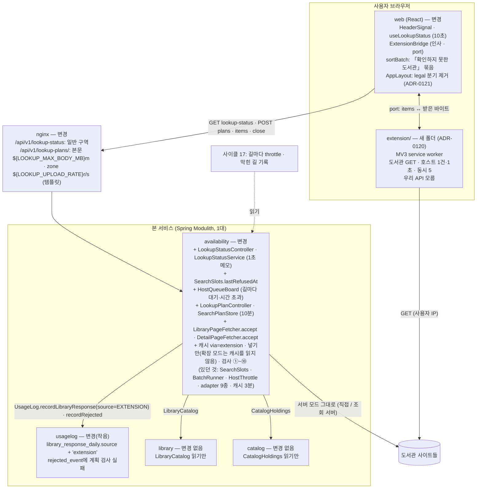
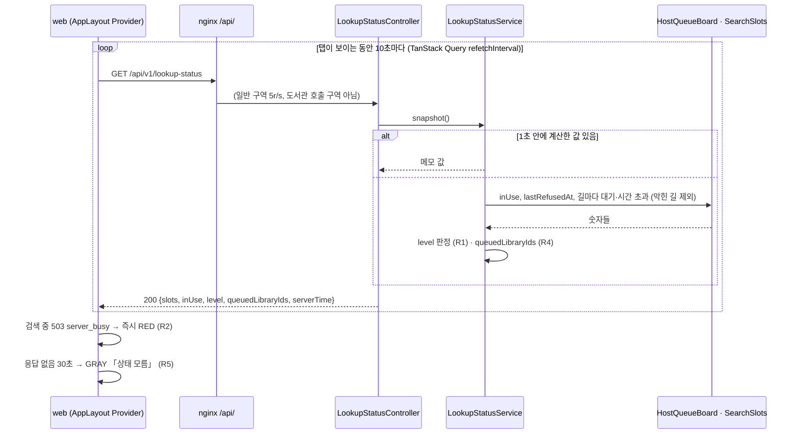
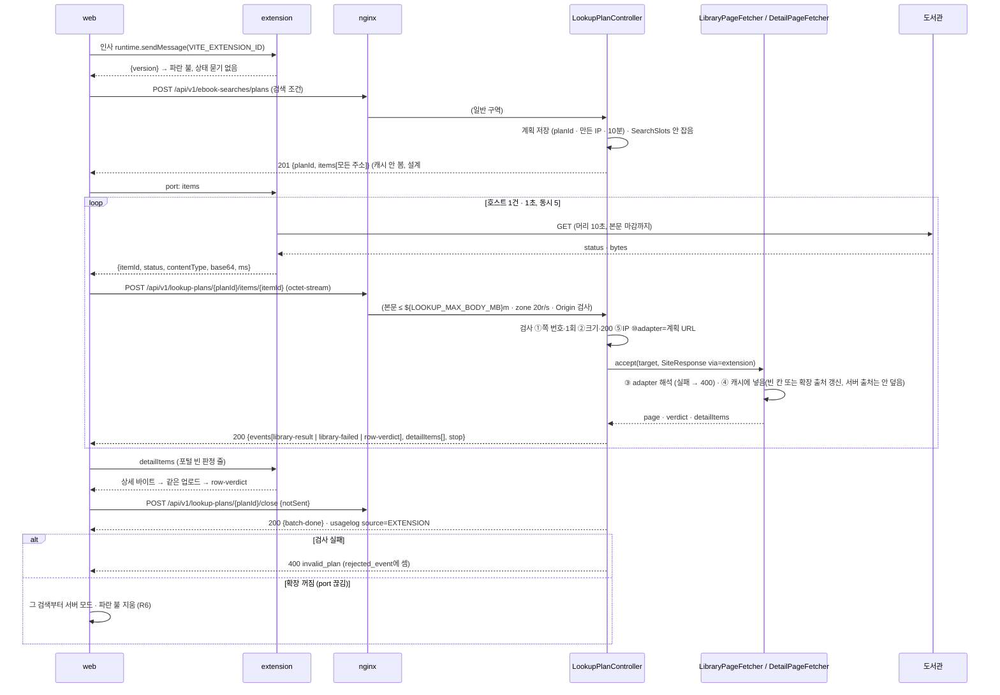
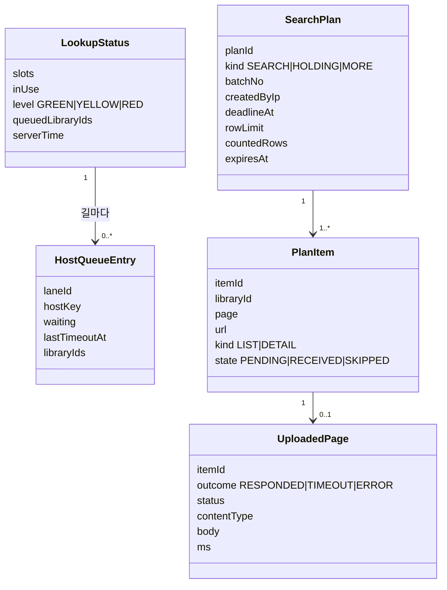
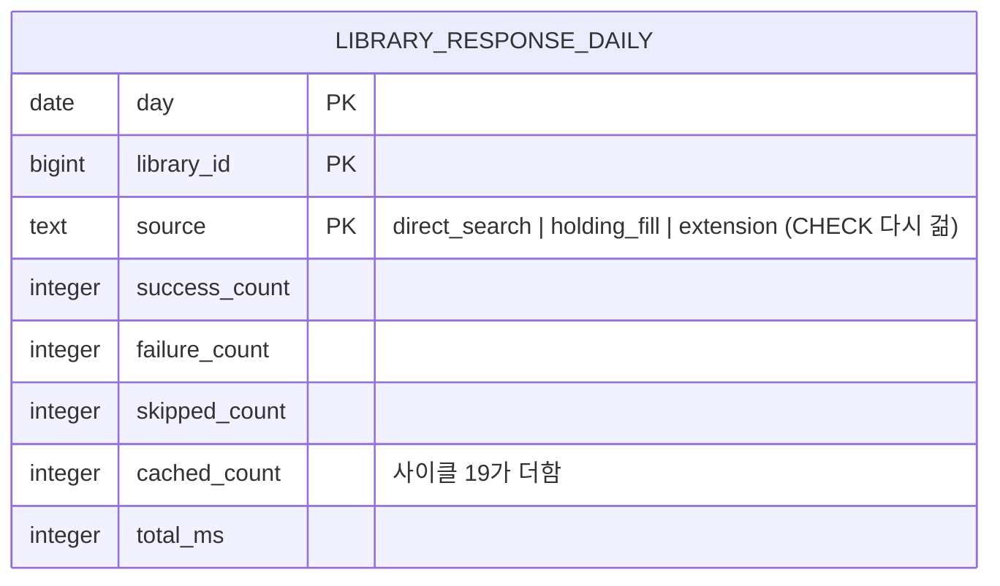

# 설계 변경: 사이클 20 조회 상태 신호와 브라우저 확장 조회

- 바탕: [`scope.md`](scope.md)(범위 8개 확정), [`spec.md`](spec.md)(R1~R14, AC-1~15), [`flow.md`](flow.md), [`architect-proposal.md`](architect-proposal.md)(설계 결정 13개 확정, 2026-10-16), ADR-0118~0121(Proposed)
- 전제: **사이클 17**(나가는 길·막힌 길 기록·운영 nginx·Actuator)과 **사이클 21**(머리말 메뉴)이 먼저 dev에 들어감. 20은 그 위에 얹음. 사이클 19와 겹치는 usagelog 파일은 나중에 합치는 쪽이 rebase([`../19-author-angle-brackets/to-cycle-20.md`](../19-author-angle-brackets/to-cycle-20.md))
- 상태: **초안** — 설계 결정은 모두 확정이나 `docs/current/` 반영과 인계는 사이클 17 회고 뒤(`CLAUDE.md`). 이 문서의 `[안]`은 결정 페이지 [`easy/2026-10-16-design-delta-decisions.html`](easy/2026-10-16-design-delta-decisions.html)에서 정함
- 그림 원본: [`easy/design-delta-original.html`](easy/design-delta-original.html)

## 구조 그림

### 모듈 구성도 (이 사이클이 더하거나 바꾸는 것만)



### 주요 흐름 1: 상태 묻기 (spec R1~R5)



### 주요 흐름 2: 확장 모드 검색 (spec R6~R11, ADR-0119)



### 도메인 모델 (새 개념만)



## 모듈

| 모듈 | 신규/변경 | 책임 | 공개 API | 발행/구독 이벤트 | 소유 테이블 |
|---|---|---|---|---|---|
| `availability` | 변경 | 상태 신호 값(`LookupStatusService`, 1초 메모), 줄 선 호스트(`HostQueueBoard`, throttle이 대기 시작·끝·시간 초과를 `(laneId, hostKey, libraryId)`로 알림), 확장 모드 계획(`SearchPlanStore`, Caffeine 10분·최대 2,000개 [안])과 업로드 입구(`LookupPlanController`), 받은 응답 입구 `LibraryPageFetcher.accept`·`DetailPageFetcher.accept`(`via=extension`), 포털 상세 조회 2단계 분리(`SiteListResolver`: 상세 주소 뽑기 / 받은 상세로 판정), 캐시 값에 `via`·시각, 검사 ①~⑩ | REST만(아래 API). 다른 모듈에 새 공개 타입 없음 | 없음 | 없음(메모리) |
| `usagelog` | 변경(작음) | `library_response_daily.source`에 `extension` 허용, 공개 enum `UsageLog.ResponseSource.EXTENSION`; 계획 검사 실패를 `rejected_event`로 셈(기존 공개 `recordRejected` [확인 필요: 지금 서명]) | 기존 `UsageLog` 그대로 + enum 값 | 없음 | `usagelog.library_response_daily`(CHECK 변경) |
| `library`·`catalog` | 변경 없음 | `LibraryCatalog`·`CatalogHoldings` 읽기만 | — | — | — |
| web | 변경 | 머리말 신호(`HeaderSignal`, `useLookupStatus` TanStack Query `refetchInterval: 10_000`, Provider는 `AppLayout`), 확장 연결(`features/extension/`: 인사 500ms [안], port), 확장 모드 검색 reducer(계획 → 업로드 → close, 이벤트는 SSE와 같은 이름·데이터), `sortBatch`에 네 번째 묶음 「확인하지 못한 도서관」(`failed`·`UNKNOWN` 줄, 계획 순서, 두 거름 모두), `AppLayout` `legal` 분기 제거, 결과 카드 「지금 이 도서관 조회가 밀려요」 | — | — | — |
| `extension/` | 신규(본 서비스 밖, dev 저장소 맨 위) | MV3 service worker: 인사 응답, port로 items 받아 호스트 1건·1초·동시 5로 GET, `{itemId,status,contentType,base64,ms}` 돌려줌. 빌드 없음 | 웹 ↔ 확장 메시지(아래 "외부 연동") | — | — |
| nginx (deploy) | 변경 | `/api/v1/lookup-plans/` location 조각을 `.template`로: `client_max_body_size ${LOOKUP_MAX_BODY_MB}m`, 별도 zone `chaekcheck_lookup_uploads` `${LOOKUP_UPLOAD_RATE}`r/s burst `${LOOKUP_UPLOAD_BURST}` (20·60, `prod.env` 변수) [확정] (사용자: "같은 변수 방식으로하고", 2026-10-16), 413·429는 Problem Details JSON. `/api/v1/lookup-status`는 일반 구역 | — | — | — |

- 모듈 의존 방향은 그대로(`availability → catalog, library, usagelog`), 새 모듈·새 이벤트 없음. `ModularityTests`·`DocumentationTests` 변경 없음
- 사이클 17 의존: `HostQueueBoard`는 17의 길(lane) 개념과 막힌 길 기록을 읽음. 17이 먼저 들어가지 않으면 길은 하나(직접)로 두고 막힌 길은 빈 목록 [확정] (전제)

## 데이터

- 스키마: `usagelog` (새 표 없음, `availability`는 메모리만)



| 테이블.컬럼 | 타입 | 제약 | 설명 | 상태 태그 |
|---|---|---|---|---|
| `usagelog.library_response_daily.source` | `text` (기존) | CHECK를 지우고 `IN ('direct_search','holding_fill','extension')`로 다시 검 | 확장 모드의 도서관 응답(검색·소장·더 보기 모두)은 `extension` | [확정] (설계 #9). 제약 이름은 dev가 확인(지금 이름 없이 걸림) [확인 필요] |
| (메모리) `SearchPlan`·`PlanItem` | Caffeine | 쓴 뒤 10분 만료, 최대 2,000개 [안], 계획 하나 수 KB | 계획 번호는 추측 불가(랜덤 128비트) | [확정] (명세 #11) / 값 [안] |
| (메모리) 캐시 값 `FetchedPage` | 기존 | + `via` (`server`\|`extension`), `storedAt` | 확장 출처 칸을 비우는 방법은 **서비스 재시작**(캐시가 메모리), 전용 엔드포인트 없음 | 보안 ⑧ [확정] / 비우는 방법 [확정] (사용자 승인, 2026-10-16, design-delta 결정 #4) |

- Liquibase: `usagelog/003-library-response-source-extension.yaml` [확정] (사용자 승인, 2026-10-16, design-delta 결정 #6) 새 changeset(기존 changeset 수정 없음). 사이클 19의 `usagelog/002`(cached_count)와 같은 표 → 나중에 main에 합치는 쪽이 include를 master 맨 끝으로
- 확장 모드의 사용 기록 [확정] (#5 확인, 2026-10-16) (사용자: "확장은 어짜피 사용자로 접근하는거니 사용자걸로 보여주고 그 결과만 우리 서버가 캐시로 가져가면 되는 거 아닐까?", 2026-10-16, design-delta 결정 #9 승인): 확장 모드는 서버 캐시를 보지 않으므로 **캐시 답(`CACHED`)이 없음**. 확장이 받아와 해석된 것은 `SUCCESS`/`FAILURE`, 보내지 못한 것은 `SKIPPED`(close의 `notSent`), 출처는 모두 `extension`

## API

| 메서드 | 경로 | 설명 | 요청 | 응답 | 에러 |
|---|---|---|---|---|---|
| GET | `/api/v1/lookup-status` | 상태 신호 값. 도서관을 부르지 않음. nginx 일반 구역. 서버 1초 메모 | 없음 | 200 `{slots, inUse, level, queuedLibraryIds[], serverTime}`, `Cache-Control: no-cache` | — |
| POST | `/api/v1/ebook-searches/plans` | 확장 모드 검색 묶음 계획(자리 안 잡음). 첫 묶음은 지금 `ebook-searches/stream`과 같은 조건, 다음 묶음은 `batchNo`·`candidates` 추가 | JSON `{title|author|publisher, residenceRegionIds, workRegionIds, filter, scope, visit, libraryIds, batchNo?, candidates?}` | 201 `{planId, batchNo, deadlineMs:8000, rowLimit:20, targets?(첫 묶음), items[{itemId, libraryId, page, url}]}` — **캐시를 보지 않고 모든 도서관 주소를 줌**, 사용자는 자기 브라우저가 받은 결과만 봄 [확정] (사용자: "확장은 어짜피 사용자로 접근하는거니 사용자걸로 보여주고 그 결과만 우리 서버가 캐시로 가져가면 되는 거 아닐까?", 2026-10-16, design-delta 결정 #9 승인) | 400 검증(지금과 같음), 429 (⑦ IP별 계획 한도 1분 20개 [안]) |
| POST | `/api/v1/book-availabilities/plans` | 책 화면(소장) 계획. items는 상세 주소 | `{bookIds, …, batchNo?, candidates?(holdingId)}` | 같은 모양(이벤트는 `holding-*`) | 같음 |
| POST | `/api/v1/availability/libraries/{libraryId}/ebooks/plans` [확정] (사용자 승인, 2026-10-16, design-delta 결정 #6) | 「더 보기」 계획(설계 #7) | `{title|…, page}` | `{planId, items[1], events[]}` | 같음 |
| POST | `/api/v1/lookup-plans/{planId}/items/{itemId}` | 받아온 원본 올리기 | 본문 `application/octet-stream`(원본 그대로); 쿼리 `status`, `ms`, `outcome=RESPONDED\|TIMEOUT\|ERROR`, `contentType`(사이트가 준 값). URL은 받지 않음 | 200 `{events[library-result\|library-failed\|row-verdict\|holding-*], detailItems[{itemId, libraryId, url, kind:DETAIL}], stop}` | 400 `invalid_plan`(계획 없음·만료·쪽 번호 없음·이미 받음·IP 다름·Origin 다름·adapter 해석 실패), 413 `payload_too_large`, 429 |
| POST | `/api/v1/lookup-plans/{planId}/close` | 묶음 끝 | `{notSent:[itemId]}` | 200 `{events:[batch-done]}` (usagelog SKIPPED·recordSearch는 여기서) | 400 `invalid_plan` |

- **확장 모드는 서버 캐시를 읽지 않고 넣기만 함** [확정] (사용자: "확장은 어짜피 사용자로 접근하는거니 사용자걸로 보여주고 그 결과만 우리 서버가 캐시로 가져가면 되는 거 아닐까?", 2026-10-16, design-delta 결정 #9 승인): 넣는 규칙 = 빈 칸이면 넣음, 확장 출처 값은 새 값으로 갱신, 서버 출처 값은 덮지 않음(#6 검사는 그대로)
- 이벤트 이름·데이터는 지금 SSE(`docs/current/api.md` 스트림 절)와 같음. `done`은 상세 단계가 끝나거나 30초가 지나면 화면이 만듦 [확정] (architect 2-3)
- 올리기 검사(ADR-0119): ① 쪽 번호가 계획에 있고 처음 ② 본문 ≤ `max-body-size`·`status` 200 ③ adapter 해석 ④ 캐시 빈 칸만 ⑤ 계획을 만든 IP와 같음 ⑥ `Origin`(없으면 `Referer`)이 책첵 주소 ⑦ IP별 계획 만들기 1분 20개 [안] ⑧ 캐시 `via=extension`·`storedAt` ⑨ 검사 실패를 IP별 `rejected_event`(종류 `invalid_plan` [안])에 세고 1분 30번 [안] 넘으면 그 IP의 계획 만들기 10분 거절 [안] ⑩ adapter는 계획의 URL 호스트로만
- 요청/응답 예시

```json
// GET /api/v1/lookup-status → 200
{"slots":20,"inUse":12,"level":"YELLOW","queuedLibraryIds":[1215,3301],"serverTime":"2026-10-20T03:00:00Z"}

// POST /api/v1/ebook-searches/plans → 201
{"planId":"p_8f3a…","batchNo":1,"deadlineMs":8000,"rowLimit":20,
 "targets":{"libraries":[…]},
 "items":[{"itemId":1,"libraryId":1215,"page":1,"url":"https://…/searchList.ink?schTxt=…"}],
 }

// POST /api/v1/lookup-plans/p_8f3a…/items/1?status=200&ms=812&outcome=RESPONDED&contentType=text%2Fhtml%3Bcharset%3DEUC-KR → 200
{"events":[{"event":"library-result","data":{…}},{"event":"row-verdict","data":{…}}],
 "detailItems":[{"itemId":7,"libraryId":1215,"url":"https://…/detail?…","kind":"DETAIL"}],"stop":false}

// 400
{"type":"about:blank","title":"Bad Request","status":400,"code":"invalid_plan","detail":"plan expired or item already received"}
```

## 외부 연동

| 대상 | 방식 | 제한·키 관리 | 실패 시 동작 | 상태 태그 |
|---|---|---|---|---|
| 도서관 사이트 (확장 모드) | 확장 service worker `fetch()` GET, `host_permissions` http·https 전체, `credentials:'omit'`, `redirect:'manual'`, User-Agent는 브라우저 것 | 호스트마다 동시 1건·앞 요청 끝 +1초, 동시 5, 응답 머리 10초·본문 묶음 마감까지, 상한 `max-body-size`(4MB) | `outcome=TIMEOUT\|ERROR`로 올림 → 그 줄 "확인하지 못한 도서관", 서버가 다시 부르지 않음 | [확정] (명세 #7·#10, 설계 #8) |
| 웹 ↔ 확장 | `externally_connectable.matches`에 책첵 운영·개발 주소; 화면이 `chrome.runtime.sendMessage(VITE_EXTENSION_ID, {type:'hello'})` → `{version}`; 조회는 `chrome.runtime.connect(id)` port로 `{type:'fetch', items}` ↔ `{type:'page', itemId, status, contentType, base64, ms}` | 확장 ID는 manifest `key`로 고정, 웹 설정 `VITE_EXTENSION_ID`. 메시지 64MiB 한도(바이트 base64) | 인사 500ms 답 없음·port 끊김 → 서버 모드 (R6) | [확정] (공식 문서, scope 외부 확인) / 메시지·설정 이름 [확정] (사용자 승인, 2026-10-16, design-delta 결정 #6) |
| nginx | 템플릿 `lookup-plans.conf.template`(`client_max_body_size ${LOOKUP_MAX_BODY_MB}m`, zone `${LOOKUP_UPLOAD_RATE}`r/s burst `${LOOKUP_UPLOAD_BURST}`), `prod.env`의 `LOOKUP_MAX_BODY_MB=4`를 compose가 Spring(`CHAEKCHECK_AVAILABILITY_MAX_BODY_SIZE=${LOOKUP_MAX_BODY_MB}MB`)과 nginx 양쪽에 | 공식 nginx 이미지 envsubst(`/etc/nginx/templates` → `conf.d`, 2026-10-16 확인) | 413·429 Problem Details JSON | [확정] (설계 #12, 사용자 "이걸로 해줘") |
| 사이클 17 막힌 길 기록·길마다 throttle | `HostQueueBoard`가 읽음 | 17 인계(`from-cycle-20-blocked-ip-resume.md`) | 17 없으면 길 하나·막힌 길 없음 | 전제 [확정] |

## 웹 (화면)

- 머리말: 사이클 21 메뉴 위에 점+글(`HeaderSignal`), 「로그인」 왼쪽, 폰은 점만·☰ 왼쪽·팝오버 설명. 상태: 빈 자리(첫 응답 전) / GREEN·YELLOW·RED / GRAY(30초) / BLUE(확장 모드, 묻지 않음). 움직임 없음 (flow #1·#2·#4, ADR-0121)
- 결과 카드: 줄이 선 도서관 글(PC 이름 옆, 폰 이름 아래). 빨강에도 카드 변화 없음. 네 번째 묶음 「확인하지 못한 도서관」(`failed` + `UNKNOWN`, 계획 순서, 두 거름 모두), 줄 글 「대출 정보를 확인하지 못했어요」(지금 「확인 실패」를 바꿈) (flow #3·#7, 설계 #10)
- 확장 모드: `features/extension/` — 감지·port·업로드·이벤트를 기존 reducer(`useSearch`·`useHoldings`)에 넣음. 「더 보기」도 계획 입구. 400 `invalid_plan`은 일반 오류 문구 (flow #6)
- 설정: `VITE_EXTENSION_ID` [확정] (사용자 승인, 2026-10-16, design-delta 결정 #6)

## 확장 꾸러미 (`extension/`)

- `manifest.json`: `manifest_version: 3`, `key`(개발자 대시보드에서 받은 공개키, ID 고정), `host_permissions: ["http://*/*","https://*/*"]`, `externally_connectable: {matches: ["https://chaekcheck.com/*","http://localhost:5173/*"]}` [안 개발 주소], `background: {service_worker: "background.js", type: "module"}`, `version`
- `background.js`: `onMessageExternal` 인사 → `{version}`; `onConnectExternal` port → items를 호스트별 큐(동시 1·+1초)와 전체 동시 5로 `fetch`, `AbortController`로 머리 10초, `arrayBuffer` → base64 → `{itemId,status,contentType,base64,ms}`; 실패는 `outcome`
- `throttle.js` + `node --test` 시험. README: 개발자 모드 설치 방법, `key` 얻는 방법(https://developer.chrome.com/docs/extensions/reference/manifest/key)
- dev `CLAUDE.md` 한 줄 추가(인계서): "`extension/` — 크롬 확장(MV3), Spring 앱 아님, Gradle 없음, 압축 해제 확장으로 로드"

## 결정 기록

- [ADR-0118](../../adr/0118-lookup-status-polling-and-host-queue-board.md) 상태 신호 10초 묻기·`HostQueueBoard`·`/api/v1/lookup-status`
- [ADR-0119](../../adr/0119-extension-as-user-side-fetcher-server-parses-and-checks.md) 확장은 사용자 쪽 조회 서버, 화면이 올림, 서버 `accept` 해석·검사·보안 ①~⑩, 상한 설정 하나
- [ADR-0120](../../adr/0120-extension-folder-no-build-chrome-first-dev-mode.md) `extension/` 빌드 없음·크롬만·개발자 모드
- [ADR-0121](../../adr/0121-same-header-on-every-screen.md) 머리말 모든 화면 같게
- 막힌 IP 풀림 규칙은 사이클 17 인계([`../17-first-deploy/from-cycle-20-blocked-ip-resume.md`](../17-first-deploy/from-cycle-20-blocked-ip-resume.md), 상한 1주일)

## 확인 필요

| 항목 | 왜 필요한가 | 확인 방법 | 막는 단계 |
|---|---|---|---|
| 확장 service worker에서 `http://` 도서관(전주)·중간 인증서 빠진 도서관이 열리는지, 받은 바이트(EUC-KR)가 adapter로 해석되는지 | AC-9·AC-10 | dev 프로토타입(사이트 3곳, 1초 간격) — 안 되면 그 도서관만 서버 모드로 보내는 규칙을 더함 | 인계 |
| 전체 도서관 호스트 CORS 일괄 확인 | 설치 없는 직접 조회 불가 확정 | dev 호출 시험 1초 간격 | 없음(참고) |
| `library_response_daily.source` CHECK 제약의 실제 이름 | changeset | dev DB 확인 | 인계 |
| `UsageLog.recordRejected`의 지금 서명(종류 값 추가 가능?) | 보안 ⑨ | dev 코드 | 설계 마무리 |
| Spring 요청 본문 기본 한도와 octet-stream 읽기(4MB를 컨트롤러에서 검사) | 413 | 공식 문서 | 인계 |
| MV3 service worker 수명(묶음 도중 잠듦)과 port 유지 | R6·AC-11 | 프로토타입 | 인계 |
| `HostQueueBoard`가 호스트→도서관을 배우는 한계(재시작 뒤 포털 소속 도서관) | R4 | dev 확인 | 없음(참고) |
| 사이클 17 `prod.conf`에 템플릿 조각을 넣는 방법(17이 템플릿을 쓰는지) | nginx | 17 인계서 확인 | 인계 |
