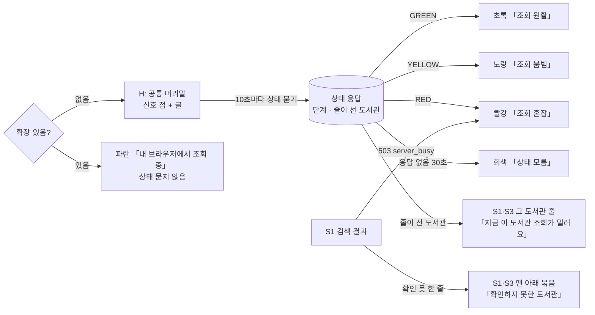
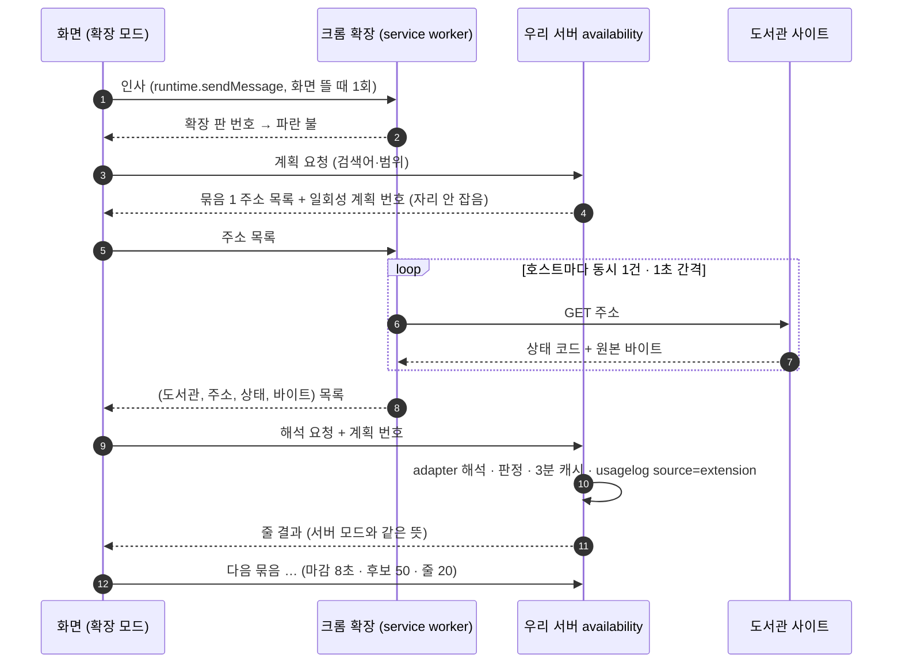

# 화면 흐름: 조회 상태 신호와 브라우저 확장 조회

- 범위 `scope.md`, 명세 `spec.md`(R1~R13, AC-1~AC-15, 모두 확정 2026-10-15). 새 화면은 없고, **공통 머리말(H)**과 **검색 결과(S1)·책 화면(S3)의 결과 줄**에 상태가 더해진다. 확장 모드는 같은 화면이 다른 길로 결과를 받는 것이라 화면이 아니라 흐름(F2)으로 적는다.
- 결정 페이지: [`easy/2026-10-15-flow-decisions.html`](easy/2026-10-15-flow-decisions.html). 그림 원본: [`easy/flow-original.html`](easy/flow-original.html)
- 화면 번호는 `docs/current/flows.md`의 것을 그대로 쓴다(S1 검색, S3 책 화면, S13 사서추천, S12 소개). H는 이 문서에서 새로 붙인 공통 머리말 이름.

## 화면별 내용

### H 공통 머리말 (모든 화면 — `/terms`·`/privacy` 포함)
- **머리말은 모든 화면에서 같음** [확정] (사용자: "왜 이용약관이랑 개인정보처리방침은 왜 머릿말이 달라? 그것들도 같아야지", 2026-10-15, 화면 흐름 #4). 지금 dev는 약관(S8)·처리방침(S9)에서 「사서추천도서」 링크와 「로그인/로그아웃」을 숨김(`AppLayout.tsx` `legal`; 사이클 05 flow 48행 "S8·S9에는 로그인·로그아웃 버튼을 두지 않음" [확정] 2026-10-04, 이유 [이유 미확인]; 사이클 10 flow 32행·14 flow 25행이 그대로 둠) → 이 사이클에서 **그 예외를 없앰**: S8·S9도 「사서추천도서」·신호·「로그인/로그아웃」을 보임. 사이클 05·10·14 결정을 바꾸는 것이라 design-delta에서 ADR로 적음
- 목적: 검색을 누르기 전에 지금 조회가 원활한지 보이기 (spec R1·R2·R5)
- 보이는 요소: 「책첵」 · 「사서추천도서」 … **[점 + 글]** · 「로그인/로그아웃」. 점+글은 「로그인」 바로 왼쪽 [확정] (범위 #4)
- 글 [확정] (명세 #1): 초록 「조회 원활」 / 노랑 「조회 붐빔」 / 빨강 「조회 혼잡」 / 회색 「상태 모름」(R5) / 파란 「내 브라우저에서 조회 중」(확장 모드, 명세 #4·#12)
- 사용자 동작: 없음(PC). 폰(640px 이하)은 점만 보이고 **누르면 말풍선(팝오버)**으로 글과 설명 한 줄(「지금 찾는 사람이 많아 검색이 거절될 수 있어요」) [확정] (사용자 승인, 2026-10-15, 화면 흐름 결정 #1)
- 호출하는 API: 상태 묻기(이름은 design-delta). 모든 화면이 **보이는 동안** 10초마다, 탭이 숨으면 멈춤, 다시 보이면 즉시 1회 [확정] (R3). 확장 모드면 묻지 않음 [확정] (R10)
- 상태: 첫 응답 전 빈 자리(명세 #8) / 초록·노랑·빨강 / 회색(30초 넘게 응답 없음, 명세 #7) / 파란(확장)
- 배치 메모: PC·태블릿은 점(지름 약 10px)+글 한 덩이, 글은 `navLink`와 같은 크기. 폰은 점만(44px 터치 영역은 다른 머리말 요소와 같은 방식). 신호가 바뀔 때 움직임(깜빡임) 없음, 색·글만 바뀜 [확정] (사용자 승인, 2026-10-15, 화면 흐름 결정 #2)

### S1 검색 결과 (지금 화면에 더해지는 것)
- 빨강일 때(R12): 카드에 더하는 것 없음, 결과는 오는 대로 [확정] (사용자: "똑같은데 도서관에서 보기 추가하는 의미가 없지 않아? 해당 도서관 대출 결과가 없으면 없다고 보여주고 빨가이어도 조회가 되면 조회 결과를 보여줘야지 대출 결과를 못 찾을 때 어느 순서에 둘 건지를 고려해야지", 2026-10-15, 화면 흐름 #7). **확인하지 못한 줄**(실패·시간 초과·줄 밀림·확장 실패)은 결과 맨 아래 묶음 「확인하지 못한 도서관」(계획 순서, 두 거름 모두에서 보임), 글 「대출 정보를 확인하지 못했어요」 [안] (지금: `UNKNOWN`으로 예약 묶음 맨 아래, 빌릴 수 있는 책만에서는 숨김)
- 줄이 선 도서관(R4, 명세 #2·#5): 그 도서관 결과 줄 이름 옆 「지금 이 도서관 조회가 밀려요」. 폰은 이름 아래 줄 [확정] (사용자 승인, 2026-10-15, 화면 흐름 결정 #3). 그 줄이 실패(`library-failed`)로 끝나도 표시는 상태 응답을 따름(60초 안에 사라짐)
- 상태: 503 받음 → 머리말 즉시 빨강(R2) + 지금 503 안내
- 사서추천(S13)·소개(S12)·내 도서관(S10)·약관·처리방침(S8·S9): 머리말 신호만 보임(결과 카드가 없음). 신호는 모든 화면의 머리말에 [확정] (사용자 제안 "그것들도 같아야지", 2026-10-15, 화면 흐름 #4)

### S3 책 화면 (책 하나의 도서관 목록)
- S1과 같은 규칙: 확인하지 못한 줄 묶음, 줄이 선 도서관 배지 [확정] (사용자 승인 "그냥 똑같은데 빨강 안내 줄 빼", 2026-10-15, 화면 흐름 결정 #5)

## 흐름

- **F1 상태 묻기**: 화면 뜸 → (확장 인사 → 답 없음) → 상태 묻기 → 10초마다 반복. 탭 숨김 → 멈춤. 다시 보임 → 즉시 1회. 응답 없음 30초 → 회색. 503 받음 → 즉시 빨강, 다음 응답으로 복귀 (R1·R2·R5)
- **F2 확장 모드 조회** (위 sequence, R6~R9): 인사 답 있음 → 파란 불, 상태 묻기 없음. 검색마다 계획 → 확장이 받아오기 → 해석. 확장이 못 받아온 도서관은 그 줄 "실패"(서버가 다시 안 부름, 명세 #10). 계획 번호 틀림 → 400 `invalid_plan`(화면은 "검색하지 못했어요" 일반 오류) [확정] (사용자 승인, 2026-10-15, 화면 흐름 결정 #6). 확장이 중간에 꺼져 첫 주소 요청이 실패 → 그 검색부터 서버 모드 + 파란 불 지움(명세 #9)
- **F3 도서관 줄 몰림**: 상태 응답의 줄이 선 도서관 목록 → S1·S3의 해당 줄 배지. 길마다 따로 셈, 막힌 길 제외(R4)

## 수용 기준 대응

| AC | 화면·흐름 |
|---|---|
| AC-1 초록 점+「조회 원활」 10초 안 | H, F1 |
| AC-2 10개 노랑 · 20개 빨강 · 복귀 | H, F1 |
| AC-3 503 즉시 빨강 + 기존 503 안내 | H, S1 |
| AC-4 빨강에도 카드 변화 없음, 확인 못 한 줄은 맨 아래 묶음 | S1, S3 |
| AC-5 줄이 선 도서관 배지, 60초 뒤 사라짐 | S1, S3, F3 |
| AC-6 탭 숨김 멈춤·복귀 즉시 1회 | F1 |
| AC-7 상태 API 1분 60번 429 없음, 도서관 요청 없음 | F1 (API) |
| AC-8 폰 점만, 누르면 설명, 가로 스크롤 없음 | H(폰) |
| AC-9 확장 모드 파란 불, 상태 묻기 없음, 도서관 요청은 확장에서 | H, F2 |
| AC-10 서버 모드와 같은 결과, 캐시 공유 | F2 |
| AC-11 확장 호스트 1건·1초 | F2 |
| AC-12 빨강(자리 20 찼음)에도 확장 모드 검색 됨 | F2 |
| AC-13 계획 번호 틀림 400, 캐시 안 들어감 | F2 |
| AC-14 확장 없는 브라우저·폰은 이전과 같음 | H, F1 |
| AC-15 usagelog source=extension | F2 (서버) |

## 상태별 동작 대응 (spec)

| spec 상태 | 화면 상태 |
|---|---|
| 로딩(첫 응답 전) | H 빈 자리 |
| 결과 없음(줄이 선 도서관 없음) | S1·S3 배지 없음 |
| 상태 요청 실패 | H 30초 유지 → 회색 「상태 모름」 |
| 확장이 못 받아옴 | S1·S3 맨 아래 「확인하지 못한 도서관」 묶음 [안] |
| 계획 번호 오류 400 | 일반 오류 안내 [확정] (화면 흐름 #6) |
| 다른 사이트가 확장에 말 걺 | 화면 없음(브라우저가 막음) |
