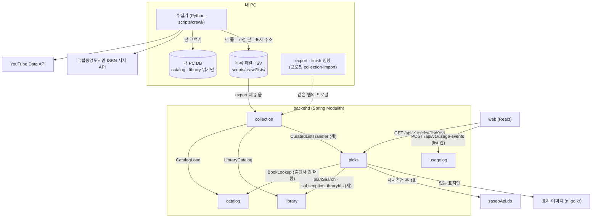
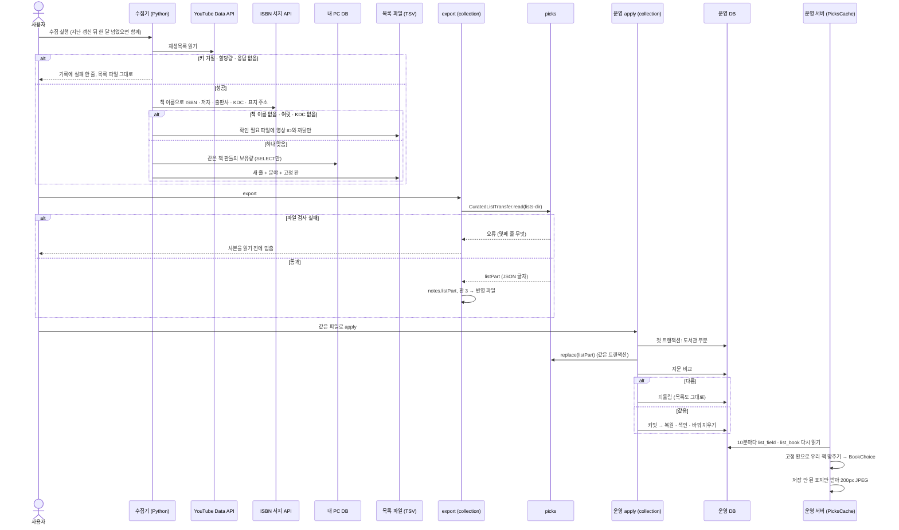
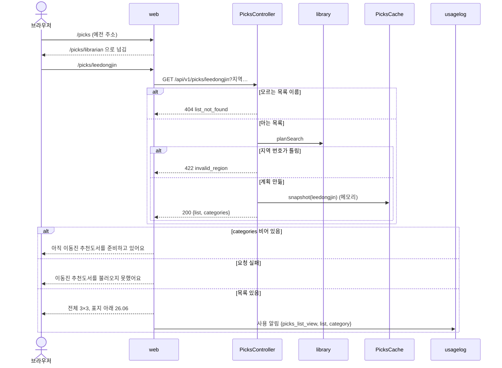
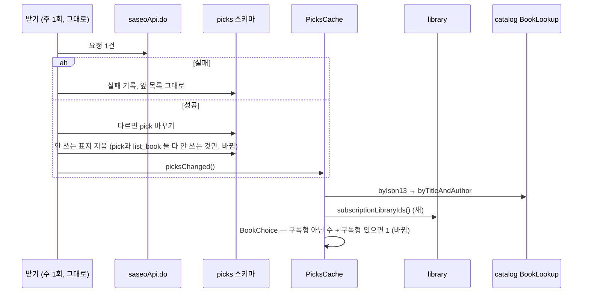
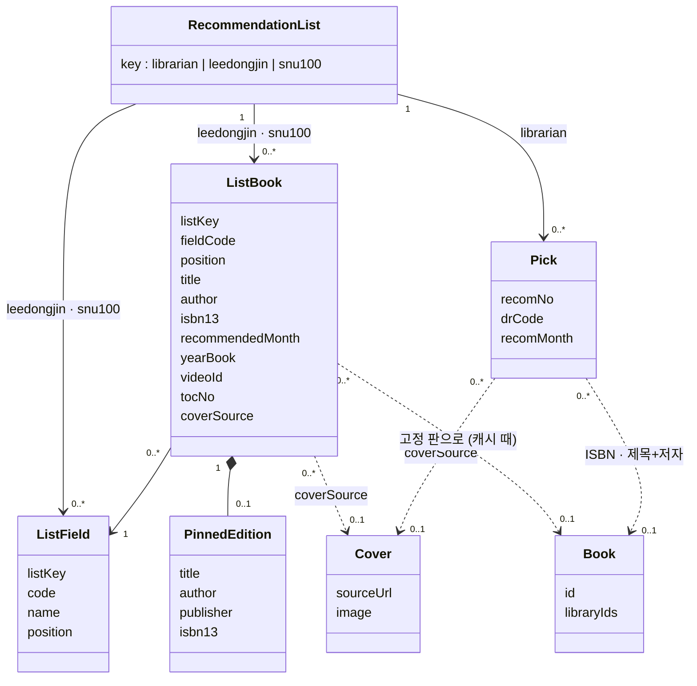
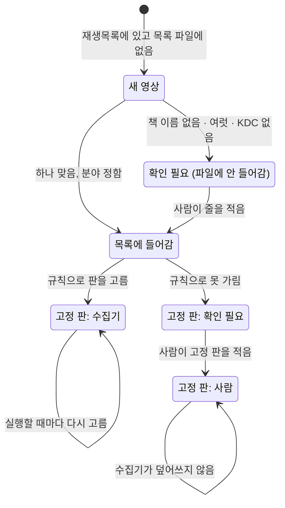
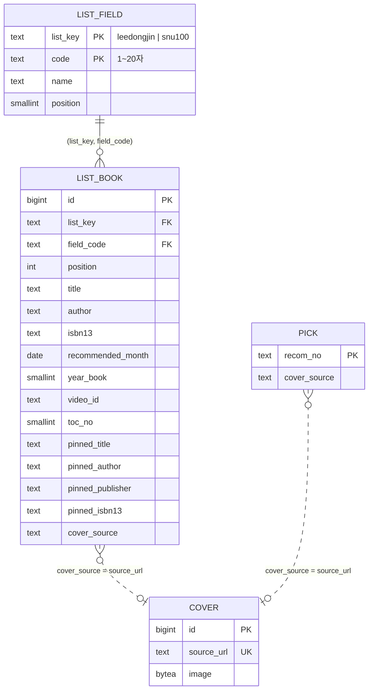

# 설계 제안: 사이클 21 추천도서 (architect, 2026-10-16)

- 만든 곳: `architect` 서브에이전트 (2026-10-16), 메인 세션이 사실 두 가지를 고침(아래 "고친 것"). spec·scope·flow의 [확정]은 다시 열지 않음
- 근거: `scope.md`·`spec.md`·`flow.md`, `from-cycle-20-header-light.md`, `../19-author-angle-brackets/to-cycle-21.md`, `docs/current/`(module-map `picks`·가져오기 따로 하기, data-model `catalog`·`collection`·`picks`·`usagelog`, api `picks`), ADR-0065·0078·0086·0089·0090·0091, `docs/reference-index.md` 3·3-1·4·4-1·6, dev 코드(읽기만, 끝에 목록), dev 스킬 spring-modulith·postgres-patterns·api-design
- 결정 페이지: `easy/2026-10-16-design-decisions.html`

## 고친 것 (메인 세션)

- ISBN 서지 API `TITLE_URL`은 공식 안내의 출력 항목 표에 "표지이미지 URL"로 있음 [확정] (https://www.nl.go.kr/NL/contents/N31101030500.do , 2026-10-15 확인). 확인 못 한 것은 주소의 호스트·경로와 인증키가 붙는지뿐 [확인 필요: API 호출 시험]
- spec R1-7: 로그인 전 「내 도서관 관리」는 로그인 안내가 아니라 같은 화면이 열리고 이 브라우저에 저장됨 (dev `MyLibrariesPage.tsx` 39행) → spec 고침 (2026-10-16)

## 지금 상태 (dev 코드, 2026-10-16)

| 대상 | 지금 |
|---|---|
| 모듈 `picks` | `allowedDependencies = catalog, catalog :: normalize, library`. 공개 Java 타입 없음. `PicksCache`가 시작 때·10분마다·받은 직후 DB를 읽어 메모리 한 벌. `BookChoice`는 `libraryIds.length` 큰 책 → 번호 작은 책(구독형도 한 곳씩) |
| 표 `picks.*` | `fetch_run`, `pick`, `cover`(`source_url` UNIQUE). 표지 정리: `pick.cover_source`에 없는 `cover`는 지움(ADR-0091). `CoverUrls`는 `www.nl.go.kr` `/afile/`만 받음 |
| API | `GET /api/v1/picks`, `GET /api/v1/picks/covers/{coverId}` |
| `catalog` 공개 API | `BookLookup.byIsbn13`, `byTitleAndAuthor`(`TitleAuthorBook(query, bookId, libraryIds)`, 출판사 없음). 반영 파일 판 `FORMAT_VERSION = 2` |
| `library` 공개 API | `LibraryCatalog.planSearch` 등. 구독형 도서관 목록을 주는 메서드 없음 |
| `collection` 가져오기 | `ImportTransfer`. export는 `Notes`(기록·지문·`libraryPart`)를 manifest JSON으로. apply는 한 트랜잭션에서 `LibraryPart.apply` → 비교 → 커밋 → 복원·색인·바꿔 끼우기. 따로 도는 프로필 `collection-import` |
| `usagelog` | `screen_event.kind`에 `picks_list_view`·`picks_book_view`, 칸 `picks_category`. 목록 이름 칸 없음 |
| 웹 | 경로 `/picks` 하나. `AppLayout`은 링크 하나와 `legal` 분기 |
| 수집기 | dev `scripts/crawl/`. 추천 목록 코드·파일 없음 |

## 결정 1: 새 두 목록을 어느 모듈에

- **A안 `picks`를 넓힘** — 표 `list_field`·`list_book`을 더하고 캐시·컨트롤러·표지·`BookChoice`를 세 목록이 함께 씀. 장점: 같은 화면·응답·고르기 규칙(R2-1·R2-2)이라 코드 한 벌, 표지 코드 재사용. 단점: `picks`가 커지고 표지 정리가 두 표를 봄. 나중에 분리할 때: `picks` 서비스 하나
- B안 새 모듈(`booklists` 등) — 표지·캐시·고르기·API가 두 벌, 공통 모듈이 필요해짐
- 추천: A안 [확정] (사용자 승인, 2026-10-16, 설계 결정 #1)

## 결정 3: 목록 파일을 반영 파일(export)에 싣는 길

- **A안 `load_manifest.notes.listPart` + 반영 파일 판 3** (ADR-0086 도서관 부분과 같은 방식) — export 때 `collection`이 `picks` 공개 API `CuratedListTransfer.read(listsDir)`를 불러 검사된 JSON 글자를 받아 `Notes.listPart`에 실음. apply는 도서관 부분과 **같은 첫 트랜잭션**에서 `replace(listPart)`, 비교가 다르면 함께 되돌림. `finish`·`in-place`도 `replace`. 판 2 → 3(판 2만 아는 앱이 목록을 버리지 않게). 장점: 파일 하나 원칙(ADR-0078), 모듈 경계 지킴, 사이클 13에서 실데이터로 통과한 방식. 단점: `collection → picks` 의존이 새로 생김, 판 3 배포 때 내 PC에 기다리는 판 2 내보내기가 있으면 `finish` 거절(ADR-0086과 같은 감수)
- B안 dump 안에 표 — `catalog` 덤프 코드가 `picks` 표를 알게 되어 경계를 어김
- C안 반영 파일 옆 작은 파일 — 옮길 파일이 둘, 짝 맞추기 검사가 새로 필요
- 추천: A안, 호출은 같은 트랜잭션의 직접 호출(가져오기 명령은 곧 내려가는 프로세스라 비동기 이벤트로는 반영이 보장되지 않음) [확정] (사용자 승인, 2026-10-16, 설계 결정 #3, 메모: 결정 6 B에 따라 "표지 그림도 가져오기 파일에 함께 실려 간다 … 이거 이렇게 해") → `listPart`에 목록 줄과 함께 줄인 표지 그림도 실음

## 결정 4: 고정 판을 우리 책 번호(`bookId`)로 바꾸는 때

- **A안 캐시를 만들 때 맞춤** (ADR-0090과 같음) — DB에는 고정 판 글자(제목·저자·출판사·ISBN)만. 캐시가 10분마다 ① `pinned_isbn13` → `byIsbn13` ② 없으면 `byTitleAndAuthor(pinned_title, pinned_author)`를 출판사 정리값으로 좁힘 ③ 그래도 여럿이면 `BookChoice`. 고정 판이 비면 목록의 ISBN → 제목+저자. `TitleAuthorBook`에 출판사 정리값 칸을 더함. 장점: 다시 가져와 책 번호가 바뀌어도 10분 안에 바로잡힘, 사서추천과 같은 길. 단점: 10분마다 조회 약 144번(묶어서 SQL 둘), `catalog` 공개 레코드 바뀜
- B안 apply 때 맞춰 `book_id` 저장 — 맞추는 길이 둘, 바꿔 끼우기 뒤 실패 처리가 새로 필요
- 추천: ~~A안~~ → **추천 바뀜 (2026-10-16)**: 새 두 목록은 **내 PC에서 가져오기 파일을 만들 때 같은 파일의 책 표(`catalog_next`)에 대고 고정 판을 맞춰 `list_book.book_id`에 저장**하고, 운영 서버는 DB를 읽기만 함(10분 메모리 캐시는 지금처럼 응답 속도용) [안]. 사서 추천도서는 서버가 따로 받으므로 지금처럼 캐시 때 맞춤. 바꾼 까닭: 사용자 지적 "DB에서 서버가 값을 읽어서 보여주는게 일반적인거 아니야? 왜 10분마다 맞춰줘야 해? 같이 맞춰주면 되는 거 아니야?" (2026-10-16, 설계 결정 #4 기타) — 처음 추천은 사서추천(ADR-0090)을 따랐으나, 새 목록은 책 목록과 같은 파일로 오므로 따로 맞출 까닭이 없음. 책 번호는 내 PC에서 정해지고(ADR-0078) 같은 책이면 이어 씀(ADR-0062)

## 결정 5: 수집기(Python)가 판을 고를 때 무엇을 읽나

- **A안 내 PC 서비스 DB를 읽기만** (조사 때와 같음) — `catalog.book`·`book_contributor`·`library.library.lending_model`을 SELECT만. 같은 책 범위·거르기·보유량 공식은 Python. 장점: 조사에서 87권을 이 방법으로 맞춤, 새 Java 코드 없음. 단점: Modulith 밖 스크립트가 두 모듈 표에 기댐, 보유량 공식이 Java·Python 두 곳 → `reference-index.md` 6절에 재작업 항목을 더하고 같은 입력으로 두 결과를 비교하는 시험을 dev 작업에 넣음
- B안 Java 명령(프로필)이 판을 골라 파일을 채우고 수집기는 부르기만 — 공식이 한 벌이지만 "수집기가"(spec R3-4 [확정])를 Java로 읽는 해석이 필요
- C안 수집 SQLite 원본으로 Python이 직접 묶기 — 묶기 규칙을 다시 짜야 해 권하지 않음
- 추천: A안 [확정] (사용자 승인, 2026-10-16, 설계 결정 #5)

## 결정 6: 새 목록 표지를 누가 받나

- **A안 운영 서버 `picks`가 받음** (ADR-0091과 같음) — 수집기는 `TITLE_URL`을 목록 파일 `cover_url`에 적기만. 서버가 캐시를 새로 읽을 때 저장 안 된 표지만 1초 간격으로 받아 200px JPEG. 실패한 주소는 다음 05:00에 한 번 더 [안]. `CoverUrls`에 ISBN 서지 표지 주소 하나 더함, 표지 정리는 `pick` ∪ `list_book` 기준. 장점: 표지 코드·제한 그대로, CSP 그대로. 단점: 새 줄 직후 최대 10분(실패면 다음 날)까지 제목 글자
- B안 수집기가 줄여서 반영 파일에 실음 — 줄이기 코드가 Python에 한 벌 더, manifest가 커짐
- 추천: A안 → **미승인, B안으로** [확정] (사용자: "다른 선택: 수집기가 표지를 받아 줄여서 가져오기 파일에 싣기 …"를 골라 미승인, 2026-10-16, 설계 결정 #6). 바뀌는 것: 수집기(Python)가 ISBN 서지 API 표지를 받아 폭 200px JPEG로 줄여(원본 상한 5MB는 ADR-0091과 같게 [안]) 목록 파일 옆 폴더에 두고, export 때 `listPart`에 그림을 함께 실음(약 144장, 1~3MB). apply의 `replace`가 `cover` 표에 넣음(키는 표지 주소 `source_url` 그대로). 운영 서버는 새 목록 표지를 바깥에서 받지 않음 → `CoverUrls`에 주소를 더하지 않음. 표지 정리는 `pick` ∪ `list_book` 기준 그대로. 새 줄이 화면에 나올 때 표지도 바로 보임

## 결정 2: KDC → 분야 대응표와 분야 목록의 자리

- **A안 목록 파일 옆 TSV** (`kdc_fields.tsv`, `fields.tsv`) — "분야 목록도 수집기 쪽에서 더하거나 고침"(R4-3)을 코드 수정 없이. 사이클 13·19 규칙 TSV와 같은 꼴. `fields.tsv`는 export에 실려 화면 분야 이름·순서가 됨
- B안 Python 상수 — 분야를 고칠 때마다 코드 수정
- 추천: A안 [확정] (사용자 승인, 2026-10-16, 설계 결정 #2)

## 결정 9: 화면 API 모양

- **A안 `GET /api/v1/picks/{listKey}`** (`librarian`·`leedongjin`·`snu100`), `GET /api/v1/picks`는 지움 — 웹 주소와 같은 모양, 모르는 이름은 404. 표지 `GET /api/v1/picks/covers/{coverId}`는 그대로 세 목록이 함께. 배포 전이고 웹만 부르므로 옛 경로를 지움(ADR-0089 선례)
- B안 `GET /api/v1/picks?list=` — 목록 이름이 계획 파라미터와 섞임
- 추천: A안 [확정] (사용자 승인, 2026-10-16, 설계 결정 #9)

## 결정 10: 이용 기록에 목록 이름

- **A안 사용 알림에 `list`, 칸 `screen_event.picks_list`** — `picks_list_view`·`picks_book_view`에 `list`(`librarian|leedongjin|snu100`) 필수, 틀리면 `rejected_event`. 새 changeset이 칸을 더하고 이미 있는 줄은 `librarian`으로 채운 뒤 CHECK
- B안 `picks_category`에 "leedongjin:essay"처럼 이어 쓰기 — 20자 상한·칸 뜻이 바뀜
- 추천: A안 [확정] (사용자 승인, 2026-10-16, 설계 결정 #10)

## 더 정할 것 (제안이 남긴 질문)

- 결정 7: 사람이 적은 고정 판(`pinned_by = manual`)은 수집기가 덮어쓰지 않고, 수집기가 고른 판(`collector`)은 실행할 때마다 다시 고름 [확정] (사용자 승인, 2026-10-16, 설계 결정 #7) (spec "확인 필요")
- 결정 8: 이동진 "올해의 책" 영상 찾기 — 재생목록 「이달의 책」 밖에 있을 수 있음(2023년 연말 영상 2개가 그랬음). 수집기가 채널의 "업로드" 재생목록을 YouTube Data API로 읽어(재생목록 읽기 1단위) 제목에 "올해의 책" 또는 "베스트북"이 든 12월 영상을 찾음 [확정] (사용자 승인, 2026-10-16, 설계 결정 #8). 검색 API(`search.list`)는 한 번에 100단위라 쓰지 않음. 업로드 재생목록을 API로 얻는 방법은 [확인 필요: 공식 문서 확인]
- 결정 11: 화면의 책 이름은 목록의 책 이름(서울대는 목차 제목, 예 「연암집」), 책 창의 저자·출판사는 맞춘 우리 책(고른 판) 값 [안]
- 결정 12: 641px 이상 태블릿은 PC처럼 "맨 위 제목"(flow #4 A)을 따름 [확정] (사용자 승인, 2026-10-16, 설계 결정 #12)

## 구조 그림 (추천안 기준)

### 모듈 구성도



### 흐름 (a) 매달 수집기 → export → apply → 캐시 → 화면



### 흐름 (b) 목록 화면 요청



### 흐름 (c) 사서 추천도서 — 고르기 규칙만 바뀜



### 도메인 모델



### 수집기가 이동진 영상 하나를 다루는 상태



## 데이터 (스키마 `picks`, 소유 `picks`, 모든 값 [안])



| 테이블.컬럼 | 타입 | 제약 | 설명 |
|---|---|---|---|
| `list_field.list_key` | text | PK 앞, CHECK IN (`leedongjin`,`snu100`) | 사서는 코드 상수 그대로 |
| `list_field.code` | text | PK 뒤, CHECK `^[a-z_]{1,20}$` | 예: `korean_fiction`, `foreign_fiction`, `graphic_novel`, `essay`, `humanities`, `history`, `society`, `economy`, `science` / `korean_lit`, `foreign_lit`, `eastern_thought`, `western_thought`, `science_tech` |
| `list_field.name` | text | NOT NULL | 화면 이름 |
| `list_field.position` | smallint | NOT NULL, ≥ 1, UNIQUE(`list_key`,`position`) | 분류 목록 순서 |
| `list_book.id` | bigint | PK, identity | 바꿀 때마다 새로 매김. 응답 `id` |
| `list_book.(list_key, field_code)` | text | NOT NULL, FK → `list_field` ON DELETE CASCADE | |
| `list_book.position` | int | NOT NULL, ≥ 1 | 이동진은 같은 달 안 소개 순서 |
| `list_book.title` / `author` / `isbn13` | text | title NOT NULL, ISBN CHECK `^97[89][0-9]{10}$` | 목록의 책 |
| `list_book.recommended_month` | date | CHECK 1일 | 이동진만 |
| `list_book.year_book` | smallint | NULL, 2000~2100 | " · 2025 올해의 책" |
| `list_book.video_id` | text | CHECK `^[A-Za-z0-9_-]{1,64}$` | 이동진만. 길이 규정은 [확인 필요: 공식 문서 확인] |
| `list_book.toc_no` | smallint | 1~100, 부분 UNIQUE `WHERE list_key='snu100'` | 서울대만 |
| 목록별 CHECK | | 이동진 ⇒ `recommended_month`·`video_id` NOT NULL. 서울대 ⇒ `toc_no` NOT NULL | |
| `list_book.pinned_*` | text | NULL | 수집기가 고른 판(내 PC `catalog.book` 값 그대로) |
| `list_book.cover_source` | text | NULL, 접두 CHECK | ISBN 서지 표지 주소, 접두는 [확인 필요: API 호출 시험] |
| `usagelog.screen_event.picks_list` | text | `picks_*` 종류일 때만 NOT NULL, IN (`librarian`,`leedongjin`,`snu100`) | 결정 10 |

- `replace`: 한 트랜잭션에서 `DELETE list_book` → `DELETE list_field` → INSERT. 크기: 이동진 44 + 월 1~4줄, 서울대 100줄
- Liquibase: 새 파일 `picks/002-curated-lists.yaml`, `usagelog/003-screen-event-picks-list.yaml`(002는 사이클 19, 번호는 인계 때 dev 마지막 번호로). 기존 changeset은 고치지 않음

### 목록 파일 (결정 2, 위치 dev `scripts/crawl/lists/` [안], UTF-8 TSV, 머리 줄)

| 파일 | 칸 | export에 실림 |
|---|---|---|
| `fields.tsv` | `list, code, name, position` | 예 |
| `leedongjin.tsv` | `month, position, year_book, video_id, field, title, author, isbn13, cover_url, pinned_title, pinned_author, pinned_publisher, pinned_isbn13, pinned_by, note` | 예 (`pinned_by`·`note` 빼고) |
| `snu100.tsv` | `toc_no, field, title, author, cover_url, pinned_*, pinned_by, note` | 예 (같음) |
| `kdc_fields.tsv` | `kdc_prefix, field, note` | 아니오 (수집기만) |
| `leedongjin_pending.tsv` | `video_id, month, reason` | 아니오 |

영상 제목·설명은 어느 파일에도 두지 않음 (spec R4-5).

## API (결정 9)

`GET /api/v1/picks/{listKey}?residenceRegionIds=&workRegionIds=&scope=&visit=&libraryIds=` (인증 없음). 계획 파라미터·검증은 지금과 같음.

```json
{
  "list": "leedongjin",
  "fetchedAt": null,
  "categories": [
    {
      "code": "ALL",
      "name": "전체",
      "books": [
        { "id": "57", "category": "science", "title": "히스토리아 비테이",
          "coverUrl": "/api/v1/picks/covers/140", "bookId": 1203344, "available": true,
          "recommendedMonth": "2026-06", "yearBook": null, "videoId": "<video-id>", "tocNo": null }
      ]
    }
  ]
}
```

- 서울대 줄은 `tocNo` 값, 이동진 칸은 null. 사서 줄은 `id = recomNo`, `recommendedMonth`만 값. `fetchedAt`은 사서만
- 목록이 없으면 200 빈 `categories`. 오류(ProblemDetail): 404 `list_not_found`, 400 `validation_error`, 422 `invalid_region`, 500 `internal_error`
- 칸 바뀜: `recomNo` → `id`(글자). 배포 전·웹만 부름 [안]
- 사용 알림 `POST /api/v1/usage-events`: `{"type":"picks_list_view","list":"snu100","category":"korean_lit"}`

## 확인 필요

| 항목 | 왜 | 확인 방법 |
|---|---|---|
| `TITLE_URL` 주소의 호스트·경로, 인증키가 붙는지 | 결정 6, `cover_source` CHECK | API 호출 시험 |
| 사서추천 인증키로 ISBN 서지 API를 부를 수 있는지, 하루 한도 | 수집기 | API 호출 시험 |
| 유튜브 영상 ID 꼴 | `video_id` CHECK | 공식 문서 확인 |
| 업로드 재생목록을 API로 얻는 방법 | 결정 8 | 공식 문서 확인 |
| 반영 파일 판 3과 사이클 19 병합 순서 (19는 판을 올리지 않음). 판 3 배포 전에 내 PC에 기다리는 판 2 내보내기가 없어야 함 | ADR-0086 같은 감수 | 인계서에 적음 |
| 사이클 19 `name_exact` 변경 뒤 세 목록 맞은 수 다시 재기 | 19 AC-14 [확정] | dev 측정 |
| 출판사 정리 함수 이름, `TitleAuthorBook` 칸 이름 | 결정 4 | dev 코드 확인 |
| 수집기의 내 PC DB 접속(dev `.env` 주소 그대로 [안]) | 결정 5 | dev 확인 |
| 서울대 100선 목록·표지 게시 조건 | 배포 전 | spec에 이미 있음 |

## backlog 후보

- 도서관 클릭 기록(`library_click.screen = 'picks'`)에도 어느 목록인지 남기기
- 목록 반영 기록 표 (언제 몇 줄이 들어갔는지, 지금은 로그만)
- 수집기와 서버의 보유량 공식을 한 곳에서 시험하는 공통 시험 자료

참고한 dev 파일(읽기만): `picks/package-info.java`, `picks/internal/cache/PicksCache.java`·`BookChoice.java`, `picks/internal/fetch/CoverUrls.java`, `picks/internal/web/PicksController.java`, `catalog/BookLookup.java`·`TitleAuthorBook.java`·`CatalogLoad.java`·`internal/JdbcBookLookup.java`, `library/LibraryCatalog.java`·`LibraryRef.java`, `collection/package-info.java`·`internal/importer/ImportTransfer.java`, `web/src/components/AppLayout.tsx`, `web/src/main.tsx`, `web/src/features/mylibrary/MyLibrariesPage.tsx`, `web/src/api/usageEvents.ts`
