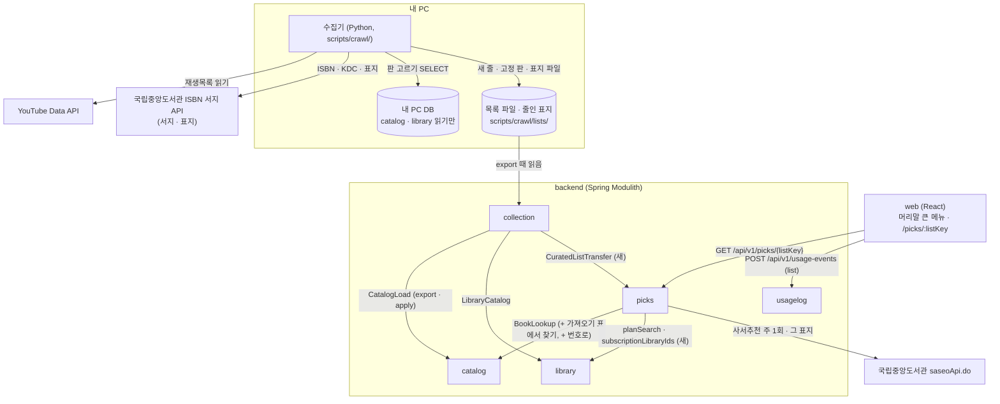
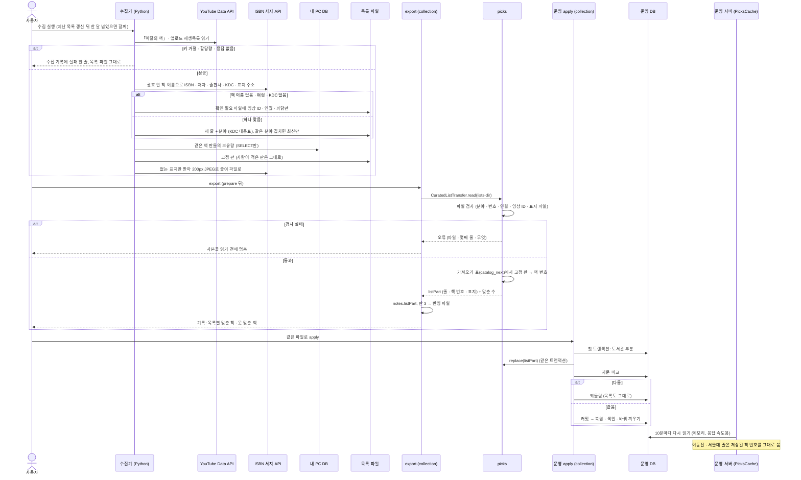
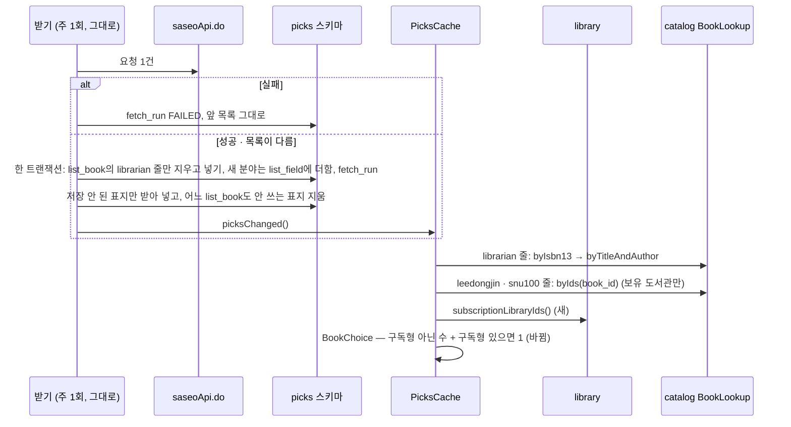
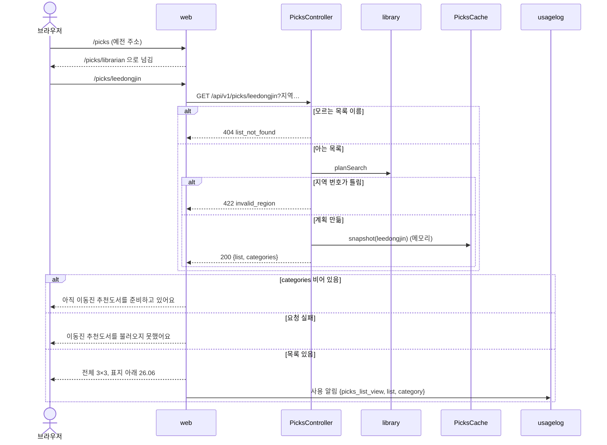
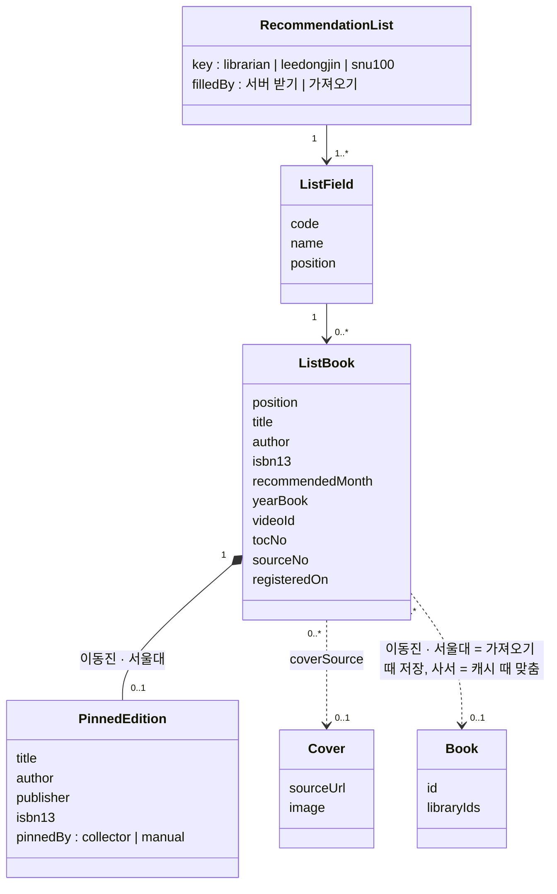
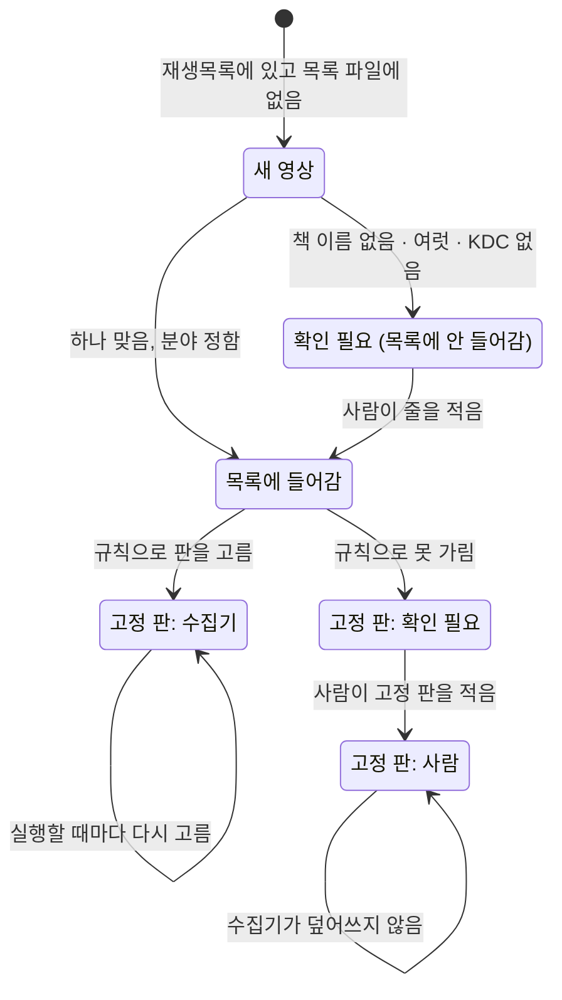
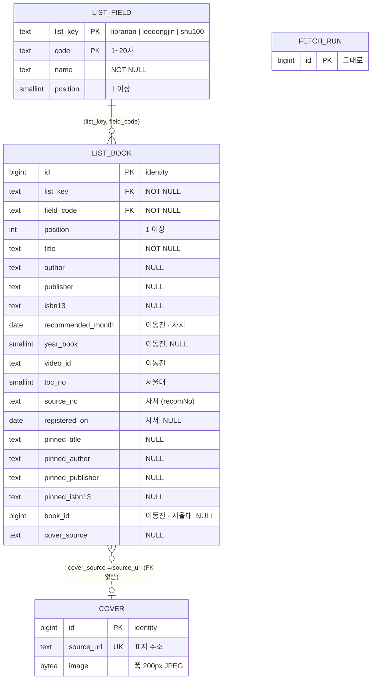

# 설계 변경: 사이클 21 추천도서 (이동진 추천도서 · 사서 추천도서 · 서울대 100선)

- 작성: 2026-10-16. 근거: [scope.md](scope.md), [spec.md](spec.md), [flow.md](flow.md), [architect-proposal.md](architect-proposal.md)(설계 결정 12개와 "확정 뒤 바뀐 데이터"), dev main 읽기만(`picks`·`catalog`·`collection`·`library`·`usagelog`, `web/src/components/AppLayout.tsx`)
- 설계 결정 12개 모두 사용자 결정 (2026-10-16, [설계 결정](easy/2026-10-16-design-decisions.html), [결정 2](easy/2026-10-16-design-decisions-2.html) 거둠, [결정 3](easy/2026-10-16-design-decisions-3.html) PICK 표 없앰). 클래스·설정·파일·칸 이름은 따로 적지 않으면 [안: 이름] (dev가 바꿔도 됨)
- 사이클 19와 나란히 개발함: 19는 `usagelog/002`, 반영 파일 판은 올리지 않음. 21이 판 3과 `usagelog/003`
- `docs/current/`는 아직 고치지 않음 (`/cycle-close`에서 합침)

## 한눈에 (지금 → 바뀐 뒤)

| 대상 | 지금 (dev, 사이클 14) | 바뀐 뒤 (사이클 21) | 태그 |
|---|---|---|---|
| 추천 목록 | 사서추천도서 하나 | 이동진 추천도서 · 사서 추천도서 · 서울대 100선 | [확정] (scope) |
| 책 줄 표 | `picks.pick` (사서만) | `picks.list_book` 하나, `list_key`로 나눔. `pick` 지움 | [확정] (ADR-0122) |
| 분야 | 코드 상수 (사서 5분야) | `picks.list_field` (목록별 분야·순서) | [확정] (ADR-0122) |
| 사서 받기 | 서버 주 1회 → `pick` | 서버 주 1회 → `list_book`의 `librarian` 줄 | [확정] (ADR-0122) |
| 이동진·서울대 넣기 | — | 수집기 → 목록 파일 → export `notes.listPart`(판 3) → apply | [확정] (ADR-0123·0128) |
| 우리 책 맞추기 | 서버가 캐시 때 ISBN → 제목+저자 | 사서: 그대로. 이동진·서울대: export 때 맞춰 `list_book.book_id` 저장, 서버는 읽기만 | [확정] (ADR-0124) |
| 같은 책 고르기 | 가진 도서관 수 (구독형도 한 곳씩) | 구독형 아닌 수 + 구독형 있으면 1 | [확정] (ADR-0125) |
| 표지 | 서버가 받아 200px JPEG | 사서: 그대로. 이동진·서울대: 수집기가 줄여 `listPart`에 실음 | [확정] (ADR-0123) |
| API | `GET /api/v1/picks` | `GET /api/v1/picks/{listKey}` | [확정] (ADR-0126) |
| 이용 기록 | `picks_category`만 | + `picks_list` | [확정] (ADR-0126) |
| 머리말 | 링크 「사서추천도서」 | 큰 메뉴 「추천도서」·「마이페이지」 | [확정] (ADR-0127) |

## 구조 그림

### 모듈 구성도



### 흐름 (a) 이동진·서울대: 수집기 → export → apply → 화면



### 흐름 (b) 사서 추천도서: 서버 주 1회 받기 (담는 표와 고르기 규칙만 바뀜)



### 흐름 (c) 목록 화면 요청



### 도메인 모델



### 수집기가 이동진 영상 하나를 다루는 상태



## 모듈

| 모듈 | 신규/변경 | 책임 | 공개 API | 발행/구독 이벤트 | 소유 테이블 |
|---|---|---|---|---|---|
| `picks` | 변경 | 세 목록 보관·캐시·화면 API, 사서 받기(담는 표만 바뀜), 가져오기 목록 검사·맞추기·바꾸기, `BookChoice` 규칙 바뀜 | 새 `CuratedListTransfer`: `read(Path listsDir)` → `ListPart`(JSON 글자 + 셈), `replace(String listPart)` (부르는 쪽 트랜잭션 안에서) [확정: ADR-0123, 이름 안] | 없음 (`collection`이 같은 트랜잭션에서 직접 부름, 곧 내려가는 가져오기 프로세스라 비동기 이벤트로는 반영이 보장되지 않음) | `list_field`·`list_book`(새), `fetch_run`·`cover`(그대로), `pick`(지움) |
| `catalog` | 변경 | 가져오기 표에서 책 찾기, 번호로 보유 도서관 | `BookLookup.byIds(Collection<Long>)` → `IsbnBook`과 같은 꼴(번호·보유 도서관). 가져오기 표(`catalog_next`)를 읽는 `BookLookup` 하나를 주는 `CatalogLoad.preparedLookup()` [안: 이름] | 없음 | 그대로 |
| `library` | 변경 | 구독형 도서관 번호 | `LibraryCatalog.subscriptionLibraryIds()` → `lending_model = SUBSCRIPTION`인 번호 (켜진 도서관만) [확정: ADR-0125, 이름 안] | 없음 | 그대로 |
| `collection` | 변경 | export에 `listPart` 싣기, apply·finish·in-place 첫 트랜잭션에서 `replace`, 반영 파일 판 3 | 없음 (안쪽: `ImportTransfer`, `Notes.listPart`, 설정 `chaekcheck.collection.import.lists-dir`) [안: 이름] | 없음 | 그대로 (`load_manifest.notes`에 칸이 하나 늘 뿐) |
| `usagelog` | 변경 | 사용 알림 `list` 받기·검사, 칸 `picks_list` | 웹 API만 바뀜 | 없음 | `screen_event.picks_list`(새 칸) |
| web | 변경 | 머리말 큰 메뉴, `/picks/:listKey` 셋, `/picks` → `/picks/librarian`, 목록별 표지 아래 글자·책 창 줄·출처 줄 | — | — | — |
| 수집기 (`scripts/crawl`) | 변경 | 이동진 목록 모으기, 이동진·서울대 판 고르기, 표지 받아 줄이기 | 목록 파일 (아래 "목록 파일") | — | 목록 파일 |

- 모듈 의존: `picks → catalog, catalog :: normalize, library` 그대로. **`collection → picks` 새로 생김** (`collection`의 `allowedDependencies`에 `picks`를 더함). 고리 없음 (`picks`는 `collection`을 모름) [확정: ADR-0123]
- 내 PC에서 고정 판을 맞추는 표는 export하는 바로 그 `catalog_next`(prepare가 책 번호를 정한 표, ADR-0078). 색인 없이 채운 표라 한 번에 묶은 쿼리 둘(ISBN, 제목+저자)로 찾음 [안], 시간은 dev 측정 [확인 필요: 프로토타입]. `in-place`(내 PC에서 바로 바꿔 끼우기)는 바꿔 끼운 뒤의 `catalog`로 같은 맞추기 [안]
- 고정 판 맞추기 순서: ① `pinned_isbn13` → `byIsbn13` ② 없으면 `pinned_title`+`pinned_author`로 `byTitleAndAuthor`, 결과를 `pinned_publisher` 정리값으로 좁힘 ③ 그래도 여럿이면 `BookChoice` ④ 고정 판이 비면 목록 줄의 ISBN → 제목+저자. 못 맞추면 `book_id` NULL (흐린 제목 글자 표지, spec R2-4) [확정: ADR-0124, 출판사 정리 함수는 dev 코드 확인]
- 사서 줄의 `book_id`는 비워 두고 지금처럼 캐시 때 맞춤 (따로 받으므로) [확정: ADR-0124]
- 캐시: 시작 때·10분마다·사서 받기 직후·(운영) 다음 10분 안에 DB를 다시 읽음 — 맞추기가 아니라 메모리에 담아 화면 응답을 빠르게 하는 것 [확정] (사이클 14 그대로)
- 책 창 제목은 목록의 책 이름(서울대는 목차 제목), 저자·출판사는 맞춘 우리 책 값 [확정: 설계 결정 #11]

## 데이터

- 스키마 `picks` (소유 `picks`). 다른 모듈과 FK·조인 없음 (`book_id`는 값으로만, ADR-0090과 같은 규칙) [확정]



| 테이블.컬럼 | 타입 | 제약 | 설명 | 상태 태그 |
|---|---|---|---|---|
| `list_field.list_key` | text | PK 앞, CHECK IN (`librarian`,`leedongjin`,`snu100`) | 목록 이름 | [확정] (ADR-0122·0126) |
| `list_field.code` | text | PK 뒤, CHECK `length(code) BETWEEN 1 AND 20` | 사서는 `drCode`(11·6·5·4·425, 모르는 코드도), 이동진·서울대는 `fields.tsv` 코드(예 `korean_fiction`, `korean_lit`) | [안] |
| `list_field.name` | text | NOT NULL | 화면 이름. 사서의 모르는 새 코드는 받은 이름, 비면 코드 (C14 R2-5) | [안] |
| `list_field.position` | smallint | NOT NULL, ≥ 1, UNIQUE(`list_key`,`position`) | 분류 목록 순서. 사서 새 코드는 끝에 붙임 | [안] |
| `list_book.id` | bigint | PK, `GENERATED ALWAYS AS IDENTITY` | 이동진·서울대 응답 `id` (바꿀 때마다 새로 매김) | [안] |
| `list_book.(list_key, field_code)` | text | NOT NULL, FK → `list_field` ON DELETE CASCADE, 색인 | 목록·분야 | [안] |
| `list_book.position` | int | NOT NULL, ≥ 1 | 이동진: 같은 달 안 소개 순서, 서울대: 목차 번호와 같음, 사서: 받은 순서 | [안] |
| `list_book.title` | text | NOT NULL | 목록의 책 이름 (화면 제목, 설계 결정 #11) | [확정] |
| `list_book.author`·`publisher` | text | NULL | 목록의 저자·출판사 | [안] |
| `list_book.isbn13` | text | NULL, CHECK `^97[89][0-9]{10}$` | 목록의 ISBN | [안] |
| `list_book.recommended_month` | date | NULL, CHECK 1일 | 이동진·사서 추천 연·월 | [안] |
| `list_book.year_book` | smallint | NULL, 2000~2100 | 이동진 올해의 책 해 (" · 2025 올해의 책") | [안] |
| `list_book.video_id` | text | NULL, CHECK `^[A-Za-z0-9_-]{1,64}$` | 이동진 영상 ID. 꼴은 [확인 필요: 공식 문서 확인] | [안] |
| `list_book.toc_no` | smallint | NULL, 1~100, 부분 UNIQUE `(toc_no) WHERE list_key = 'snu100'` | 서울대 목차 번호 | [안] |
| `list_book.source_no` | text | NULL, CHECK `^[0-9]{1,20}$`, 부분 UNIQUE `WHERE list_key = 'librarian'` | 사서 `recomNo` (지금 `pick.recom_no`). 사서 응답 `id` | [확정] (결정 3 #1), 이름 [안] |
| `list_book.registered_on` | date | NULL | 사서 `regdate`, 같은 달 안 정렬 | [확정] (결정 3 #1) |
| `list_book.pinned_title`·`pinned_author`·`pinned_publisher`·`pinned_isbn13` | text | NULL, ISBN CHECK 같음 | 수집기가 고른 판(또는 사람이 적은 판). `pinned_by`는 목록 파일에만 | [확정] (ADR-0124), 칸 [안] |
| `list_book.book_id` | bigint | NULL | 이동진·서울대: export 때 맞춘 우리 책 번호(`catalog.book.id` 값, FK 없음). 사서는 늘 NULL | [확정] (ADR-0124) |
| `list_book.cover_source` | text | NULL. 사서 ⇒ `LIKE 'https://www.nl.go.kr/afile/%'`, 그 밖 ⇒ `LIKE 'https://%'` | `cover.source_url`과 맞춤 | [안], 이동진·서울대 접두 [확인 필요: API 호출 시험] |
| 목록별 CHECK | | `librarian` ⇒ `source_no`·`recommended_month` NOT NULL, `book_id`·`toc_no`·`video_id` NULL. `leedongjin` ⇒ `recommended_month`·`video_id` NOT NULL. `snu100` ⇒ `toc_no` NOT NULL | 이름 `list_book_<list>_check` | [안] |
| `cover` | | 그대로 (`source_url` UNIQUE, 200px JPEG) | 이동진·서울대 표지는 `replace`가 넣음(`fetched_at` = 수집기가 받은 때) | [확정] (ADR-0123) |
| `fetch_run` | | 그대로. "목록 없음" 판단은 `list_book`의 `librarian` 줄로 | 사서 받기 기록 | [확정] (ADR-0122) |
| `usagelog.screen_event.picks_list` | text | NULL, CHECK IN (`librarian`,`leedongjin`,`snu100`), `picks_*` 종류일 때만 NOT NULL (종류별 칸 CHECK 고침) | 어느 목록 | [확정] (ADR-0126) |

- 누가 어느 줄을 바꾸나 [확정: ADR-0122]: 서버 사서 받기는 `list_key = 'librarian'` 줄만(지우고 넣기 + `fetch_run` 한 트랜잭션, 지금과 같은 규칙), 가져오기 `replace`는 `leedongjin`·`snu100` 줄만(`list_book` 지우기 → `list_field` 지우기 → 넣기, 부르는 쪽 트랜잭션 안). 두 쓰기가 겹칠 때는 `list_book` 줄 잠금 대신 목록별 `pg_advisory_xact_lock` 하나 [안]
- 표지 정리: 사서 받기 뒤와 `replace` 뒤 모두 "어느 `list_book.cover_source`도 쓰지 않는 `cover`"를 지움 [확정: ADR-0091 규칙을 한 표로]
- 크기: 사서 108줄 + 이동진 44줄(월 1~4줄씩 늚) + 서울대 100줄 ≈ 250줄. 표지 약 250장, 3~4MB (사이클 14 실측 장당 4~22KB) [안]
- Liquibase: 새 파일 `db/changelog/picks/002-curated-lists.yaml`, master 끝에 `# cycle 21` 주석과 include. 기존 changeset은 고치지 않음(사이클 17 첫 배포가 21보다 먼저일 수 있으므로) [안: 파일 이름]
  1. `list_field`·`list_book` 만들기 (CHECK·색인은 changeset 안 `sql`)
  2. 사서 분야 넣기: 아는 다섯(11 문학, 6 인문, 5 사회, 4 자연, 425 테마, C14 순서) + `pick`에 있는 그 밖의 `dr_code`(이름은 `dr_code_name`, 비면 코드)
  3. `INSERT INTO list_book (list_key='librarian', …) SELECT … FROM pick` — 옮기지 않으면 "목록 없음 → 받기"(dev `FetchDecision` 규칙 2)로 켜지자마자 다시 받는 1~2분 동안 비고, 그날 이미 받았으면(규칙 1) 다음 날 05:00까지 비므로 옮김 [안]
  4. `DROP TABLE picks.pick`
- 새 파일 `db/changelog/usagelog/003-screen-event-picks-list.yaml` (002는 사이클 19): 칸 더함 → 있던 `picks_*` 줄을 `librarian`으로 채움 → CHECK [안: 파일 이름]. 21이 19보다 먼저 main에 들어가면 번호를 바꾸지 말고 master 순서만 맞춤(나중에 합치는 쪽이 자기 줄을 끝으로)

### 반영 파일 `notes.listPart` (판 3)

| 칸 | 내용 | 태그 |
|---|---|---|
| `formatVersion` | 반영 파일 판 2 → 3. 판 3을 아는 앱만 apply·finish (판 2 파일은 판 3 앱이 받되 목록은 건드리지 않음 [안]) | [확정] (ADR-0123) |
| `listPart.fields` | `fields.tsv`의 이동진·서울대 줄 | [안] |
| `listPart.books` | 줄마다 목록 파일 칸(`pinned_by`·`note` 빼고) + 맞춘 `bookId` | [안] |
| `listPart.covers` | `{sourceUrl, fetchedAt, jpegBase64}`, 줄이 쓰는 표지만 | [안] |
| `listPart.counts` | 목록별 줄 수·맞춘 수·못 맞춘 수 (export·apply 기록에 씀) | [안] |

- 크기: 표지 약 144장 1~3MB가 manifest JSON 하나에 들어감(TOAST) [안]. 판 3 배포 때 내 PC에 기다리는 판 2 내보내기가 있으면 `finish`가 거절됨 — 배포 전에 finish나 discard (ADR-0086과 같은 감수) [확정]

### 목록 파일 (dev `scripts/crawl/lists/`, UTF-8 TSV, 머리 줄) [확정: ADR-0128 위치, 칸 이름 안]

| 파일 | 칸 | export에 실림 |
|---|---|---|
| `fields.tsv` | `list, code, name, position` | 예 |
| `leedongjin.tsv` | `month, position, year_book, video_id, field, title, author, publisher, isbn13, cover_url, pinned_title, pinned_author, pinned_publisher, pinned_isbn13, pinned_by, note` | 예 (`pinned_by`·`note` 빼고) |
| `snu100.tsv` | `toc_no, field, title, author, cover_url, pinned_*, pinned_by, note` | 예 (같음) |
| `covers/<sha1(cover_url)>.jpg` | 수집기가 줄인 표지 (폭 200px, 원본 5MB 넘으면 받지 않음) | 예 (`listPart.covers`) |
| `kdc_fields.tsv` | `kdc_prefix, field, note` | 아니오 (수집기만) |
| `leedongjin_pending.tsv` | `video_id, month, reason` | 아니오 |

- 영상 제목·설명은 어느 파일에도 두지 않음 (spec R4-5) [확정]
- `pinned_by` = `collector` | `manual`. `manual` 줄은 수집기가 덮어쓰지 않음, `collector` 줄은 실행할 때마다 다시 고름 [확정: 설계 결정 #7]
- 서울대 판 거르기: 출판사 "어린이", 저자 "번역AI", "[100분 고전]" 같은 요약 시리즈 뺌. 못 가리는 책(미국의 민주주의, 페더랄리스트)은 사람이 `manual`로 [확정] (spec R3-4)

## API

| 메서드 | 경로 | 설명 | 요청 | 응답 | 에러 |
|---|---|---|---|---|---|
| GET | `/api/v1/picks/{listKey}` | 목록 하나 (인증 없음) | `listKey` = `librarian`·`leedongjin`·`snu100`, 계획 파라미터 `residenceRegionIds`·`workRegionIds`·`scope`·`visit`·`libraryIds` (지금과 같음) | 200 `{list, fetchedAt, categories[]}`. 목록이 없으면 빈 `categories` | 404 `list_not_found`, 400 `validation_error`, 422 `invalid_region`, 500 `internal_error` (ProblemDetail) |
| GET | `/api/v1/picks/covers/{coverId}` | 표지 (그대로, 세 목록 함께) | | `image/jpeg` | 404 |
| ~~GET~~ | ~~`/api/v1/picks`~~ | 지움 (배포 전, 웹만 부름, ADR-0089 선례) | | | |
| POST | `/api/v1/usage-events` | 사용 알림에 `list` 필수 (`picks_list_view`·`picks_book_view`) | | 그대로 | 틀리면 `rejected_event` (그대로) |

[확정: ADR-0126]

```json
{
  "list": "leedongjin",
  "fetchedAt": null,
  "categories": [
    {
      "code": "ALL",
      "name": "전체",
      "books": [
        { "id": "57", "category": "science", "title": "히스토리아 비테이",
          "coverUrl": "/api/v1/picks/covers/140", "bookId": 1203344, "available": true,
          "recommendedMonth": "2026-06", "yearBook": null, "videoId": "<video-id>", "tocNo": null }
      ]
    }
  ]
}
```

- 책 칸: 사서 `id` = `source_no`(지금 `recomNo`), `recommendedMonth`만 값. 이동진 `id` = `list_book.id`, `recommendedMonth`·`yearBook`·`videoId`. 서울대 `tocNo`. `fetchedAt`은 사서만(마지막 성공 받기) [안: 칸 이름]
- 칸 바뀜: `recomNo` → `id`(글자). 배포 전·웹만 부름 [안]
- 사용 알림 예: `{"type":"picks_list_view","list":"snu100","category":"korean_lit"}`

## 웹

| 자리 | 바뀜 | 태그 |
|---|---|---|
| 머리말 (`AppLayout`) | 큰 메뉴 「추천도서」(이동진 추천도서 → `/picks/leedongjin`, 사서 추천도서 → `/picks/librarian`, 서울대 100선 → `/picks/snu100`)·「마이페이지」(내 도서관 관리 → `/my-libraries`). PC 0.5초 열기·닫기, 덮지 않음(그림자·선), 글자 누르면 첫 항목, Tab·Enter·↓·Esc. 640px 이하 ☰ + 어둡게 덮기. 조회 상태 점은 「로그인」 왼쪽(폰 ☰ 왼쪽). `legal` 분기 없음(약관·처리방침도 같은 머리말) | [확정] (ADR-0121·0127) |
| PC 펼친 칸 정렬 | 결정 페이지 그림처럼 왼쪽에 몰지 않음. 정보나루처럼 각 칸이 자기 큰 메뉴 바로 아래, 칸 배경은 화면 전체 폭. dev가 실제 사이트를 열어 맞추고 화면 확인 때 보임 | [확정] (flow 화면 결정 #2 메모) |
| 목록 화면 | 경로 셋, `/picks` → `/picks/librarian`. 맨 위 제목(PC·641px 이상 태블릿, flow #4 A), 폰은 머리말 메뉴로만(C). 이상하면 dev가 안 A~D를 화면으로 나란히 만들어 보임 | [확정] (flow #4, 설계 결정 #12) |
| 표지 아래 글자 | 이동진 "26.06", 서울대 "3", 사서 그대로 | [확정] (spec R5) |
| 책 창 | 목록별 한 줄, 이동진 [영상 보기](새 탭, 희망도서 안내에도) · " · 2025 올해의 책" | [확정] (spec R6) |
| 출처 줄·기준 보기 | spec R5-5 문구, YouTube 서비스 약관 링크 | [확정] (spec R5-5) |
| 자리 기억 | 목록마다 (C14 AC-20) | [확정] (spec R2-6) |

## 외부 연동

| 대상 | 방식 | 제한·키 관리 | 실패 시 동작 | 상태 태그 |
|---|---|---|---|---|
| YouTube Data API v3 (수집기) | `playlistItems.list`: 「이달의 책」(`PLUpgTv3bu9rGxQBAMVaMvam27P0YbiY29`), 채널 업로드 재생목록(12월 "올해의 책"·"베스트북"). `search.list`는 쓰지 않음(100단위) | 하루 10,000단위, 재생목록 읽기 1단위 (https://developers.google.com/youtube/v3/determine_quota_cost , 2026-10-15 확인). 키는 dev `.env`. 페이지 자동 접근 금지 (https://www.youtube.com/t/terms). 30일 저장 규칙은 매달 다시 읽어 지킴 (개발자 정책 III.E.4.d) | 키 거절·할당량·응답 없음 → 목록 파일 그대로, 수집 기록 한 줄 | [확정] (ADR-0128). 업로드 재생목록 ID 얻는 법 [확인 필요: 공식 문서 확인] |
| 국립중앙도서관 ISBN 서지 API (수집기) | `https://www.nl.go.kr/seoji/SearchApi.do`: 책 이름 → ISBN·저자·출판사·KDC·`TITLE_URL`(표지 이미지 URL) | 키는 dev `.env`. 하루 한도·이용 허락 범위 확인 못 함 | 못 찾음·여럿·KDC 없음 → 확인 필요 파일. 표지 안 열림 → 표지 없이(제목 글자 표지) | 항목 [확정] (https://www.nl.go.kr/NL/contents/N31101030500.do , 2026-10-15 확인), 한도·조건 [확인 필요: API 호출 시험·공식 문서 확인] |
| 국립중앙도서관 `saseoApi.do`·표지 (운영 서버) | 사이클 14 그대로 (주 1회, 실패 뒤 매일) | 그대로 | 그대로 | [확정] |
| 내 PC 서비스 DB (수집기) | `catalog.book`·`book_contributor`·`library.library.lending_model` SELECT만 | 접속은 dev `.env` 주소 [안] | 접속 실패 → 고정 판 칸 그대로, 기록 한 줄 [안] | [확정] (ADR-0124) |

## 시험 (AC별)

| AC | 시험 |
|---|---|
| 1·2·3 | 웹 시험: 머리말 0.5초 열기·닫기, 덮지 않음, 375px ☰·어둡게 덮기, 320px 한 줄, `/terms`·`/privacy` 같은 머리말. 화면 확인 때 PC 정렬 |
| 4·5·8·9·15 | `PicksController` 시험(세 목록, 404 `list_not_found`), 웹 시험(목차 번호·"26.06"·책 창 줄·[영상 보기]·출처 줄·흐린 표지 → 희망도서 안내) |
| 6·7 | `BookChoice` 시험(구독형 셋 = 1, 같으면 번호 작은 것, 여러 권짜리 1권) + 수집기 판 고르기 시험. **같은 입력으로 Java·Python 보유량 결과가 같은지** 비교 시험 |
| 10 | 사서 받기 시험: `librarian` 줄만 바뀌고 이동진·서울대 줄 그대로, 표지 정리가 다른 목록 표지를 지우지 않음, Liquibase 002 뒤 사서 목록이 그대로 보임 |
| 11·12·13·14 | 수집기 단위 시험(API 응답 저장본): 새 영상 → 새 줄, 제목·설명 없음, `www.youtube.com` 요청 0건, 키 틀림 → 파일 그대로 + 기록, 책 이름 없음 → 확인 필요 |
| 가져오기 | `CuratedListTransfer` 시험: 검사 실패 줄 번호, 고정 판 → 책 번호(ISBN·제목+저자+출판사·못 맞춤), `replace`가 사서 줄을 건드리지 않음, 지문 다름 → 목록도 되돌림, 판 3 manifest 읽기 |
| 공통 | Modulith `verify`(`collection → picks` 허용), 사이클 19 반영 뒤 세 목록 맞은 수 다시 재기(19 AC-14) |

## 결정 기록

- [ADR-0122](../../adr/0122-recommended-lists-one-module-one-table.md) 추천 목록 셋은 `picks` 하나, 책 줄은 `list_book` 하나 (`pick` 없앰) (Proposed)
- [ADR-0123](../../adr/0123-curated-lists-ride-export-manifest.md) 이동진·서울대 목록과 표지는 반영 파일 목차 `listPart`(판 3)로 (Proposed)
- [ADR-0124](../../adr/0124-pinned-edition-matched-at-export.md) 고정 판은 수집기가 고르고 export 때 책 번호로 맞춰 저장, 서버는 읽기만 (Proposed)
- [ADR-0125](../../adr/0125-book-choice-subscription-counts-once.md) 같은 책 고르기: 구독형은 몇 곳이든 1 (Proposed)
- [ADR-0126](../../adr/0126-picks-api-per-list-and-usage-list.md) `GET /api/v1/picks/{listKey}`, 이용 기록 `picks_list` (Proposed)
- [ADR-0127](../../adr/0127-header-mega-menu.md) 머리말 정보나루식 큰 메뉴 (Proposed)
- [ADR-0128](../../adr/0128-leedongjin-list-by-collector-youtube-api.md) 이동진 목록은 수집기가 YouTube Data API·ISBN 서지 API로 (Proposed)
- 그대로 따름: ADR-0062(책 번호 잇기), ADR-0078(내 PC 가져오기 → 운영 반영), ADR-0086(목차 칸·판 올림 감수), ADR-0089(사서추천 출처), ADR-0090(사서 줄 맞추는 길 — 고르기 규칙만 0125로), ADR-0091(표지 200px, 정리 규칙을 한 표로), ADR-0121(모든 화면 같은 머리말)

## 확인 필요

| 항목 | 왜 | 확인 방법 | 막는 단계 |
|---|---|---|---|
| `TITLE_URL` 주소의 호스트·경로, 인증키가 붙는지 | `cover_source` CHECK, 표지 받기 | API 호출 시험 | 개발 |
| 사서추천 인증키로 ISBN 서지 API를 부를 수 있는지, 하루 한도, KDC·표지 빈 값 비율 | 수집기, spec R4-4 | API 호출 시험 (44 + 100권) | 개발 (빈 값이 많으면 R4-4 다시 묻기) |
| 유튜브 영상 ID 꼴 | `video_id` CHECK | 공식 문서 확인 | 개발 |
| 채널 업로드 재생목록 ID를 API로 얻는 법 | 설계 결정 #8 | 공식 문서 확인 (`channels.list` `contentDetails`) | 개발 |
| 색인 없는 `catalog_next`에서 고정 판 맞추는 시간 | export 시간 | 프로토타입 (dev 측정) | 개발 |
| 출판사 정리 함수 이름 | 고정 판 맞추기 ② | dev 코드 확인 | 개발 |
| 수집기의 내 PC DB 접속 방법 | 판 고르기 | dev 확인 | 개발 |
| 반영 파일 판 3과 사이클 19 병합 순서 (19는 판을 올리지 않음). 판 3 배포 전에 내 PC에 기다리는 판 2 내보내기가 없어야 함 | ADR-0086과 같은 감수 | 인계서에 적음 | 배포 |
| 사이클 19 `name_exact` 변경 뒤 세 목록 맞은 수 다시 재기 | 19 AC-14 | dev 측정 | 19 반영 뒤 |
| ISBN 서지 표지·서지 이용 허락 범위, 서울대 100선 목록 게시 | spec 확인 필요 | 공식 문서 확인 · 사용자에게 질문 | 배포 |

## backlog 후보 (설계하지 않음)

- 도서관 클릭 기록(`library_click.screen = 'picks'`)에도 어느 목록인지 남기기
- 목록 반영 기록 표 (언제 몇 줄이 들어갔는지, 지금은 export·apply 기록만)
