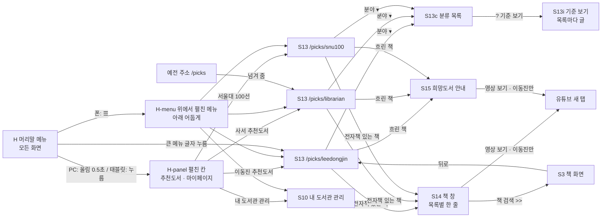

# 화면 흐름: 추천도서 (이동진 추천도서 · 사서 추천도서 · 서울대 100선)

- 바탕: 사이클 14 화면 흐름 `../14-librarian-picks/flow.md` (S13, S13c, S13i, S14, S15). 적지 않은 화면·상태는 사이클 14 그대로이고 세 목록에 똑같이 씀
- 근거: `scope.md` (결정 14개), `spec.md` (결정 13개), 둘 다 2026-10-15 정함
- 화면 그림: 머리말 메뉴 `easy/2026-10-15-menu-decisions-2.html`, 목록 화면 `../../research/leedongjin-picks/easy/2026-10-15-picks-screen-and-holdings.html`

## 화면별 내용

### H 머리말 메뉴 (모든 화면, 약관·처리방침 포함)

- 목적: 추천 목록 셋과 내 도서관 관리로 가는 길 [확정] (spec R1-1)
- 보이는 요소: 「책첵」 로고, 큰 메뉴 「추천도서」·「마이페이지」, 조회 상태 점(+ PC는 글), 「로그인/로그아웃」. 폰은 큰 메뉴 대신 ☰ [확정] (spec R1-1·R1-5·R1-6)
- 사용자 동작
  - PC: 큰 메뉴에 마우스를 0.5초 멈추면 H-panel이 머리말 아래로 펼쳐지고, 메뉴 밖으로 나간 뒤 0.5초에 닫힘. 큰 메뉴 글자를 누르면 첫 항목 화면 [확정] (spec R1-3)
  - 태블릿(641px 이상): 큰 메뉴를 누르면 펼침, 다시 누르거나 바깥을 누르면 닫힘 [확정] (scope #10)
  - 폰(640px 이하): ☰를 누르면 H-menu가 위에서 펼쳐지고 아래가 어두워짐. ✕나 어두운 곳을 누르면 닫힘 [확정] (scope #10, spec R1-5)
  - 작은 메뉴를 누르면 그 화면으로 가고 메뉴는 닫힘 [확정] (사용자 승인, 2026-10-15, 화면 결정 #1)
- H-panel: 두 칸(「추천도서」: 이동진 추천도서, 사서 추천도서, 서울대 100선 / 「마이페이지」: 내 도서관 관리). 아래 화면은 덮지 않고 그림자·선 [확정] (spec R1-2)
- 지금 보는 화면 표시: 추천 목록 화면에 있으면 큰 메뉴 「추천도서」에 밑줄, 펼친 칸과 폰 ☰ 메뉴에서는 그 목록 이름을 굵게 [확정] (사용자 승인, 2026-10-15, 화면 결정 #2)
- **PC 펼친 칸 정렬 — 개발 때 주의** [확정] (사용자 메모, 화면 결정 #2: "그 pc버전 정렬은 이 예시처럼이면 안 돼.. 개발할 때 조심해.. 다른 사이트 보면서 파악하고"): 결정 페이지 그림처럼 칸을 왼쪽에 몰지 않음. 참고: 도서관 정보나루는 각 칸이 자기 큰 메뉴 바로 아래에 같은 너비로 놓이고(큰 메뉴 241px, 칸은 그 안쪽 15px부터), 칸 배경은 화면 전체 폭 (2026-10-15 PC 1622px에서 잼). dev는 정보나루 등 실제 사이트를 열어 정렬을 맞추고 화면 확인 때 보여 줌
- 키보드: Tab으로 큰 메뉴에 오면 Enter나 ↓로 펼치고, Esc로 닫음 [확정] (사용자 승인, 2026-10-15, 화면 결정 #3)
- 호출 API: 없음 (메뉴는 화면 안에 고정)
- 상태: 기본 / 펼침 / 닫힘. 로그인 전에도 「마이페이지」 칸이 보이고 「내 도서관 관리」는 지금 화면이 로그인 전에 하는 대로 [확정] (spec R1-7)

### S13 picks (세 목록이 같은 화면을 씀)

- 주소: `/picks/leedongjin`, `/picks/librarian`, `/picks/snu100` (끝 이름은 설계). 예전 `/picks`는 `/picks/librarian`으로 넘겨 줌 [확정] (spec R2-6)
- 목적: 고른 목록의 책을 분야별로 넘겨 보며 내 도서관에서 빌릴 수 있는 책 찾기
- 보이는 요소: 분야 하나가 한 화면, 분야 이름과 "1 - 9 / N", 표지 3×3, ◀ ▶, 점, 아래 가운데 [분야 ▾], 맨 아래 출처 줄 [확정] (C14, spec R2-1)
  - 이동진: 표지 아래 추천 연·월 "26.03" (겹치면 최신만, spec R3-5), 분야 「전체」 + 9개 [확정] (spec R5-1)
  - 서울대: 표지 아래 목차 번호 "3", 분야 「전체」 + 5개 [확정] (spec R5-2)
  - 사서: 지금과 같음 [확정] (spec AC-10)
- 지금 어느 목록인지 보이기: 아래 가운데 떠 있는 [분야 ▾] 버튼 위에 목록 이름을 작게 한 줄("이동진 추천도서") [안]. 사이클 14에서 화면 제목을 없앴기 때문에(사용자: "이거 위에 있는거 불필요하니까 없애고", 2026-10-12) 제목 대신 떠 있는 버튼에 붙임
- 사용자 동작: 사이클 14 그대로(휠·스와이프 한 번에 다음 분야, ◀ ▶ 9권씩, 표지 누르기) [확정]
- 흐린 표지: 검색하는 도서관에 전자책이 없거나, 우리 책을 못 찾은 책(제목 글자 표지) [확정] (spec R2-3·R2-4)
- 호출 API: 목록 받기(목록 이름을 함께 보냄, 상세는 design-delta)
- 상태: 로딩(회색 카드 9개) / 목록 없음("아직 이동진 추천도서를 준비하고 있어요") / 요청 실패("이동진 추천도서를 불러오지 못했어요. 잠시 뒤에 다시 해 주세요.") — 서울대·사서도 같은 꼴 [확정] (spec R7-1, C14)
- 폰·태블릿: 사이클 14 배치 그대로(폰은 격자가 꽉 차고 ◀ ▶가 표지 위에 뜸) [확정]

### S13c 분류 목록

- 사이클 14 그대로. 목록마다 분야 순서가 다름(이동진 9개, 서울대 5개, 사서 지금 그대로) [확정] (spec R5-1·R5-2)
- 책이 0권인 분야는 목록에서 숨김 [확정] (spec R5-3)

### S13i 기준 보기

- 목록마다 글이 다름 [확정] (spec R5-5)
  - 이동진: "이동진 평론가가 유튜브 「B tv 이동진의 파이아키아」에서 고른 이달의 책과 올해의 책이에요" / "책첵은 이동진 평론가·파이아키아와 관계가 없어요" / "흐린 책은 검색하는 도서관에 전자책이 없어요"
  - 서울대: "서울대학교 기초교육원이 펴낸 『권장도서 해제집』의 100권이에요" / "판이 여러 개인 책은 가장 많은 도서관이 가진 판을 보여 드려요" / "흐린 책은 검색하는 도서관에 전자책이 없어요"
  - 사서: 지금 그대로
- 출처 줄: 이동진 "출처: 유튜브 「B tv 이동진의 파이아키아」 · 책첵은 이동진 평론가·파이아키아와 관계가 없어요 · YouTube 서비스 약관(링크)", 서울대 "출처: 서울대학교 기초교육원 『권장도서 해제집』(서울대학교출판문화원)" [확정] (spec R5-5)

### S14 책 창

- 사이클 14 창(표지, 책 이름, 추천 줄, 저자·출판사, "책 검색 >>", 대출 줄 최대 3곳) [확정] (C14)
- 추천 줄이 목록마다 다름 [확정] (spec R6-1·R6-2)
  - 이동진: "이동진 평론가가 「파이아키아」 영상에서 추천 (2026년 3월)", 올해의 책이면 끝에 " · 2025 올해의 책"
  - 서울대: "서울대 권장도서 100선" (분야·번호 없음)
  - 사서: 지금 그대로("2026년 10월 사서추천 · 문학")
- [영상 보기] (이동진만) [확정] (사용자 승인, 2026-10-15, 화면 결정 #5): PC·태블릿은 "책 검색 >>" 옆에 같은 크기의 테두리 버튼, 폰(아래에서 올라오는 창)은 "책 검색 >>" 아래 줄. S15 희망도서 안내에서도 같은 모양으로 안내 글 아래. 누르면 유튜브 영상이 새 탭 (새 탭은 spec R6-2 [확정])

### S15 희망도서 안내

- 사이클 14 그대로 [확정]
- 이동진 책이면 안내 글 아래에 [영상 보기] [확정] (spec R6-2). 모양은 S14 [영상 보기] 줄

### S10 내 도서관 관리

- 바뀌지 않음. 머리말 「마이페이지」 → 「내 도서관 관리」로도 들어옴 [확정] (spec R1-1)

## 수용 기준 대응

| AC (spec) | 화면 |
|---|---|
| AC-1 PC 메뉴 0.5초, 덮지 않음 | H, H-panel |
| AC-2 폰 ☰, 덮기, 320px 한 줄 | H, H-menu |
| AC-3 약관·처리방침에서도 같은 머리말 | H |
| AC-4 서울대 첫 9권·번호·분야 순서 | S13 `/picks/snu100`, S13c |
| AC-5 이동진 첫 권이 최신·"26.06" | S13 `/picks/leedongjin` |
| AC-6 판 = 보유량 최대(구독형 1) | S13 (표지·책 창의 책), 수집기 |
| AC-7 여러 권짜리는 1권 | S13, S14 |
| AC-8 책 창 추천 줄·[영상 보기] 새 탭, 서울대는 분야·번호 없음 | S14 |
| AC-9 이동진 출처 줄 관계없음 | S13 출처 줄 |
| AC-10 사서 추천도서 그대로 | S13 `/picks/librarian` |
| AC-11~AC-14 수집기 | 화면 없음 (수집기·목록 파일·기록) |
| AC-15 못 찾은 책은 흐린 제목 글자, 누르면 희망도서 안내 | S13, S15 |
| C14 AC-2·3·5·7~10·16·18~21 | S13, S13c, S13i, S14, S15 (세 목록) |

## 상태별 동작 대응

| 상태 (spec) | 화면 상태 |
|---|---|
| 로딩 | S13 회색 카드 9개 |
| 목록이 아직 없음 | S13 "아직 … 준비하고 있어요" |
| 화면 요청 실패 | S13 "… 불러오지 못했어요. 잠시 뒤에 다시 해 주세요." |
| 수집기 실패 | 화면 바뀜 없음 (앞 목록 그대로) |
| 새 영상에 책 이름 없음 / 여럿 | 화면 바뀜 없음 (그 영상만 빠짐) |
| 표지 없음·안 열림 | S13·S14 제목 글자 표지 |
| 우리 책을 못 찾음 | S13 흐린 제목 글자 표지 → S15 |
