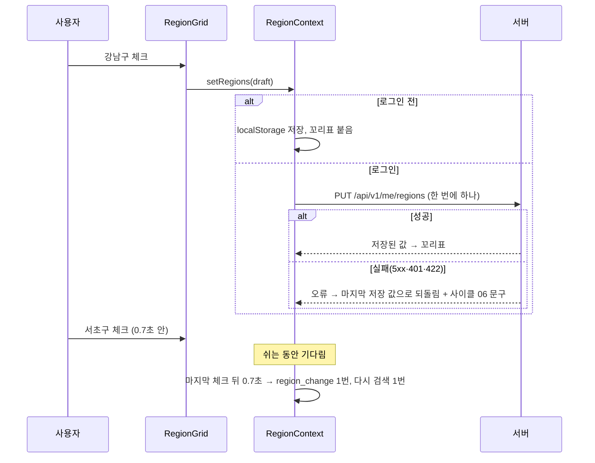
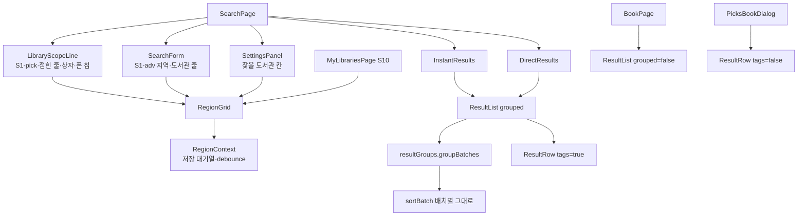
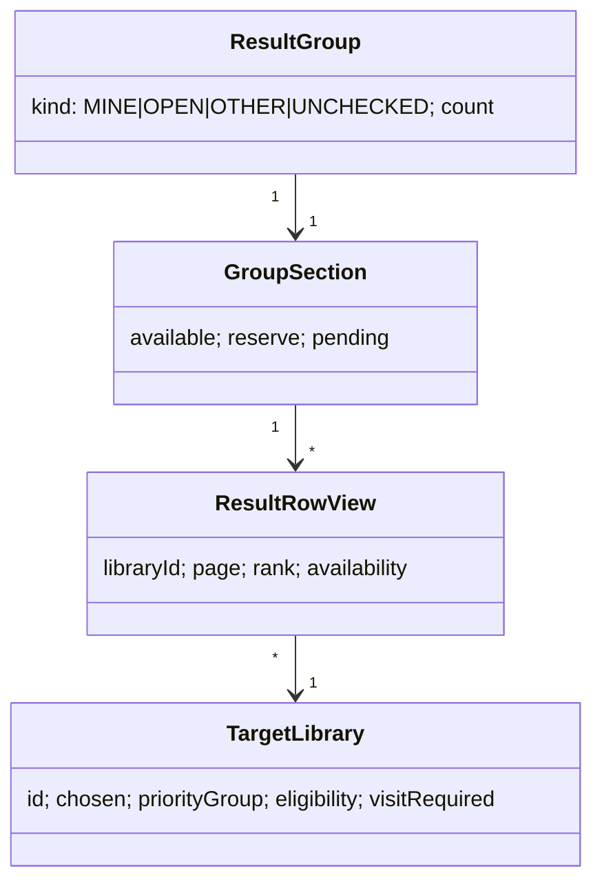
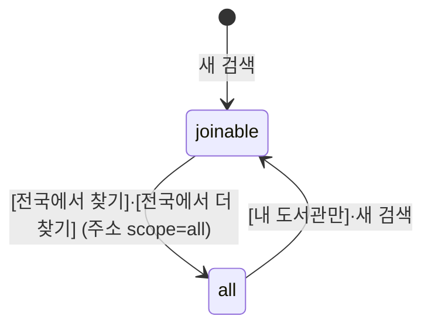

# 설계 제안: 사이클 22 첫 화면 사용성

- 작성 2026-10-18 (architect 서브에이전트, 읽기만 함). 결정은 `easy/2026-10-18-design-decisions.html`에서. 결정 뒤 `design-delta.md`로 정리. **이 문서의 결정 6 B안(0.7초 debounce)과 "스위치" 문장은 design-delta·ADR-0135·0137로 대체됨** — 기록용으로만 둠.
- 읽은 자료(2026-10-18): 사이클 22의 scope.md·spec.md·flow.md, `docs/current/data-model.md`(`library` 절), `api.md` 329행, dev `web/src/features/{search,region,mylibrary,book,picks}`, `api/types.ts`, `api/usageEvents.ts`, dev 백엔드 `library/internal/Library.java`·`001-library-schema.yaml`·`LibraryListController.java`, dev 스킬 `api-design` 버전 절.

## 현재 상태

- 서버: 이 슬라이스가 쓰는 API는 모두 지금 있습니다. `GET /api/v1/regions`, `PUT /api/v1/me/regions`, `/api/v1/me/libraries/**`, `GET /api/v1/libraries`, 검색 스트림 셋(`targets.libraries[]`). **`library.library` 표에는 지역 칸이 없습니다** [확정] (dev `Library.java`의 칸 목록, `001-library-schema.yaml`). 어디 살든 가입(OPEN) 도서관의 규칙은 `NATIONWIDE`라서 `scope_region_id`도 없습니다. `targets.libraries[]`에는 `matchedBy`(거주/직장)도 없습니다 [확정] (`types.ts` `TargetLibrary`).
- 웹(지금):
  - `useLibraryScope`는 `SearchPage`·`BookPage`·`usePicksPlan` 셋이 같이 씁니다. 로그인 전에는 `guestScope`, 뒤에는 `myScope`를 쓰고, **계정 값을 읽는 동안이나 실패했을 때는 `all`**입니다.
  - 결과는 배치마다 `BatchSection` 하나(`sortBatch`는 배치 안에서만 정렬)이고, 둘째 배치부터 "더 찾은 결과 · 도서관 N곳" 구분 줄이 붙습니다. 「확인하지 못한 도서관」만 `ResultList`가 모든 배치에서 모읍니다.
  - `ResultList`는 `BookPage`도 쓰고, `ResultRow`는 `PicksBookDialog`도 씁니다.
  - 지역 저장은 `RegionModal`이 저장 단추를 누를 때 한 번 `setRegions`를 부릅니다. 계정이면 PUT이 끝난 뒤에 화면 값이 바뀌고, `region_change` 기록도 한 번 갑니다. `InstantResults`는 `bookQuery`가 키라서 지역이 바뀌면 다시 마운트되고 앞 스트림은 중단됩니다.
  - 직접 추가 목록은 브라우저(`chaekcheck.chosenLibraries.v1`)든 계정이든 **번호만** 있습니다. 이름은 `GET /api/v1/libraries`(약 870KB, gzip 62KB)를 받아야 알 수 있고, 마이페이지는 지역을 키로 이 목록을 받습니다(`staleTime` 5분).

## 이번 슬라이스가 요구하는 것

| 요구/수용 기준 | 설계에서 필요한 것 |
|---|---|
| R1·R2·R3, AC-1·2·7·14 | 웹 새 부품 `LibraryScopeLine` [안 이름]: 처음 온 사람의 고르기 단추(S1-pick), 접힌 줄, 펼친 상자, 폰 칩. 곳 수는 기억값 |
| R4, AC-10·11 | 범위 스위치 삭제. `scope`는 주소의 `scope=all`일 때만 `all`, 아니면 `joinable` |
| R5, AC-3·4·16 | 배치를 가로지르는 묶음 단계(①②③ + 지금 ④) |
| R6, AC-5 | `ResultRow`에 꼬리표와 말풍선. 이 기능을 켜는 prop을 따로 둬서 책 화면·추천도서 창은 지금 그대로 |
| R8, AC-6 | 지금 `visit` 값 그대로. 켜는 곳 셋 |
| R9, AC-15 | 저장 안내를 닫았다는 표시를 브라우저에 기억 |
| R10, AC-8·12 | 상세검색에 격자 두 줄 + 도서관 이름 찾기(전체 목록이 필요) |
| R11·R12, AC-9·13 | `RegionModal`에서 격자를 빼내 공통 부품으로, 창은 삭제. 체크마다 저장 |
| AC-18 | 서버 API·표 그대로(결정 1·2에서 서버를 바꾸지 않는 안을 추천) |

## 결정 1: [어디 살든 가입] 말풍선의 "{시도}"

- **A안: 문구에서 시도를 뺌.** "그 지역에 살지 않아도 온라인으로 가입할 수 있어요 · 가입 방법 보기". 서버·데이터 변경 없음(AC-18), 모든 줄 문구 같음. 덜 구체적. 되돌리는 비용 낮음.
- **B안: 서버에 도서관 시도를 실음.** `library.library` 새 칸(예: `sido_region_id`) + Liquibase + 2,663줄 채우기 + `targets.libraries[]`에 `sidoShortName`. 정확하지만 이 사이클의 "서버 변경 없음"을 벗어나고 데이터 조사가 필요. 칸 추가는 v1 안에서 깨지지 않는 변경(dev `api-design` "Adding new fields") [확정]이나 AC-18과 어긋남. 되돌리는 비용 높음.
- **C안: 도서관 이름 앞머리를 `/api/v1/regions`의 시도 `shortName`과 맞춰 봄.** 무료지만 줄마다 문구가 달라지고 잘못 맞을 수 있음. 이름 규칙에 기대는 화면 논리(ADR-0071과 결이 다름).
- **추천: A안 [안].** 표에 근거 데이터가 없고 범위가 서버 변경 없음이며 spec R6-3이 이미 갈음을 허용함.

## 결정 2: [내 지역] 말풍선의 "{사는 곳/일하는 곳}으로" (새로 찾은 빈틈)

`targets`에 `matchedBy`가 없어 거주·직장을 둘 다 고른 사람의 줄은 어느 쪽 덕분인지 알 수 없습니다.

- **A안: 사용자 지역으로 갈음.** 직장이 비었으면 "사는 곳으로", 거주가 비었으면 "일하는 곳으로", 둘 다 있으면 "사는 곳이나 일하는 곳으로 가입할 수 있어요". 서버 변경 없음.
- **B안: `targets.libraries[]`에 `matchedBy` 추가.** 정확하지만 서버 변경(AC-18과 어긋남).
- **추천: A안 [안].**

## 결정 3: 「결과 더 보기」로 온 줄이 묶음 안 어디에 붙는지 (거름 "전체"일 때)

묶음 단계를 둘 곳은 고를 것이 아닙니다: `sortBatch`는 지금처럼 배치마다 정렬하고, 새 순수 함수 `resultGroups.ts`의 `groupBatches(views, libraryById)`가 ①②③으로 나눠 배치 순서대로 이어 붙입니다. `ResultList`가 부르므로 `InstantResults`·`DirectResults`가 함께 씁니다. `BatchSection`은 `GroupSection`으로 바뀌고 배치마다 있던 "더 찾은 결과" 구분 줄은 없어집니다.

- **A안: 소절 끝에 붙임.** 묶음 ① = [지금 빌릴 수 있어요: 배치1, 배치2…] → [예약하고 기다려요: 배치1, 배치2…] → [조회 중]. 소절 제목이 묶음마다 한 번(R5-2). 이미 보던 예약 줄이 아래로 밀림.
- **B안: 묶음 맨 끝에 배치 덩어리로 붙임.** 보던 줄이 전혀 안 움직이지만 한 묶음 안에 "지금 빌릴 수 있어요" 제목이 여러 번(R5-2와 어긋남).
- **추천: A안 [안].** 기본 거름("지금 빌릴 수 있는 책만")에서는 두 안이 같음.

함께 정할 세부 [안]: 배치마다 나오던 빈 결과 글("지금까지 N곳에서 찾지 못했습니다")은 목록 맨 아래 「결과 더 보기」 바로 위 한 줄로 옮김. "내 도서관에는 없어요 (0)"은 지역이나 직접 추가가 있고 첫 배치가 끝난 뒤에만 보임(AC-4: 지역이 없으면 ①이 아예 없음).

묶음 판정 `libraryGroup(target)`(R5-1 그대로): `chosen` 또는 `priorityGroup` `MY_SIGUNGU`/`MY_SIDO` 또는 `eligibility` `ELIGIBLE` → `MINE`, `OPEN` → `OPEN`, 그 밖 → `OTHER`. 실패·`UNKNOWN` 줄은 지금처럼 `sortBatch.unchecked`에서 ④로.

## 결정 4: 펼친 상자의 "직접 추가 N곳 (이름 두어 개)"

- **A안: 수만 보임**, 이름은 마이페이지에서만. 비용 0. flow의 "이름 두어 개"를 바꿔야 함.
- **B안: 지금 결과의 `targets`(`chosen=true`)에서 이름.** 서버 요청 없음. 검색 전 첫 화면에서는 수만, 바꾼 뒤 다음 검색 전까지 안 맞음.
- **C안: 상자를 열었을 때 직접 추가가 1곳 이상이면 그때만 `GET /api/v1/libraries`(지역 없이)를 받아 캐시.** 상세검색 "도서관" 줄 이름 찾기(R10-3, 전체 목록 필요)와 같은 캐시. 늘 맞는 이름. 직접 추가가 있는 사람만 상자를 처음 열 때 약 62KB(gzip). 서버 요청 수 ≤ 직접 추가가 있는 사용자의 페이지 방문 수.
- **추천: C안 [안].** 상세검색 이름 찾기 때문에 이 목록은 어차피 받고, 직접 추가 0인 대다수에게는 요청 없음.

## 결정 5: 곳 수(R3-3)와 저장 안내 닫음(R9-2)을 기억하는 곳

- **A안: 지금 키 `chaekcheck.searchSettings.v1`에 칸을 더함.** `planCount: {key, count}`, `openCount`, `saveHintClosed`. 있는 `readStored`/`savePrefs`·`DROPPED_PREFS`를 그대로 쓰고 같은 변경에서 `guestScope`·`myScope`를 지움. 성격이 조금 섞임.
- **B안: 새 키 하나**(예: `chaekcheck.myLibraryHints.v1` [안 이름]). 깔끔하지만 저장 헬퍼 하나 더.
- **C안: 지역 키 `chaekcheck.regions.v1`에 넣음.** 형식이 바뀌고 로그인한 사람은 이 키를 쓰지 않음. 추천하지 않음.
- **추천: A안 [안].**

어느 안이든 공통 [안]: `planCount.key` = `source|residence|work|libraryIds|visit` 지문, 지문이 같을 때만 수를 보임(지역·방문 빼기·직접 추가·로그인 상태가 바뀌면 자연히 숨겨져 R3-3의 "바꾸면 지움"이 됨). `scope=all` 검색의 수는 저장하지 않음. `openCount`(R3-4의 39)는 지역도 직접 추가도 없는 검색의 `targets` 길이 또는 전체 목록의 OPEN 수에서 갱신.

## 결정 6: 격자를 체크할 때마다 저장하고 다시 검색하기 (R1-3·R10-2·R12-1)

격자 부품은 `RegionModal`에서 `RegionGrid`(props: `field`, `value`, `onToggle`, `full`, 트리 상태)로 빼내 S1-box·S1-adv·S4·S10이 함께 씁니다. `RegionModal`·`RegionSummary`·`MyLibrarySummary`·`ScopeSummary`는 지웁니다. 선택은 저장·다시 검색의 시점입니다.

- **A안: 체크마다 바로 처리.** 저장/PUT, 다시 검색, "자동 N곳" 목록 다시 받기, `region_change` 기록이 체크마다. 연달아 세 곳 체크 = 검색 3번(앞 둘은 외부 조회 시작했다 중단), 870KB 목록 3번, PUT 3번(응답 순서 뒤바뀜 위험), 기록 3줄.
- **B안: 저장은 체크마다, 무거운 일은 마지막 체크 뒤 한 번.** 브라우저는 바로 저장; 계정은 PUT을 한 번에 하나씩, 보내는 중에 또 바뀌면 마지막 값만 다음에. 다시 검색·"자동 N곳" 다시 받기·`region_change`는 마지막 체크 뒤 잠깐(debounce, [안] 약 0.7초) 한 번. 실패: 마지막 저장된 서버 값으로 꼬리표 되돌림 + 사이클 06 문구; 422는 해석 안내.
- **C안: 저장은 체크마다, 다시 검색은 상자를 닫을 때.** R10-2 "바꾸는 즉시 다시 검색" [확정]과 어긋남.
- **추천: B안 [안].** → **모두 미승인 → 사용자 규칙 [확정]** (2026-10-18): "체크와 검색이 따로. 기다리는 시간도, 체크마다 검색도 없습니다. 무슨 0.7초 기다리지 마라" → 체크는 저장만(계정 PUT은 한 번에 하나씩), 검색은 [검색] 단추로만, 자동 재검색·debounce 없음. 아래 그림의 0.7초 부분은 무효.

## 결정 7: 로그인한 사람의 계정 값을 읽는 동안의 검색

지금은 계정 값을 읽는 동안이나 실패했을 때 `scope=all`입니다(사이클 06 flow S1 [확정], `useLibraryScope`). 스위치가 없어지면 다시 정해야 합니다.

- **A안: 계정 값을 읽을 때까지 검색이 기다림**(`RegionContext.ready=false`). 실패하면 지역 없이 `joinable`로 찾고 접힌 줄에 "내 도서관을 불러오지 못했어요 [다시 시도]", 녹색 안내 줄은 숨김. 첫 검색이 GET 두 번만큼 늦음.
- **B안: 지금처럼 읽는 동안은 `all`.** 약 376곳 계획이 시작됐다가 곧 `joinable`로 다시 마운트(외부 조회 낭비), 전국 화면이 잠깐 보임.
- **추천: A안 [안].** 다른 사이클의 [확정]을 바꾸므로 사용자 결정 필요.

## 모듈·데이터·API 초안 (추천안 기준)

- 모듈: 백엔드 모듈·공개 API·이벤트·소유 표 변경 없음.
- 웹의 범위 읽기: `useLibraryScope`를 `readScope(params)`로 바꿈(`scope=all`일 때만 `all`). `BookPage`·`usePicksPlan`도 같은 함수. `search()`는 새 주소에 `scope`를 싣지 않음. 책 링크(`bookLinkSearch`)는 지금처럼 주소에 있던 `scope=all`을 이어서 실음 [안].
- 데이터: 표 변경 없음. 브라우저: `chaekcheck.searchSettings.v1`에 `planCount`·`openCount`·`saveHintClosed`를 더하고 `guestScope`·`myScope`를 지움(결정 5 A).
- API: 바뀌는 것 없음. 부르는 횟수만: `GET /api/v1/libraries`(지역 없이)를 상자·상세검색에서 필요할 때만 한 번(결정 4 C), PUT·검색은 마지막 체크 뒤 한 번(결정 6 B).

## 확인 필요 / 사용자 결정 필요

1. 결정 1~7의 [안].
2. 문서끼리 어긋나는 곳(문서 고침 필요): scope.md 완료 기준 "울산에 살지 않아도"(결정 1 A이면 "그 지역에"); AC-1 작은 글 "안 고르면 어디 살든 가입되는 도서관에서 찾아요" ↔ R1-2·흐름 #6 "안 고르면 전국에서 찾아요"; R7-1 "스위치가 '내 도서관'이고"; R7-1 [사는 곳 고르기] ↔ AC-4 [지역 고르기]; R5-4 "· 전국으로 바꾸면 …" → [전국에서 찾기] 링크; scope 포함 5·R11 "두 단계 고르기" → 격자.
3. R8-2 "방문 가입 {N}곳을 뺐어요" ↔ flow "방문 가입 도서관을 뺐어요": 다시 검색하면 빠진 곳이 `targets`에 없어 N을 알 수 없음 → N 없는 문구 [안].
4. 책 화면 `BookPage`에 묶음·꼬리표를 넣는지: `ResultList`를 같이 쓰므로 정해야 함. 넣지 않음(`grouped=false`) [안], R5-6·scope #2와 맞춤.
5. 가입 정보 창의 "누구나 가입" → "어디 살든 온라인 가입"(R6-5): `ResultRow`를 같이 쓰므로 책 화면·추천도서 창에서도 바뀜. AC-17의 예외로 둠 [안].
6. 추천도서·책 화면의 범위: 저장 스위치 값이 없어져 늘 `joinable`(주소 `scope=all`일 때만 전국). 전에 "전체 도서관"을 저장해 둔 사람은 바뀜.
7. 웹 debounce 값(약 0.7초)을 `docs/settings-index.md`에 적을지.

## backlog 후보

- `targets.libraries[]`에 `matchedBy`와 도서관 시도 칸 더하기(결정 1·2 B). 지역별 안내가 더 필요해지면.
- 도서관 이름만 주는 가벼운 목록 API(870KB 목록 대신). 이름 찾기가 잦아지면.

## 서버 변경 없음 확인

그대로: API `GET /api/v1/regions`, `GET /api/v1/regions/resolutions`, `GET`/`PUT /api/v1/me/regions`, `/api/v1/me/libraries/**`, `GET /api/v1/libraries`, `GET /api/v1/books`, `/api/v1/book-availabilities/stream`·`…/batches/stream`, `/api/v1/ebook-searches/stream`(`targets` 칸 그대로; `scope`는 `joinable`, 전국 링크 때만 `all`; `visit`·지역·`libraryIds` 그대로). 표 `library.library`, `library.eligibility_rule`, `region.*`, `account_region`·`account_library`, 이용 기록 표들. 이용 기록: 새 이벤트 없음(전국 링크는 `search_event.scope='all'`, 방문 빼기는 `visit`로 이미 남음; `region_change`는 결정 6 B이면 묶어서 한 번).

## 바꿀 웹 파일 (dev `web/src/`)

- `features/search/`: 고침 `SearchPage.tsx`, `SearchForm.tsx`(상세검색 줄 셋, 폰 칩), `SettingsPanel.tsx`, `searchSettings.ts`, `ResultList.tsx`(묶음, 녹색 안내 줄, 전국 링크, 맨 아래 빈 결과 글), `ResultRow.tsx`(`tags` prop, 꼬리표·말풍선), `InstantResults.tsx`·`DirectResults.tsx`. 새로 `resultGroups.ts`(+test), `GroupSection.tsx`(`BatchSection.tsx` 대신), `LibraryScopeLine.tsx` [안 이름]. 바꿈 `useLibraryScope.ts` → `readScope`. 지움 `LibraryScopeToggle.tsx`, `VisitToggle.tsx`, `ScopeSummary.tsx`(+css). 그대로 `sortBatch.ts`, `holdingView.ts`.
- `features/region/`: 새로 `RegionGrid.tsx`(`RegionModal`에서 빼냄). 고침 `RegionContext.tsx`(저장 대기열·debounce·`region_change` 한 번, 계정 값 읽는 동안 `ready=false`). 지움 `RegionModal.tsx`, `RegionSummary.tsx`.
- `features/mylibrary/`: 고침 `MyLibrariesPage.tsx`(격자를 칸 안에, 첫 문장·OPEN 줄 문구, 저장 안내). 지움 `MyLibrarySummary.tsx`. 새로 저장 안내 한 줄 부품.
- `features/book/BookPage.tsx`, `features/picks/usePicksPlan.ts`: `readScope`로 바꿈.
- 위 파일들의 테스트. `api/types.ts`·`api/usageEvents.ts`는 고치지 않음.
