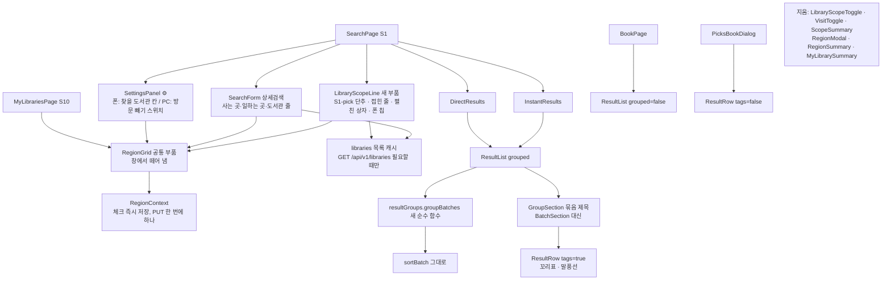
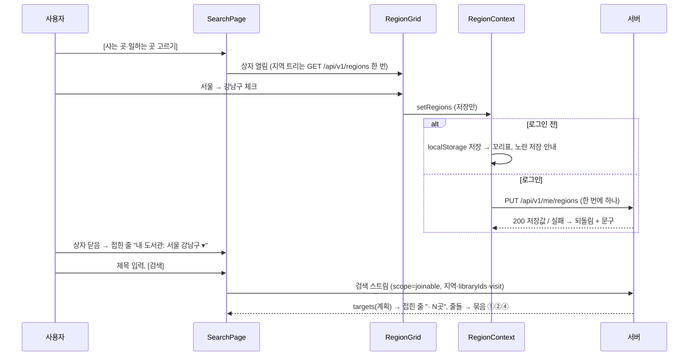
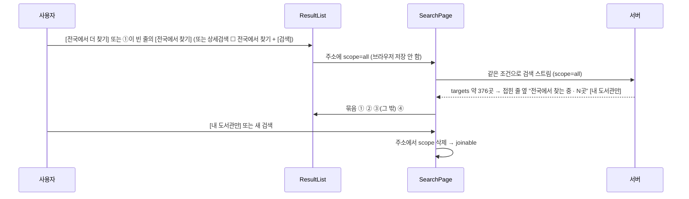
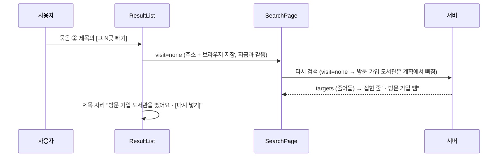
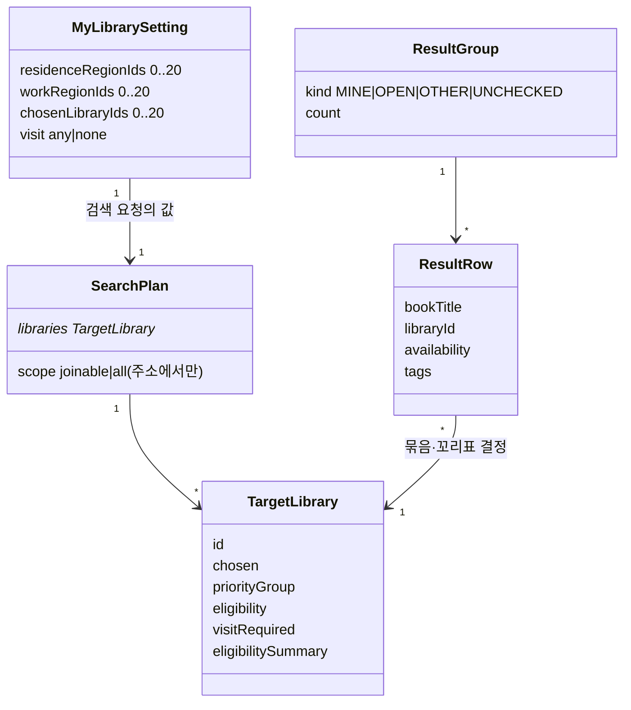
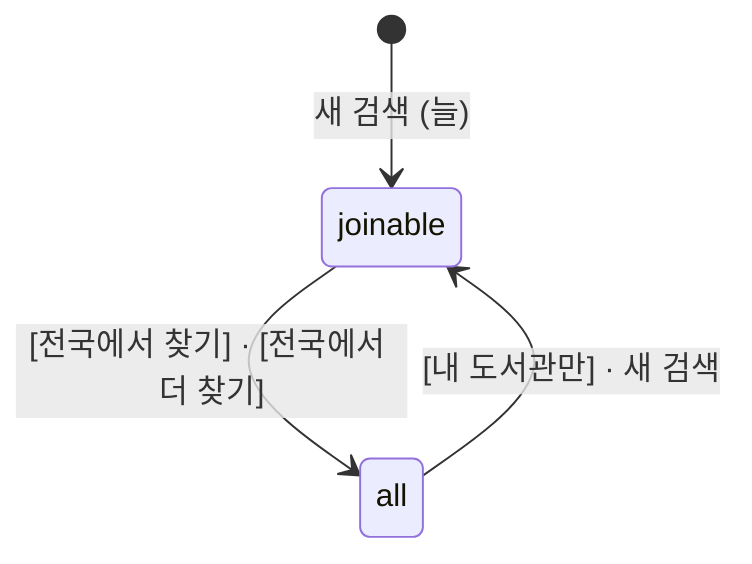

# 설계 변경: 사이클 22 첫 화면 사용성

- 작성 2026-10-18. 근거: [architect-proposal.md](architect-proposal.md)(설계 결정 9개, 2026-10-18 모두 정함), [spec.md](spec.md), [flow.md](flow.md). 결정 페이지 `easy/2026-10-18-design-decisions.html`.
- **서버(백엔드 모듈·API·표·이벤트)는 바뀌지 않습니다.** 바뀌는 것은 웹(`web/src/`)뿐입니다. 그래서 모듈·데이터·API 표는 "변경 없음"을 확인하는 표이고, 설계는 웹 부품 단위입니다.
- 버전: 화면만 바뀌고 API 호환이라 dev 17의 유의적 버전에서 MINOR(v1.1.0) 후보 [안: dev가 배포 때 정함] (인계서에 CHANGELOG 절).

## 구조 그림

### 웹 부품 구성도 (바뀌는 것만)

### 주요 흐름 1: 처음 온 사람이 사는 곳을 고르고 검색

### 주요 흐름 2: 전국 링크 검색과 돌아오기

### 주요 흐름 3: 방문 가입 빼기 (결과 안 단추)

### 도메인 모델 (웹 화면의 개념)

### 상태: 찾는 범위

## 모듈

| 모듈 | 신규/변경 | 책임 | 공개 API | 발행/구독 이벤트 | 소유 테이블 |
|---|---|---|---|---|---|
| (백엔드 전체) | 변경 없음 | — | 그대로 | 그대로 | 그대로 |
| 웹 `features/search` | 변경 | 첫 화면 줄(새 `LibraryScopeLine`), 상세검색 줄 셋, 결과 묶음(새 `resultGroups.ts`·`GroupSection`), 꼬리표·말풍선(`ResultRow` `tags` prop), 전국 링크, 방문 빼기 줄, 설정 스위치 이름. `useLibraryScope` → `readScope(params)`. 지움: `LibraryScopeToggle`·`VisitToggle`·`ScopeSummary` | — | — | — |
| 웹 `features/region` | 변경 | 새 `RegionGrid`(창에서 떼어 냄), `RegionContext`(체크 즉시 저장, 계정 PUT 한 번에 하나, 계정 읽는 동안 `ready=false`). 지움: `RegionModal`·`RegionSummary` | — | — | — |
| 웹 `features/mylibrary` | 변경 | `MyLibrariesPage`(지역 칸 안 격자, 첫 문장, 어디 살든 가입 줄 문구, 저장 안내). 지움: `MyLibrarySummary` | — | — | — |
| 웹 `features/book`, `features/picks` | 변경(작음) | `readScope`로 바꿈. 묶음·꼬리표 끄기(`grouped=false`, `tags=false`) | — | — | — |

### 웹 규칙 (설계 결정)

| # | 규칙 | 근거 |
|---|---|---|
| D1 | [어디 살든 가입] 말풍선은 "그 지역에 살지 않아도 온라인으로 가입할 수 있어요 · 가입 방법 보기" (도서관 시도는 `library` 표·`targets`에 없음) | 설계 결정 #1 [확정] |
| D2 | [내 지역] 말풍선은 사용자가 고른 쪽으로: 사는 곳만/일하는 곳만/"사는 곳이나 일하는 곳으로" | 설계 결정 #2 [확정] |
| D3 | 묶음 단계는 `resultGroups.groupBatches(views, libraryById)`: 배치 순서대로 ①②③에 넣고, 묶음 안은 `sortBatch` 결과를 소절(빌릴 수 있어요 → 예약 → 조회 중)마다 이어 붙임. [더 보기] 줄은 자기 소절 끝. 배치마다 있던 "더 찾은 결과" 구분 줄·"N곳에서 찾지 못했습니다" 글은 없애고 후자는 목록 맨 아래 한 줄로. "내 도서관에는 없어요 (0)"은 지역·직접 추가가 있고 첫 배치가 끝난 뒤만 | 설계 결정 #3 [확정] |
| D3' | `libraryGroup(target)`: `chosen` ∨ `priorityGroup∈{MY_SIGUNGU, MY_SIDO}` ∨ `eligibility=ELIGIBLE` → MINE; `eligibility=OPEN` → OPEN; 그 밖 → OTHER; 실패·UNKNOWN 판정 줄은 `sortBatch.unchecked` → UNCHECKED(사이클 20 그대로) | spec R5-1 [확정] |
| D4 | 펼친 상자의 직접 추가 이름과 상세검색 도서관 이름 찾기는 `GET /api/v1/libraries`(지역 없이)를 **필요할 때 한 번** 받아 페이지 안에서 캐시(React Query key `['libraries','','']`, staleTime 5분). 직접 추가 0이고 이름 찾기를 안 쓰면 요청 없음 | 설계 결정 #4 [확정] |
| D5 | 브라우저 저장 `chaekcheck.searchSettings.v1`에 `planCount {key, count}`, `openCount`, `saveHintClosed` 추가; `guestScope`·`myScope`는 `DROPPED_PREFS`로 지움. `planCount.key` = `source|residence|work|libraryIds|visit` 지문 — 같을 때만 수를 보임(바뀌면 자연히 숨김). `scope=all` 검색의 수는 저장 안 함 | 설계 결정 #5 [확정] |
| D6 | 격자 체크 = 저장만(로그인 전 localStorage, 뒤 PUT을 한 번에 하나씩 — 보내는 중 또 바뀌면 마지막 값만 다음에; 실패 시 마지막 저장값으로 되돌리고 사이클 06 문구, 422는 해석 안내). 검색은 [검색] 단추로만. 자동 재검색·debounce 없음. `region_change` 기록은 저장마다(지금과 같음). 마이페이지 "자동 N곳" 목록은 격자 체크 뒤 다시 받음(지금과 같음) | 설계 결정 #6 [확정] (사용자 규칙) |
| D7 | 로그인한 사람: `RegionContext.ready=false` 동안 검색을 시작하지 않음(`bookQuery=null`). 계정 읽기 실패: 지역 없이 `joinable`, 접힌 줄에 "내 도서관을 불러오지 못했어요 [다시 시도]", 녹색 안내 줄 숨김 | 설계 결정 #7 [확정] (사이클 06 flow S1 "읽는 동안 all" 대체) |
| D8 | 방문 가입을 뺀 뒤 제목 자리 "방문 가입 도서관을 뺐어요 · [다시 넣기]" (수 없음) | 설계 결정 #8 [확정] |
| D9 | `BookPage`는 `ResultList grouped=false`, `PicksBookDialog`는 `ResultRow tags=false`. 가입 정보 창의 "누구나 가입" → "어디 살든 온라인 가입"은 공통이라 그 화면들에서도 바뀜(AC-17 예외). 추천도서·책 화면의 범위는 늘 `joinable`(주소 `scope=all`일 때만 전국) | 설계 결정 #9 [확정] |
| D10 | 범위 읽기 `readScope(params)`: 주소 `scope=all`이면 `all`, 아니면 `joinable`. `search()`는 상세검색의 "☐ 전국에서 찾기"가 체크됐을 때만 새 주소에 `scope=all`을 실음(체크 상태는 저장하지 않고 검색 뒤 풀림). 결과 안 [전국에서 찾기]·[전국에서 더 찾기]는 주소에 `scope=all`을 붙여 다시 검색. 책 링크(`bookLinkSearch`)는 주소에 있던 `scope=all`을 이어서 실음 | 흐름 후속 #2, ADR-0135 [확정] / 책 링크는 지금 동작 그대로(사이클 06) [확정] |
| D11 | `RegionGrid` 크기: 글자 16px 이상, 체크 칸 높이 40px 이상, 너비 100%(PC 상자 최대 약 640px, 시군구 4칸 → 좁으면 3·2칸), 폰은 화면 너비 전체 | spec R12-1 [확정] |

## 데이터

- 스키마: 변경 없음. 표 `library.library`, `library.eligibility_rule`, `region.*`, 계정 `account_region`·`account_library`, 이용 기록 표 모두 그대로.
- Liquibase: changeset 없음.
- 브라우저 저장(웹): 위 D5. 지역 `chaekcheck.regions.v1`, 직접 추가 `chaekcheck.chosenLibraries.v1`은 그대로.

| 저장(브라우저).칸 | 타입 | 뜻 | 상태 태그 |
|---|---|---|---|
| `searchSettings.v1.planCount` | `{key: string, count: number}` | 마지막 검색의 계획 길이와 그때의 조건 지문 | [확정] (설계 결정 #5) |
| `searchSettings.v1.openCount` | number | 지역·직접 추가 없는 마지막 검색의 계획 길이(= 어디 살든 가입 사이트 수) | [확정] |
| `searchSettings.v1.saveHintClosed` | boolean | 저장 안내 ×를 누름 | [확정] |
| ~~`guestScope`, `myScope`~~ | — | 지움(`DROPPED_PREFS`) | [확정] |

## API

| 메서드 | 경로 | 설명 | 변경 |
|---|---|---|---|
| GET | `/api/v1/regions` | 시도·시군구 트리 | 없음. 격자가 처음 열릴 때 한 번(지금 `useRegionTree`) |
| GET/PUT | `/api/v1/me/regions` | 계정 지역 | 없음. 체크마다 PUT 한 번에 하나씩(D6) |
| POST/DELETE | `/api/v1/me/libraries/**`, `/api/v1/me/library-imports` | 직접 추가 | 없음 |
| GET | `/api/v1/libraries` | 전체 도서관 목록 + 자격 | 없음. 부르는 때만 달라짐(D4) |
| GET | `/api/v1/ebook-searches/stream`, `/api/v1/books` + `/api/v1/book-availabilities/stream`, `…/batches/stream` | 검색 | 없음. `scope`는 `joinable`, 전국 링크 때만 `all`; `visit`·지역·`libraryIds` 그대로 |
| — | 이용 기록 | — | 새 이벤트 없음. 전국 링크 = `search_event.scope='all'`, 방문 빼기 = `visit`, `region_change`는 저장마다 |

## 외부 연동

없음(바뀌지 않음).

## 결정 기록

- [ADR-0135](../../adr/0135-no-scope-switch-nationwide-per-search.md) 검색 범위 스위치 삭제, 전국은 결과 안 링크·상세검색 칸으로 그 검색만, 로그인 계정 읽을 때까지 대기 — Accepted (2026-10-18)
- [ADR-0136](../../adr/0136-result-groups-and-tags.md) 결과 묶음 넷·꼬리표·말풍선, 서버 변경 없음, 접힌 줄 수는 계획 길이 — Accepted (2026-10-18)
- [ADR-0137](../../adr/0137-region-grid-component-save-only.md) 지역 격자 공통 부품(창 삭제, 크기), 체크는 저장만·검색은 [검색] 단추 — Accepted (2026-10-18)

## 세 관점 자체 점검 (2026-10-18)

| 관점 | 본 것 | 결과 |
|---|---|---|
| 사용자 | 결과 화면에서 지역을 바꾼 뒤 [검색]을 안 누르면 결과와 접힌 줄이 어긋남 | 접힌 줄은 저장값을, 결과는 검색 당시 값을 보이므로 "· N곳"은 지문이 달라 숨겨짐(D5). 안내 줄은 따로 두지 않음(단순하게) [확정: 설계자 정리, 2026-10-18] |
| 사용자 | 전국 링크 검색 중에 [결과 더 보기]를 누르면? | 같은 주소(`scope=all`)의 다음 배치 → 전국 그대로. 새 검색만 `joinable`로 돌아감 [확정] (D10) |
| 사용자 | 로그인 직후 가져오기 창(S11)과 새 저장 안내가 겹침 | S11은 그대로, 저장 안내는 로그인한 사람에게 안 보임(R9-2)이라 겹치지 않음 |
| 서버 자원 | 체크마다 검색이 사라져 외부 조회 낭비 없음(D6). 전체 목록 870KB는 직접 추가 있는 사람이 상자를 열 때·이름 찾기 때만(D4). 전국 링크는 사용자가 누른 그 검색만(계획 약 376곳, 첫 배치는 똑같이 10곳) | 지금보다 늘어나는 요청 없음. 계정 PUT이 체크 수만큼 늘지만 DB 쓰기 한 줄 |
| 보안·안정성 | 주소 `scope=all`은 지금도 받는 값(검증 그대로). 브라우저 저장 칸 셋은 숫자·불리언·문자열이고 읽을 때 기본값으로 떨어짐(`loadPrefs` 방식). PUT 순서 보장으로 되돌아감 방지 | 새 공격면 없음. 격자가 받는 지역 ID는 지금처럼 `resolutions`로 해석 |

## 확인 필요

| 항목 | 왜 | 확인 방법 | 막는 단계 |
|---|---|---|---|
| ~~상자를 닫을 때 "지역이 바뀌었어요 · [검색]을 눌러 다시 찾기" 한 줄~~ → 넣지 않음(사용자 규칙 "체크와 검색이 따로"에 맞춰 단순하게; 접힌 줄의 곳 수가 숨겨지는 것으로 충분). 필요해지면 백로그 | 세 관점 점검 첫 줄 | — | 없음 |
| `GET /api/v1/libraries` 지역 없이 받은 목록으로 직접 추가 이름을 찾을 때 꺼진 도서관(목록에 없음)은 "꺼진 도서관"으로 | 사이클 06 S10 규칙 재사용 | dev 구현 때 확인 | 없음 |
