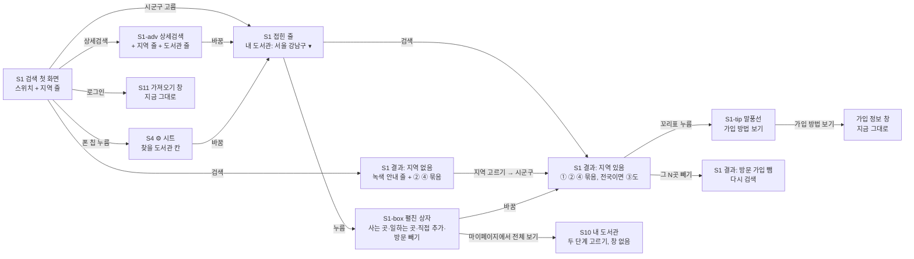

# 화면 흐름: 첫 화면 사용성 (지역 먼저 묻기 · 결과는 내 도서관부터 · 방문 가입 표시)

- 작성 2026-10-18. 근거 [spec.md](spec.md)(결정 11개 승인), [scope.md](scope.md). 결정 페이지 `easy/2026-10-18-flow-decisions.html`.
- 화면 번호는 지금 `docs/current/flows.md`의 것을 이어 씁니다: S1 검색(첫 화면·결과 화면이 한 화면), S4 ⚙ 설정, S10 마이페이지 내 도서관, S11 로그인 뒤 가져오기 창. **S2 내 지역 창은 이 사이클에서 없어집니다.** 새로 생기는 것은 화면이 아니라 S1·S10 안의 부품과 상태입니다: S1-pick(지역 고르기 줄), S1-box(펼친 상자), S1-tip(꼬리표 말풍선), S1-adv(상세검색 패널의 지역·도서관 줄).
- 그림은 구조와 상태이고 디자인이 아닙니다. 새·바뀐 화면의 PC·폰 그림은 결정 페이지에.

## 화면별 내용

### S1 검색 — 첫 화면 (아직 검색하지 않음)

- 목적: 책 제목을 넣기 전에 "어디서 빌릴지"를 정하게 하고, 지금 어느 도서관을 찾는지 한 줄로 보인다.
- 보이는 요소(PC, 641px 이상, 위에서 아래): 제목 글 / 검색창 [검색] [상세검색 ⌄] [⚙] / **찾을 도서관 줄**: 스위치 [내 도서관 | 전국](한 네모 안 두 칸) + 그 옆에 ⓐ 지역·직접 추가가 없으면 **S1-pick** "어디서 빌리실 건가요? [시도 ▾][시군구 ▾]"와 아래 작은 글 "안 고르면 전국 누구나 가입 도서관(39곳)에서 찾아요 · 일하는 곳도 더하기", ⓑ 있으면 **접힌 줄** "내 도서관: 서울 강남구(· 일하는 곳 성남시)(· 방문 가입 뺌)(· 직접 추가 2)(· 68곳) ▾". 지금의 [방문 없이 가입]·[내 도서관 설정]·[내 도서관 관리 ⌄]는 없음 [확정] (scope 결정 #1, spec R1).
- 사용자 동작: 시도 고르기 → 시군구 고르기(그 순간 저장, 접힌 줄로 바뀜, 로그인 전이면 노란 저장 안내 한 줄) / 접힌 줄 누르기 → S1-box / [일하는 곳도 더하기] → S1-box가 일하는 곳 줄에 초점을 두고 열림 / [상세검색] → S1-adv / 검색.
- 호출 API: `GET /api/v1/regions`(처음 고르기를 열 때 한 번, 지금 `useRegionTree`), 로그인 뒤 저장 `PUT /api/v1/me/regions`. 그 밖 없음.
- 상태: 기본(ⓐ/ⓑ) / 지역 목록 로딩(고르기가 "불러오는 중…"으로 비활성) / 지역 목록 실패("지역 목록을 불러오지 못했어요 [다시 시도]", spec 결정 #11) / 저장 실패(로그인 뒤: 고르기 옆 사이클 06 문구, 꼬리표 안 붙음) / 20개 참(고르기 비활성 + "최대 20곳이에요").
- 폰(640px 이하): 찾을 도서관 줄 대신 **칩 하나** "내 도서관: 서울 강남구 · 68곳 ▾"(없으면 "어디서 빌리실 건가요? ▾"). 누르면 S4 시트의 "찾을 도서관" 칸 [확정] (spec R2-1, 결정 #2). 스위치는 시트 안.
- 로그인한 사람: 같은 모양, 값은 계정. 바꾸면 계정 저장, 저장 안내 없음 [확정] (spec R1-6, R9).

### S1-box 펼친 상자 (S1의 상태, PC)

- 목적: 사용자별 도서관 정보를 한 자리에서 고친다.
- 보이는 요소(위에서 아래): 사는 곳(꼬리표들 + [시도 ▾][시군구 ▾]) / 일하는 곳(없으면 "없음" + 고르기, 있으면 꼬리표 + 고르기) / 직접 추가 N곳(이름 두어 개, "상세검색이나 마이페이지에서 이름으로 더할 수 있어요") / ☐ 직접 가야 가입되는 도서관은 빼기 / "누구나 가입 39곳은 늘 들어 있어요" / [마이페이지에서 전체 보기] [확정] (scope 결정 #1).
- 동작: 고르는 즉시 저장. 결과 화면이면 즉시 다시 검색. 상자 밖 누름·Esc로 닫힘. 여는 방식은 검색창 아래 떠 있는 상자(결과 목록을 밀지 않음) [안] (결정 #2 아래).
- 로그인 전 저장 직후: 저장한 줄 바로 아래 노란 안내 "이 브라우저에만 저장됐어요. 로그인하면 다른 기기에서도 그대로예요 [카카오 로그인] ×" (spec 결정 #10).

### S1 검색 — 결과 화면

- 목적: 내 도서관부터 보이고, 줄마다 왜 나왔는지와 가입 가능 여부를 바로 알린다.
- 보이는 요소(위에서 아래): 검색창 줄 / 찾을 도서관 줄(첫 화면과 같은 부품; 지역 없으면 S1-pick 그대로) / 거름 탭(지금 빌릴 수 있는 책만 | 전체) + [기본 순서 ⌄] / (지역 없음) **녹색 안내 줄** "지금은 전국 누구나 가입 도서관 N곳에서 찾았어요 … [지역 고르기]", × 없음 / 묶음 ① 내 도서관에 있어요 (n) · 작은 글 → ② 누구나 가입 도서관에 있어요 (n) · 작은 글 · 방문 가입이 있으면 "이 중 N곳은 … [그 N곳 빼기]" → (전국) ③ 그 밖의 도서관에 있어요 (n) · 작은 글 → ④ 확인하지 못한 도서관 (n) / 각 묶음 안에 "● 지금 빌릴 수 있어요 (n)" (전체 거름이면 "예약하고 기다려요"도) / 줄: 책 · 도서관 이름 + 꼬리표 · 수 / 맨 아래 [결과 더 보기] [확정] (spec R5~R8).
- 꼬리표: [직접 추가] [내 지역] [누구나 가입] 중 하나 + [방문 가입]. ③ 줄은 가입 조건 요약(회색) [확정] (spec R6-1).
- 사용자 동작: 꼬리표 누름(PC는 올림) → **S1-tip** 말풍선(그 줄 위, 목록 안 밀림) → "가입 방법 보기" → 지금 가입 정보 창 / [그 N곳 빼기] → 다시 검색, 제목 자리 "방문 가입 도서관을 뺐어요 · [다시 넣기]" / [지역 고르기] → S1-pick에 초점(폰은 S4) / [결과 더 보기] → 새 줄이 자기 묶음 끝에.
- 호출 API: 지금과 같음(`/api/v1/ebook-searches/stream`, `/api/v1/books` + `/book-availabilities/stream`, `…/batches/stream`). 묶음·꼬리표는 첫 묶음 `targets.libraries[]`의 `chosen`·`priorityGroup`·`eligibility`·`visitRequired`로 화면이 정함 [확정] (spec 2절).
- 상태: 로딩(첫 묶음 전: 접힌 줄 곳 수는 기억값/생략, 묶음 제목은 줄이 처음 올 때) / 조회 중 줄은 자기 묶음 맨 아래 "대출 정보 조회 중" / ①만 비면 "내 도서관에는 없어요 (0) · 전국으로 바꾸면 …"(회색), ②③ 비면 숨김 / 모두 비면 지금 "결과 없음" 화면 / 실패·UNKNOWN 줄은 ④(사이클 20 그대로) / 막힘(429·503)은 사이클 08 그대로 [확정] (spec 5절).
- 폰: 찾을 도서관 줄 자리에 칩. 묶음 제목의 작은 글은 제목 아래 줄로. 꼬리표는 도서관 이름 뒤 그대로. 말풍선은 탭으로.

### S1-adv 상세검색 패널 (S1의 상태)

- 보이는 요소: 제목(완전 일치) / 저자(완전 일치·옮긴이·그림·엮은이) / 출판사(완전 일치) / **지역**: 사는 곳 꼬리표 + 고르기, 일하는 곳 꼬리표 + 고르기 / **도서관**: "도서관 이름으로 찾기" 입력 → 아래 찾은 목록(10곳씩 더 보기, 각 줄 [더하기]) + "직접 추가 N/20"과 추가한 이름 꼬리표(× 로 빼기) [확정] (spec R10).
- 동작: 지역·도서관은 검색 단추와 무관하게 즉시 저장, 결과 화면이면 즉시 다시 검색. 제목·저자·출판사는 지금처럼 검색 때 적용 [확정] (spec R10-2).
- 폰: 지금 상세검색이 접히는 방식 그대로, 두 줄이 아래에 더해짐 [안] (결정 #4).

### S4 ⚙ 설정 (폰 시트 / PC 작은 창)

- 폰 시트 "찾을 도서관" 칸 안(위에서 아래): 스위치 [내 도서관 | 전국] / 사는 곳 / 일하는 곳 / 직접 추가 N곳 / ☐ 직접 가야 가입되는 도서관은 빼기 / [마이페이지에서 전체 보기] — S1-box와 같은 차례 [확정] (spec R2-1). 지금 "내 도서관 관리"·"내 지역 설정/변경" 단추는 없음.
- PC 작은 창: 지금의 보기 방식·도서관에서 직접 찾기 아래에 "직접 가야 가입되는 도서관은 빼기" 스위치 한 줄 [확정] (spec R8-1). 지역은 PC에서는 S1-box가 맡으므로 여기에 두지 않음 [안] (결정 #3).
- 폰에서 시도·시군구 고르기 모양: 브라우저 기본 `<select>` 두 개(폰에서는 OS가 아래에서 올리는 목록, PC는 드롭다운) [안] (결정 #1).

### S10 마이페이지 내 도서관

- 바뀌는 것: 첫 문장 "검색 스위치를 '내 도서관'에 두면 여기 있는 도서관에서 찾아요" / "지역 선택" 칸에서 [변경] 단추를 없애고 사는 곳 줄·일하는 곳 줄(꼬리표 + 고르기)을 둠, "거주 지역으로 자동 N곳 ▸"·"직장 … 자동 N곳 ▸" 펼침은 그대로 / 로그인 전 저장 직후 노란 안내 한 줄 [확정] (spec R11, 결정 #5·#10).
- 그대로: 맨 위 "누구나 가입하는 도서관 39곳도 …" 줄, 직접 도서관 추가, 직접 추가한 도서관 N/20, [돌아가기].
- **S2 내 지역 창 삭제**: 어디서도 열리지 않음 [확정] (scope 결정 #5).

### S11 로그인 뒤 가져오기 창 — 그대로

- 사이클 07 흐름 19 그대로. 이 사이클에서 바뀌지 않음 [확정].

### 두 단계 고르기 부품 (S1-pick · S1-box · S1-adv · S4 · S10 공통)

- [시도 ▾] → [시군구 ▾](그 시도의 시군구, 이미 고른 것은 흐리게) → 꼬리표 "{시도 짧은 이름} {시군구} ×" 추가, 고르기는 비워짐 / 20개면 비활성 + "최대 20곳이에요" / 목록 실패 시 한 줄 + [다시 시도] [확정] (spec R12, 결정 #3·#11).
- 시군구가 하나뿐인 시도(세종 1곳)는 시도를 고르면 시군구가 자동으로 골라짐 [안] (결정 #5).

## 수용 기준 대응

| AC | 화면 |
|---|---|
| AC-1 처음 온 사람의 첫 화면 | S1 첫 화면 ⓐ (S1-pick) |
| AC-2 시군구 고르면 접힌 줄 | S1 첫 화면 ⓑ, S10 |
| AC-3 결과 묶음 ①②와 꼬리표, 접힌 줄 곳 수 | S1 결과 |
| AC-4 지역 없이 검색한 녹색 줄 | S1 결과(지역 없음) |
| AC-5 [방문 가입] 꼬리표와 말풍선, 가입 방법 보기 | S1 결과, S1-tip, 가입 정보 창 |
| AC-6 [그 N곳 빼기] → 다시 검색, ⚙ 스위치, 접힌 줄 "방문 가입 뺌", `visit=none` | S1 결과, S4, 접힌 줄 |
| AC-7 펼친 상자의 차례와 닫힘 | S1-box |
| AC-8 일하는 곳이 세 곳에 같이 보임 | S1-box, S1-adv, S10 |
| AC-9 여러 사는 곳 꼬리표, 20 한도 | 두 단계 고르기 부품 |
| AC-10 스위치 이름, 마이페이지 첫 문장 | S1, S4, S10 |
| AC-11 전국일 때 ①②③④, ③ 꼬리표, 접힌 줄 그대로 | S1 결과 |
| AC-12 상세검색 지역·도서관 줄, 직접 추가 → [직접 추가] 꼬리표 | S1-adv, S1 결과 |
| AC-13 마이페이지 고르기, 내 지역 창 없음 | S10 |
| AC-14 폰 칩 → 시트 | S1 폰, S4 |
| AC-15 저장 안내 한 줄과 × | S1-box, S1-adv, S10 |
| AC-16 더 보기 때 묶음 끝 | S1 결과 |
| AC-17 책 먼저 고르기·추천도서 그대로 | (바뀌지 않음) |
| AC-18 API 그대로 | 모든 화면의 호출 API |

## 상태별 동작 대응 (spec 5절)

| 상태 | 화면 상태 |
|---|---|
| 로딩(첫 묶음 전) | S1 결과: 접힌 줄 곳 수 기억값/생략, 묶음 제목은 첫 줄 도착 때 |
| 결과 없음 / ①만 비음 | S1 결과: 지금 "결과 없음" / "내 도서관에는 없어요 (0)" |
| 외부 조회 실패·지연 | S1 결과 ④ (사이클 20 그대로) |
| 지역 저장 실패 | S1-box·S1-adv·S10 고르기 옆 사이클 06 문구 |
| 지역 목록 실패 | 고르기 자리 한 줄 + [다시 시도] |
| 브라우저 저장 막힘 | 지금처럼 이 방문 동안만(주소) |

## 먼저 정할 것 (결정 페이지)

| # | 항목 | 안 |
|---|---|---|
| 1 | 시도·시군구 고르기 부품의 모양 | 브라우저 기본 `<select>` 두 개(PC 드롭다운, 폰은 OS 목록) [안] |
| 2 | PC에서 접힌 줄을 펼친 상자가 열리는 방식 | 검색창 아래 떠 있는 상자(결과 목록을 밀지 않음), 밖 누르면 닫힘 [안] |
| 3 | PC ⚙ 작은 창에 지역을 둘지 | 두지 않음(S1-box가 맡음), 방문 가입 스위치만 [안] |
| 4 | 폰 상세검색의 지역·도서관 줄 | 지금 접히는 패널 아래에 두 줄 더함(시트로 바꾸지 않음) [안] |
| 5 | 시군구가 하나뿐인 시도(세종) | 시도를 고르면 자동으로 골라짐 [안] |
| 6 | "누구나 가입"이라는 말 (친구분 피드백 2026-10-18 저녁: "누구나 가입 이게 안 와닿아서 코멘트 자체를 빼는 게 나은 듯", "그냥 고르면 조건대로 나온다. 안 고르면 전국에서 검색 정도만") | 사용자 눈에 보이는 글에서 "누구나 가입"을 빼고 "어디 살든 가입"으로: 첫 화면 작은 글 "고르면 그 지역 기준으로 찾아요 · 안 고르면 전국에서 찾아요", 묶음 ② "어디 살든 가입되는 도서관에 있어요", 꼬리표 [어디 살든 가입], 녹색 줄 "사는 곳을 고르지 않아 전국에서 찾았어요. 아래 도서관은 어디 살든 온라인으로 가입할 수 있어요. 사는 곳을 고르면 그 지역 도서관부터 보여요", 마이페이지·펼친 상자의 "누구나 가입 39곳" 줄도 같은 말로 [안] |
