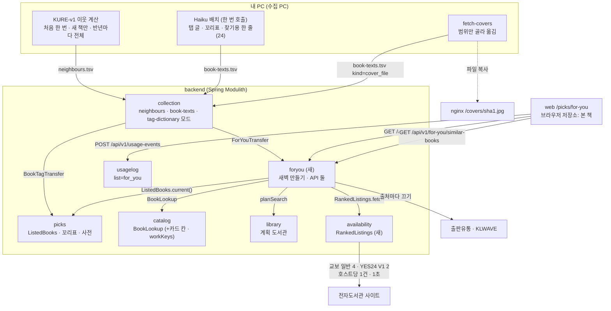
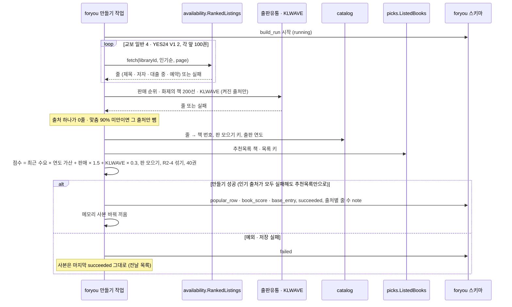
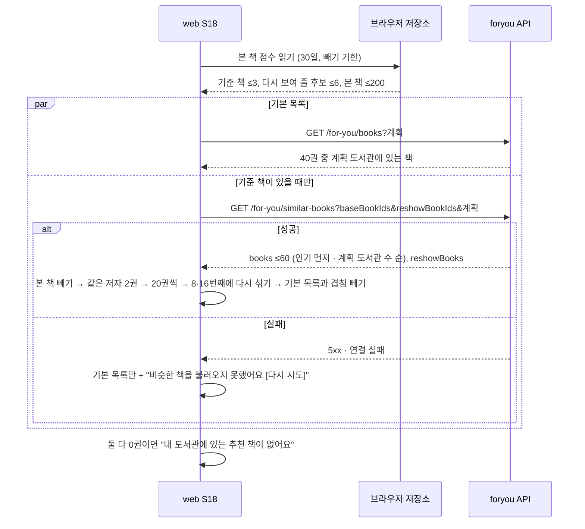
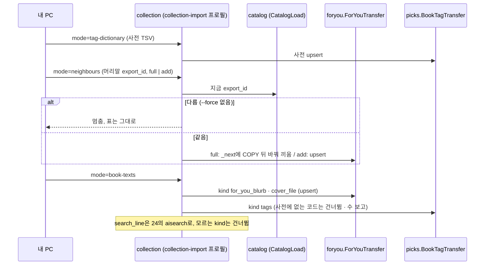
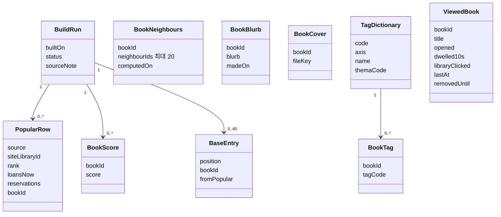
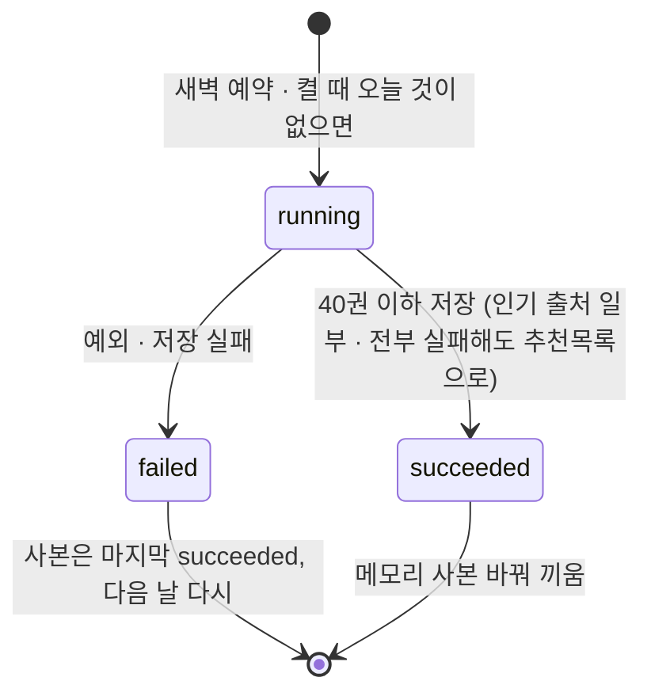
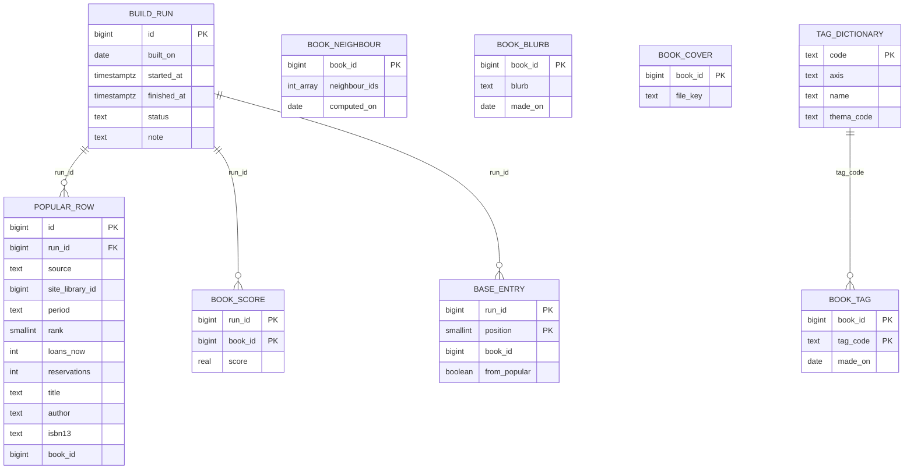

# 설계 변경: 사이클 23 추천 도서 탭 「나에게 맞는 책」

- 사용자 검토 승인 2026-10-24 (검토 페이지 easy/2026-10-24-design-review.html #1)
- 쓴 날: 2026-10-24. 기준: [spec.md](spec.md), [flow.md](flow.md), [architect-proposal.md](architect-proposal.md), 설계 결정 페이지 [easy/2026-10-24-design-decisions.html](easy/2026-10-24-design-decisions.html) (claude.ai Artifact, 사용자 답 2026-10-24)
- dev 기준: main `adba2d3` (GitHub로 읽음). 사이클 24(`aisearch`, `ListedBooks`, `book-texts`)는 다른 브랜치에서 설계됨, 아직 dev에 없음 — 두 사이클 중 먼저 개발하는 쪽이 공통 부분(`ListedBooks`, `book-texts` 모드)을 만듦
- `docs/current/`는 `/cycle-close`에서 고침

## 설계 결정 (사용자, 2026-10-24)

| # | 결정 | 사용자 답 |
|---|---|---|
| 1 | 인기 목록은 **운영 서버가 매일 새벽 직접** 받음. 도서관 사이트는 `availability`의 조회 줄(호스트당 1건·1초)로만 | 승인. 덧붙임 "책 수집할 때 인기 도서 찾는거 검증하라고 따로 써줘" → [to-dev-popular-list-check.md](to-dev-popular-list-check.md) |
| 2 | 새 모듈 **`foryou`**, 꼬리표·꼬리표 사전은 **`picks`** | 승인 |
| 3 | 비슷한 책 표는 **책마다 한 줄, 이웃 번호는 4바이트 정수 배열**. 탭 글·꼬리표·표지 연결은 24의 `book-texts` 명령에 kind로 | 승인 (#3 다시). 덧붙임 "일단 (가)로 하고 나중에 임베딩 벡터 뭐 이런거 계산해서 사용하는 거 고려하자" → backlog |
| 4 | 개인 추천: 서버가 이웃 모으기·보유 거르기·정렬, 브라우저가 본 책 빼기·같은 저자·쪽 나누기·다시 섞기. 보내는 번호는 기준 책 ≤3 + 다시 보여 줄 후보 ≤6 | 승인 |
| 5 | 표지: **PC `fetch-covers` 결과 가운데 탭 글 범위(추천목록 책 + 보유 많은 3만 권 + 기본 목록 후보)를 운영 `/covers/`로 옮김**, 연결은 `book-texts` kind `cover_file`. 그 밖은 제목 글자 표지 | "어짜피 보여야 하는 거면 수집하자 수집 세션에게 하라고 시켜" (#5 다시 미승인 → 처음 안 #5로). 수집 세션에 부탁함 2026-10-24 |
| 6 | 같은 책의 다른 판은 "같은 책" 규칙으로 모아 점수를 합치고 소장 많은 판 하나만 | 승인 |
| 7 | PC Haiku 배치 **한 번 호출로** 꼬리표(23)·찾기용 한 줄(24)·탭 추천 글(23)을 함께, **대상 책 목록을 입력으로** 받아 새 책만 더 돌림 | 승인 (#7 다시, 사용자 "추후 늘어날 것도 생각") |
| 8 | 비슷한 책은 처음 한 번 뒤 새 책만, **반년에 한 번쯤 전체 다시** | 승인 |
| 9 | 꼬리표 사전은 **DB 표** | 미승인 + "DB 표" |
| 10 | ADR은 둘로 묶음: ADR-0148(#1·#5), ADR-0149(#2·#3·#4·#6·#7·#8·#9) | 승인 |
| — | 개인 추천 "나머지는 내 도서관에 많이 있는 순" = **계획 도서관 가운데 가진 곳의 수** | 시험 결과 결정 #3 고친 안 승인 문구 그대로 |

## 구조 그림

### 모듈 구성도



### 주요 흐름

흐름 A: 새벽 기본 목록 만들기 (출처 실패·전체 실패 포함)



흐름 B: 탭 열기 (개인 추천만 실패하는 길 포함)



흐름 C: PC 결과 넣기



### 도메인 모델



- `BookNeighbours`·`BookBlurb`·`BookCover`는 `foryou`, `TagDictionary`·`BookTag`는 `picks`, `ViewedBook`은 브라우저 저장소에만 있음. 다른 모듈과는 `bookId` 값으로만 이어짐(FK 없음)

### 만들기 실행 상태



## 모듈

| 모듈 | 신규/변경 | 책임 | 공개 API | 발행/구독 이벤트 | 소유 테이블 |
|---|---|---|---|---|---|
| `foryou` | 신규 [확정: 모듈] (결정 #2), 이름 [확정: 결정 페이지 문구] | 새벽 기본 목록 만들기(인기 수집·점수·판 모으기·섞기), 비슷한 책·탭 글·표지 연결 보관, API 둘 | `ForYouTransfer`(이웃 full/add, 탭 글·표지 연결 upsert — `collection`만 부름) [안: 이름] | 없음 | `foryou.build_run`, `popular_row`, `book_score`, `base_entry`, `book_neighbour`, `book_blurb`, `book_cover` |
| `picks` | 변경 | 추천목록 + 꼬리표·사전 | `ListedBooks.current()`·`loadFromDb()`(24와 같음), `ListedBook`에 `bookId`·목록 키·`tags`(nullable). `BookTagTransfer`(꼬리표 upsert, 사전 upsert) [안: 이름] | 없음 | 새 `picks.tag_dictionary`, `picks.book_tag` |
| `catalog` | 변경 | 카드용 서지와 판 모으기 키 | `BookLookup`에 카드 칸(첫 저자 표시·출판사·출판 연도·첫 저자 `name_exact`) [안: 모양], `workKeys(bookIds)` [안: 이름] (결정 #6) | 없음 | 그대로 |
| `availability` | 변경 | 인기순 목록 한 쪽 받기 | `RankedListings.fetch(libraryId, sort, page)` [안: 이름]: 교보 일반 `orderByKey=loanNmvl`, YES24 V1 `sort=lending`, 기존 어댑터·`HostQueueBoard`·나가는 길 그대로. `*.dkyobobook.co.kr` 막음 | 없음 | 그대로 |
| `collection` | 변경 | PC 결과 넣기 | 모드 `neighbours`·`tag-dictionary`(새), `book-texts` kind `for_you_blurb`·`tags`·`cover_file`(새, 모드는 24가 정한 것). 새 의존 `collection → foryou` | 없음 | 그대로 |
| `usagelog` | 변경 | 사용 알림 | `picks_list_view`·`picks_book_view`의 `list` 값에 `for_you` | 없음 | CHECK만 |
| `library` | 그대로 | | `planSearch` | | |

- `foryou` allowedDependencies [안]: `catalog`, `library`, `picks`, `availability`. 고리 없음(`picks`·`availability`·`catalog`는 `foryou`를 모름)
- 웹(`web/src/features/picks/`): `PICKS_TABS` 맨 앞 for-you, `/picks` → `/picks/for-you`, 본 책 저장소(번호·제목·점수 비트 셋·마지막 시각·빼기 기한, 200권, 30일), 10초는 `visibilitychange`로 멈춤, S18·S19, 결정 #4의 순서 규칙과 Vitest
- 나중에 분리할 때: `foryou`는 추천 서비스 하나(`foryou` 스키마)로 떼고, `ListedBooks`·`BookLookup`·`planSearch`·`RankedListings`가 서비스 사이 읽기 API가 됨

## 데이터

- 스키마: `foryou` (새), `picks` (표 둘 더함)



| 테이블.컬럼 | 타입 | 제약 | 설명 | 상태 태그 |
|---|---|---|---|---|
| `foryou.build_run.id` | bigint | identity PK | | [안] |
| `foryou.build_run.built_on` | date | NOT NULL | Asia/Seoul 날짜 | [안] |
| `foryou.build_run.status` | text | NOT NULL, CHECK IN (`running`,`succeeded`,`failed`), 색인 `(status, built_on DESC)` | 마지막 성공 목록 찾기 | [안] |
| `foryou.build_run.note` | text | NULL | 출처별 받은 줄 수·맞춘 수 (검증 노트 [to-dev-popular-list-check.md](to-dev-popular-list-check.md) 5번) | [안] |
| `foryou.popular_row.run_id` | bigint | FK `build_run` ON DELETE CASCADE | 같은 모듈 안 FK | [안] |
| `foryou.popular_row.source` | text | NOT NULL, CHECK IN (`kyobo_elib`,`yes24_elib`,`kpipa_rank`,`kpipa_200`,`klwave`) | 출처 | [안] |
| `foryou.popular_row.site_library_id` | bigint | NULL (출판유통·KLWAVE), FK 없음 | `library.id` 값 | [안] |
| `foryou.popular_row.period` | text | NULL, CHECK IN (`day`,`week`,`month`,`quarter`) | 출판유통·KLWAVE 기간 | [안] |
| `foryou.popular_row.rank` | smallint | NOT NULL, ≥ 1 | | [안] |
| `foryou.popular_row.loans_now`·`reservations` | int | NULL, ≥ 0 | 교보·YES24만 | [안] |
| `foryou.popular_row.title`·`author`·`publisher`·`isbn13` | text | title NOT NULL | 맞추기 전 원래 값 | [안] |
| `foryou.popular_row.book_id` | bigint | NULL | 맞춘 책 | [안] |
| `foryou.popular_row` 보관 | | 실행 기록과 함께 30일 지난 것 지움 | 가중치 조정(R2-3a) 원재료 | 30일 [안] |
| `foryou.book_score` | PK (`run_id`, `book_id`), `score real` NOT NULL ≥ 0 | FK `build_run` CASCADE | 판을 모은 뒤 대표 판에만. 개인 추천 "인기 먼저" 정렬 | [안] |
| `foryou.base_entry` | PK (`run_id`, `position`), `book_id` NOT NULL, `from_popular boolean` NOT NULL | `position` 1~40, UNIQUE (`run_id`, `book_id`), FK CASCADE | 기본 목록 차례 | 40 [안] (R2-4) |
| `foryou.book_neighbour.book_id` | bigint | PK | | [안] |
| `foryou.book_neighbour.neighbour_ids` | integer[] | NOT NULL, CHECK `cardinality BETWEEN 1 AND 20`, `array_ndims = 1` | 가까운 차례. 자기 자신·중복 없음(넣을 때 검사). 책 번호가 2,147,483,647을 넘으면 넣기 거부 | 20 [확정] (R6-1), 4바이트 [확정] (결정 #3) |
| `foryou.book_neighbour.computed_on` | date | NOT NULL | 반년 전체 다시(결정 #8) 판단용 | [안] |
| `foryou.book_blurb` | `book_id` PK, `blurb text` NOT NULL, `made_on date` NOT NULL | `char_length(blurb)` 1~300 | 80~150자 규칙(R8-4)은 PC가 지킴 | 300 [안] |
| `foryou.book_cover` | `book_id` PK, `file_key text` NOT NULL | `~ '^[0-9a-f]{40}$'` | `/covers/<file_key>.jpg` | [안] |
| `picks.tag_dictionary` | `code text` PK, `axis text` NOT NULL, `name text` NOT NULL, `thema_code text` NULL, `active boolean` NOT NULL DEFAULT true | `code ~ '^[A-Za-z0-9_]{1,20}$'`, `axis` IN (`mood`,`subject`,`audience`) | 사전 (결정 #9). 사전에서 빠진 코드는 지우지 않고 `active=false` | [안] |
| `picks.book_tag` | PK (`book_id`, `tag_code`), `made_on date` NOT NULL | FK `tag_code → picks.tag_dictionary(code)` | 추천목록 책만(R9-1). 카드에는 `active` 코드 가운데 느낌 1 + 주제 1~2 | [안] |

- 크기 어림 [추론]: 이웃 약 0.2GB(134만 줄), 탭 글 약 15MB(3.3만 줄), 표지 파일 약 0.3GB(3.3만 장 × 약 10KB, 수집 세션이 잼 [확인 필요]), 나머지 작음
- 다른 모듈과 FK·조인 없음. 가져오기로 사라진 책 번호는 `BookLookup`이 돌려주지 않아 읽을 때 빠짐
- 바뀌는 기존 CHECK: `usagelog.screen_event.picks_list`에 `for_you` 더함(서버 검사 상수도). `picks.list_field`·`list_book`의 목록 키 CHECK는 그대로(`for_you`는 목록이 아님)
- Liquibase: 새 changelog 파일로 추가 (기존 changeset 수정 없음), 번호는 23·24를 합칠 때 다음 번호
  - `db/changelog/foryou/001-for-you.yaml` — 스키마 `foryou`, 표 일곱, CHECK는 changeset 안 `sql`
  - `db/changelog/picks/006-tag-dictionary-and-book-tag.yaml` [안: 번호]
  - `db/changelog/usagelog/00N-picks-list-for-you.yaml` — CHECK 지우고 다시 만듦, 24 `usagelog-ai-search-event` 다음
  - master 끝에 include

## API

| 메서드 | 경로 | 설명 | 요청 | 응답 | 에러 |
|---|---|---|---|---|---|
| GET | `/api/v1/for-you/books` [안] | 오늘 기본 목록 가운데 계획 도서관에 있는 책 | 계획 파라미터(`residenceRegionIds`·`workRegionIds`·`scope`·`visit`·`libraryIds`, `/api/v1/picks/{listKey}`와 같은 이름·검증) | 200 `{builtOn, books[]}`. 한 번도 못 만들면 `builtOn: null` + 추천목록만 | 400 `validation_error`, 422 `invalid_region`, 500 `internal_error` |
| GET | `/api/v1/for-you/similar-books` [안] | 기준 책의 비슷한 책 | `baseBookIds`(1~3, 쉼표, 필수), `reshowBookIds`(0~6), 계획 파라미터 | 200 `{baseBooks[], books[] ≤60, reshowBooks[]}`. 모르는 번호는 조용히 뺌 | 400 `validation_error`(`errors[].field` `baseBookIds`·`reshowBookIds`, `code` `required`·`invalid_format`·`too_many`·`duplicate`), 422, 500 |

- 인증 없음, GET이라 CSRF 없음. nginx 일반 `/api/` 구역(5r/s) [확정: 지금 설정]. `Cache-Control`은 정하지 않음(picks 목록과 같음) [안]
- 카드 칸: `bookId`, `title`, `author`, `publisher`, `coverUrl`(없으면 null), `blurb`(없으면 null), `tags[{code, axis, name}]`(추천목록 책만), `planLibraryCount`(≥ 1), `lists`(목록 키만, "KAIST 추천목록에 있어요" 문구는 웹이 탭 이름으로 만듦), similar에는 `authorKey`(첫 저자 `name_exact`)
- 인기 점수·출처 이름은 내보내지 않음(R3-2)
- `similar-books` 정렬: 기준 책 빼기 → 계획 도서관 0곳 빼기 → 오늘 `book_score`가 있는 책 점수 높은 순 → 나머지 `planLibraryCount` 많은 순 → `bookId` [안: 마지막 차례]

요청/응답 예시 (값은 보기)

```json
GET /api/v1/for-you/books?residenceRegionIds=1114
{
  "builtOn": "2026-10-25",
  "books": [
    { "bookId": 1203344, "title": "책 제목", "author": "저자", "publisher": "출판사",
      "coverUrl": "/covers/3f2a….jpg", "blurb": "해요체 한두 문장.", "tags": [],
      "planLibraryCount": 3, "lists": [] },
    { "bookId": 78100, "title": "책 제목", "author": "저자", "publisher": "출판사",
      "coverUrl": null, "blurb": null,
      "tags": [ {"code": "m03", "axis": "mood", "name": "잔잔한"} ],
      "planLibraryCount": 1, "lists": ["snu100", "kaist"] }
  ]
}
```

```json
GET /api/v1/for-you/similar-books?baseBookIds=11,22,33&reshowBookIds=44&residenceRegionIds=1114
{
  "baseBooks": [ {"bookId": 11, "title": "책 A"}, {"bookId": 22, "title": "책 B"} ],
  "books": [ { "bookId": 501, "title": "…", "author": "…", "publisher": "…", "coverUrl": null,
               "blurb": null, "tags": [], "planLibraryCount": 2, "lists": [], "authorKey": "…" } ],
  "reshowBooks": [ { "bookId": 44, "title": "…", "author": "…", "publisher": "…", "coverUrl": null,
                     "blurb": "…", "tags": [], "planLibraryCount": 1, "lists": [], "authorKey": "…" } ]
}
```

```json
400
{ "title": "Bad Request", "status": 400, "code": "validation_error",
  "errors": [ { "field": "baseBookIds", "code": "too_many" } ] }
```

- 사용 알림: `{"type":"picks_list_view","list":"for_you",…}`, `{"type":"picks_book_view","list":"for_you","bookId":501,…}`. `category` 값 [확인 필요]

### 넣는 명령 (PC → 운영, `collection-import` 프로필)

| 모드 | 파일 | 동작 | 상태 태그 |
|---|---|---|---|
| `neighbours` (새) | TSV `book_id\tneighbour_ids`(쉼표), 머리말 `export_id`, `full`·`add` | `full`: `foryou.book_neighbour_next`에 COPY → 한 트랜잭션에서 이름 바꿔 끼움. `add`: `ON CONFLICT (book_id) DO UPDATE`. 운영 `catalog_import.export_id`와 다르면 멈춤(`--force`로만) | [안] |
| `tag-dictionary` (새) | TSV `code\taxis\tname\tthema_code` | upsert, 파일에 없는 코드는 `active=false` | [안] (결정 #9) |
| `book-texts` (24가 정한 모드) | `kind\tbook_id\tsource\tmade_on\ttext` | kind `for_you_blurb` → `foryou.book_blurb`, `tags` → `picks.book_tag`(`text` = 코드 쉼표 목록, 그 책의 꼬리표를 통째로 바꿈, 사전에 없는 코드는 건너뜀), `cover_file` → `foryou.book_cover`(`text` = sha1), `search_line` → 24 `aisearch`. 모르는 kind는 건너뛰고 수 보고 | kind 이름 [안] |

## 외부 연동

| 대상 | 방식 | 제한·키 관리 | 실패 시 동작 | 상태 태그 |
|---|---|---|---|---|
| 교보 일반 전자도서관 4곳 (서초 반포·연천·도봉·부천) | 운영 서버 `availability` 길, `contentList.ink?…orderByKey=loanNmvl`, 앞 100권 | 호스트당 1건·1초, 나가는 길 설정(프록시) 그대로, 키 없음. 교보문고 약관 제11조⑨가 걸리는지 [확인 필요] | 그 사이트만 빠짐 | 사이트 [확정] (시험 결과 결정 #2), 쪽 크기 [확인 필요: 사전 시험은 쪽당 80 받음] |
| YES24 V1 전자도서관 2곳 (국립세종·성남) | 같은 길, `/search/?…&sort=lending`, 앞 100권 | 같음 | 그 사이트만 빠짐 | [확정] (같음) |
| `*.dkyobobook.co.kr` | 보내지 않음 | 사이트 목록에서 빼고 어댑터 앞에서 막음 | — | [확정] (사이클 13 R1-6) |
| 출판유통통합전산망 판매 순위·「화제의 책 200선」 | `foryou` 안 HTTP 클라이언트, 간격 1초 | 위험 감수(ADR-0147). 출처만 끄는 설정 `chaekcheck.foryou.sources.<source>.enabled` [안: 이름]. 받을 범위(일·주·월 Top100 vs Thema 월간 Top50) [확인 필요] | 그 출처만 빠짐 | [확정: 쓰기] / 방식 [확인 필요] |
| KLWAVE (공공데이터포털 15159949) | 파일인지 API인지 [확인 필요] | 공공데이터 이용 조건 [확인 필요] | 그 출처만 빠짐 | [확인 필요]. 파일이면 PC 파일 모드가 더 필요함 |
| 표지 | PC `fetch-covers` → 범위만 운영 `/srv/chaekcheck/covers/`로 복사 | 서버는 책 사이트에 요청하지 않음. 출처별 이용 조건은 공개 배포 전 [확인 필요] | 표지 없으면 제목 글자 표지 | 방식 [확정] (결정 #5), 범위 보고 수집 세션 [확인 필요] |
| Claude Haiku (PC 배치) | Message Batches, 한 번 호출로 탭 글·꼬리표·찾기용 한 줄 | 키는 PC에만, 서비스는 부르지 않음 | 실패한 책은 다음 배치 | [확정] (결정 #7) |

## 설정 (settings-index에 더할 것, 이름·값 [안])

- 만들기 시각 `chaekcheck.foryou.build.cron` 새벽(05:00 사서 받기와 겹치지 않게, 예 04:00), 켤 때 오늘 것 없으면 만듦
- 출처마다 `enabled`, 인기 사이트 목록(`library_id` 여섯), 사이트마다 100권, 출판유통·KLWAVE 연결 5초·읽기 10초·간격 1초
- 출처 빼기 기준: 0줄 또는 맞춤 90% 미만
- 기록 30일, 기본 목록 40, 이웃 20, 개인 추천 60·한 쪽 20·다시 보여 주기 20권마다 2·후보 6
- 브라우저: 본 책 200권·30일·10초·다시 보여 주기 3일·S19 빼기 30일
- 메모리 사본: 만든 뒤와 10분마다 다시 읽음(PicksCache와 같게)

## 결정 기록

- ADR-0147 출판유통 판매 순위를 위험 감수하고 씀 (Accepted, 2026-10-24)
- [ADR-0148](../../adr/0148-for-you-popular-fetch-and-covers.md) 「나에게 맞는 책」 인기 목록은 운영 서버가 새벽에 받고, 표지는 PC 표지를 옮김 (Accepted, 결정 #1·#5)
- [ADR-0149](../../adr/0149-for-you-module-neighbours-and-split.md) 「나에게 맞는 책」 모듈 `foryou`, 이웃 표·넣는 길, 개인 추천 나누기, 판 모으기, 한 번 호출 배치, 꼬리표 사전 표 (Accepted, 결정 #2·#3·#4·#6·#7·#8·#9)

## 확인 필요

| 항목 | 왜 | 확인 방법 |
|---|---|---|
| 프록시 길(사이클 20)이 dev main에 있는지, 교보 일반·YES24 V1 인기순 화면을 지금 어댑터 파서로 읽는지 | 결정 #1의 조건(안 되면 PC 파일로 바꾸자고 다시 물음) | dev 코드 |
| 목록 줄 → 책 번호 맞추기 방법(사전 시험은 "그 도서관 소장 줄"로 맞춤), 운영 `catalog`의 소장 키 역조회 | `catalog`·`availability` API 범위 | dev 보고서·코드 |
| `BookLookup`의 저자·출판사·출판 연도("전자책이 나온 해": 대표 출판일인지 가장 이른 소장 날짜인지) | 카드, 연도 가산 | dev 코드 + 사용자 |
| 24 `ListedBook`의 실제 칸, `book-texts` kind별 동작 | 결정 #2·#3 | 24 브랜치 |
| 출판유통 받을 범위, 「화제의 책 200선」 보충 방식, KLWAVE 형식 | R2-3 | 사용자 PC 원문 |
| 운영 디스크·DB 여유 (이웃 0.2GB + 표지 0.3GB) | 사이클 17 운영 기록 | 운영 기록 |
| 표지 범위의 장 수·크기·출처별 이용 조건 | 결정 #5 | 수집 세션 보고(부탁 2026-10-24) |
| 소개 원문 채우기·이웃 다시 재기 결과 | R7·R8 입력 | 수집 세션 보고(`to-dev-intro-test-2026-10-24.md`) |
| for-you 사용 알림의 `category` 값 | AC-12 | dev `UsageEventController` |
| 오늘 기본 목록의 새 책 가운데 글·표지 없는 것을 PC가 아는 방법 | R8-7, 결정 #5 | dev 절차 (운영 DB 질의 파일 등) |
| 교보문고 약관 제11조⑨ | 결정 #1 | 공식 문서, 사용자 |
