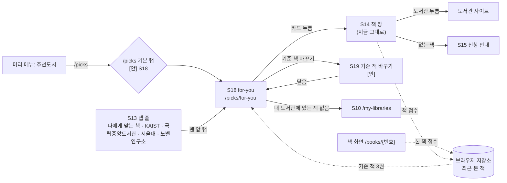
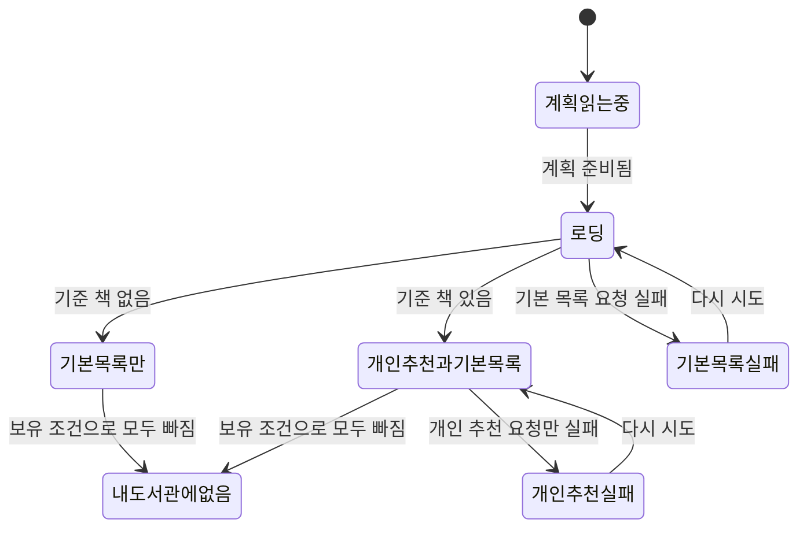

# 화면 흐름: 추천 도서 탭 「나에게 맞는 책」

- 쓴 날: 2026-10-24. 기준: [spec.md](spec.md), [scope.md](scope.md). 지금 dev 화면(main `adba2d3`, 2026-10-24 GitHub로 읽음): 추천도서 화면 S13 `/picks/:listKey`, 탭 `PICKS_TABS = [KAIST, 국립중앙도서관, 서울대, 노벨연구소]`(`web/src/features/picks/picksLists.ts`), 책 창 S14 `PicksBookDialog`, 신청 안내 S15 `RequestNotice`
- 화면 번호: 사이클 23은 S18~S29를 씀(24는 S30, 24 세션 전달 2026-10-24). 이번에 새로 쓰는 번호는 S18·S19
- 결정 페이지: [easy/2026-10-24-screen-flow-decisions.html](easy/2026-10-24-screen-flow-decisions.html)

## 화면별 내용

### S13 picks (지금 화면, 바뀌는 곳만)

- 탭 줄 맨 앞에 「나에게 맞는 책」을 더함. 나머지 탭과 차례는 그대로 [확정] (R1-1)
- `/picks`(탭 없는 주소)가 어디로 갈지: [안] S18 `/picks/for-you`로 넘김(맨 앞 탭과 같게). 다른 선택: 지금처럼 KAIST — 결정 페이지 #1 (R1-2)
- "추천 기준과 출처 보기"(S13i): 이 탭에서는 이 탭의 글을 보임 [안: 문구 — 아래 S18]

### S18 for-you (`/picks/for-you`)

- 목적: 무엇을 읽을지 정하지 않은 사람이 빌리러 갈 책을 고름. 책을 본 사람은 비슷한 책을 위에서 봄
- 보이는 요소 (위에서 아래로)
  1. AI 줄 "책 소개 글과 꼬리표는 AI가 골랐어요" (한 번) [확정] (R10-1)
  2. 기준 책 줄 (기준 책이 있을 때만): "최근 본 책 ○○·○○·○○과 비슷한 책 · 기준 책 바꾸기" [확정] (overview 6-1 #1). 폰은 두 줄로 접힘 [안]
  3. 맨 위 한 권: 한 줄 전체, 큰 표지·큰 제목·글 전부 [확정] (R1-3)
  4. 그 아래 한 줄에 두 권씩 카드. 개인 추천 먼저, 그 뒤 기본 목록 [확정] (R6-2)
  5. 개인 추천 20권이 끝나는 자리에 "비슷한 책 더 보기" (다음 20권, 60권까지) [확정] (R6-3). 누르면 그 자리에 붙고, 그 아래 기본 목록은 그대로 이어짐
  6. 맨 아래 "추천 기준과 출처 보기"(S13i와 같은 꼴) [안: 문구 "요즘 전자도서관에서 많이 빌리는 책과 판매 순위, 추천목록을 섞었어요 · 최근 본 책은 이 브라우저에만 저장돼요 · 주제 분류: Thema (EDItEUR)"]
- 카드: 표지(없으면 제목 글자 표지), 제목, 저자·출판사, 추천 글(있을 때, 자르지 않음), 꼬리표 2~3개(있을 때, 누를 수 없음), "내 도서관 N곳", 추천목록에 있으면 "○○ 추천목록에 있어요" [확정] (R3-1·R3-2·R9-5)
- 사용자 동작: 카드 누름 → S14 책 창(그 안에서 도서관별 대출 여부 조회, 지금 그대로) [확정] (R3-3) / 기준 책 바꾸기 → S19 / 더 보기 / 다시 시도
- 호출하는 API(이름만): 기본 목록 받기, 개인 추천 받기(기준 책 3권 보냄), 책 창 상세(지금 그대로), 사용 알림 `picks_list_view`·`picks_book_view` (`list=for_you`) [확정] (R11-1)
- 상태

| 상태 | 보이는 것 | 태그 |
|---|---|---|
| 계획을 읽는 중 | 지금 추천도서처럼 기다림 | [확정] |
| 로딩 | 카드 자리 뼈대(맨 위 한 장 + 두 장씩) | [확정] |
| 기준 책 없음 (처음 온 사람, 사생활 보호 창, 다른 기기) | AI 줄 + 기본 목록만. 기준 책 줄·안내 문구 없음 | [확정] (R1-4·R5-6) |
| 기준 책 있음 | AI 줄 + 기준 책 줄 + 개인 추천 + 기본 목록 | [확정] |
| 기준 책은 있지만 개인 추천이 0권 | 기준 책 줄은 보이고, 그 아래 바로 기본 목록 [안] (결정 페이지 #2와 사전 시험 결정 #3에 따라 드묾) | [안] |
| 개인 추천 요청 실패 | 기본 목록은 그대로, 기준 책 줄 자리에 "비슷한 책을 불러오지 못했어요 [다시 시도]" | [확정] |
| 기본 목록 요청 실패 | "추천 책을 불러오지 못했어요 [다시 시도]" | [확정] |
| 보유 조건으로 모두 빠짐 | "내 도서관에 있는 추천 책이 없어요" + 마이페이지(S10)로 가는 줄 | [확정] |
| 오늘 목록을 아직 못 만듦 | 전날 목록 (사용자에게는 다른 점이 보이지 않음) | [확정] |
| 글·꼬리표 없는 카드 | 그 줄 없이 카드 | [확정] |

- 배치 메모: PC(1440px) 본문 폭은 지금 추천도서 화면과 같음, 맨 위 한 권은 표지 왼쪽·글 오른쪽, 아래는 두 칸. 태블릿·폰(375px)도 두 칸 그대로, 맨 위 한 권은 표지 위·글 아래로 쌓임 [안]. 짜임은 PC·태블릿·폰 같음 [확정] (R1-3)

### S19 기준 책 바꾸기 [안]

- 목적: 엉뚱한 책(남에게 선물하려고 본 책 등)이 기준 책이 됐을 때 빼기 (R6-4)
- [안] 작은 창(폰은 아래에서 올라오는 시트): 최근 본 책을 점수 차례로 최대 10권, 지금 기준인 3권에 표시. 책마다 [빼기] → 그 책은 30일 동안 기준 책이 되지 않고 다음 책이 올라옴. 맨 아래 "최근 본 책 기록 모두 지우기". 닫으면 S18이 개인 추천을 다시 받음
- 다른 선택 (결정 페이지 #2): ① 창 없이 기준 책 줄의 책 이름 옆 × 만 ② "기록 모두 지우기"만
- 서버 호출 없음(브라우저 저장소만 고침). 닫은 뒤 개인 추천 받기를 다시 부름
- 상태: 최근 본 책 없음 → 이 창으로 가는 줄 자체가 없음(기준 책 줄이 없으므로)

### S14 책 창 (지금 그대로, 이 탭에서 열 때만 다른 점)

- 연도 줄("2025년 KAIST 사서추천")은 그 책이 추천목록에 있을 때만, 지금 규칙 그대로 [확정: dev `yearLine`]
- AI 요약(`aiSummary`) 칸은 지금처럼 추천목록 책에만. 탭 카드의 추천 글과는 다른 글 [확정] (R8-1, AC-11)
- 창을 열면 R5 점수의 "책을 연 적 있음", 10초 넘게 보이면 "열어 둔 적 있음", 도서관 줄을 누르면 "도서관을 누른 적 있음"을 브라우저가 셈 [확정] (R5-2~R5-4)

### 책 화면 `/books/{번호}` (지금 그대로)

- 화면에는 바뀌는 것이 없음. 브라우저가 R5 점수를 셈 [확정] (R5-3)

## 정할 것 (결정 페이지)

| # | 질문 | [안] | 다른 선택 |
|---|---|---|---|
| 1 | `/picks` 기본 탭 (R1-2) | 「나에게 맞는 책」(S18) | 지금처럼 KAIST |
| 2 | "기준 책 바꾸기" (R6-4) | S19 창: 최근 본 책 10권 중 빼기 + 기록 모두 지우기 | 기준 책 이름 옆 × 만 / 기록 지우기만 |
| 3 | 글 없는 카드 (R8-5) | 미리 쓰는 범위를 기본 목록·추천목록 책 + 보유 도서관이 많은 책 3만 권으로 넓힘. 그래도 없으면 글 줄 없이 | 지금 명세(기본 목록·추천목록 약 2,800권만) |

## 수용 기준 대응

| AC | 화면 |
|---|---|
| AC-1 | S13 탭 줄, S18 주소 |
| AC-2 | S18 "기준 책 없음" |
| AC-3 | S18 카드 꼬리말 |
| AC-4 | S18 기본 목록 차례 |
| AC-5 | S18 카드 "내 도서관 N곳", "보유 조건으로 모두 빠짐" |
| AC-6 | 책 화면·S14(점수 세기) → S18 "기준 책 있음" |
| AC-7 | S18 기준 책 줄 (브라우저 저장소) |
| AC-8 | S18 개인 추천 차례 |
| AC-9 | S18 AI 줄 |
| AC-10 | S18 카드 꼬리표 |
| AC-11 | S18 카드 추천 글, S14 AI 요약 |
| AC-12 | S18 열기·S14 열기 사용 알림 |
| AC-13 | S18 배치 메모 (PC·태블릿·폰) |
| AC-14 | S18 "개인 추천 요청 실패" |
| (새로) S19 | 결정 페이지 #2에 따라 spec에 AC를 더함 |
