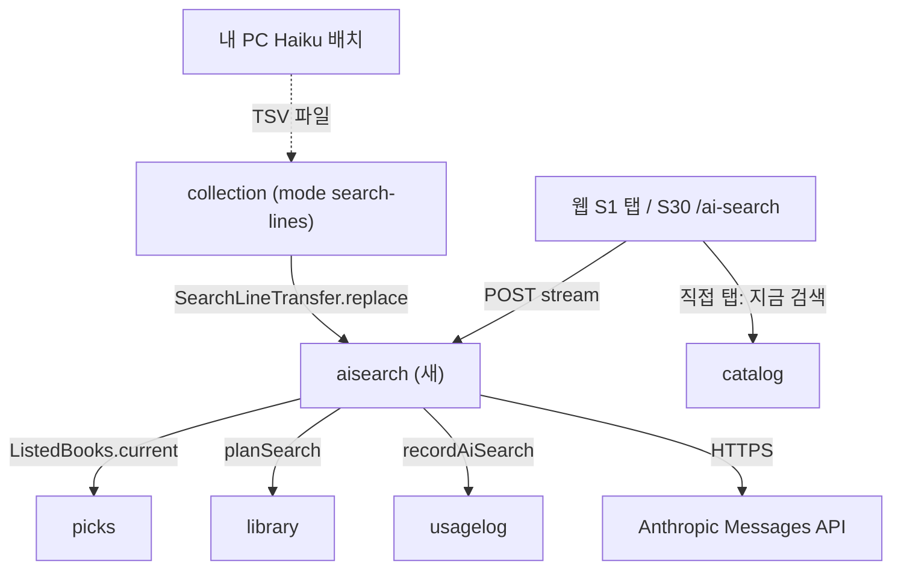
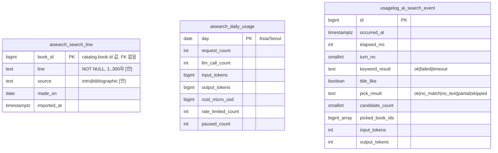

# 설계 제안: 사이클 24 AI 책 찾기 (architect, 2026-10-24)

> **최신은 [design-delta.md](design-delta.md).** 이 문서의 결정 2(넣기 모드 이름 `search-lines` → `book-texts`, `kind` 칸)와 결정 3(메모리 색인 `SearchIndex` → DB 낱말 맞추기, 표 `search_line` → `search_book`)은 사용자 선택으로 대체됨 (2026-10-24)

- 바탕: `scope.md`, `spec.md`(R1~R13, AC-1~15), `flow.md`(S1 탭 「AI」/「직접」, S30 `/ai-search`), main의 `docs/current/*`, 사이클 23 브랜치(`claude/server-status-library-crawl-test-uv7s8b`)의 `docs/current/*`·ADR-0140~0146·23 scope/spec(더 새 것이라 우선).
- dev 코드는 열지 못함(Windows 경로). "현재 상태"는 plan 문서의 dev 확인 기록에 기댐 → dev 코드로 다시 맞춰 봐야 함 [확인 필요].
- 결정 페이지: [easy/2026-10-24-design-decisions.html](easy/2026-10-24-design-decisions.html) (https://claude.ai/artifact/Bex3jp6arMgBiABGzC5fiC)

## 현재 상태 (이 슬라이스가 닿는 것)

| 대상 | 지금 | 출처 |
|---|---|---|
| AI 검색 모듈·표·API | 없음 | — |
| `picks` | 목록 다섯(`librarian`·`leedongjin`·`snu100`·`kaist`·`nobel`). 메모리 캐시 `PicksCache`가 책마다 `(bookId, libraryIds)`·화면 제목(`ShownTitle`)·표지 주소를 들고 10분마다 다시 읽음. 목록 책을 읽는 공개 Java API 없음(`CuratedListTransfer`는 가져오기용) | 23 `module-map.md`, ADR-0142~0144 |
| 표지 | 사서 `/api/v1/picks/covers/{id}`, 그 밖 nginx `/covers/<sha1>.jpg`. `catalog`에 표지 칸 없음 | ADR-0144 |
| `list_book.id` | 목록을 바꿀 때마다 새로 매겨져 다른 표의 열쇠로 못 씀 | 23 `data-model.md` |
| `catalog` | `BookLookup.byIds`, 가져와도 책 번호가 이어짐(ADR-0070), 검색은 pg_bigm | `module-map.md` |
| `library` | `LibraryCatalog.planSearch(…, PlanOptions)` | `module-map.md` |
| PC → 운영 반영 | ① 사이클 11/21 export/apply(`load_manifest.notes`, 형식 번호 3) ② `lists` 모드(ADR-0143). 둘 다 `collection` | ADR-0123·0143 |
| 스트림 관례 | 웹은 `fetch`로 읽음. 검증 오류는 스트림을 열기 전 ProblemDetail. `produces` 안 걸음. 이벤트 이름 kebab-case | `api.md` 공통 규칙 |
| 횟수 제한 | nginx `limit_req`(도서관을 부르는 API만), 429 `too_many_requests`. 메모리 상태는 인터페이스 뒤, 서버 1대 | `api.md`, ADR-0021·0133 |
| `usagelog` | 공개 `UsageLog`를 직접 부름, 기록 설정 기본 꺼짐, 변경 파일 `usagelog/007`까지 | `module-map.md` |
| 비밀 값 | Parameter Store `/chaekcheck/prod/` → `up.sh` → env 파일 | 사이클 17 `design-delta.md` |

## 결정 1: 모듈 자리와 찾기용 한 줄 표의 주인

- **A안 (추천) [안]: 새 모듈 `aisearch`.** 의존 `picks`·`library`·`usagelog`. `picks`에 읽기 공개 API `ListedBooks` 하나(캐시 사본, DB 호출 없음). 표 `aisearch.search_line`. LLM 클라이언트는 `aisearch.internal.llm`. 장점: R10-1 "전용 자료"와 주인이 같음, 사이클 23이 크게 고치는 `picks` 안쪽에 새 파일 둘만, 범위를 넓힐 때 책 출처만 `catalog`로 바꿈. 단점: 모듈 하나, `picks` 공개 API 하나. 되돌리기 낮음. 나중에 분리할 때 가장 쉬움
- B안: `picks` 안(`picks.internal.aisearch`). 새 공개 API 없음. 단점: 23과 같은 패키지를 동시에 고쳐 충돌, `picks`가 외부 LLM·요금 상한까지 맡음
- C안: A의 변형, 제목·저자·`libraryIds`를 `catalog` `BookLookup.byIds`로. 단점: 부르는 곳 둘, 화면 제목이 추천도서와 달라짐, 표지는 어차피 `picks`

`ListedBooks` [안: 이름은 dev]
```java
public interface ListedBooks {
  Snapshot current();
  record Snapshot(Instant builtAt, List<ListedBook> books) {}
  record ListedBook(long bookId, String title /* ShownTitle */, String author,
                    String coverUrl /* nullable */, long[] libraryIds, Set<String> listKeys) {}
}
```
`bookId` 없는 줄은 뺌, 여러 목록에 있으면 한 줄, 23의 꼬리표·탭 추천 글은 나중에 nullable 칸으로.

## 결정 2: 찾기용 한 줄이 운영 DB에 닿는 길

- A안: export/apply 반영 파일(`notes.searchLinePart`). 단점: 무거운 카탈로그 반영 때만 바뀜, 형식 번호 3→4가 23과 부딪힐 수 있음
- **B안 (추천) [안]: `collection`의 새 반영 모드 `search-lines`.** `--chaekcheck.collection.import.mode=search-lines --chaekcheck.collection.import.search-lines-file=<path>`. TSV(`book_id`, `source`, `made_on`, `line`)를 읽어 `aisearch`의 공개 `SearchLineTransfer.replace(rows)`를 부름(한 트랜잭션에서 지우고 넣음, 목록 책에 없는 번호는 건너뛰고 수 보고). 장점: `lists` 모드와 같은 절차, 몇 초, 형식 번호 그대로, 23과 안 겹침. 단점: 운영에서 명령 하나 더
- C안: 빌드 리소스(ADR-0142처럼). 단점: 글 하나 바꿔도 다시 배포, R10-3 [확정] "한 줄만 운영 DB로"와 맞지 않음

서버는 다음 색인 새로 고침(10분 [안]) 때 새 줄을 읽음. 한 줄 없는 책은 제목·저자로만.

## 결정 3: 약 2,800권 낱말 맞추기

맞출 글자가 두 모듈(`picks` 제목·저자, `aisearch` 한 줄)에 나뉘어 DB 한 쿼리로는 모듈 경계를 넘음.

- **A안 (추천) [안]: 메모리 색인 `SearchIndex`** = `ListedBooks.current()` + `search_line` 전체, 시작·10분마다·`builtAt`이 바뀔 때 새로 만듦. 정리 NFKC → 소문자 → 빈칸 지움, `contains`. 속도 1ms 아래·메모리 2~3MB [확인 필요: dev 측정]
- B안: `aisearch` 표에 제목·저자 사본 + pg_bigm. 단점: 사본이 어긋남, 2,800줄에 색인은 지나침

맞추기 규칙 [안]: 점수 = 맞은 서로 다른 낱말 수, 같으면 계획 도서관 수 많은 순 → `bookId` 작은 순, 계획 0곳 뺌, 최대 30권, 정리 뒤 2자 이상 낱말만.

## 결정 4: API (대안 없음 — 질문을 주소에 넣지 않으므로 POST)

`POST /api/v1/ai-searches/stream` [안: 경로]. 인증 없음, CSRF는 로그인 기능 켜짐이면 `POST /api/v1/usage-events`처럼 [안]. 오류는 스트림 열기 전 ProblemDetail, `produces` 없음, 웹은 `fetch` + `ReadableStream`(EventSource는 POST 불가). nginx 이 경로 버퍼링 끔·gzip 안 함 [안].

요청 본문 [안]
```json
{
  "question": "잠들기 전에 조금씩 읽을 과학책",
  "history": [ { "question": "과학책 추천해줘", "bookIds": [1203344, 88012] } ],
  "residenceRegionIds": [1168], "workRegionIds": [], "libraryIds": [],
  "scope": "joinable", "visit": "none"
}
```
`question` 2자 [확정]~200자 [안] (아래 비고), `history` 최대 5 [확정], 한 턴 `bookIds` 최대 8 [안], 목록 밖 번호는 조용히 버림. 20번 상한은 웹이 셈.

스트림 이벤트 [안]

| event | data | 언제 |
|---|---|---|
| `title-guess` | `{"title":"채식주의자"}` | R13: 제목·저자로 보일 때 맨 먼저 |
| `head-delta` | `{"text":"…"}` | 머리말 글 조각 |
| `card` | `{"no":1,"bookId":…,"title":"…","author":"…","coverUrl":"…","myLibraryCount":3}` | 번호가 후보 안·중복 아님 확인 뒤만(R12-2). 대신하는 길이면 앞 8권 |
| `card-delta` | `{"bookId":…,"text":"…"}` | 그 카드 글 조각, 300자에서 끊음 |
| `done` | `{"result":"ok"\|"no_match"\|"no_text"\|"partial","bookIds":[…]}` | 끝. 웹이 `bookIds`를 대화에 넣음 |
| `error` | `{"code":"internal_error"}` | 연 뒤 예상 못 한 오류 |

`title-guess.title`은 Haiku가 뽑은 글이 질문 안에 그대로 있을 때만, 아니면 질문 전체 [안](지어낸 제목이 단추에 뜨지 않게).

열기 전 오류 [안]: 400 `validation_error` / 400 `invalid_query`(2자 미만·200자 초과) / 422 `invalid_region` / 429 `too_many_requests` + `Retry-After` / 503 `ai_search_paused`(새) / 404 `not_found`(기능 꺼짐).

R13: 서버는 `catalog`에서 제목을 찾아보지 않음(추천) [안] — `title-guess`는 "찾으시나요?" 제안이고 누르면 웹이 지금 직접 검색을 돌림. 목록 안에서 그 책을 맨 앞에 두는 것은 메모리 색인(제목 칸 맞으면 큰 점수) + 2차 지시문. R13-4(곧장 직접 검색)를 고르면 `title-guess` 뒤 `done{result:"title_only"}`, 2차 안 부름.

## 결정 5: 요청 횟수와 하루 비용을 세는 곳 (서버 1대)

- A안: 둘 다 메모리 — 재시작하면 오늘 비용이 0이 되어 $2를 넘을 수 있음
- B안: 둘 다 DB — IP를 DB에 적게 됨(기록 최소 원칙, 처리방침 항목 늘어남)
- **C안 (추천) [안]: IP 횟수는 메모리(`AiSearchQuota` → `InMemoryAiSearchQuota`, `X-Real-IP`만, ADR-0140 규칙), 하루 비용은 `aisearch.daily_usage` 날짜당 한 줄 UPSERT**, 시작할 때 읽음. 재시작해도 상한이 지켜지고 IP는 저장 안 함, `usagelog.enabled`가 꺼져도 동작

날짜 경계 Asia/Seoul 자정 [안]. 비용 = 입력 × $0.10/1M + 출력 × $0.50/1M — 10만 토큰 이하 요청의 가격 [확정] (https://platform.claude.com/docs/en/about-claude/pricing , 2026-10-24 확인: 10만 넘으면 입력 $0.50·출력 $2.50. 이 기능의 요청은 10만 아래 [추론]). 스트림이 끊겨 `usage`가 안 오면 출력은 `max_tokens`로 셈 [안]. 상한은 시작할 때만 봄(돌고 있는 요청만큼 넘을 수 있음, 몇 센트 [추론]). 겉 울타리로 Anthropic Console 사용 한도 [확인 필요].

## 결정 6: LLM 클라이언트

- **A안 (추천) [안]: JDK `HttpClient` 직접** — `picks`의 `NlkTransport`처럼 얇게, SSE 줄 읽기 직접. 새 라이브러리 없음, `output_config`를 바로 씀, OpenAI 호환 구현도 같은 모양
- B안: 공식 Anthropic Java SDK — 의존 늘어남, SDK가 `output_config`를 따라오는지 [확인 필요]

경계(`aisearch.internal.llm`, 이름 [안])
```java
interface LlmClient {
  LlmReply complete(LlmCall call, Duration timeout);                    // 1차
  void stream(LlmCall call, Duration timeout, LlmStreamListener sink);  // 2차
}
record LlmCall(String system, List<LlmMessage> messages, String jsonSchema, int maxTokens) {}
record LlmUsage(long inputTokens, long outputTokens) {}
interface LlmStreamListener { void onText(String chunk); void onEnd(LlmUsage u); void onError(LlmFailure f); }
enum LlmFailure { TIMEOUT, HTTP_ERROR, OVERLOADED, BAD_OUTPUT }
```
- `PickStreamParser`: 2차 스키마 하나만 읽는 작은 상태 기계(`head` → `picks[]` 차례로 `no` → `text`, 조각 경계의 escape 이어 읽기). Jackson 비동기 파서는 문자열이 끝나야 값을 주는 것으로 알고 있음 [확인 필요]
- 2차 스키마 `{head, picks: [{no, text}] maxItems 8}` 모두 required. 1차 스키마 `{notBook, titleLike, title, refersToShown, keywords[] maxItems 8}` [안]. `refersToShown`이면 후보 = 앞 답 책 + 낱말 맞춘 책, 아니면 보여 준 책을 뺌(R11-4)
- 앞 대화의 `bookIds`는 서버가 제목으로 바꿔 넣음. 회원·IP·도서관 이름은 안 넣음(R4-4)
- thinking: Haiku 5.5는 adaptive thinking, 기본 effort `medium` [확정] (models overview, 2026-10-24). 1차 5초 안에 들려면 끄거나 effort를 낮춰야 할 수 있음 [확인 필요: API 호출 시험]

설정 속성(이름 [안]): `chaekcheck.aisearch.enabled`(기본 false), `…llm.provider=anthropic`, `…llm.anthropic.base-url` [확인 필요], `…llm.anthropic.api-key` ← env `CHAEKCHECK_AISEARCH_ANTHROPIC_API_KEY`(비면 대신하는 길), `…llm.anthropic.model=claude-haiku-5-5` [확정], `…keyword-timeout`/`…pick-timeout` 5s/15s [확정], `…rate.per-minute`/`per-day` 10/100 [확정], `…budget.daily-usd` 2 [확정], 가격 0.10/0.50 [확정], `…candidates.max` 30 [확정], `…picks.max` 8 [안], `…history.max-turns` 5 [확정], `…question.max-length` 200 [안], `…card-text.max-chars` 300 [안], `…index.refresh-interval` 10분 [안], max-tokens [확인 필요: 프로토타입]. SSM 이름 `/chaekcheck/prod/CHAEKCHECK_AISEARCH_ANTHROPIC_API_KEY` [안]. 키는 로그·예외에 남기지 않음. 모두 `docs/settings-index.md`에.

## 모듈·데이터 초안 (추천안 기준)



- `aisearch`: 공개 `SearchLineTransfer`, REST `POST /api/v1/ai-searches/stream`, 이벤트 없음, 표 `search_line`·`daily_usage`, `allowedDependencies = {"picks","library","usagelog"}` [안]
- `picks`: 새 공개 `ListedBooks` 하나. 표·REST 그대로
- `collection`: 모드 `search-lines`, 새 의존 `collection → aisearch`
- `usagelog`: 새 `UsageLog.recordAiSearch(...)`, 새 표 `usagelog.ai_search_event`(`visit_key`·`account_id` 안 넣음 [안]). 429/503 거절은 `daily_usage` 수로만


Liquibase 새 파일만: `aisearch/001-search-line-and-daily-usage.yaml`, `usagelog/00N-ai-search-event.yaml`(번호는 23과 합칠 때) [안]. 모듈 넘는 FK 없음. 반영 TSV 머리줄 `book_id\tsource\tmade_on\tline`, UTF-8, 줄 안 탭·줄바꿈은 거절.

사이클 23과 겹치는 곳: `picks`(새 파일 둘만), `usagelog` 변경 파일 번호(합칠 때 다음 번호, changeSet id는 이름으로), 반영 파일 형식 번호(안 건드림), 첫 화면(24만), 추천도서 화면(23만), ADR 0150~.

주 흐름·실패 흐름·상태 그림은 결정 페이지와 `design-delta.md`에 옮김.

## 확인 필요 (architect가 낸 것)

결정 1~6 승인, R13 (가)/(나), [직접 찾기에서 보기]를 누르면 그 글이 직접 검색처럼 주소에 들어가는 것, thinking 끄기, `anthropic-version`·base URL·`usage` 자리, 스트리밍 칸 차례·`maxItems`, `max_tokens`, Console 사용 한도, 서버 전체 동시 상한·스레드 모델, `X-Real-IP`, 색인 측정, 한 줄 길이·`source`, `ai_search_event` 칸, 웹 스트림 읽기 함수·CSRF, nginx 버퍼링, Jackson, 이름 전부.

비고: 질문 최대 200자는 명세 규칙 #2(1차 페이지 기타)에서 직접 정하지 않았음 → 이 제안과 함께 결정 페이지에서 확인.
