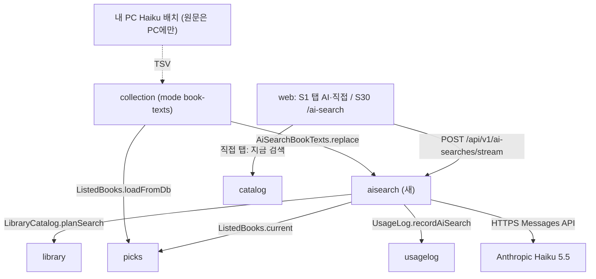
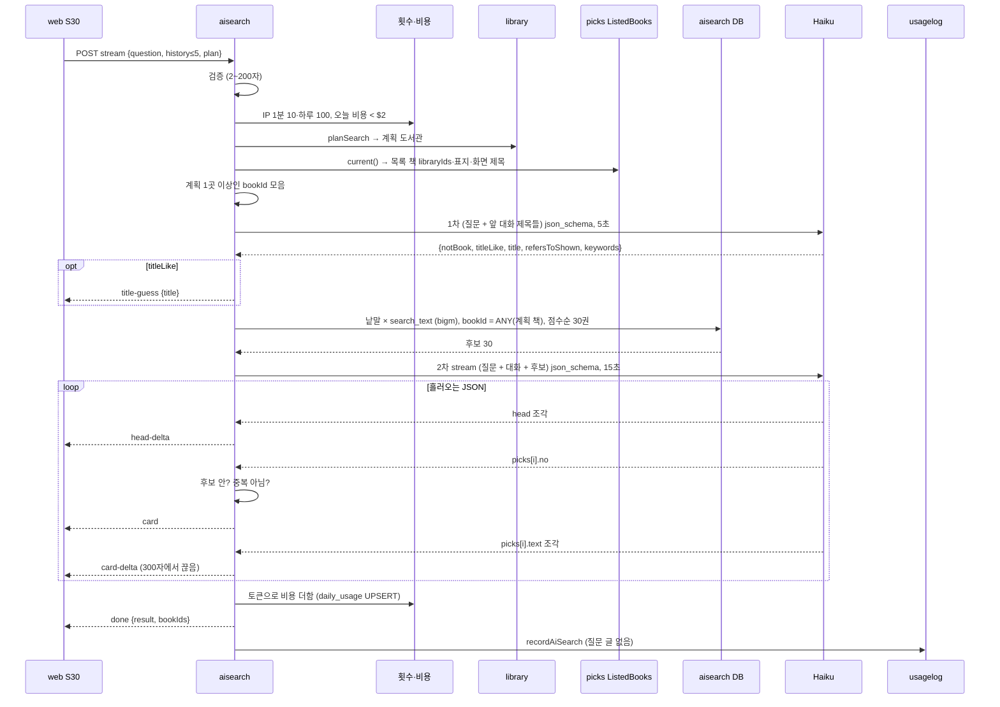
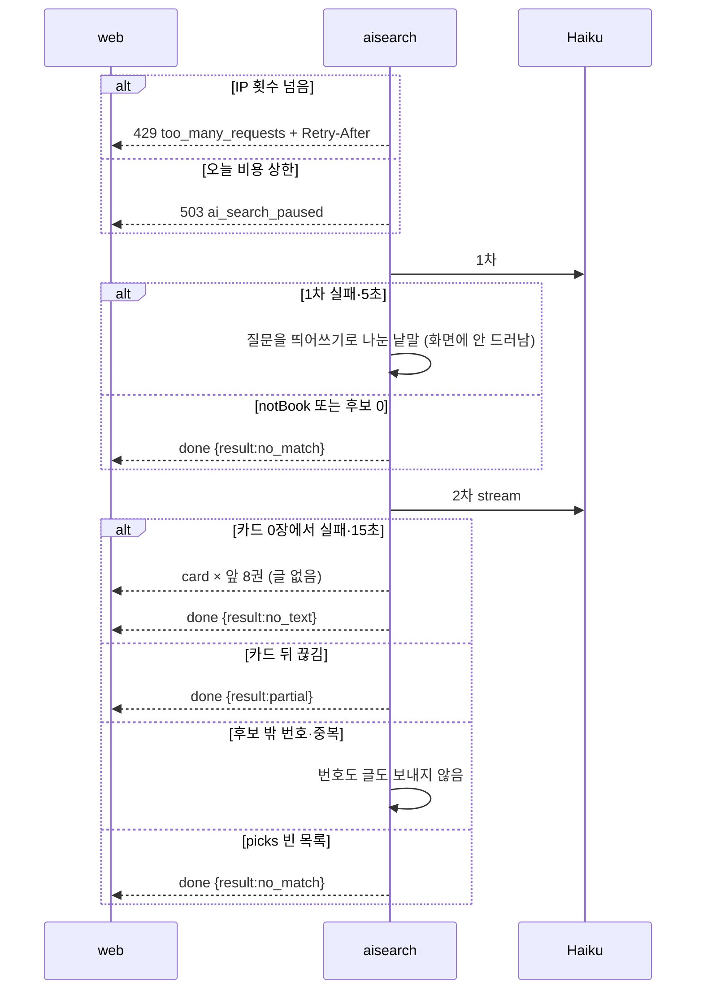
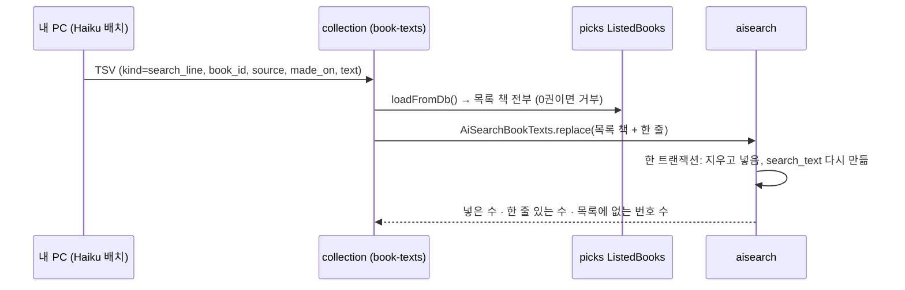
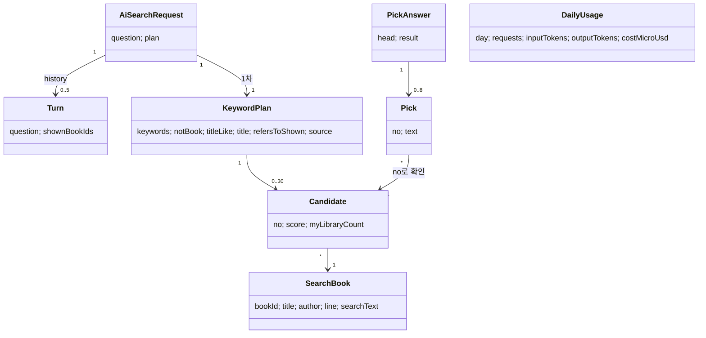
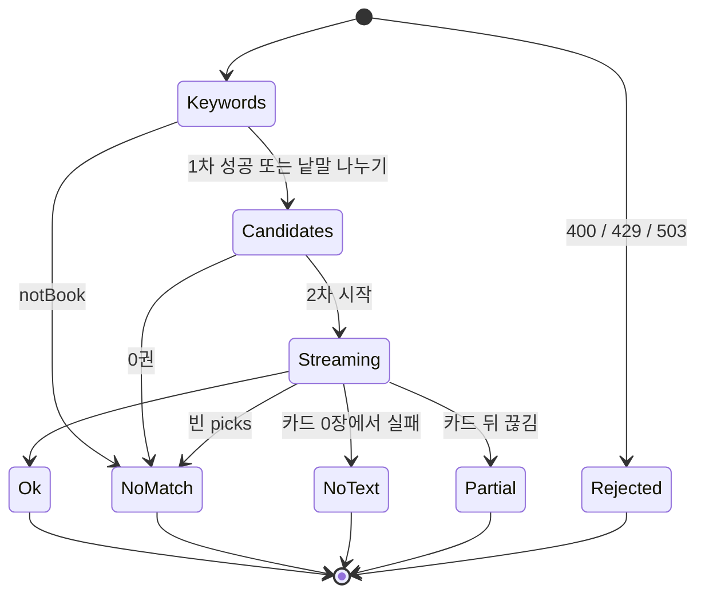
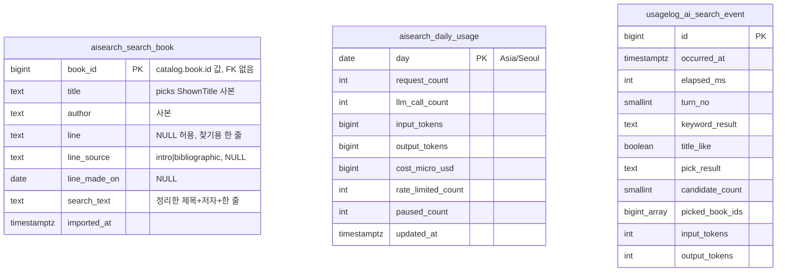

# 설계 변경: 사이클 24 AI 책 찾기

- 작성 2026-10-24. 바탕 [architect-proposal.md](architect-proposal.md), 결정 페이지 [easy/2026-10-24-design-decisions.html](easy/2026-10-24-design-decisions.html) (https://claude.ai/artifact/Bex3jp6arMgBiABGzC5fiC) — 8개 모두 사용자 선택 (2026-10-24)
- `docs/current/`는 아직 고치지 않음(`/cycle-close`에서 합침). 사이클 23 브랜치의 `docs/current/`가 더 새 것이라 그쪽 상태를 기준으로 봄
- dev 코드·dev 스킬(`spring-modulith`, `postgres-patterns`, `api-design`)은 이 세션에서 열 수 없음(Windows 경로) → plan 문서에 적힌 dev 관례로 맞춤. **인계 전에 dev 스킬과 대조 필요** [확인 필요]

## 결정 요약

| # | 정한 것 | 사용자 선택 |
|---|---|---|
| 1 | 새 모듈 `aisearch`, `picks`에는 읽기 공개 API `ListedBooks` 하나 | "(가) 새 구역 aisearch" |
| 2 | 찾기용 한 줄은 `collection`의 따로 넣는 명령으로. **사이클 23의 책별 AI 글도 나중에 같은 명령으로 넣을 수 있게** 파일에 종류 칸을 둠 | "(가) 따로 넣는 명령" + "따로 하고 나중에 23이랑 같이 되도록 설계" |
| 3 | 낱말 맞추기는 **DB에서**: `aisearch` 표에 목록 책의 제목·저자 사본 + 한 줄, pg_bigm 색인 | "(나) DB에서" + "추천도서가 중간에 바뀌기는 어렵고 일단 있는 것으로 해줘" |
| 4 | IP 횟수는 메모리, 하루 비용은 DB 날짜당 한 줄 | "(가) IP는 메모리, 비용은 DB" |
| 5 | Haiku는 JDK `HttpClient`로 직접, `LlmClient` 경계 하나 | "(가) 직접 요청" |
| 6 | 제목만 넣으면 제목 줄 + 평소 답, 서버는 `catalog`에서 제목을 찾지 않음 | "(가) 제목 줄 + 평소 답" |
| 7 | 기록 칸: 질문 글 없이 + 몇 번째 질문·토큰 수, 방문·회원 번호 없음 | "이대로" |
| 8 | 질문 200자, 한 답 8권, 한 줄 300자 | "이 값으로" |

## 구조 그림

### 모듈 구성도



### 주요 흐름: 질문 하나 (제목 같음 포함)



### 대신하는 길과 실패



### 찾기용 한 줄 넣기



### 도메인 모델



### 답 하나의 상태



## 모듈

| 모듈 | 신규/변경 | 책임 | 공개 API | 발행/구독 이벤트 | 소유 테이블 |
|---|---|---|---|---|---|
| `aisearch` | 신규 | 질문 → 낱말(Haiku 1차) → 후보(DB) → 고르기·글(Haiku 2차, 스트림), 횟수·비용 상한, 찾기용 한 줄 보관 | Java `AiSearchBookTexts.replace(rows)`(`collection`이 씀). REST `POST /api/v1/ai-searches/stream` | 없음 | `aisearch.search_book`, `aisearch.daily_usage` |
| `picks` | 변경 | 목록 책 사본 읽기 창구 | 새 `ListedBooks.current()`(서버: 캐시 사본, DB 호출 없음), `ListedBooks.loadFromDb()`(넣기 명령용, 캐시 없이 DB에서) [안] | 없음 | 바뀌지 않음 |
| `collection` | 변경 | 새 반영 모드 `book-texts` | 없음 | 없음 | 없음 |
| `usagelog` | 변경 | AI 찾기 기록 | 새 `UsageLog.recordAiSearch(UsageRequest, AiSearchRecord)` | 없음 | 새 `usagelog.ai_search_event` |

- `aisearch` 의존: `picks`, `library`, `usagelog` [안]. 새 의존 `collection → aisearch`. 고리 없음
- `aisearch` 안쪽(이름 [안]): `web/AiSearchController`, `flow/AiSearchFlow`, `flow/PickStreamParser`(2차 JSON을 조각으로 읽는 작은 상태 기계), `match/CandidateQuery`, `quota/AiSearchQuota`·`InMemoryAiSearchQuota`·`DailyBudget`, `llm/LlmClient`·`AnthropicLlmClient`
- `ListedBooks` 모양(이름 [안]): `Snapshot(builtAt, books)`, `ListedBook(bookId, title /* ShownTitle */, author, coverUrl, libraryIds, listKeys)`. `bookId` 없는 줄은 빼고 여러 목록의 같은 책은 한 줄. 23의 꼬리표·탭 추천 글은 나중에 nullable 칸으로

## 데이터

- 스키마: `aisearch` (새), `usagelog` (표 하나 더함)



| 테이블.컬럼 | 타입 | 제약 | 설명 | 상태 태그 |
|---|---|---|---|---|
| `aisearch.search_book.book_id` | bigint | PK, CHECK `>= 1` | 목록 책 번호(`catalog.book.id` 값, 모듈 넘는 FK 없음 — ADR-0124와 같은 원칙) | [안] |
| `…title`, `…author` | text | NOT NULL / NULL 허용 | 넣을 때의 `ListedBooks` 사본. 추천도서가 바뀌어도 다음 넣기까지 그대로 | [확정] 사본 방식 (결정 #3, 사용자 "추천도서가 중간에 바뀌기는 어렵고 일단 있는 것으로 해줘") |
| `…line` | text | NULL 허용, CHECK `char_length(line) BETWEEN 1 AND 300` | 찾기용 한 줄. 없으면 제목·저자로만 찾음 | 300자 [확정] (결정 #8) |
| `…line_source` | text | NULL, CHECK IN ('intro','bibliographic') | 원문으로 만들었는지, 서지만으로 만들었는지 | [안] |
| `…line_made_on` | date | NULL | PC 배치 날짜 | [안] |
| `…search_text` | text | NOT NULL | NFKC → 소문자 → 빈칸 지운 제목+저자+한 줄. 색인 `search_book_search_text_bigm` GIN (`gin_bigm_ops`) | [안] (pg_bigm은 `catalog`가 이미 씀) |
| `…imported_at` | timestamptz | NOT NULL DEFAULT now() | 넣은 시각 | [안] |
| `aisearch.daily_usage.day` | date | PK | 한국 날짜 | [안] |
| `…request_count`·`llm_call_count`·`rate_limited_count`·`paused_count` | integer | NOT NULL DEFAULT 0 | 그날 수 | [안] |
| `…input_tokens`·`output_tokens`·`cost_micro_usd` | bigint | NOT NULL DEFAULT 0 | 비용 = 입력 × 0.10 + 출력 × 0.50 (100만 토큰당 달러, 10만 토큰 이하 요청) → 백만분의 1달러 | 가격 [확정] (https://platform.claude.com/docs/en/about-claude/pricing , 2026-10-24) |
| `usagelog.ai_search_event` | 위 그림 | `turn_no` 1~20, `keyword_result` IN ('ok','failed','timeout'), `pick_result` IN ('ok','no_match','no_text','partial','skipped'), `picked_book_ids` 최대 8 | 질문 글·IP·`visit_key`·`account_id` 없음. 보관은 지금 `usagelog` 정리 규칙 | 칸 [확정] (결정 #7 "이대로"), 보관 기간 [확인 필요] |

- 낱말 맞추기 [안]: 서버가 먼저 `ListedBooks`의 `libraryIds`와 계획 도서관을 맞춰 **계획 도서관 수**를 책마다 셈(메모리) → SQL에는 대상 책 번호와 그 수를 함께 넘겨 점수와 계획 도서관 수로 정렬한 뒤 30권을 자름(검토 지적 #5: 30권을 먼저 자르면 동점 책이 `book_id` 순으로 잘림). 모양: `SELECT s.book_id, (s.search_text LIKE :k1)::int + … AS score FROM aisearch.search_book s JOIN unnest(:ids, :planCounts) AS e(book_id, plan_count) USING (book_id) WHERE s.search_text LIKE :k1 OR … ORDER BY score DESC, e.plan_count DESC, s.book_id LIMIT 30`. 낱말은 정리 뒤 2자 이상만, 1차 `keywords` 최대 8개 [안]. 2,800줄이라 색인 없이도 빠를 수 있음 → dev 측정 [확인 필요]
- 이어서 묻기 [안] (spec R11-8·R11-9): 1차가 `refersToShown`이면 후보 = 앞 답에서 보여 준 책(`history` 마지막 턴의 `bookIds`) + 낱말로 맞춘 책, 아니면 `history`의 보여 준 책을 후보에서 뺌. 앞 대화의 `bookIds`는 서버가 `ListedBooks` 제목으로 바꿔 1·2차 입력에 넣음
- 목록 책이 새로 늘면(사서 월 1회, KAIST·노벨 `lists` 모드) **다음 넣기 전까지 AI 찾기에 안 나옴** — 결정 #3에서 감수
- Liquibase(새 파일만): `aisearch/001-aisearch-schema.yaml` [안], `usagelog/00N-ai-search-event.yaml`(번호는 23과 합칠 때 다음 번호, changeSet id는 이름으로 `usagelog-ai-search-event`) [안]

### 넣는 파일 (`book-texts` 모드, 23과 같이 쓸 수 있게)

- 명령 [안]: `--spring.profiles.active=collection-import --chaekcheck.collection.import.mode=book-texts --chaekcheck.collection.import.book-texts-file=<path>`
- TSV 머리줄 [안]: `kind\tbook_id\tsource\tmade_on\ttext`, UTF-8, 줄 안 탭·줄바꿈은 거절
- `kind`: 이번에는 `search_line`만 받고 `aisearch`에 넘김. **사이클 23의 탭 추천 글은 나중에 `kind=for_you_blurb` 같은 값으로 같은 파일·같은 명령에 실을 수 있음** — `collection`이 종류마다 주인 모듈의 창구를 부름 [안] (결정 #2 덧붙임 "나중에 23이랑 같이 되도록 설계"). 모르는 `kind`는 그 줄을 건너뛰고 수를 보고
- **넣기 명령은 `collection-import` 프로필로 따로 도는 프로세스라 `PicksCache`가 비어 있을 수 있음**(검토 지적 #6) → `ListedBooks`에 DB에서 바로 읽는 길 `loadFromDb()`를 두고 넣기 명령은 그 길을 씀. 읽은 목록 책이 0권이면 넣기를 거부하고 표를 지우지 않음 [안]
- `search_line`을 넣을 때는 `ListedBooks`의 목록 책 **전부**를 넣고(한 줄 없는 책은 `line` NULL), 한 트랜잭션에서 지우고 넣음. 목록에 없는 `book_id`의 줄은 건너뛰고 수를 보고

## API

| 메서드 | 경로 | 설명 | 요청 | 응답 | 에러 |
|---|---|---|---|---|---|
| POST | `/api/v1/ai-searches/stream` [안] | 질문 하나에 답을 흘려 보냄. 질문은 본문에만(주소·접속 기록에 없음) | JSON 본문 (아래) | SSE (`event:` kebab-case) | 스트림 열기 전 ProblemDetail: 400 `validation_error`, 400 `invalid_query`(2자 미만·200자 초과), 422 `invalid_region`, 429 `too_many_requests` + `Retry-After`, 503 `ai_search_paused`(새), 404 `not_found`(기능 꺼짐) |

- 인증 없음. 로그인 기능이 켜져 있으면 CSRF 검사는 `POST /api/v1/usage-events`와 같이 [안]
- 스트림 관례는 지금과 같음: 오류는 열기 전, `produces` 없음, 웹은 `fetch` + `ReadableStream`(EventSource는 POST 불가). nginx 이 경로 버퍼링 끔(`X-Accel-Buffering: no`), gzip 안 함 [안]

요청 [안]
```json
{
  "question": "잠들기 전에 조금씩 읽을 과학책",
  "turnNo": 2,
  "history": [ { "question": "과학책 추천해줘", "bookIds": [1203344, 88012] } ],
  "residenceRegionIds": [1168], "workRegionIds": [], "libraryIds": [],
  "scope": "joinable", "visit": "none"
}
```
- `question` 2자 [확정]~200자 [확정] (결정 #8), `history` 최대 5 [확정] (화면 흐름 #3), 한 턴 `bookIds` 최대 8 [확정] (결정 #8), 목록 밖 번호는 조용히 버림. 20번 상한은 웹이 셈. `turnNo`(1~20)는 웹이 보내는 몇 번째 질문 — `usagelog.ai_search_event.turn_no`에 씀 [확정] (인계서 확인 #2, 2026-10-24; 서버는 `history`를 5개만 받아 셀 수 없음)

스트림 이벤트 [안: 이름]

| event | data | 언제 |
|---|---|---|
| `title-guess` | `{"title":"채식주의자"}` | 1차가 제목·저자 같다고 할 때 맨 먼저. 제목은 질문 글 안에 있는 말만, 아니면 질문 전체 |
| `head-delta` | `{"text":"…"}` | 머리말 조각 |
| `card` | `{"no":1,"bookId":1203344,"title":"…","author":"…","coverUrl":"…","myLibraryCount":3}` | 번호가 후보 안·중복 아님을 확인한 뒤만. 대신하는 길이면 앞 8권 |
| `card-delta` | `{"bookId":1203344,"text":"…"}` | 그 카드 글 조각, 300자에서 끊음 |
| `done` | `{"result":"ok"\|"no_match"\|"no_text"\|"partial","bookIds":[…]}` | 끝. 웹이 대화(sessionStorage)에 넣음 |
| `error` | `{"code":"internal_error"}` | 연 뒤 예상 못 한 오류(받은 카드는 남음) |

```
event: title-guess
data: {"title":"채식주의자"}

event: head-delta
data: {"text":"「채식주의자」와 결이 닮은 "}

event: card
data: {"no":1,"bookId":1203344,"title":"채식주의자","author":"한강","coverUrl":"/covers/3f…e1.jpg","myLibraryCount":4}

event: card-delta
data: {"bookId":1203344,"text":"찾으시던 그 책이에요. "}

event: done
data: {"result":"ok","bookIds":[1203344,88012,51007]}
```

## 외부 연동

| 대상 | 방식 | 제한·키 관리 | 실패 시 동작 | 상태 태그 |
|---|---|---|---|---|
| Anthropic Messages API, 모델 `claude-haiku-5-5` | JDK `HttpClient` 직접(결정 #5). 1차 보통 요청, 2차 스트림. 구조화 출력 `output_config.format` `json_schema`(2차 칸 `head`, `picks[].no`, `picks[].text` 모두 required → 차례 지킴) | 키: Parameter Store `/chaekcheck/prod/CHAEKCHECK_AISEARCH_ANTHROPIC_API_KEY` → env → `chaekcheck.aisearch.llm.anthropic.api-key` [안], 로그·예외에 안 남김. 키가 비면 1차·2차 모두 대신하는 길 | 1차 5초 → 낱말 나누기, 2차 15초 → 글 없이 / partial | 모델 ID·구조화 출력·스트리밍 [확정] (https://platform.claude.com/docs/en/about-claude/models/overview , https://platform.claude.com/docs/en/build-with-claude/structured-outputs , 2026-10-24 확인). `anthropic-version` 값·base URL·스트림의 `usage` 자리 [확인 필요: 공식 문서]. thinking 끄기·effort 낮추기로 5초 안에 드는지 [확인 필요: API 호출 시험] (Haiku 5.5 기본 adaptive thinking, effort `medium` [확정] — models overview, 2026-10-24) |
| 내 PC Haiku 배치(찾기용 한 줄) | PC에서 돌림(서버 밖), 결과 TSV를 `book-texts` 모드로 | 원문은 PC에만 | — | [확정] (spec R10) |

## 설정값 (`docs/settings-index.md`에 더함)

| 속성 [안: 이름] | 값 | 태그 |
|---|---|---|
| `chaekcheck.aisearch.enabled` | 기본 `false`, 운영에서 켬 | [안] |
| `…llm.anthropic.model` | `claude-haiku-5-5` | [확정] |
| `…keyword-timeout` / `…pick-timeout` | 5초 / 15초(2차 호출 전체) | [확정] (명세 규칙 #3) |
| `…rate.per-minute` / `…rate.per-day` | 10 / 100 (같은 IP, `X-Real-IP`) | [확정] (명세 규칙 #4) |
| `…budget.daily-usd` | 2 | [확정] (명세 규칙 #4) |
| `…price.input-per-mtok` / `…output-per-mtok` | 0.10 / 0.50 | [확정] (공식 가격, 10만 토큰 이하) |
| `…candidates.max` / `…picks.max` / `…history.max-turns` / 대화 최대 | 30 / 8 / 5 / 20(웹) | [확정] (명세 규칙 2차 #2, 결정 #8, 화면 흐름 #3) |
| `…question.max-length` / `…card-text.max-chars` / 한 줄 최대 | 200 / 300 / 300 | [확정] (결정 #8; 카드 글 300은 spec R4-3·R12-3) |
| `…keyword-max-tokens` / `…pick-max-tokens` | — | [확인 필요: 프로토타입] |

## 사이클 23과 겹치는 곳

| 곳 | 어떻게 |
|---|---|
| `picks` | 새 파일(`ListedBooks`와 구현)만 |
| `collection` | 새 모드 `book-texts` — 23이 탭 추천 글을 넣을 때 같은 모드에 `kind`를 더해 쓸 수 있음 |
| `usagelog` 변경 파일 번호 | 합칠 때 다음 번호 |
| 반영 파일 형식 번호 | 건드리지 않음 |
| 첫 화면 / 추천도서 화면 | 24만 / 23만 |
| ADR | 0150~ (23이 0149를 넘기면 0154부터) |
| `PicksCache` 구조 | 23이 `picks` 캐시를 바꾸면 `ListedBooks` 구현을 다시 확인 |

## 결정 기록

- [ADR-0150](../../adr/0150-aisearch-module-haiku-realtime.md) AI 책 찾기: 새 모듈 `aisearch`, Haiku 실시간 두 번 호출, LLM 부르는 곳 하나(직접 요청) — Accepted (2026-10-24)
- [ADR-0151](../../adr/0151-search-lines-import-and-db-match.md) 찾기용 한 줄: 따로 넣는 명령(`book-texts`, 23과 같이 쓸 수 있게), `aisearch` 표의 사본에서 DB 낱말 맞추기 — Accepted (2026-10-24)
- [ADR-0152](../../adr/0152-no-question-storage-quota.md) 질문 글과 대화를 서버에 남기지 않음: POST 본문, 대화는 브라우저 탭, IP 횟수는 메모리·하루 비용은 DB, 기록 칸 — Accepted (2026-10-24)
- [ADR-0153](../../adr/0153-streamed-answers-number-first-title-guess.md) 답을 조금씩 흘리되 책 번호를 먼저 확인, 제목만 넣으면 제목 줄 — Accepted (2026-10-24)

## 검토 뒤 덧붙임 (2026-10-24, design-reviewer)

- ADR-0151에 적지 않은 것: 새 의존 `collection → aisearch`, `collection`이 `ListedBooks.loadFromDb()`를 씀(`collection → picks`는 이미 있음). 찾는 범위를 추천도서 목록 책으로 시작한다는 범위 결정 #1은 이 문서와 `scope.md`에 기록(Accepted ADR은 고치지 않음)
- ADR-0152에 적지 않은 것: Anthropic 보관 기간 [확인 필요: 공식 문서]
- 하루 비용 상한은 질문을 **시작할 때만** 봄 → 이미 돌고 있는 질문만큼(몇 센트 [추론]) 넘을 수 있음
- 시간: 1차 5초 + 2차 15초 = 한 질문 최대 약 21초 → nginx `proxy_read_timeout`이 이보다 길어야 함 [확인 필요: dev `deploy/nginx`]
- `Retry-After` 값: 1분 제한이면 남은 초, 하루 제한이면 한국 자정까지 [안]

## 확인 필요

| 항목 | 확인 방법 |
|---|---|
| dev 스킬(`spring-modulith`·`postgres-patterns`·`api-design`)과 이 설계 대조 | dev 코드·스킬 읽기 (dev 세션 또는 노트북 세션) |
| `anthropic-version` 값, base URL, 스트림 이벤트의 `usage` 자리 | 공식 문서 확인 |
| thinking 끄기·effort로 1차 5초 안 | API 호출 시험 |
| 스트리밍 때 칸 차례·`maxItems` 지킴, 질문 하나 비용·시간, `max_tokens` | 프로토타입 (`llm-test-set.md` 20개, AC-12) |
| 낱말 맞추기 속도(색인 필요 여부) | dev 측정 |
| 넣기 명령에서 `ListedBooks.loadFromDb()`가 서버 캐시와 같은 책·제목을 주는지 | dev 코드 읽기 |
| AI 기능이 꺼졌을 때 웹이 아는 방법(설정 API·빌드 값) | dev 코드 읽기 |
| 서버 전체 동시 AI 찾기 상한(한 요청 최대 약 21초), 스레드 모델 | dev 코드 읽기 → 사용자에게 질문 |
| 실제 사용자 IP(`X-Real-IP`, Cloudflare 터널 뒤) | dev·배포 설정 읽기 |
| 웹 스트림 읽기 함수를 POST에 다시 쓸 수 있는지, CSRF | dev 코드 읽기 |
| nginx 이 경로 버퍼링 끄기 | dev `deploy/nginx` 읽기 |
| `ai_search_event` 보관 기간 | 지금 `usagelog` 정리 규칙 확인 |
| Anthropic Console 사용 한도를 겉 울타리로 | 공식 문서 확인 → 사용자에게 질문 |
| Anthropic 보관 기간(처리방침) | 공식 문서 확인 |
