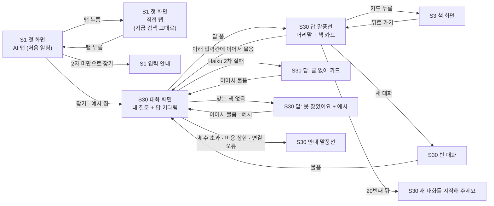

# 화면 흐름: AI 책 찾기 (사이클 24)

- 작성 2026-10-24. 근거 [spec.md](spec.md) (R1~R13, AC-1~19, 판정 "설계 진행 가능"), [scope.md](scope.md). 결정 페이지 [easy/2026-10-24-flow-decisions.html](easy/2026-10-24-flow-decisions.html) (https://claude.ai/artifact/K94iZYYPwF6aEu5pw1eMLt)
- 화면 번호는 `docs/current/flows.md`를 이어 씀: S1 검색(첫 화면·결과가 한 화면), S3 책 화면(`/books/{bookId}`). **새 화면 S30 AI 결과**. 사이클 23이 다른 브랜치에서 새 번호를 쓸 수 있어 S18~S29는 비워 둠 [안]
- 지금 첫 화면 모양은 사이클 22 `flow.md`와 22 회고(23 브랜치, 2026-10-23: 지역은 메인에서 거주 하나만, 첫 화면 아래 KAIST 추천 책장)를 바탕으로 함. **dev 코드로는 맞춰 보지 않음** (dev 폴더는 이 세션에서 열 수 없음)
- 그림은 구조와 상태이고 디자인이 아님. PC·태블릿·폰 그림은 결정 페이지에

- 2026-10-24 바뀜: 결과 화면을 **ChatGPT처럼 대화 모양**으로, **이어서 묻기** 가능 — 사용자 "그리고 ai 책 검색칸 결과 ui는 마치 chatgpt처럼하고 질문을 연달아서 하는것이 가능했으면 해" [확정]. 첫 결정 페이지(카드 모양 결과)는 아무것도 저장되기 전에 이 페이지로 바꿈

## 화면별 내용

### S1 검색 — 첫 화면 (바뀜)

- 목적: 원하는 책을 문장으로 찾을지, 제목으로 찾을지 고른다.
- 보이는 요소(PC, 위에서 아래): 제목 글 / **탭 줄 [AI] [직접]** (탭 이름 [확정] 사용자 "AI 도서관 표기말고 AI 직접 이렇게하자" (2026-10-24); 처음엔 "AI / 도서관"이었음. 문서에서는 "AI 탭"·"직접 탭"으로 부름), 처음 열면 AI 책 찾기 [확정] (3차 #4), AI 탭이 왼쪽 [확정] (사용자 선택, 2026-10-24, 화면 흐름 #1) / 탭 아래 입력칸 / 찾을 도서관 줄(지금 그대로, 두 탭 모두) / 지금 첫 화면 아래 내용(KAIST 추천 책장 등) 그대로
- **AI 책 찾기 탭**: 입력칸(안내 글 "어떤 책을 찾으세요? 예: 잠들기 전에 조금씩 읽을 과학책") [찾기] / 입력칸 아래 예시 질문 칩 3개(누르면 바로 찾기) [확정] (사용자 선택, 2026-10-24, 화면 흐름 #1) / [상세검색 ⌄]·[⚙]는 보이지 않음 [확정] (사용자 선택, 2026-10-24, 화면 흐름 #1)
- **직접 탭**: 지금 그대로
- **AI 기능이 꺼져 있을 때**(`chaekcheck.aisearch.enabled=false` 또는 키 없음): 웹이 설정을 알고 AI 탭을 숨기고 직접 탭을 엶 [안] (검토 지적; 웹이 설정을 아는 방법은 인계에서 dev가 정함)
- 동작: 찾기 → S30 대화 화면이 열리고 첫 질문이 첫 말풍선이 됨
- 상태: 기본 / 입력 안내(2자 미만) / 200자에서 더 쳐지지 않음 (spec R1-2)
- 폰: 탭 두 개가 한 줄을 반씩, 예시 칩은 가로로 넘김 [안]

### S30 ai-chat — AI 책 찾기 대화 (새 화면)

- 목적: 질문과 답을 대화로 쌓으며 책을 좁혀 간다.
- 주소: `/ai-search`, 화면 번호 S30 [확정] (사용자 선택, 2026-10-24, 화면 흐름 #6) — 질문은 주소에 넣지 않음 [확정]
- 보이는 요소(PC, ChatGPT식) — 모양 전체 [확정] (사용자 선택, 2026-10-24, 화면 흐름 #2) "이대로":
  - 맨 위 얇은 줄: [새 대화] 단추 / AI 표시 한 줄 "책 설명은 AI가 질문에 맞춰 썼어요. 실제 내용과 다를 수 있어요" [확정] / 찾을 도서관 한 줄 요약("내 도서관: 서울 강남구") [안]
  - 가운데: 대화가 위에서 아래로 쌓임. **내 질문 = 오른쪽 말풍선**, **답 = 왼쪽, 머리말 한 줄 + 책 카드** [안]
  - 답의 책 카드: 맨 위 한 권 크게 + 두 권씩(폰은 한 권씩) [안]. 카드 = 표지·제목·저자·"내 도서관 N곳"·질문에 맞춘 글 2~3문장
  - 맨 아래 고정 입력칸 "이어서 물어보세요. 예: 이 중에 소설만" [보내기] [안]
- 동작: 이어서 묻기 → 내 말풍선이 붙고 그 아래 답을 기다림, 새 답이 오면 그 자리로 내려감 / 카드 누름 → S3 / S3에서 뒤로 → 같은 대화·자리 [안] / [새 대화] → 대화를 비움 (spec R11-5)
- 호출 API: 질문 하나마다 AI 책 찾기 요청 하나(이번 질문 + 앞 대화 최근 5번 + 계획 값, 요청 본문으로) — spec R11-2·R11-3
- 상태:
  - **답 기다림·나오는 중**: ChatGPT처럼 **글이 조금씩 나옴** [확정] (사용자 선택 "(나) 글이 조금씩", 2026-10-24, 화면 흐름 #5). 차례: "책을 찾고 있어요" → 머리말이 써지며 나옴 → 카드가 하나씩 붙고 그 카드의 글이 써지며 나옴 (spec R12). 다 나올 때까지 보내기 막힘 [안]
  - **답**: 머리말 + 카드
  - **제목만 넣었을 때**: 답 맨 위 "「○○」을(를) 찾으시나요? [직접 찾기에서 보기]" → 누르면 S1 직접 탭 + 그 글로 검색 [안] (spec R13)
  - **글 없이**: 카드에 글 칸 없음, 머리말 자리 "지금은 설명을 쓰지 못했어요" [확정]
  - **맞는 책 없음**: 답 말풍선 "맞는 책을 찾지 못했어요. 다른 말로 써 보시겠어요?" + 예시 칩 [확정]
  - **횟수 초과 / 하루 비용 상한 / 연결 오류**: 답 자리에 안내 말풍선(문구는 spec R7·R8, 연결 오류 "연결이 원활하지 않아요 [다시 시도]") — 비용 상한이면 [직접 찾기로] 단추 [확정]·[안]
  - **20번째 뒤**: "새 대화를 시작해 주세요" + [새 대화] [안]
  - **새로 고침**: 이 브라우저 탭 안에서는 대화가 남고, 탭을 닫으면 사라짐 [확정] (사용자 선택, 2026-10-24, 화면 흐름 #4) "(나) 이 탭 안에서는 남음"
- 태블릿: PC와 같음, 대화 폭만 좁음. 폰: 말풍선 폭 거의 전체, 입력칸은 화면 아래 고정(키보드 위) [안]

### S3 책 화면 — 바뀌지 않음

## 수용 기준 대응

| AC | 화면 |
|---|---|
| AC-1 AI 탭이 처음 열림, 직접 탭은 지금 그대로 | S1A, S1L |
| AC-2 결과 카드와 AI 표시 | S30 답 |
| AC-3 목록 책·계획 도서관 책만 | S30 답 (API 응답) |
| AC-4 후보 밖 번호 버림 | S30 답 (모의 응답 시험) |
| AC-5 책 질문 아님 → 맞는 책 없음 | S30 맞는 책 없음 |
| AC-6 Haiku 실패 때 | S30 글 없이 |
| AC-7 주소·기록에 질문 없음 | S30 주소, 새로 고침 |
| AC-8 횟수 초과 | S30 횟수 초과 |
| AC-9 하루 비용 상한 | S30 하루 비용 상한 → S1L |
| AC-10 카드 → 책 화면 | S30 → S3 |
| AC-11 PC·태블릿·폰 짜임 | S1, S30 (결정 페이지 그림) |
| AC-12 질문 20개 시험 | (화면 없음, dev 시험 기록) |
| AC-13 이어서 묻기 | S30 답 → 이어서 물음 → 새 답 |
| AC-14 새 대화 | S30 새 대화 |
| AC-15 제목만 넣음 | S30 제목 줄 → S1 직접 탭 검색 |
| AC-16 2자 미만 | S1 입력 안내 |
| AC-17 20번 뒤 | S30 새 대화를 시작해 주세요 |
| AC-18 흐르다 끊김·후보 밖 번호 | S30 답(partial) |
| AC-19 하루 100번 | S30 횟수 초과 |

상태별 동작(spec) 대응: 로딩 → S30 로딩 / 결과 없음 → S30 맞는 책 없음 / 외부 API 오류·지연 → S30 글 없이(2차), 1차 실패는 화면에 드러나지 않음(낱말 나누기로 이어 감) / 입력 오류 → S1 입력 안내, S30 횟수 초과·비용 상한
