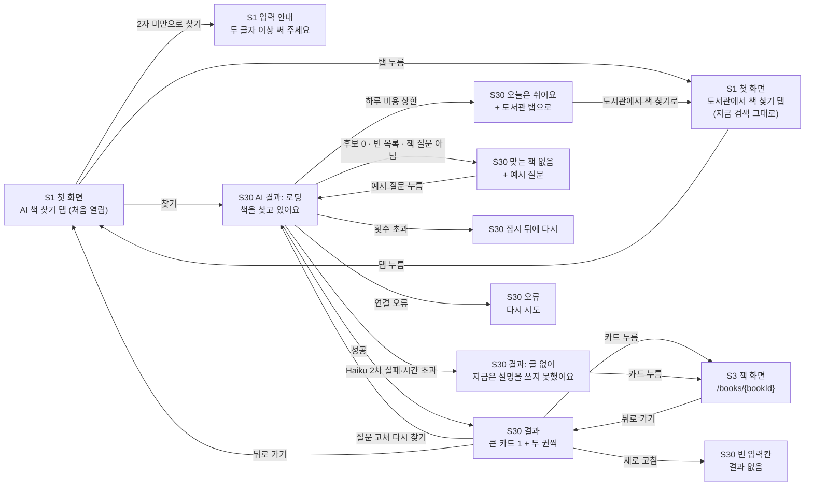

# 화면 흐름: AI 책 찾기 (사이클 24)

- 작성 2026-10-24. 근거 [spec.md](spec.md) (R1~R10, AC-1~12, 판정 "설계 진행 가능"), [scope.md](scope.md). 결정 페이지 [easy/2026-10-24-flow-decisions.html](easy/2026-10-24-flow-decisions.html) (https://claude.ai/artifact/K94iZYYPwF6aEu5pw1eMLt)
- 화면 번호는 `docs/current/flows.md`를 이어 씀: S1 검색(첫 화면·결과가 한 화면), S3 책 화면(`/books/{bookId}`). **새 화면 S30 AI 결과**. 사이클 23이 다른 브랜치에서 새 번호를 쓸 수 있어 S18~S29는 비워 둠 [안]
- 지금 첫 화면 모양은 사이클 22 `flow.md`와 22 회고(23 브랜치, 2026-10-23: 지역은 메인에서 거주 하나만, 첫 화면 아래 KAIST 추천 책장)를 바탕으로 함. **dev 코드로는 맞춰 보지 않음** (dev 폴더는 이 세션에서 열 수 없음)
- 그림은 구조와 상태이고 디자인이 아님. PC·태블릿·폰 그림은 결정 페이지에

## 화면별 내용

### S1 검색 — 첫 화면 (바뀜)

- 목적: 원하는 책을 문장으로 찾을지, 제목으로 찾을지 고른다.
- 보이는 요소(PC, 위에서 아래): 제목 글 / **탭 줄 [AI 책 찾기] [도서관에서 책 찾기]**, 처음 열면 AI 책 찾기 [확정] (3차 #4), AI 탭이 왼쪽 [안] / 탭 아래 입력칸 / 찾을 도서관 줄(지금 그대로, 두 탭 모두) / 지금 첫 화면 아래 내용(KAIST 추천 책장 등) 그대로
- **AI 책 찾기 탭**: 입력칸(안내 글 "어떤 책을 찾으세요? 예: 잠들기 전에 조금씩 읽을 과학책") [찾기] / 입력칸 아래 예시 질문 칩 3개(누르면 바로 찾기) [안] / [상세검색 ⌄]·[⚙]는 보이지 않음 [안] (AI 탭에는 제목·저자 칸이 없음)
- **도서관에서 책 찾기 탭**: 지금 검색창·[상세검색 ⌄]·[⚙]·결과(S1 결과 화면) 그대로
- 사용자 동작: 탭 누름(각 탭의 입력 글은 이 화면을 떠나기 전까지 남음, spec R1-3 [안]) / 찾기 / 예시 칩
- 호출 API: AI 탭은 S1에서 부르지 않음(찾기는 S30에서). 도서관 탭은 지금 그대로
- 상태: 기본 / 입력 안내(2자 미만, 입력칸 아래 "두 글자 이상 써 주세요") / 200자에서 더 쳐지지 않음 (spec R1-2)
- 태블릿: PC와 같음. 폰: 탭 두 개가 한 줄을 반씩, 예시 칩은 가로로 넘김 [안]

### S30 ai-results — AI 결과 (새 화면)

- 목적: 질문에 맞는 책을 이유와 함께 보여 주고, 그 책 화면으로 보낸다.
- 주소: `/ai-search` [안] — 질문은 주소에 넣지 않음 [확정] (명세 규칙 #1)
- 보이는 요소(PC, 위에서 아래): 입력칸(질문이 들어 있음) [다시 찾기] / AI 표시 한 줄 "책 설명은 AI가 질문에 맞춰 썼어요. 실제 내용과 다를 수 있어요" [확정] / 맨 위 한 권 큰 카드(한 줄 전체) / 그 아래 두 권씩(「나에게 맞는 책」 짜임과 같음) [안]
- 카드: 표지(없으면 제목 글자 표지, 사이클 21과 같음) / 제목 / 저자 / "내 도서관 N곳" / 질문에 맞춘 글 2~3문장(자르지 않음)
- 사용자 동작: 카드 누름 → S3 / 질문 고쳐 [다시 찾기] / 뒤로 가기 → S1 AI 탭(입력 글 남음, spec R2-3 [확정]) / S3에서 뒤로 가기 → S30 같은 결과·스크롤 자리 [안]
- 호출 API: AI 책 찾기 요청 하나(질문 + 계획 값, 요청 본문으로; 이름·모양은 design-delta)
- 상태:
  - **로딩**: 입력칸 + "책을 찾고 있어요" + 카드 자리 회색 틀 3개, [다시 찾기] 누를 수 없음. 글은 한 번에 나옴(스트리밍 아님, 비목표) [안]
  - **결과**: 위 짜임
  - **글 없이**: 카드에 글 칸이 없고 AI 표시 줄 자리에 "지금은 설명을 쓰지 못했어요" [확정] (명세 규칙 #3)
  - **맞는 책 없음**: "맞는 책을 찾지 못했어요. 다른 말로 써 보시겠어요?" + 예시 질문 칩 2~3개 [확정] (명세 규칙 #6)
  - **횟수 초과**: "잠시 뒤에 다시 써 주세요" (R7)
  - **하루 비용 상한**: "오늘은 AI 책 찾기를 쉬어요. 도서관에서 책 찾기를 써 주세요" + [도서관에서 책 찾기로] → S1 도서관 탭 (R8)
  - **연결 오류**(우리 서버에 닿지 못함): "연결이 원활하지 않아요" [다시 시도] [안]
  - **새로 고침**: 빈 입력칸, 결과 없음, 안내 없음 [안] (질문을 주소·기록에 두지 않으므로, 명세 R2-3 [확정])
- 태블릿: PC와 같음. 폰(375px): 큰 카드 1 + 아래는 한 줄에 한 권 [안]

### S3 책 화면 — 바뀌지 않음

- S30에서 들어와도 지금과 같음. 뒤로 가기는 브라우저 뒤로 가기

## 수용 기준 대응

| AC | 화면 |
|---|---|
| AC-1 AI 탭이 처음 열림, 도서관 탭은 지금 그대로 | S1A, S1L |
| AC-2 결과 카드와 AI 표시 | S30 결과 |
| AC-3 목록 책·계획 도서관 책만 | S30 결과 (API 응답) |
| AC-4 후보 밖 번호 버림 | S30 결과 (모의 응답 시험) |
| AC-5 책 질문 아님 → 맞는 책 없음 | S30 맞는 책 없음 |
| AC-6 Haiku 실패 때 | S30 글 없이 |
| AC-7 주소·기록에 질문 없음 | S30 주소, 새로 고침 |
| AC-8 횟수 초과 | S30 횟수 초과 |
| AC-9 하루 비용 상한 | S30 하루 비용 상한 → S1L |
| AC-10 카드 → 책 화면 | S30 → S3 |
| AC-11 PC·태블릿·폰 짜임 | S1, S30 (결정 페이지 그림) |
| AC-12 질문 20개 시험 | (화면 없음, dev 시험 기록) |

상태별 동작(spec) 대응: 로딩 → S30 로딩 / 결과 없음 → S30 맞는 책 없음 / 외부 API 오류·지연 → S30 글 없이(2차), 1차 실패는 화면에 드러나지 않음(낱말 나누기로 이어 감) / 입력 오류 → S1 입력 안내, S30 횟수 초과·비용 상한
