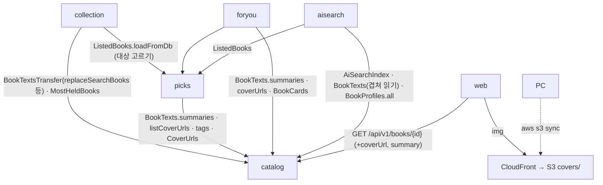
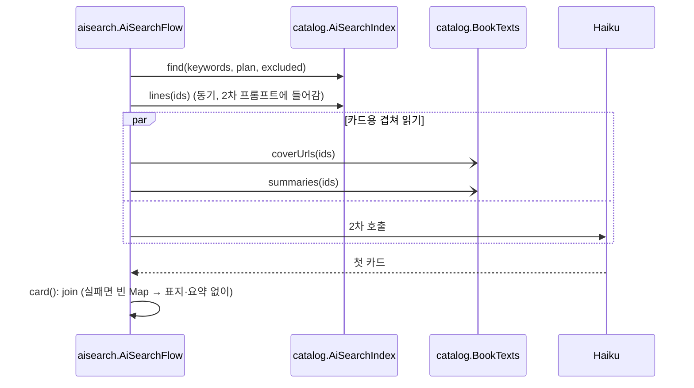
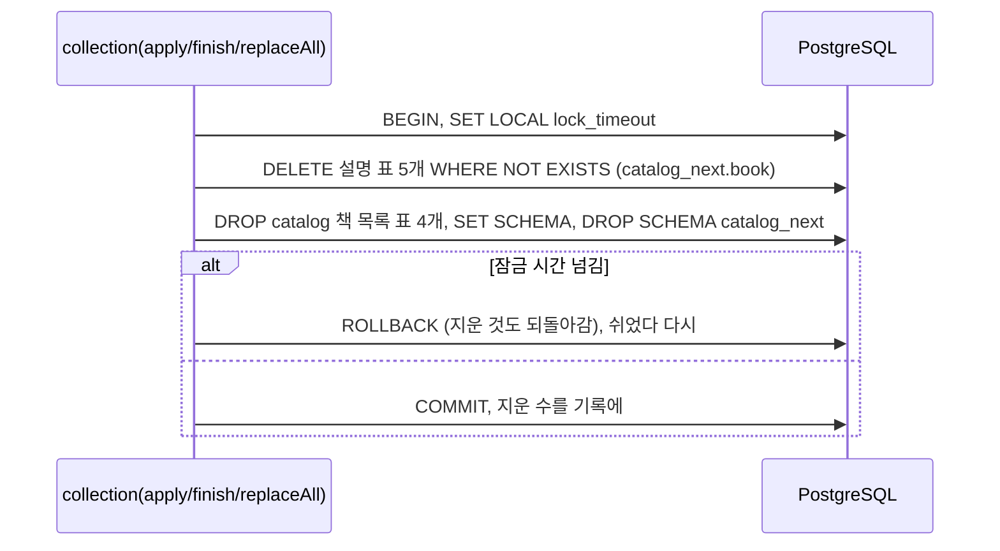
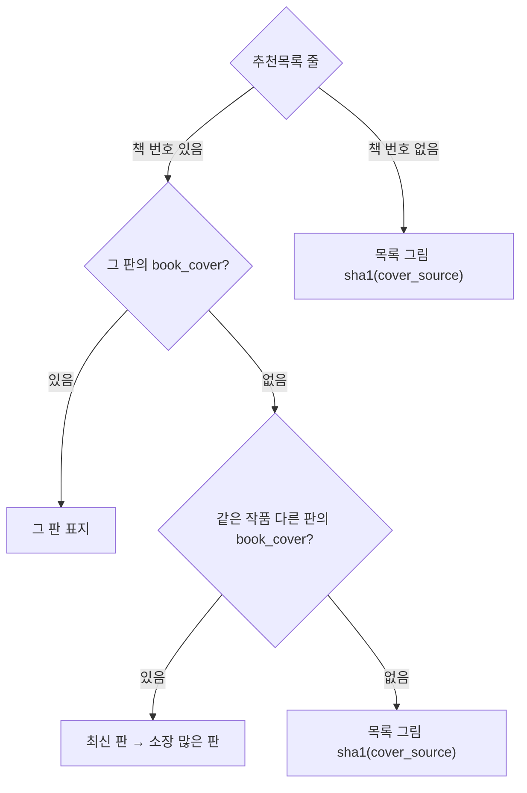
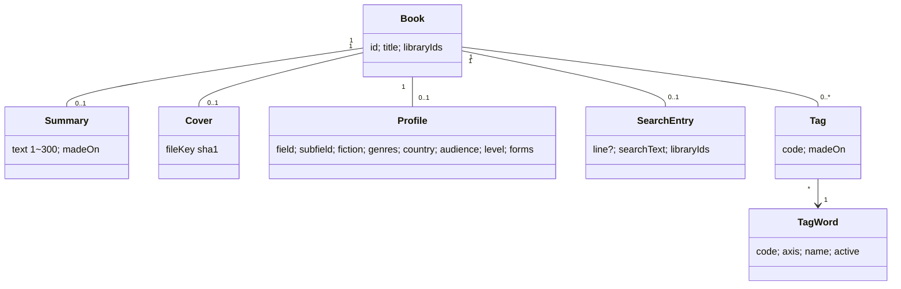
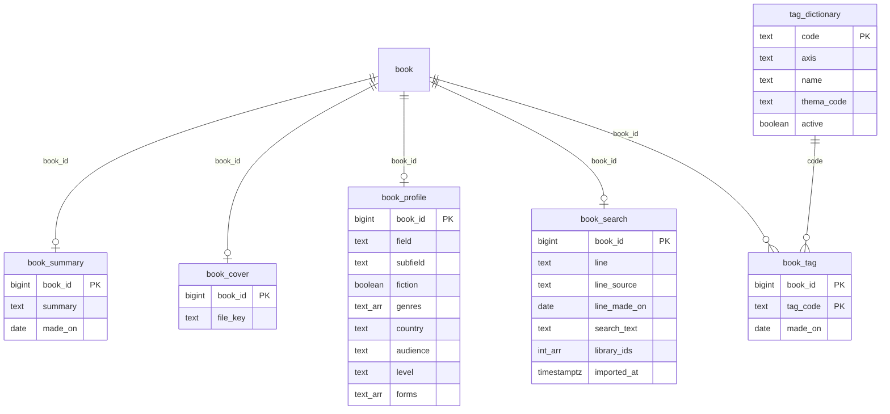

# 설계 변경: 사이클 26 책 설명 한 곳에 모으기

- 작성 2026-10-28. 근거 [spec.md](spec.md), [flow.md](flow.md), [architect-proposal.md](architect-proposal.md)(코드 사실 F1~F6, dev main `905eab7`·v1.19.0 `claude/aisearch-faster-first`)
- 설계 결정 (결정 페이지 [easy/2026-10-28-design-decisions.html](easy/2026-10-28-design-decisions.html), 2026-10-28): #1·#2·#3·#4·#5·#7 승인, #6 기타("나는 속도가 우선이긴 한데 그렇게 차이가 많이나나? 조사해서 알려줘") → 측정 뒤 #8 승인 "승인하고 예외라고 기록해 줘" (ADR-0160)

## 구조 그림

### 모듈 구성도



없어지는 의존: `aisearch → foryou`(`BookBlurbs`·`BookCovers`). `catalog`에 새 의존 없음.

### 주요 흐름

AI 검색 카드 (R6, dev 24 제약 유지)



다시 가져오기 바꿔 끼우기 (R4)



추천목록 줄 표지 고르기 (명세 #11, flow.md 두 번째 그림과 같음)



### 도메인 모델



## 모듈

| 모듈 | 신규/변경 | 책임 | 공개 API | 발행/구독 이벤트 | 소유 테이블 |
|---|---|---|---|---|---|
| `catalog` | 변경 | 책 목록 + 책 설명(요약·판 표지·프로필·AI 찾기·꼬리표) [확정] (범위 #1, 설계 #1) | 읽기 `BookTexts`(`summaries`, `coverUrls`, `listCoverUrls`, `tags`), `CoverUrls`(`of(fileKey)`), `BookProfiles`(`all`, `version`), `AiSearchIndex`(`find`, `planCounts`, `lines`, `books`, `version`, `compact`) / 쓰기 `BookTextsTransfer`(`upsertSummaries`, `upsertCovers`, `replaceTags`, `replaceTagDictionary`, `replaceProfiles`, `replaceSearchBooks`) — 이름 [안] (설계 #2 승인) | 없음 | 기존 4 + `book_summary`, `book_cover`, `book_profile`, `book_search`, `tag_dictionary`, `book_tag` |
| `picks` | 변경 | 추천목록. `ListedBook.aiSummary` 값 = `catalog` 요약, `coverPath` = 위 차례 | `ListedBooks` 그대로 | 없음 | `picks.cover`, `book_tag`, `tag_dictionary` 없앰(배포 2). `AiSummaries`, `BookTagTransfer` 없앰 |
| `foryou` | 변경 (배포 1에서 dev 26, 사용자 2026-10-28) | 요약·표지 읽기를 `catalog`로 | `BookBlurbs`, `BookCovers` 없앰. `ForYouTransfer`는 이웃만 | 없음 | `book_blurb`, `book_cover` 없앰(배포 2) |
| `aisearch` | 변경 (배포 1에서 dev 26, 사용자 2026-10-28) | 찾기를 `catalog.AiSearchIndex`로, 프로필을 `BookProfiles.all()`로(시작 때 한 번) | `AiSearchBookTexts` 없앰 | 없음 | `search_book` 없앰(배포 2) |
| `collection` | 변경 | `book-texts`가 `catalog` 쓰기 API를 부름, `# export_id=` 검사(`neighbours`와 같은 강제 설정), 새 모드 `book-profiles` | 없음 | 없음 | `catalog_import`에 지운 수 칸 [안] |

- 함정 고침 [확정: 코드]: `JdbcCatalogLoad.createIndexesAndConstraints`에 `t.relname = ANY(TABLES)` 거르기(안 하면 다시 가져오기가 새 표에서 깨짐), `swap`의 `first`에 DELETE 5줄(`book_summary`·`book_cover`·`book_profile`·`book_search`·`book_tag`, `tag_dictionary`는 `book_id`가 없어 제외; `NOT EXISTS`로 쓰고 실행 계획 확인; DROP 앞, 같은 트랜잭션)

## 데이터

- 스키마: `catalog` (설계 #1 승인: 종류마다 표 하나)



| 테이블.컬럼 | 타입 | 제약 | 설명 | 상태 태그 |
|---|---|---|---|---|
| `book_summary.book_id` | bigint | PK, `>= 1`, FK 없음 | `catalog.book.id` 값 (가져오기 때 `book`을 DROP하므로 FK 없음, 바꿔 끼우기 DELETE로 지킴) | [안] |
| `book_summary.summary` | text | `char_length` 1~300 | 책첵 요약(해요체) — 지금 `foryou.book_blurb.blurb` 규칙 그대로 | [확정] (범위 #3) |
| `book_summary.made_on` | date | NOT NULL | 만든 날 | [안] |
| `book_cover.file_key` | text | `^[0-9a-f]{40}$` | 그림 이름(sha1). 주소는 `CoverUrls`가 `<base-url>/covers/<key>.jpg`로 만듦 | [확정] (지금 규칙) |
| `book_profile.*` | text / boolean / text[] | 어휘 CHECK 없음 | 지금 `book-profiles.tsv` 칸 그대로 (설계 #7 승인) | [확정] |
| `book_search.line` | text COLLATE "C" | NULL 또는 1~300, `line`·`line_source`·`line_made_on` 함께 있거나 함께 없음 | 찾기용 한 줄 — `aisearch.search_book`에서 옮김 | [확정] (명세 #3) |
| `book_search.search_text` | text COLLATE "C" | NOT NULL, `gin_bigm_ops` 색인 | 찾기 글 (제목은 이제 `catalog.book.title`로 만듦, architect 0-3) | [확정] |
| `book_search.library_ids` | integer[] | NOT NULL | 찾기 전용 칸(같은 모듈 안 `catalog.book.library_ids`와 같은 값). 측정: 캐시 빈 상태 중간값 106ms ↔ 이어 읽기 230ms, 최대 234ms ↔ 1,054ms (dev `plan-feedback.md` "# 사이클 26 질의 속도", 2026-10-28) | [확정] 예외 (사용자 "승인하고 예외라고 기록해 줘", 2026-10-28, [ADR-0160](../../adr/0160-search-entry-library-ids-exception.md)) |
| `tag_dictionary`, `book_tag` | — | 지금 `picks` 표 규칙 그대로, `book_tag.tag_code → tag_dictionary.code` FK | 지금 0줄 | [확정] |
| `collection.catalog_import.description_deleted_count` | integer | `>= 0` | 바꿔 끼울 때 지운 설명 수 | [안] |

- Liquibase (새 changelog 파일, 기존 changeset 수정 없음) [안: 번호는 23·24 브랜치와 겹치면 올림]
  - 배포 1: `catalog/002-book-descriptions.yaml` — 표 6개, 색인, 한 번 복사(`foryou.book_blurb` → `book_summary`, `foryou.book_cover` → `book_cover`, `picks.tag_dictionary` → `tag_dictionary` 다음 `picks.book_tag` → `book_tag`, `aisearch.search_book` → `book_search`(제목·저자 빼고)). `collection/007-description-deleted-count.yaml`
  - 배포 2: `foryou/002-drop-book-blurb-cover.yaml`, `picks/007-drop-moved-tables.yaml`(`book_tag`, `tag_dictionary`, `cover`), `aisearch/005-drop-search-book.yaml`
  - 프로필은 배포 1 뒤 `book-profiles` 모드로 처음 넣음 (파일 책 번호의 내보내기 기준 확인)

## API

| 메서드 | 경로 | 설명 | 요청 | 응답 | 에러 |
|---|---|---|---|---|---|
| GET | `/api/v1/books/{bookId}` | 책 상세 (지금 `BookSearchController`) — 칸 더함, 버전 그대로 | 그대로 | `BookDetail`에 `coverUrl`(완성 주소 또는 null), `summary`(또는 null) | 그대로 (없는 책 404) |
| GET | `/api/v1/picks/{listKey}` | 추천목록 | 그대로 | `coverUrl` = 새 차례로 고른 완성 주소, `aiSummary` 값 = `catalog` 요약 (칸 이름 그대로) [안] | 그대로 |
| GET | `/api/v1/picks/covers/{coverId}` | 사서추천 DB 그림 | — | 배포 2에서 없앰 | — |
| GET | `/api/v1/for-you/books`, `/similar-books` | 카드의 `blurb`·`coverUrl` 출처만 `catalog`. 카드의 `aiSummary` 칸은 없애고 `blurb` 하나(같은 값이 두 칸에 오지 않게; 추천목록 응답의 `aiSummary`는 웹 책 창이 이미 그 이름으로 읽어서 이름만 유지) [안, dev 23] | 그대로 | | 그대로 |

```json
{ "id": 812345, "title": "코스모스", "authorDisplay": "칼 세이건", "publisher": "사이언스북스",
  "publishedOn": "2006-12-20", "isbn13": "9788983711892", "holdingLibraryCount": 41,
  "coverUrl": "https://<id>.cloudfront.net/covers/7f2abb2f74006f006d47b182ecb398a9febfd23d.jpg",
  "summary": "우주와 인류의 기원을 …해요.", "libraries": [] }
```

- 웹: `safeCoverUrl`이 `^https://<CloudFront 주소>/covers/[0-9a-f]{40}\.jpg$`도 받게 (주소는 빌드 설정). 책 상세에 표지·「AI 요약 ⓘ」 칸 (flow S2)

## 외부 연동

| 대상 | 방식 | 제한·키 관리 | 실패 시 동작 | 상태 태그 |
|---|---|---|---|---|
| Amazon S3 (시드니) | 비공개 버킷 `covers/<sha1>.jpg`, `Cache-Control: public, max-age=604800` | PC의 AWS CLI 프로필 하나(IAM 사용자 키, 그 버킷 `s3:PutObject`·`s3:ListBucket`만). 운영 서버에는 권한 없음 (설계 #4 승인) | 올리기 실패면 `cover_file` 줄을 넣지 않음 ("그림 먼저, 연결 나중") | [확정] 방식 / 버킷·사용자 이름 [안] |
| Amazon CloudFront | 기본 도메인 `<id>.cloudfront.net`, S3는 OAC로만 읽음 (설계 #3 승인; OAC 권장·버킷 정책 예시 https://docs.aws.amazon.com/AmazonCloudFront/latest/DeveloperGuide/private-content-restricting-access-to-s3.html, 2026-10-28 확인) | CSP `img-src 'self' data: https://<id>.cloudfront.net`, 서버 설정 `chaekcheck.covers.base-url` [안] | 그림을 못 받으면 웹이 제목 글자 표지(`CoverImage` 지금 동작) | [확정] 방식 |
| 비용 | 저장 월 약 $0.38, 첫 올리기 PUT 약 $7.4(한 번), 전송은 CloudFront 늘 무료 1TB 안 [추론] | 무료 플랜 동안 크레딧 (research.md 1절) | — | [확정] 가격 / 사용량 [추론] |

## 서버 자원 [추론]

| 항목 | 값 |
|---|---|
| 프로필 메모리 (77,551권) | 같은 값 문자열을 나눠 쓰면 약 12~16MB (힙 `-Xmx640m`), 지금 파일 방식보다 늘지 않음 |
| `book_cover` 134만 줄 | 약 110MB + PK 약 30MB |
| `book_summary` | 약 25MB |
| `book_search` | 지금 `aisearch.search_book`에서 옮김(약 70MB + bigm 색인) |
| 배포 1~2 사이 | 옛 표·새 표 함께 약 +110~150MB, 디스크 여유 11GB 안 |
| 바꿔 끼우기 DELETE | 트랜잭션 안에서 도는 시간은 근거 없는 어림이라 dev가 시험 DB에서 잼 [확인 필요]. 검색이 멈추는 것은 `catalog` 잠금을 잡는 DROP 단계뿐이라 지금과 같음 |

## 공개 API 보충

- `BookTexts.listCoverUrls(Map<listRowKey, bookId>)` [안: 모양]: 추천목록 줄이 연결한 책 번호마다 ADR-0164 차례로 판 표지 주소를 돌려줌(없으면 비움 → `picks`가 목록 그림 `CoverUrls.of(sha1(cover_source))`). "같은 책 다른 판"은 지금 `catalog.BookCards.workKeys`와 같은 규칙(본제목 정리값 + 저자 `name_exact` 공유)으로 `catalog` 안에서 찾고, 최신 = `published_on` 큰 판, 다음 소장 많은 판(`cardinality(library_ids)`)
- `MostHeldBooks`, `BookCards`는 지금 있는 `catalog` 공개 API(바뀌지 않음)

## 배포 순서 [안: 차례는 표지가 깨지지 않게 정함]

1. S3 버킷·CloudFront(OAC)·PC IAM 키 만들기, 지금 운영 `/srv/chaekcheck/covers/`의 약 8만 장과 `picks.cover` 그림(sha1 파일로 꺼냄)을 S3에 올림
2. 배포 1: 새 표 + 복사(Liquibase), 읽는 곳 바꿈, `coverUrl`을 CloudFront 기준으로(`chaekcheck.covers.base-url`), CSP `img-src` 추가, 웹 `safeCoverUrl`
3. 화면 확인(AC-1·2·4·9·10), AI 검색 전후 비교(AC-7·12)
4. 나머지 표지 약 134만 장 올리기 → `book-texts` `cover_file`로 연결
5. `book-profiles`로 프로필 처음 넣기 → 서버 다시 켬
6. 배포 2: 옛 표(`foryou.book_blurb`·`book_cover`, `picks.book_tag`·`tag_dictionary`·`cover`, `aisearch.search_book`)와 `/api/v1/picks/covers/{id}` 지움. nginx `/covers/` 위치와 운영 디스크의 옛 표지 폴더도 이때 치움

## settings-index.md에 올릴 값 (인계 때 같은 변경으로)

`chaekcheck.covers.base-url`, S3 객체 `Cache-Control: public, max-age=604800`, CSP `img-src` 추가 주소, PC IAM 권한(`s3:PutObject`·`s3:ListBucket`), 바꿔 끼우기 `lock_timeout`(DELETE가 같은 트랜잭션에 들어감), 프로필 메모리(약 12~16MB [추론])

## 결정 기록

- [ADR-0160](../../adr/0160-search-entry-library-ids-exception.md) AI 찾기 표의 `library_ids`는 중복 저장 금지의 예외 (Accepted)
- [ADR-0161](../../adr/0161-book-descriptions-owned-by-catalog.md) 책 설명은 `catalog`가 맡음 (Accepted)
- [ADR-0163](../../adr/0163-covers-on-s3-cloudfront.md) 표지는 S3 + CloudFront, PC만 올림 (Accepted)
- [ADR-0164](../../adr/0164-data-owner-principle-and-list-covers.md) 데이터 주인 원칙과 추천목록 표지 차례 (Accepted)
- [ADR-0162](../../adr/0162-description-cleanup-and-export-id.md) 설명 정리·가져오기 번호 검사 (Accepted)
- [ADR-0165](../../adr/0165-drop-aisearch-copy-profiles-in-db.md) AI 검색 사본 표 없앰, 프로필 DB (Accepted)
- [ADR-0166](../../adr/0166-one-copy-migration-drop-next-deploy.md) 한 번 복사, 옛 표는 다음 배포에서 지움 (Accepted)

## 확인 필요

| # | 항목 | 방법 | 막는 단계 |
|---|---|---|---|
| 1 | ~~설계 #6 질의 시간 차이~~ → 잼(2026-10-28), 결정 페이지 #8 | — | — |
| 2 | 운영 사서추천 목록이 첫 배포 뒤 그대로인지(서버 받기 꺼짐) | dev 운영 DB `picks.fetch_run` | 인계 |
| 3 | 목록 책 AI 카드 제목·`search_text`가 `catalog.book.title`로 바뀌는 영향 | dev 24, AC-7 전후 비교 | 인계 |
| 4 | ~~운영 프로필 파일 줄 수~~ → 77,551줄 [확정] (dev 24, 2026-10-28). 27,227은 옛 판(서버 `book-profiles.tsv.27k`)과 낡은 javadoc(`aisearch/internal/firstcall/BookProfiles.java:14`) | 닫힘 | — |
| 5 | 옮기기 전 고아 id 수 | dev, 운영 역할 DB | 배포 1 |
| 6 | 23·24 브랜치 Liquibase 번호 겹침 | `to-dev23-24.md` 3절 | 인계 |
| 8 | 무료 플랜 끝·크레딧 만료 날짜 (ADR-0163의 "약 2027-04"는 research.md 1-1절 기준, 공식 문서끼리 6개월·12개월이 섞임) | 콘솔 Billing Settings에서 확인 | 인계 (운영 일) |
| 9 | PC에서 IAM 사용자 키 대신 단기 자격 증명을 쓸 수 있는지 | 공식 문서 확인 못 함 (architect) | 인계 |
| 7 | 매달 새 사서추천 책 요약: 목록 책 중 `catalog` 요약 없는 책 → PC 배치 → `book-texts` (dev `4-picks.md` 8절 고쳐 씀) | 인계서 | 인계 |
