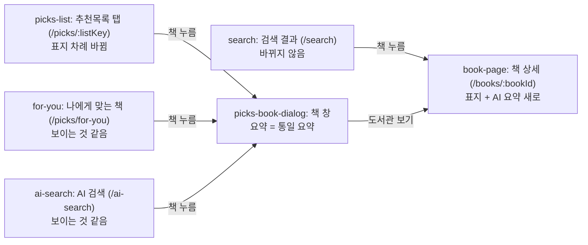
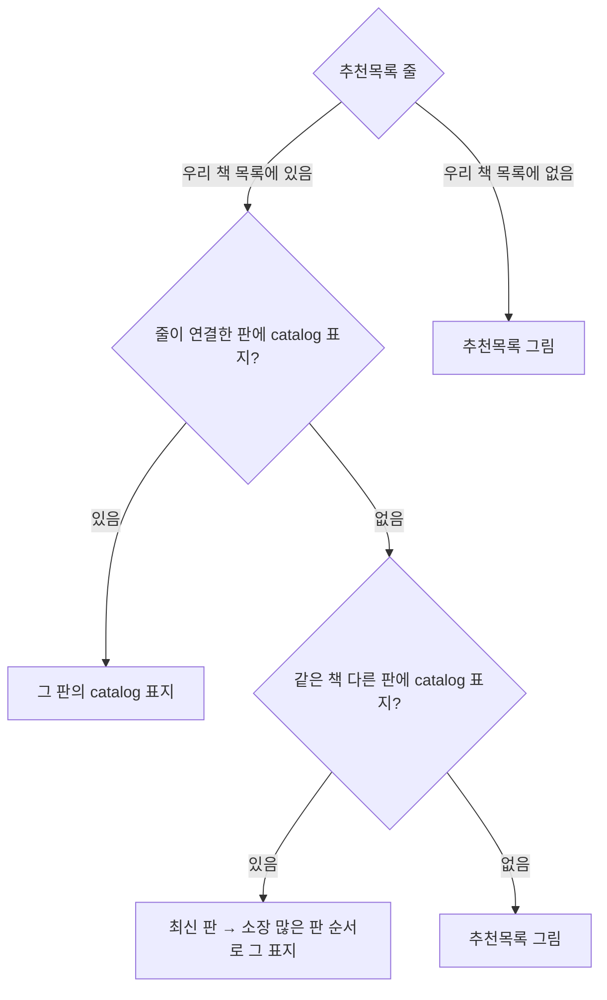

# 화면 흐름: 책 설명 한 곳에 모으기 (사이클 26)

- 작성 2026-10-28. 근거 [spec.md](spec.md), 화면은 dev main `905eab7`의 지금 화면(`web/src/main.tsx` 경로, `BookPage.tsx`, `PicksBookDialog.tsx`)을 기준으로 함
- 새 화면은 없음. 바뀌는 화면은 책 상세 하나이고, 나머지는 보이는 글·표지의 출처만 바뀜

## 화면별 내용

### S1 search — 검색 결과 (`/search`)
- 바뀌지 않음. 결과 줄에 요약·표지를 넣지 않음 [확정] (범위 결정 #5)
- 책을 누르면 S2

### S2 book-page — 책 상세 (`/books/:bookId`)
- 목적: 판 하나의 정보와 그 판을 가진 도서관
- 보이는 요소 (위에서 아래, PC·태블릿·폰 같은 차례) [확정] (범위 결정 #5, 결정 페이지 그림)
  1. 머리: 왼쪽 표지(그 판의 `catalog` 표지), 오른쪽 제목·저자·출판사·출판일·보유 도서관 수 (지금 글 그대로)
  2. 「AI 요약 ⓘ」 + 요약 전체 (자르지 않음). ⓘ 안내 글은 지금 책 창과 같음
  3. 조건·지역·가입 방식 (지금 그대로)
  4. 도서관 목록 (지금 그대로)
- 호출 API: 책 정보 API가 표지 주소·요약을 함께 돌려줌 (이름·칸은 design-delta)
- 상태
  - 기본: 위 차례
  - 로딩: 지금처럼 책 정보를 받은 뒤 그림. 표지·요약은 같은 응답이라 따로 기다리는 칸 없음 [안: 응답 모양은 design-delta]
  - 요약 없음: 2번 칸이 없음 [확정] (명세 결정 #1)
  - 표지 없음: 표지 자리를 비우지 않고 글을 왼쪽에 붙임 [확정]
  - 표지 그림을 못 받음(CloudFront 오류): 지금 `CoverImage`처럼 제목 글자 표지로 [안]
- 폰: 표지 폭만 작게(결정 페이지 그림 기준), 차례는 같음

### S3 picks-list — 추천목록 탭 (`/picks/:listKey`)
- 보이는 요소는 그대로. 표지만 위 두 번째 그림의 차례로 고름 [확정] (명세 결정 #11, 사용자 구조 2026-10-28)
- 표지 그림은 S3 + CloudFront 주소에서 받음 [확정] (R9)

### S4 picks-book-dialog — 책 창 (추천목록·나에게 맞는 책·AI 검색에서 엶)
- 표지: 연 곳의 카드 표지 그대로 (추천목록이면 S3의 차례, 나머지는 판 표지)
- 요약: 「AI 요약 ⓘ」 + 통일 요약 (`catalog` 요약, 책첵 요약 한 종류) [확정] (범위 결정 #3·#7). 추천목록 요약 파일은 없어짐
- 요약 없음: 칸 없음 (지금과 같음)

### S5 for-you — 나에게 맞는 책 (`/picks/for-you`)
- 화면은 그대로. 카드의 표지·요약 출처만 `catalog`로 바뀜. 탭 맨 위 "책 소개 글은 AI가 썼어요" 한 줄 그대로 (명세 결정 #1)

### S6 ai-search — AI 검색 (`/ai-search`)
- 화면은 그대로. 카드 표지는 추천목록 표지가 있으면 그것, 없으면 판 표지(지금과 같은 차례), 요약은 `catalog` 요약. AI 호출과 겹쳐 읽음 (R6)

## 수용 기준 대응

| AC | 화면 |
|---|---|
| AC-1 같은 책 네 곳 같은 요약 | S2, S4(S3·S5·S6에서 엶) |
| AC-2 책 상세에 표지·요약, 결과 줄에는 없음 | S1, S2 |
| AC-3 요약·표지 없는 책 | S2 상태 |
| AC-4 옮긴 뒤 수 | 화면 없음 (DB 조회) |
| AC-5 가져오기 번호 다른 파일 거절 | 화면 없음 (명령) |
| AC-6 합쳐진 책 설명 정리 | 화면 없음 (가져오기 + 조회) |
| AC-7 AI 검색 첫 글 시간 | S6 |
| AC-8 옛 표·API를 읽지 않음 | 화면 없음 (모듈 검사) |
