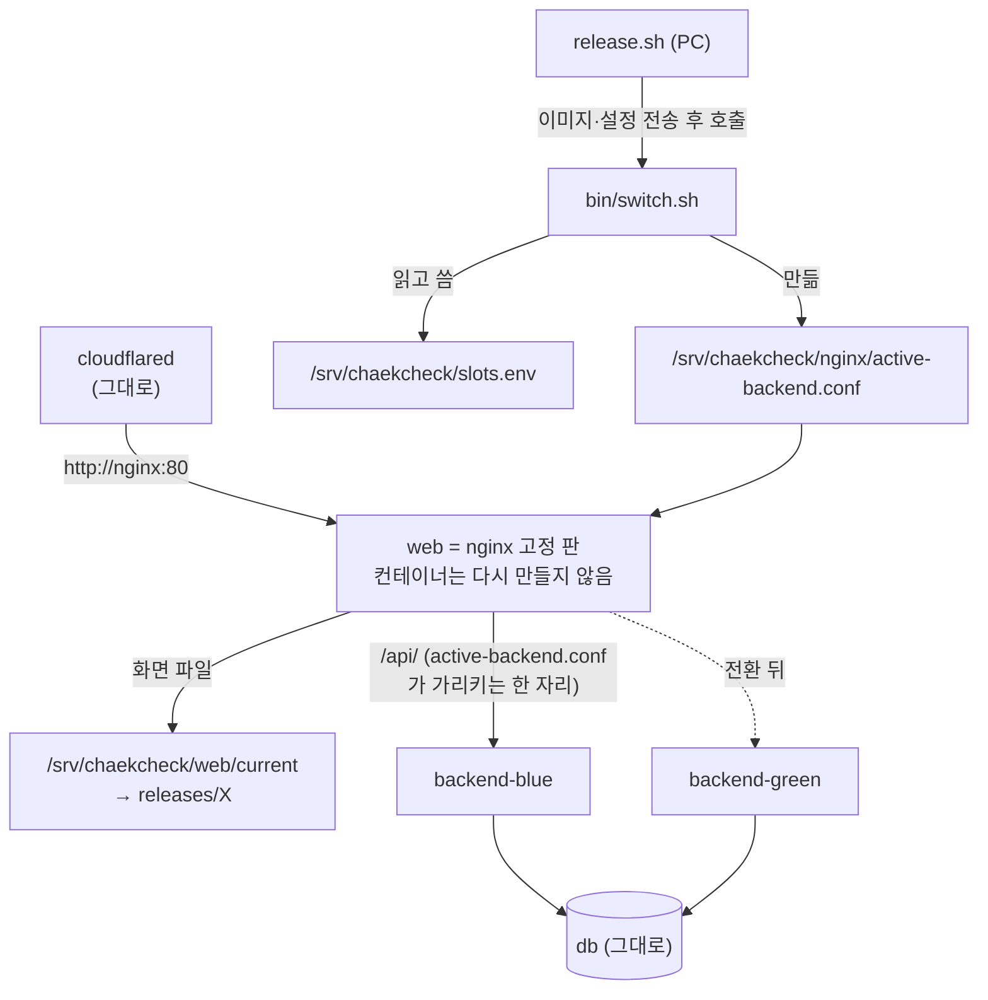
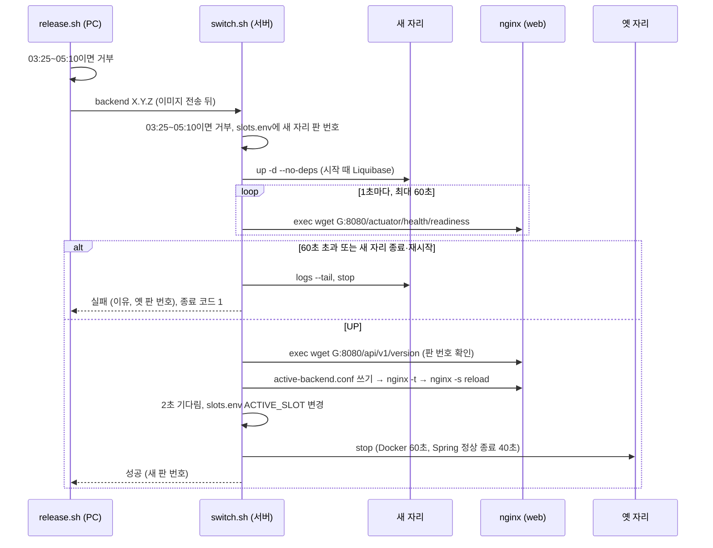
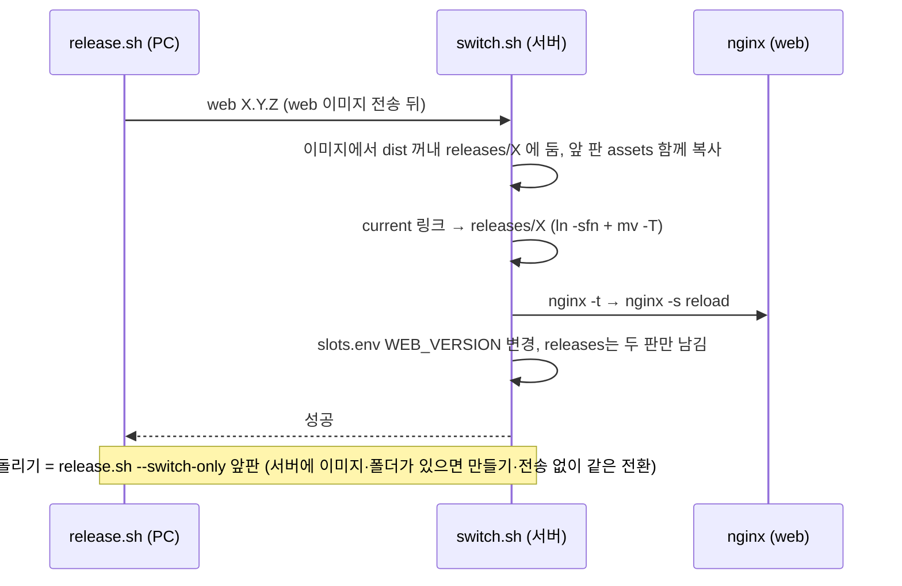
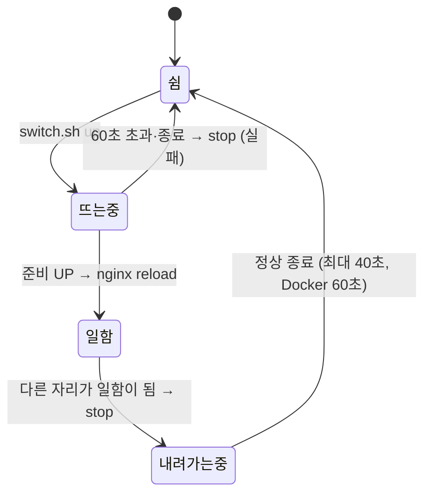

# 설계 변경: 사이클 27 무중단 배포

- 근거: `scope.md`(범위 6개 승인), `spec.md`(명세 6개 승인 + 준비 기다림 60초), `flow.md`, `architect-proposal.md`(설계 결정 6개 승인, 2026-10-29), `research.md` 3~5절
- **도메인 모듈·표·REST API 변경 없음.** 바뀌는 것은 배포 파일과 백엔드 설정(Actuator, 정상 종료)뿐 [확정] (범위 승인 2026-10-29)
- 처음 한 번(지금 구조 → 새 구조로 옮기는 배포)은 점검 배포로 짧게 끊김 [확정] (설계 결정 페이지 "먼저" 칸, 승인 2026-10-29)

## 구조 그림

### 서버 구성도 (바뀐 뒤)

### 백엔드 배포 (정상·실패)

### 화면(web) 배포·되돌리기

### 자리 상태

## 모듈

| 모듈 | 신규/변경 | 책임 | 공개 API | 발행/구독 이벤트 | 소유 테이블 |
|---|---|---|---|---|---|
| (없음) | — | 도메인 모듈 변경 없음. 백엔드 공통 설정에 Actuator `health`만 추가 | — | — | — |

- `AccountDeleted`를 새 판이 시작 때 다시 보내도 받는 쪽 셋이 두 번 받아도 됨 → 바꿀 것 없음 [확정] (dev 코드 읽기 2026-10-29, `architect-proposal.md`)

## 데이터

- 표 변경 없음. Liquibase changelog 추가 없음
- **DB 변경 규칙** (이 사이클부터 모든 사이클에 적용) [확정] (범위 #4 승인 2026-10-29):
  - 새 판은 시작할 때 Liquibase를 돌리고, 옛 판은 바뀐 DB에서 최대 약 1분 더 돎 (`ddl-auto: validate`는 시작 때만 검사)
  - 무중단 배포 가능: 표·칸·인덱스 추가(널 허용 또는 기본값), 옛 판이 안 쓰는 칸 지우기, 옛 판과 같은 결과를 내는 함수·트리거 본문 바꾸기(`runOnChange`)
  - 두 번에 나눔: 칸 이름 바꾸기·지우기·타입 바꾸기 → 1차 배포에서 새 칸 추가·둘 다 씀, 2차 배포에서 옛 칸 지움 (사이클 26 ADR-0166과 같은 방식)
  - 나눌 수 없으면 점검 배포 (지금 방식, 짧은 중단). 인계서에 "점검 배포"라고 적음
  - 새 판이 준비 확인에 실패해도 이미 돈 Liquibase 변경은 남음 → 위 규칙을 지키면 옛 판이 그대로 돎

## API

- 공개 REST API 변경 없음
- 서버 안에서만 쓰는 주소 추가: `GET /actuator/health/readiness` (Spring Actuator, 같은 포트 8080). 바깥(`chaekcheck.com/actuator/...`)은 nginx에서 404 [확정] (설계 결정 #4 승인 2026-10-29)

## 배포 설정 (dev 파일마다)

| dev 파일 | 바꿀 것 | 상태 태그 |
|---|---|---|
| `backend/build.gradle` | `spring-boot-starter-actuator` 추가 | [확정] (설계 결정 #4) |
| `backend/src/main/resources/application.yml` | `server.shutdown: graceful`, `spring.lifecycle.timeout-per-shutdown-phase: 40s`, `management.endpoint.health.probes.enabled: true`, `management.endpoints.web.exposure.include: health` | [확정] (명세 결정 #2·#3, 설계 결정 #4) |
| `deploy/prod/compose.yaml` | `backend` → `backend-blue`·`backend-green` (공통은 YAML 앵커, `image: chaekcheck/backend:${BACKEND_BLUE_VERSION:?}` 식, 별칭 자리별), `stop_grace_period: 60s`, `127.0.0.1:8080` 포트·`backend-host` 별칭 없앰. `web` = 고정 판 nginx 이미지(지금 `nginx:stable-alpine` 계열에서 정확한 판 하나로 고정 [안: dev가 정함]. 준비 확인에 busybox `wget`을 쓰므로 alpine 계열이어야 함) + `/srv/chaekcheck/nginx`·`/srv/chaekcheck/web` 폴더째 읽기 전용 mount, `depends_on: backend` 지움 (별칭 `nginx`, `127.0.0.1:8088` 그대로) | [확정] (설계 결정 #1·#3) |
| `deploy/nginx/ec2-tunnel.conf` | `upstream` 블록 → `include /etc/nginx/chaekcheck/active-backend.conf;`, `root` = `current` 링크 경로 | [확정] (설계 결정 #3) |
| `deploy/nginx/chaekcheck-locations.conf` | `location ^~ /actuator/ { return 404; }` 한 줄 | [확정] (설계 결정 #4) |
| `deploy/prod/web.Dockerfile` | 화면 파일 운반용: `web/dist`만 (nginx 설정 COPY 빼기) | [확정] (설계 결정 #3) |
| `deploy/prod/bin/switch.sh` (새로) | `switch.sh backend X.Y.Z` / `switch.sh web X.Y.Z`: 새벽 검사 → `slots.env` → `up.sh`로 자리 띄움(`--no-deps`) → 준비 확인(1초 간격 60초, 종료·재시작이면 바로 실패) → `/api/v1/version` 판 번호 확인 → `active-backend.conf` 쓰기·`nginx -t`·reload → 2초(값 [확정] 설계 결정 #5, 충분한지 [확인 필요: AC-1 감시]) → `ACTIVE_SLOT` 변경 → 옛 자리 `stop`(지우지 않음) → 결과 한 줄 + 종료 코드(성공 0, 실패 1) | [확정] (설계 결정 #5, 명세 결정 #3·#4·#6) |
| `deploy/prod/bin/up.sh` | `slots.env`를 `--env-file`로, 서비스 이름 없이 부르면 db + 일하는 자리 + web + cloudflared만, `active-backend.conf`가 없거나 `slots.env`와 다르면 다시 만듦 | [확정] (설계 결정 #2) |
| `deploy/prod/bin/release.sh` | 시작 때 새벽 검사(`TZ=Asia/Seoul`), compose `image:` `sed` 지움, `deploy/nginx/*.conf`·`switch.sh` 전송, 4단계에서 `switch.sh` 호출, `--switch-only X.Y.Z`(서버에 이미지가 있는지 확인 뒤 전환만), 정리 때 `web/releases` 두 판만 | [확정] (설계 결정 #5) |
| `deploy/prod/README.md` | 배포·되돌리기·점검 배포(db·cloudflared·nginx 이미지 판 올리기, 나눌 수 없는 DB 변경)·처음 한 번 옮기기 절차 | [확정] (범위 #3·#4·#5) |

- 서버에 새로 생기는 것: `/srv/chaekcheck/slots.env`, `/srv/chaekcheck/nginx/`(설정 4개 + `active-backend.conf`), `/srv/chaekcheck/web/releases/<판>/`, `/srv/chaekcheck/web/current` [확정] (설계 결정 #6)
- 스왑: 이미 `/swapfile` 2GB 있음, 새로 할 일 없음 [확정] (실측 2026-10-29)

## 외부 연동

| 대상 | 방식 | 제한·키 관리 | 실패 시 동작 | 상태 태그 |
|---|---|---|---|---|
| Cloudflare Tunnel | 그대로 `http://nginx:80`. nginx 컨테이너를 다시 만들지 않으므로 연결이 이어짐 | 변경 없음 | — | [확정] (Cloudflare 문서 확인 2026-10-29, `research.md` 3절) |

## 결정 기록

- ADR-0167 같은 서버 블루·그린 무중단 배포 (서비스 두 자리, `slots.env`, `switch.sh`)
- ADR-0168 nginx는 고정 판으로 두고 화면 파일·설정은 서버 폴더에서 바꿈
- ADR-0169 준비 확인은 Actuator readiness, 같은 포트, nginx 컨테이너 안에서 확인
- ADR-0170 DB 변경은 옛 판·새 판이 같이 돌아도 되는 것만, 아니면 두 번에 나누거나 점검 배포
- ADR-0171 바뀌는 순간 서버마다 따로 갖는 상태는 그대로 받아들이고, 새벽 정해진 일 시간에는 배포하지 않음

## 확인 필요

| 항목 | 확인 방법 | 막는 단계 |
|---|---|---|
| Boot 4.1.1에서 `probes.enabled: true`로 쿠버네티스 밖에서도 `/actuator/health/readiness`가 열리는지, 정상 종료 때 `REFUSING_TRAFFIC`가 되는지 | dev 프로토타입 (인계 첫 단계) | 인계 뒤 dev 첫 단계 |
| reload 뒤 2초 기다림으로 AC-1 실패 0건이 되는지 | AC-1 감시 (1초마다 불러 보기) | dev 완료 확인 |
| 겹칠 때 새 판 시작 시간 (CPU 2코어 나눔) | AC-1 감시 때 `switch.sh` 출력에 기록 | 없음 (60초 안이면 됨) |
| 정상 종료 때 가입 중 세션이 끝남 처리되어 카카오 연결이 끊기는지 | dev 프로토타입 | 없음 (지금 재시작과 같은 성질) |
