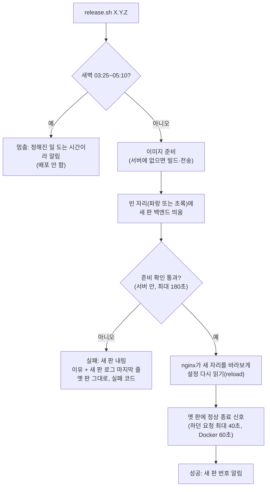
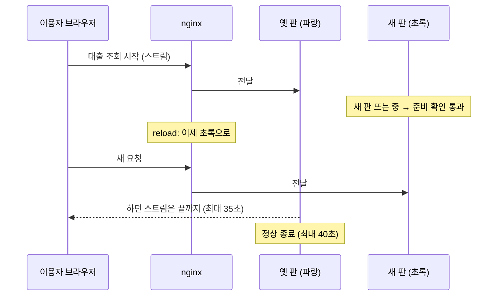

# 화면 흐름: 무중단 배포 (사이클 27)

이 사이클에는 **새 화면이 없습니다.** 이용자 화면은 배포 중에도 지금과 같아야 하는 것이 요구사항입니다(spec AC-1·AC-2). 그래서 이 문서는 운영자가 보는 `release.sh` 진행 단계와, 그동안 이용자 요청이 어디로 가는지를 그립니다. 모든 단계는 `spec.md`에서 승인된 것만 씁니다(범위 #1~#6, 명세 결정 #1~#6, 2026-10-29) [확정].

## 1. 배포 명령 진행 (운영자)

- web만 배포할 때: D3~D4 대신 새 화면 파일을 nginx에 넣고 D5(reload)만 합니다. nginx 컨테이너는 다시 만들지 않습니다 [확정] (범위 #2). 파일을 넣는 방법은 `design-delta.md`
- 되돌리기: 앞 판 번호로 같은 명령. 서버에 이미 있는 이미지면 D2에서 빌드·전송을 건너뜁니다 [확정] (명세 결정 #6)
- DB·cloudflared 판 올리기와 지킬 수 없는 DB 변경은 이 흐름이 아니라 "점검 배포"(지금 방식) [확정] (범위 #4·#5)

## 2. 그동안 이용자 요청이 가는 곳

## 단계별 내용

### D0~D2 시작
- 운영자가 보는 것: 판 번호, 새벽 시간이면 멈춘 이유
- 상태: 새벽 시간 → X1

### D3~D4 새 판 띄우기·준비 확인
- 이용자: 변화 없음 (옛 판이 계속 받음)
- 상태: 준비 확인 통과 / 180초 초과 / 컨테이너가 스스로 끝남 → X2
- 이때 새 판이 시작하며 Liquibase를 돌림 → 옛 판이 계속 쓸 수 있는 변경만 (범위 #4)

### D5 전환
- 이용자: 전환 뒤 새로 연 요청부터 새 판. 판 번호가 한 번만 바뀜 (AC-1)
- 카카오 로그인 진행 중이던 사람은 드물게 다시 로그인 (명세 결정 #1, 지금과 같음)

### D6~D7 옛 판 내리기·끝
- 이용자: 열려 있던 스트림은 끝까지 (AC-2)
- 운영자가 보는 것: 성공 줄과 새 판 번호. 끝난 뒤 백엔드는 하나 (AC-6)

### X1·X2 멈춤·실패
- 이용자: 변화 없음, 옛 판 (AC-3)
- 운영자가 보는 것: 이유, 실패 코드

## 수용 기준 대응

| AC | 단계 |
|---|---|
| AC-1 실패 0건, 판 번호 한 번 바뀜 | D3~D7, 2절 |
| AC-2 열린 스트림 끝까지 | D6, 2절 |
| AC-3 망가진 판이면 옛 판 그대로 | D4 → X2 |
| AC-4 되돌리기 | 1절 "되돌리기" (같은 흐름) |
| AC-5 web만 배포 | 1절 "web만 배포할 때" |
| AC-6 옛 판 정상 종료, 백엔드 하나 | D6~D7 |
| AC-7 이용 기록 안 빠짐 | D6 (Docker 60초 안에 마지막 저장) |
| AC-8 새벽 배포 멈춤 | D1 → X1 |
| AC-9 준비 확인 주소 바깥에서 안 열림 | D4 (서버 안에서만) |

## 상태별 동작 대응

| spec 상황 | 단계 |
|---|---|
| 정상 배포 | D0→D7 |
| 새 판이 안 뜸 | X2 |
| 배포 중 스트림 열림 | D6, 2절 |
| 배포 중 카카오 로그인 | D5 |
| 새벽 배포 | X1 |
| 되돌리기 | 1절 |
