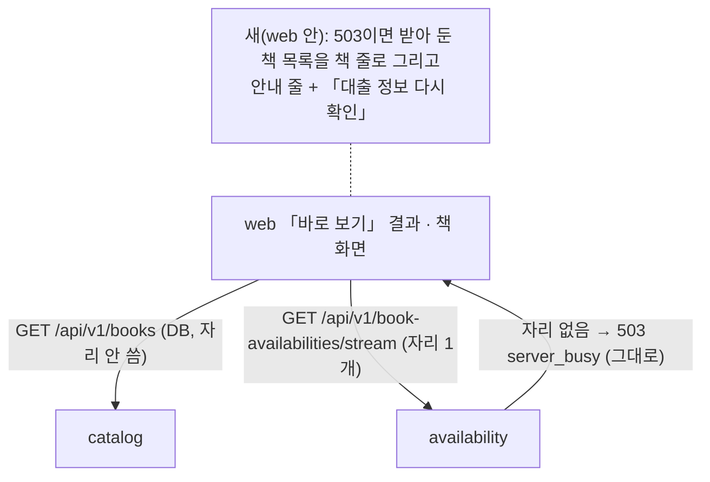

# 설계 변경: 사이클 28 자리가 다 차도 책 목록은 보여 주기 (번외)

대안 비교는 `architect-proposal.md`. 이 문서는 결정 페이지(`easy/2026-11-01-decisions.html`) 2번에서 고른 **다안(화면만 고침)** 기준으로 씁니다. 태그는 사용자 결정에 따라 갱신합니다.

## 구조 그림

### 모듈 구성도 (바뀌는 곳만)

### 주요 흐름

`flow.md` 2절의 순서 그림과 같음 (서버는 바뀌지 않음). 그림 원본 보기: `easy/flow-original.html`.

### 도메인 모델

바뀌지 않음.

## 모듈

| 모듈 | 신규/변경 | 책임 | 공개 API | 발행/구독 이벤트 | 소유 테이블 |
|---|---|---|---|---|---|
| `availability` | 변경 없음 | 자리 거절(503 `server_busy`, `Retry-After: 5`), `RefusalRecord`·`LookupOpsCounters.refused()` 그대로 | 그대로 | 그대로 | 그대로 |
| `catalog` | 변경 없음 | 책 목록 `/books` | 그대로 | — | 그대로 |
| web | 변경 | 첫 대출 조회 503 때 책 줄 목록 + 안내 줄 + 다시 확인 단추 | — | — | — |

## 데이터

변경 없음. Liquibase changelog 없음.

## API

변경 없음. `GET /api/v1/book-availabilities/stream`·`…/batches/stream`의 503 `server_busy`(`Retry-After: 5`), 스트림 이벤트, 오류 코드 모두 그대로 [확정] (사용자 승인, 결정 페이지 2026-11-07) (결정 페이지 2번).

## 웹 (dev 파일 기준, 2026-11-01)

| 어디 | 바꾸는 것 | 상태 태그 |
|---|---|---|
| `web/src/features/search/InstantResults.tsx` 131~141행 | `noHoldings && blocked === 'busy'`(`noHoldings`는 이미 `!streaming`을 포함, 131행; `blocked.ts` 19행은 503이면 코드와 무관하게 `busy`)일 때 안내문 대신: 받아 둔 `books.items`를 책 줄로(제목·저자·출판사·연도·"보유 도서관 N곳", 누르면 `/books/{id}?…` — 링크 쿼리는 `SearchPage.tsx` 473~476행이 만드는 `bookLinkSearch`를 `BookList`처럼 prop으로 받음, 648행 `<InstantResults>`에 새 prop), 위에 안내 줄 "지금 찾는 사람이 많아 대출 정보는 알 수 없어요. 책 목록만 먼저 보여 드려요." + 「대출 정보 다시 확인」. 단추는 첫 검색 뒤에는 `open(books.items, planOptions())`, 「다음 책 N권 보기」 뒤에는 그 페이지 책만 `open(books.last.items, planOptions())`(89행과 같음). 사이클 08 "다시 버튼 없음 [확정]"(`blocked.ts` 4~6행 주석)을 이 경우에 한해 뒤집음. 429(`too_many`)는 지금 그대로 | [확정] (사용자 승인, 결정 페이지 2026-11-07) (결정 3·4·5·8) |
| 책 줄 공용 조각 | `BookList.tsx` 107~117행의 줄(`Link`, title·meta·count·chevron)을 작은 컴포넌트로 빼서 두 곳에서 씀 (`BookList`는 `/books`를 스스로 부르므로 통째로 재사용하지 않음) | [확정] (사용자 승인, 결정 페이지 2026-11-07) |
| 안내 줄 + 단추 | 기존 `.blocked` 줄(`ResultList.module.css` 220행 모양) 안에 단추. 누른 뒤 답을 기다리는 동안 문구 "대출 정보 확인 중…", 단추 잠김. 또 503이면 원래 문구·단추로 | [확정] (사용자 승인, 결정 페이지 2026-11-07) (결정 5) |
| `web/src/features/book/BookPage.tsx` 208~232행 | `holdings.state.phase !== 'streaming' && holdings.state.blocked === 'busy'`이고 `order`가 비었으면(스트림 시작 전후에 안내 줄이 깜빡이지 않게) `ResultList` 대신 안내 줄("지금 찾는 사람이 많아 대출 정보는 알 수 없어요.") + 「대출 정보 다시 확인」(같은 `open`). "이 책을 가진 도서관을 모두 조회했습니다"는 보이지 않음 | [확정] (사용자 승인, 결정 페이지 2026-11-07) (결정 6) |
| 「다음 책 N권 보기」 뒤 503 (`InstantResults.tsx` 81~96행) | 지금 동작(결과 남고 안내 줄) + 안내 줄에 같은 단추(그 페이지 책 `books.last.items`로 `open` 다시, 앞 페이지 책은 다시 묻지 않음). 새 책의 책 줄은 그리지 않음 | [확정] (사용자 승인, 결정 페이지 2026-11-07) (결정 7) |
| 「결과 더 보기」 503, 추천도서 책 창, 직접 찾기, `blocked.ts` 문구 | 그대로 | [확정] (사용자 승인, 결정 페이지 2026-11-07) (결정 9) |
| 테스트 | `blocked.test.tsx`(사이클 08 AC-3) 첫 스트림 거절 기대값: 안내문 대신 책 줄 + 안내 줄 + 단추; 단추 → 스트림 다시 열림; 책 화면 테스트 하나. 서버 테스트 변경 없음 | [확정] (사용자 승인, 결정 페이지 2026-11-07) |

## 외부 연동

변경 없음.

## 결정 기록

- ADR-0173 자리 거절 때 책 목록은 화면이 지킴(서버 503 그대로) — Accepted 2026-11-07 (결정 페이지 10번 승인; 번호는 0172가 첫 운영 서버 기록에 먼저 쓰여 0173)

## 문서 갱신 (cycle-close에서)

- `docs/current/flows.md` 흐름 22: 「바로 보기」 첫 조회 503의 화면 동작을 이 사이클 것으로
- `docs/current/api.md` 오류 코드 `server_busy` 행: 화면 안내 설명 한 줄 (API 모양은 그대로)
- `docs/settings-index.md` 3절 "(넘으면 바로 503 `server_busy`)" 옆에 "사이클 28부터 「바로 보기」 첫 조회는 책 목록을 보임" 한 줄
- `docs/backlog.md`: 첫 조회 거절 때 도서관별 줄·링크(가안 방식) 한 줄

## 확인 필요

- 없음 (결정 10개 모두 승인, 2026-11-07)
