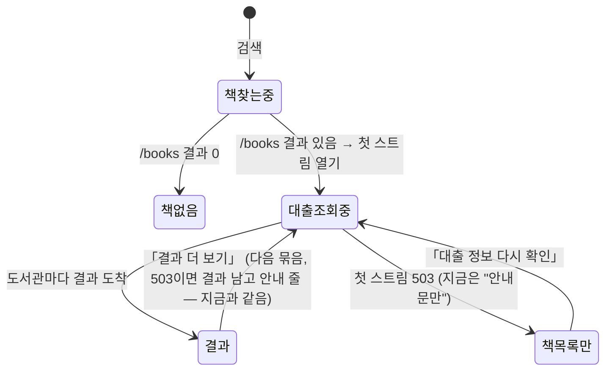
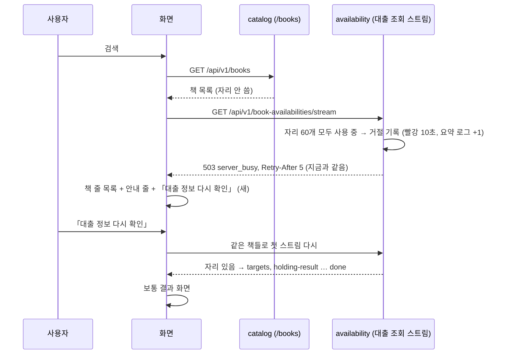

# 화면 흐름: 자리가 다 차도 책 목록은 보여 주기 (사이클 28, 번외)

새 화면은 없습니다. 바뀌는 것은 「바로 보기」 결과 화면(S-결과)과 책 화면(S-책)이 **첫 대출 조회 스트림이 503일 때** 보이는 상태 하나와, 거기서 나가는 「대출 정보 다시 확인」 길입니다. 문구와 규칙은 `spec.md`(모두 [확정] (사용자 승인, 결정 페이지 2026-11-07)). 화면 그림(PC·태블릿·폰)은 `easy/2026-11-01-decisions.html`.

## 1. 「바로 보기」 결과 화면의 상태

- `책목록만` [확정] (사용자 승인, 결정 페이지 2026-11-07): 책마다 한 줄(제목·저자·출판사·보유 도서관 N곳, 누르면 책 화면), 위에 안내 줄 "지금 찾는 사람이 많아 대출 정보는 알 수 없어요. 책 목록만 먼저 보여 드려요." + 「대출 정보 다시 확인」
- 지금(사이클 08 R2 [확정]): `대출조회중 → 안내문만`(결과 자리 전체가 "지금 찾는 사람이 많아요. 잠시 뒤에 다시 해 주세요.", 책 목록 안 보임, 단추 없음). 이 사이클이 이 상태를 `책목록만`으로 바꿈
- 429(너무 자주)는 지금 상태 그대로(이 그림에 없음) [확정] (사용자 승인, 결정 페이지 2026-11-07)

## 2. 요청 순서 (첫 스트림이 503일 때)

## 3. 화면별 바뀌는 자리

| 화면 | 지금 (첫 스트림 503) | 바뀐 뒤 [확정] (사용자 승인, 결정 페이지 2026-11-07) |
|---|---|---|
| S-결과 「바로 보기」 | 결과 자리 전체가 안내문 한 줄 | 책 줄 목록, 위에 안내 줄 + 단추(폰은 단추가 안내 줄 아래) |
| S-결과 「다음 책 N권 보기」 뒤 | 새 책 안 보임, 안내 줄 | 지금 동작 그대로(앞 결과 남고 안내 줄) + 안내 줄에 「대출 정보 다시 확인」 단추, 새 책의 책 줄은 그리지 않음 |
| S-책 책 화면 | 책 머리, 안내 줄, "모두 조회했습니다"(잘못) | 책 머리, 안내 줄 + 단추, "모두 조회했습니다" 없음 |
| 추천도서 책 창 | "대출 정보를 확인하지 못했어요. 잠시 뒤 다시 시도해 주세요." | 그대로 |
| 직접 찾기 결과·「결과 더 보기」 | 503 안내 줄 | 그대로 |

- 단추를 누른 뒤 답을 기다리는 동안: 단추는 눌리지 않게, 안내 줄은 "대출 정보 확인 중…" [확정] (사용자 승인, 결정 페이지 2026-11-07)
- 또 503이면: 책 줄·안내 줄 그대로, 단추 다시 가능 [확정] (사용자 승인, 결정 페이지 2026-11-07)
