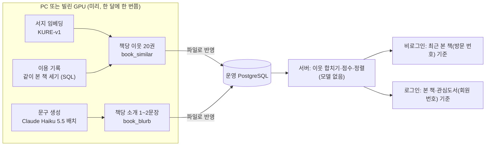

# AI 도서 추천: 책첵에 맞는 구성 (종합)

- 작성 2026-10-17. 사이클 밖 사전 조사입니다. 모듈·표·API·화면은 사이클에서 정합니다. 이 문서는 방향과 모델 조합만 [안]으로 냅니다.
- 계기: 사용자 "사이클과 번외로 나는 도서 추천 알고리즘을 생각하고있어 ai를 활용해서 추천 문구도 ai로 써서", "vast.ai같은걸 써서 rest api로 연결할까해", "개인화도 하고 싶은데 이러면 로깅 데이터도 바꿔야 하나", "로그인/비로그인 모두 추천 도서를 하고 싶어", "로깅을 어떻게 약관을 어떻게 바꾸면 되는지", "실제 업체들에서는 어떻게 맞춤 알고리즘을 내주는지", "jev같은 종류의 ai를 쓰는게 어떨가", "(로깅으로 추천도서 + 아니면 글 설명으로 추천도서)에 적합한 ai모델들을 알려주고 이것을 어떻게 구성하면 좋은지" (2026-10-17)
- 근거 문서: [industry.md](industry.md) 업체 사례·방식, [infra-cost.md](infra-cost.md) vast.ai·모델·비용, [law.md](law.md) 개인정보·AI 기본법·저작권
- 결정 페이지: [easy/2026-10-17-ai-recommend-decisions.html](easy/2026-10-17-ai-recommend-decisions.html)

## 0. 한눈에

추천은 세 단계로 나누고, **모델은 운영 서버에서 돌리지 않습니다.** 계산은 PC(또는 잠깐 빌린 GPU)에서 미리 하고 결과 표만 운영 DB에 넣습니다(사이클 11의 "내 PC에서 만들고 운영 DB에는 파일로" 방식).

| 단계 | 하는 일 | 쓰는 것 | 어디서 | 비로그인 | 로그인 |
|---|---|---|---|---|---|
| ① 후보 뽑기 | 책마다 "비슷한 책" 이웃 20권 | (가) 서지 임베딩 KURE-v1 (나) 같이 본 책 공출현 (다) 추천목록·인기 | PC에서 미리 | ○ | ○ |
| ② 순위 | 이웃을 합치고 점수로 정렬 | 규칙 계산(소장 도서관 수·추천목록·최근 본 책). 나중에 Jev 같은 점수 모델 검토 | 서버(가벼운 계산) | 최근 본 책 기준(방문 번호) | 본 책·관심도서 기준(회원 번호) |
| ③ 문구 | 책마다 1~2문장 소개 | Claude Haiku 5.5 배치 (자체 호스팅이면 Qwen3·Kanana) | PC에서 미리, DB에 저장 | ○ | ○ |

업체들도 같은 모양입니다: 항목-항목 유사도는 비개인화로 미리 계산(Netflix "Because You Watched", Amazon "함께 산 상품"), 개인화는 "어느 책을 기준으로 보여 줄지"에서 생기고, LLM은 선택이 아니라 설명 문구에 먼저 쓰였습니다([industry.md](industry.md) 1절 [확정]).

## 1. 모델 고르기 — 역할별로 다른 모델

"로깅으로 추천"과 "글 설명으로 추천"은 서로 다른 모델이 맡습니다.

| 역할 | 무엇을 하나 | 맞는 모델 | 왜 | 근거 |
|---|---|---|---|---|
| 글(서지)로 비슷한 책 찾기 | 제목·저자·출판사·분야를 숫자 벡터로 바꿔 가까운 책을 찾음 | **nlpai-lab/KURE-v1** (bge-m3를 한국어로 조정, 1024차원, MIT) [확정] (사용자 승인, 2026-10-17). 대안 BAAI/bge-m3, Qwen3-Embedding-0.6B(Apache-2.0, 차원 줄이기 가능) | 한국어 검색 성능이 bge-m3 계열 중 가장 높게 보고됨, 무료, PC CPU로 가능 | [infra-cost.md](infra-cost.md) 2절 [확정] |
| 기록으로 비슷한 책 찾기 | "이 책을 본 방문에서 같이 본 책"을 세고 인기 보정 | **모델 없음 — SQL**(Amazon식 공출현). 기록이 많이 쌓이면 Python `implicit` ALS | 작은 서비스에서는 공출현이 GRU4Rec 논문의 비교 기준 수준. 기록이 적을 때 학습 모델은 더 나쁨 | [industry.md](industry.md) 3·5절 |
| 순위 매기기 | 후보 중 무엇을 위에 둘지 | **규칙 계산** [확정] (사용자 승인, 2026-10-18) (세 단계 구성의 일부): 유사도 × 내 도서관에 있음 × 추천목록 포함 × 최근 본 책 가중치. 나중에 **Jev(TypeSafe AI)** 같은 "선택·점수만 돌려주는 모델"을 점수 계산에 검토 | Jev는 글을 만들지 않고 정해진 선택지·점수·확률만 돌려줌("returns typed decisions and probabilities rather than generated text", 입력은 글만), 환각이 없음. 그러나 early access, API만, 개인정보 처리 문구 홈페이지에서 못 찾음 | https://docs.typesafe.ai/concepts/system-one , https://typesafe.ai/ (확인 2026-10-17) [확정: 성격] / [확인 필요: 가입 가능 여부, 약관, 요금 $42/10억 입력 토큰이 유지되는지] |
| 추천 문구 쓰기 | 책마다 1~2문장 | **Claude Haiku 5.5 Message Batches** [확정] (사용자 승인, 2026-10-17) ($0.05/$0.25 per MTok, 10만 권 약 $3.5~7). 자체 호스팅이면 Qwen3 8B/14B 또는 Kakao Kanana 1.5 8B(Apache-2.0). LG EXAONE은 상업 금지 | 10만 권 문구가 몇 천 원. GPU 빌려 설치하는 것보다 싸고 빠름 | [infra-cost.md](infra-cost.md) 3절 [확정] |
| 문구 품질 검사 | 표본 몇 백 개를 큰 모델로 검사 | Claude Sonnet/Opus 표본 검사 [안: 결정 페이지에 올리지 않음, 사이클에서] | 비용은 표본만 | — |
| 자연어 요청 해석(나중) | "출근길에 가볍게 읽을 과학책" → 분야·분위기 필터 | Claude Haiku (온라인 호출) — 이번 범위 아님 | 국내 서점의 2025~26 흐름(교보 큐봇, YES24 크레마 AI) | [industry.md](industry.md) 2절 |

LLM이 **하지 말아야 할 것** [확정: 연구]: 카탈로그 없이 책 제목을 직접 고르게 하기(없는 책 환각, 인기 편향), 요청마다 온라인 호출(비용·지연), 회원 식별 정보를 프롬프트에 넣기. 후보는 항상 우리 DB에서 뽑고 LLM에는 후보 목록과 번호만 줍니다([industry.md](industry.md) 3절).

## 2. 자료 — 무엇으로 계산하나

| 자료 | 지금 있나 | 쓰임 | 주의 |
|---|---|---|---|
| `catalog.book` 제목·저자·출판사·출판일·`library_ids`, `book_contributor` | 있음 | 임베딩 입력, "내 도서관에 있음" 점수 | 분야(KDC)·책 소개 칸 없음 → 서지만으로 임베딩 [안]. 사이클 21의 이동진 KDC 비어 있음 |
| 추천목록 세 개(사서·이동진·서울대, `picks.list_book`) | 사이클 21 설계됨 | 좋은 책 신호, 비로그인 첫 화면 | — |
| 이용 기록 `usagelog.book_view`·`library_click` | 있음 | 같이 본 책 공출현 | **기록끼리 잇는 칸이 없어 지금은 못 셈** (ADR-0096 "기록끼리 잇는 칸 없음") → 3절 |
| 회원의 내 도서관·지역(`mylibrary`) | 있음 | "내 도서관에 있는 책" 거르기 | 회원 번호는 추천용 표에 따로(3절) |
| 관심도서 | 없음(백로그) | 로그인 개인화의 가장 확실한 신호 | 새 표 필요(사이클에서) |
| 정보나루 `usageAnalysisList` "함께 대출된 도서" | 외부 API(키) | 자체 기록이 없을 때 공출현 대신 | 사이클 10에서 인기 도서 출처로는 쓰지 않기로 함(아동 도서 과다). 유사 책 출처로 쓸지는 따로 결정 [안: 처음엔 쓰지 않음] |
| 책 소개·목차 (국립중앙도서관 ISBN API) | 외부, 2021-02 이전만 | 임베딩·문구 입력 보강 | 권리 귀속 미확인, 범위 제한 → 처음엔 쓰지 않음 [안]. 알라딘 API는 2026-10-30 종료(원래 안 씀, 사용자 2026-10-17) |

## 3. 로깅을 어떻게 바꾸나

지금 기록(사이클 15, ADR-0096)은 **회원 번호·쿠키 없음, 기록끼리 잇는 칸 없음, IP 30일**. 그대로는 "같이 본 책"도 "회원 맞춤"도 못 합니다. 바꾸는 범위는 최소로 둘로 나눕니다.

### 3-1. 비로그인·로그인 공통: 방문 번호 (같이 본 책용) [확정] (사용자 승인, 2026-10-17)

- 브라우저 탭을 열 때 난수 하나를 만들어(`sessionStorage`, 탭 닫으면 사라짐) 사용 알림(책 상세 열기, 도서관 클릭)에 함께 보냄. **쿠키 아님**, 회원 번호와 잇지 않음.
- 기록 표에 `visit_key` 칸 하나 추가. 공출현 계산은 "같은 `visit_key` 안에서 함께 연 책".
- 법: 쿠키가 아니고 회원 번호·IP와 결합할 키가 없으면 개인정보가 아니라고 볼 여지가 큼 [추론, law.md 3절]. 단 **같은 줄에 IP가 있으면** IP+방문 번호 결합 가능성 → 공출현 계산은 IP를 비운 뒤(30일 뒤) 하거나, 계산할 때 IP를 읽지 않음 [안].
- ADR-0096의 "기록끼리 잇는 칸 없음"을 바꾸는 일 → 새 ADR.
- 다른 선택: 쿠키(기기 단위, 며칠 이어 봄) — 처리방침에 "자동 수집 장치 설치·운영·거부" 절이 필수가 되고(제30조①7호 [확정]) 광고 차단기가 막을 수 있음. 이번엔 쓰지 않음 [안].

### 3-2. 로그인 개인화: 별도 표 (C안) — 폐기 (2026-10-18, 3-2′로 대체)

- `usagelog`는 그대로 두고(익명 통계 유지), 추천용 표를 따로: `(account_id, book_id, kind: viewed|library_clicked|favorite, at)`. 모듈·표 이름은 사이클에서.
- 탈퇴하면 `AccountDeleted`로 지움(`mylibrary`와 같은 방식). 보관 기간 [안: 1년].
- 켜고 끄기: **기본 켬 + 회원 설정에서 "맞춤 추천 끄기"** [안]. 끄면 저장도 멈추고 있던 줄도 지움.
- 법적 근거: 약관에 "맞춤 추천"을 서비스 내용으로 적고 처리방침에 공개 → 제15조①4호(개인정보위 FAQ가 직접 인정) [확정: law.md 1절]. 다른 선택: 가입 동의에 "맞춤 추천" 항목을 더해 선택 동의(1호) — 이미 가입한 회원에게 다시 받아야 함.
- 다른 선택(B안): `usagelog`에 회원 번호를 넣기 — ADR-0096을 뒤집고 익명 통계 표에 식별자가 들어가 처리방침 전체를 다시 봐야 함 → 권하지 않음.

### 3-3. 추천 결과 표 (서버가 읽는 것)

- `book_similar(book_id, neighbour_ids int4[20], scores real[20], source)` — 68만 권이면 약 130MB, PK 조회만 [추론, infra-cost.md 4절]. 벡터·HNSW 인덱스는 운영 서버에 두지 않음 [안].
- `book_blurb(book_id, text, model, generated_at)` — 10만 권 × 150자.
- 반영은 사이클 11 방식(PC에서 파일 → 운영 DB 반영).

## 4. 약관·처리방침을 어떻게 바꾸나 (1차 초안 — 4′로 대체됨)

처리방침 1절 "자동으로 수집되는 정보"는 그대로 두고 아래를 더합니다.

- **이용약관** 서비스 내용에 한 줄: "책첵은 회원이 본 책과 관심도서를 바탕으로 책을 추천합니다. 설정에서 끌 수 있습니다." [안]
- **처리방침 새 항목 "맞춤 추천(행태정보)"** (작성지침 기재사항 6가지 [확정]): 
  - 법적 근거: 이용계약 이행(개인정보 보호법 제15조①4호)
  - 항목: 회원이 연 책, 누른 도서관, 관심도서
  - 방법: 서비스 안에서 책을 열거나 관심도서로 넣을 때 서버가 기록
  - 목적: 맞춤 책 추천
  - 보유 기간: 탈퇴 또는 마지막 로그인 뒤 1년, 끄면 바로 삭제 [안]
  - 거부 방법: 설정 > 맞춤 추천 끄기. 로그인하지 않으면 모이지 않음
- **비로그인 "같이 본 책"**: 개인을 식별하지 않는 처리라 기재 의무는 없고 권장 [확정: 작성지침 p.58] → 1절에 "서비스 이용 기록(같은 방문에서 연 책을 묶어 통계·추천에 씀)" 한 구절 [안]
- **AI 표시** (인공지능 기본법 제31조①② [확정]): 서비스 안내·약관에 "책 소개 문구 일부는 생성형 AI(Claude)가 씁니다" 사전 고지 + 문구 옆 "AI가 쓴 소개" 표시 [안]. 계도기간(2027-01 이후까지)이지만 비용 없음. 비슷한 책 목록 자체는 글을 만들지 않으므로 표시 대상 아님 [추론].
- **자동화된 결정 절**: 불필요 [확정: 개인정보위 안내서가 상품·콘텐츠 추천을 제외].
- 쿠키 절: 방문 번호는 쿠키가 아니므로 그대로.

## 5. 비용·자원

| 항목 | 값 | 근거 |
|---|---|---|
| 임베딩 68만 권 | PC CPU 약 2~9시간(가정) → 0원. 느리면 vast.ai RTX 3090 $0.16/h | infra-cost 2·5절 |
| 문구 10만 권 | Claude Haiku 5.5 배치 $3.5~7 (한국어 토큰 2배면 $7~14) | infra-cost 3절 [확정 단가] |
| 운영 서버 추가 | 표 약 130MB + 문구 15MB, 메모리 모델 없음, 요청당 PK 조회 몇 번 | infra-cost 4절 [추론] |
| vast.ai를 쓸 때 | on-demand로 빌려 끝나면 바로 destroy. 책 서지만 올리고 키·DB 덤프·이용 기록은 올리지 않음(호스트가 데이터를 못 본다는 명시 없음) | infra-cost 1절 [확정] |
| vast.ai REST를 서버가 실시간으로 부르는 구성 | 쓰지 않음 [확정] (사용자 승인, 2026-10-17): 켜 둔 시간만큼 과금, 빌린 장비·주소가 바뀜, 입찰형은 중단됨 | infra-cost 1절 |

## 6. 순서 [확정] (사용자 승인, 2026-10-17) (1단계 범위 승인, 2·3단계는 순서만)

1. **1단계 (한 사이클)**: 책 화면과 추천도서 화면에 "비슷한 책" (서지 임베딩, 비개인화, 비로그인 포함) + AI 문구 + 표시. 로깅 변경 없음.
2. **2단계**: 방문 번호 추가 → "이 책을 본 사람이 같이 본 책". ADR-0096 변경.
3. **3단계**: 관심도서 + 회원 추천 표 + 설정 끄기 + 약관·처리방침 새 판 → 로그인 맞춤 추천.
4. 그 뒤: 자연어 요청 해석, Jev 같은 점수 모델로 순위 교체 검토, `implicit` ALS.

처음부터 맞춤 추천을 만들면 기록이 적어 결과가 나쁩니다(업체들도 인기 → 콘텐츠 → 협업 순, industry.md 4절 [확정]).

## 7. 결정할 것 (결정 페이지의 [안] 목록)

결정 페이지 1차(2026-10-17, 11개 중 8개 승인, 결정 페이지 번호로):

1. 세 단계 구성과 "모델은 운영 서버 밖" — 2차 페이지 #1 [확정] (사용자 승인, 2026-10-18)
2. 1단계 범위: 서지 임베딩 비슷한 책 + 문구, 로깅 변경 없음 — #2 [확정] (사용자 승인, 2026-10-17)
3. vast.ai는 일괄 작업에만(on-demand, 끝나면 destroy, 서지만 올림), 서버 실시간 연결은 안 함 — #3 [확정] (사용자 승인, 2026-10-17)
4. 임베딩 모델 KURE-v1, PC에서, 입력은 제목·저자·출판사(·출판일) — #4 [확정] (사용자 승인, 2026-10-17)
5. 같이 본 책은 모델 없이 SQL(Amazon식 인기 보정), 기록이 쌓이면 implicit — #5 [확정] (사용자 승인, 2026-10-17)
6. 문구 모델 Claude Haiku 5.5 배치, 입력은 서지만, 책 소개 원문 안 넣음 — #6 [확정] (사용자 승인, 2026-10-17)
7. Jev는 순위 점수용으로 나중에 검토(가입·약관·개인정보 처리 확인 뒤) — #7 [확정] (사용자 승인, 2026-10-17)
8. 방문 번호(탭 난수, 쿠키 아님, IP 안 읽음)로 같이 본 책 — 2단계, ADR-0096 변경 — #8 [확정] (사용자 승인, 2026-10-17)
9. 로그인 개인화 저장 방식 — #9 기타: 사용자 "아직 외부 배포 전이라서 괜찮지 않나 / 기록 표에 회원번호 넣기" → 별도 표(C안) 대신 **기록 표에 회원 번호를 넣는 B안**으로 다시 냄 → 2차 페이지 #2 [확정] (사용자 제안 2026-10-17, 승인 2026-10-18; 아래 3-2′)
10. AI 문구 표시 "AI가 쓴 소개" + 사전 고지, 비슷한 책 목록은 표시 안 함 — #10 [확정] (사용자 승인, 2026-10-17)
11. 약관·처리방침 추가 문구 — #11 기타: "9안 첨언 참고해서 어떻게 하면 좋을지 다시" → B안에 맞춘 문구로 다시 냄 → 2차 페이지 #3 [확정] (사용자 승인, 2026-10-18; 아래 4′)
12. 정보나루 "함께 대출된 도서"·국립중앙도서관 책 소개는 처음엔 쓰지 않음 — 페이지 #11 주의 문단에 넣었고 #11 승인(2026-10-18)으로 함께 [확정]

### 3-2′. 로그인 개인화: 기록 표에 회원 번호 (B안, 사용자 제안을 구체화) [확정] (사용자 승인, 2026-10-18). 3-2의 별도 표(C안)는 폐기

사용자(2026-10-17): "아직 외부 배포 전이라서 괜찮지 않나 / 기록 표에 회원번호 넣기". 공개 배포 전이라 아직 아무 이용자 기록이 없으므로 ADR-0096을 바꾸는 비용이 지금이 가장 작습니다.

- `usagelog.book_view`·`library_click`·`screen_event`에 `account_id bigint NULL` 칸 추가 [확정: 방향, 칸 이름은 안]. 로그인했고 맞춤 추천이 켜져 있을 때만 채움, 아니면 NULL. `search_event`에는 넣지 않음(검색어는 민감할 수 있고 추천에 필요 없음) [안].
- 탈퇴: `AccountDeleted`를 `usagelog`가 받아 그 회원의 `account_id`를 NULL로 비움(줄은 남겨 익명 통계 유지). `mylibrary`와 같은 방식.
- 끄기: 회원 설정 "맞춤 추천 끄기" → 그 뒤로 NULL로 저장 + 있던 줄의 `account_id`를 NULL로. 거부 방법 기재 의무(작성지침)를 이것으로 채움.
- 보관: 기록 표 그대로 1년(IP 30일). 회원 번호는 탈퇴·끄기 때 바로 비움.
- 관심도서는 기록이 아니라 회원의 선택이라 따로 표(`favorite` 같은 것, 사이클에서).
- C안(별도 표)과 비교: 표 하나 덜 만들고 반영이 단순. 대신 익명 통계 표에 식별자가 들어가므로 통계 SQL이 `account_id`를 읽지 않도록 하고, 처리방침 1절 "자동으로 수집되는 정보"에 "회원 번호(로그인한 경우)"를 더해야 함.
- ADR-0096의 "회원 번호·쿠키·User-Agent는 남기지 않는다"를 "회원 번호는 맞춤 추천을 켠 회원만, 탈퇴·끄기 때 비움"으로 바꾸는 새 ADR 필요. 처리방침 공개일 2026-10-18 이전이면 새 판 없이 첫 판에 넣을 수 있음 [확인 필요: 사이클 16 dev 진행 상태].

### 4′. 약관·처리방침 문구 (B안 기준) [확정] (사용자 승인, 2026-10-18). 4절의 초안을 대신함

| 어디 | 언제 | 문구 |
|---|---|---|
| 처리방침 1절 "자동으로 수집되는 정보" | 1·2단계 | "IP 주소, 브라우저 종류, 접속 기록, 서비스 이용 기록(같은 방문에서 연 책을 묶어 통계와 추천에 씁니다), 부정 이용 기록" — 목적에 "책 추천" 추가 |
| 처리방침 1절 "가입한 경우" | 3단계 | 항목에 "맞춤 추천을 켠 경우: 연 책, 누른 도서관, 관심도서" 추가, 목적에 "맞춤 책 추천", 보유 "탈퇴 또는 끄면 바로 비움" |
| 처리방침 새 항목 "맞춤 추천" | 3단계 | 근거: 이용계약 이행(제15조①4호) / 항목: 위와 같음 / 방법: 로그인한 채 책을 열거나 도서관을 누르거나 관심도서로 넣을 때 서버가 기록 / 목적: 맞춤 책 추천 / 보유: 탈퇴 또는 끄면 바로 비움, 그 밖에는 이용 기록과 같이 1년 / 거부: 설정 › 맞춤 추천 끄기 |
| 이용약관 서비스 내용 | 3단계 | "책첵은 회원이 본 책·누른 도서관·관심도서를 바탕으로 책을 추천합니다. 설정에서 끌 수 있습니다." |
| 서비스 안내·약관 | 1단계 | "책 소개 문구 일부는 생성형 AI(Claude)가 씁니다. 사실과 다를 수 있으니 책 정보는 도서관 페이지에서 확인해 주세요." |

## 확인 필요

| 항목 | 어떻게 |
|---|---|
| 한국어 서지 임베딩 품질(제목·저자만으로 비슷한 책이 그럴듯한지) | 프로토타입: 1,000권 표본으로 이웃 20권을 뽑아 사용자가 봄 |
| PC CPU 임베딩 처리량 | 프로토타입: 1,000권 시간 측정 |
| 한국어 토큰 수(비용) | API 호출 시험: `count_tokens` 1,000권 |
| Jev 가입 가능 여부·약관·개인정보 처리·요금 유지 | 공식 문서 확인(typesafe.ai 약관), 가입 시험 |
| 국립중앙도서관 책소개 권리 귀속 | 공식 문서 확인 또는 문의 — 쓰기로 할 때만 |
| 「온라인 맞춤형 광고 가이드라인」 현행본 | 공식 문서 확인 — 쿠키를 쓰기로 할 때만 |
