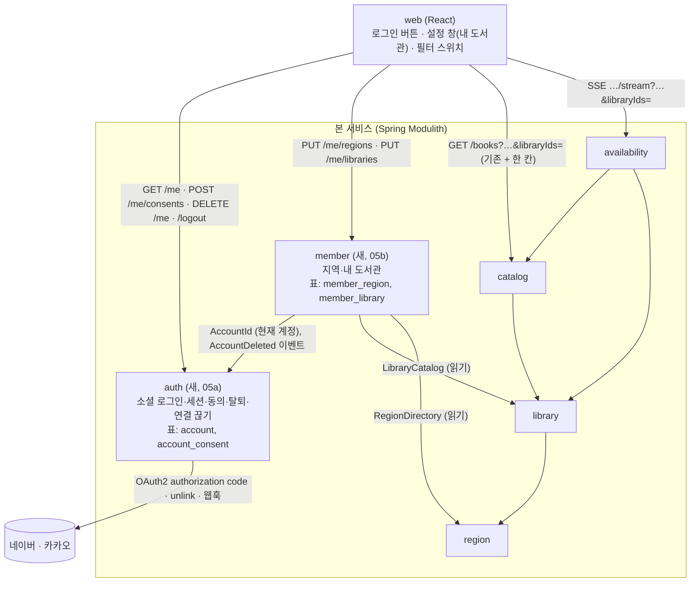

# 회원과 관련 서비스를 chaekcheck에 넣는 방법 — 제안 [안]

- 작성: 2026-10-01 (chaekcheck-plan 세션). 사용자 요청: "내가 앞으로 할 회원가입과 관련 서비스들을 어떻게 이 프로젝트에 반영하면 좋은지 진지하게 고민해서 안을 만들어줘"
- 성격: 사이클 밖 제안입니다. 여기서 고른 안은 `/cycle-start 회원`에서 `scope.md`가 되고, 모듈·표·API의 확정값은 그 사이클의 `design-delta.md`와 ADR에서 정합니다.
- 전제: `outline.md`(밑그림), `signup-security.md`(보안·법 근거), dev `CLAUDE.md`(Spring Modulith, 모듈 경계, 나중에 MSA·Expo 앱), `docs/current/module-map.md`·`api.md`(지금 구조).
- 태그: 사용자가 고른 세 가지(아래)는 [확정], 나머지 값은 [안]입니다.

### 사용자 결정 (2026-10-01) [확정]

| 고른 것 | 선택 | 이유 |
|---|---|---|
| 모듈 | **안 B: `auth` + `member` 둘** (3.1) | [이유 미확인] |
| 검색 연결 | **안 1: 웹이 파라미터로** (3.2) | [이유 미확인] |
| 사이클 자르기 | **안 Y: 05a 로그인·계정 → 05b 내 도서관·검색 연결 → 06 알림** (5절) | [이유 미확인] |

세 결정은 `/cycle-start`에서 ADR로 기록합니다(사이클 번호가 필요하므로 여기서는 기록만).

**번호 대응 (사용자 확인, 2026-10-01)**: 이 문서의 "05a" = **사이클 05** (`docs/cycles/05-login-account`, 2026-10-01 시작), "05b" = **사이클 06** 내 도서관·검색 연결, "06 알림" = **사이클 07**. 사이클 05 포함 범위는 사용자 선택 "공통 + 웹훅 + 이벤트·저장소"(`docs/cycles/05-login-account/scope.md`).

## 0. 한 줄 결론

**회원은 "저장"만 더하는 두 모듈(`auth`, `member`)로 넣는다.** 지금의 검색·조회는 비회원 그대로 두고, 회원이면 지역·직접 고른 도서관·(나중에) 관심 책이 서버에 남아 기기가 바뀌어도 같게 보이게 한다. 검색 모듈(`catalog`, `availability`)은 회원을 모르게 두고, 웹이 회원 정보를 받아 지금 쓰는 파라미터로 바꿔 보낸다. 사이클은 **05a 로그인·계정 → 05b 내 도서관·검색 연결 → 06 알림** 셋으로 자른다 [확정].

## 1. 지켜야 할 원칙 (근거)

| 원칙 | 왜 | 근거 |
|---|---|---|
| 비회원도 지금 기능을 전부 쓴다 | 회원의 이유는 "알아서 도서관 매핑"과 "내 도서관 저장"이지 접근 제한이 아님 | 사용자 발언 (`outline.md` 1절) |
| 회원 모듈은 자기 표만 갖고, 다른 모듈은 ID로만 참조 | 모듈 경계, 나중에 서비스로 분리 | dev `CLAUDE.md` Architecture, ADR-0001 |
| 검색 모듈은 회원을 모른다 | 검색 서비스가 회원 서비스를 부르지 않아야 나중에 분리가 쉬움. 브라우저가 계획을 갖는 지금 방식과 같음 | ADR-0014, ADR-0021 |
| 최소 수집: 제공자 + 제공자 번호, 시군구 코드, 도서관 ID | 입증책임이 운영자에게 있음 | `signup-security.md` C8-1 제16조 |
| 탈퇴는 물리 삭제 + 연결 끊기 + 세션 종료 | 법·카카오 정책 | `signup-security.md` 3절 5·6번 |
| 값·이름은 사이클에서 정하고, 여기서는 구조만 | 사용자 방침 "큰 틀 먼저" | 2026-10-01 |

## 2. 회원 관련 서비스 지도 (무엇이 있고 언제 하나)

```
지금(04까지)  비회원 검색: 지역을 브라우저가 들고 → 가입 가능 도서관 계획 → 실시간 조회

05 회원       로그인(네이버·카카오) · 세션 · 지역 저장 · 내 도서관(자동+직접) · 탈퇴 · 동의/처리방침
              └ 검색 연결: "내 도서관만" 필터 하나 (outline.md 2.3 안 A)

06 알림       관심 책 저장 · "빌릴 수 있게 됨" 감지 · 전달 수단 · 알림 끄기
              └ 감지 방식은 주기 갱신 사이클과 맞물림 (4절)

나중          내 서재(읽은 책·읽을 책) · 소속 기관 자격(대학·회사) · 알림 채널 확장 · Expo 앱 로그인(토큰)
```

- 05와 06을 나누는 기준: 06은 "서버가 사용자 없이 도서관 사이트를 읽는" 새 종류의 일이 생깁니다. 05는 새로 읽는 일이 없고 저장만 합니다. 위험의 종류가 달라서 나눕니다.
- 05를 더 잘게(로그인만 / 내 도서관만) 나누지 않는 이유: 로그인만 있고 저장할 것이 없으면 사용자에게 보이는 가치가 없습니다. 사용자도 너무 작은 사이클을 꺼렸습니다 (2026-09-30, backlog).

## 3. 사이클 05 회원 — 구조 제안

### 3.1 모듈: `auth` + `member` 둘 [확정: 사용자 선택 안 B, 2026-10-01. 이유 미확인]



- 의존 방향: `member → auth, library, region`. `auth`는 다른 모듈에 의존하지 않음. **`catalog`·`availability`는 둘 다 모릅니다.** 순환 없음.
- **`auth`가 갖는 것**: Spring Security `oauth2Login`(네이버·카카오 provider), 세션, 계정 표(`account`: provider + provider_user_id), 동의 기록, 탈퇴(연결 끊기 → 삭제 → 세션 종료), 카카오 연결 해제 웹훅, 개인정보 처리방침 버전. 공개 Java API [안]: 현재 요청의 계정을 주는 타입 `AccountId`(Spring Security principal), 계정이 삭제될 때의 이벤트 `AccountDeleted(accountId)`.
- **`member`가 갖는 것**: 지역 자격, 직접 추가 도서관(나중에 관심 책). 모든 행은 `account_id`로 `auth`의 계정을 가리킴(FK 없음, 모듈 경계). `AccountDeleted`를 받아 자기 행을 지움 → 이 이벤트가 두 모듈 사이 첫 계약이므로 **05a에서 이벤트와 영속 발행 저장소(Spring Modulith event publication registry)를 함께 넣음** [안] (`spring-modulith` 스킬: 메모리 저장소는 내구성이 없음).
- 나중에 분리할 때: `auth` 서비스(IdP 경계)와 `member` 서비스. 이벤트는 그때 외부 브로커로 내보냄(지금은 넣지 않음).
- 처음 검토한 안 A(`member` 하나, 안에 패키지로 나눔)는 채택하지 않음 [이유 미확인].

### 3.2 검색 연결: 웹이 파라미터로 바꿔 보냄 [확정: 사용자 선택 안 1, 2026-10-01. 이유 미확인. 값(상한 등)은 05b에서]

"내 도서관 = 지역으로 가입 가능한 곳 ∪ 직접 추가한 곳"(`outline.md` 2.2)을 검색에 적용하는 방법입니다.

| | 안 1: 웹이 파라미터로 (추천) | 안 2: 서버가 세션으로 |
|---|---|---|
| 방법 | 웹이 `GET /api/v1/me`로 지역·직접 추가 목록을 받아, 기존 `residenceRegionIds`·`workRegionIds`·`scope=joinable`에 **새 칸 `libraryIds=`(직접 추가, 자격과 무관하게 포함)** 만 더해 보냄 | `scope=mine`을 새로 두고, `catalog`·`availability`가 세션의 회원 ID로 `member`에 물어 계획을 만듦 |
| 검색 모듈 변경 | `library.planSearch`에 "이 ID들은 자격과 상관없이 포함" 옵션 한 줄, 파라미터 검증 한 줄 | `catalog → member`, `availability → member` 의존이 새로 생김. 세션 없는 요청과 있는 요청을 둘 다 처리 |
| 좋은 점 | 검색 모듈이 회원을 모름. 주소를 공유해도 비회원이 같은 결과를 봄. 지금 구조(브라우저가 계획을 가짐)와 같음 | 주소가 짧음. 웹이 회원 정보를 매번 붙이지 않아도 됨 |
| 나쁜 점 | 직접 추가 도서관이 많으면 주소가 길어짐 → 상한 필요 [안: 20곳, 지역 ID 상한과 같게]. 사용자가 주소를 고쳐 다른 도서관을 넣을 수 있음(공개 자료라 해가 없음) | 검색 서비스를 나중에 분리하면 회원 서비스 호출이 필요. 캐시 키에 회원이 섞일 위험 |

- 안 1에서 "내 도서관만" 스위치 = `scope=joinable` + `libraryIds=<직접 추가>`. "전체" = 지금과 같음. `visit=none`은 그대로.
- 직접 추가 도서관의 정렬 위치(`joinTier`, `priorityGroup`)는 사이클에서 정함 [확인 필요: 사용자에게 질문. 후보: 자동 매핑과 같은 단계 / 맨 앞].

### 3.3 인증·세션: 서버 세션 쿠키 [안]

| | 서버 세션 (추천) | 토큰(JWT) |
|---|---|---|
| 방법 | Spring Security `oauth2Login` + `HttpSession`. 세션 저장은 처음엔 메모리, 재시작 뒤에도 로그인이 남게 하려면 Spring Session JDBC [안, 확인 필요: 재시작 시 로그아웃을 감수할지] | 로그인 뒤 서명한 토큰을 브라우저에 줌 |
| 좋은 점 | 탈퇴·연결 끊기 때 세션을 즉시 끊을 수 있음(법·카카오 정책 요구). CSRF·세션 고정 보호가 Spring 기본 | 서버가 상태를 안 가짐 |
| 나쁜 점 | 여러 대가 되면 세션 공유 저장소 필요 (ADR-0021과 같은 방식: 인터페이스 뒤에 두고 나중에 Redis/JDBC) | 발급한 토큰을 만료 전에 무효화하기 어려움 → 탈퇴 요구와 충돌 |
| Expo 앱(나중) | 앱은 시스템 브라우저로 로그인 뒤 토큰 발급 경로를 따로 더함. 05에서는 만들지 않음 | — |

세부(쿠키 속성, 만료, PKCE, CSRF)는 `signup-security.md` 3절 7~9번 그대로.

### 3.4 데이터 (스키마 `auth`, `member`) [안]

| 스키마.표 | 한 줄 = | 칸 (이름은 사이클에서) | 사이클 |
|---|---|---|---|
| `auth.account` | 계정 하나 | id, provider(`NAVER`/`KAKAO`), provider_user_id, created_at, last_login_at. UNIQUE(provider, provider_user_id) | 05a |
| `auth.account_consent` | 계정 × 동의 | account_id(FK, cascade), policy_version, agreed_at. 동의 증빙(제15조), 처리방침 버전이 바뀌면 재동의 판단 | 05a |
| `member.member_region` | 계정 × 지역 자격 | account_id(FK 없음, `auth` 모듈 ID), kind(`RESIDENCE`/`WORK`), region_id(`region` 모듈 ID, FK 없음). 지역 폐지는 읽을 때 `/regions/resolutions`로 해석(ADR-0003) | 05b |
| `member.member_library` | 계정 × 직접 추가 도서관 | account_id, library_id(`library` 모듈 ID, FK 없음), added_at. 꺼진 도서관은 읽을 때 거름 | 05b |

- 저장하지 않는 것: 이메일, 이름, 닉네임, 프로필 사진, 토큰(액세스·리프레시는 로그인 흐름 안에서만 쓰고 버림 [안, 확인 필요: 연결 끊기 API가 토큰을 요구하면 저장 필요]).
- 탈퇴: `auth.account` 삭제(같은 스키마 FK cascade) + `AccountDeleted` 이벤트 → `member`가 자기 행 삭제. 06의 관심 책도 같은 방식. 이벤트 처리기는 멱등(같은 이벤트가 두 번 와도 결과 같음).
- Liquibase `auth/001-auth-schema.yaml`(05a), `member/001-member-schema.yaml`(05b), 이벤트 발행 저장소 표(05a). 배포 전 규칙(`PRE_DEPLOYMENT`) 그대로.

### 3.5 API [안]

| 메서드 | 경로 | 모듈 | 사이클 | 설명 |
|---|---|---|---|---|
| GET | `/oauth2/authorization/{naver\|kakao}` | `auth` | 05a | Spring Security가 만드는 로그인 시작 주소 |
| GET | `/api/v1/me` | `auth` | 05a | 계정 정보: provider, 동의 상태. 비로그인 401 `unauthorized`. 05b에서 regions[], libraries[]를 더할지, `member`가 `/api/v1/me/profile`로 따로 줄지는 05b에서 정함 [안] |
| POST | `/api/v1/me/consents` | `auth` | 05a | 동의 기록 (policy_version) |
| DELETE | `/api/v1/me` | `auth` | 05a | 탈퇴: 연결 끊기 호출 → 삭제 → `AccountDeleted` → 세션 종료 |
| POST | `/logout` | `auth` | 05a | Spring Security 기본, CSRF 토큰 필요 |
| POST | `/api/v1/kakao/unlink-callback` | `auth` | 05a | 카카오 연결 해제 웹훅. 3초 내 200 (`signup-security.md` A2-6) |
| PUT | `/api/v1/me/regions` | `member` | 05b | 거주지·직장 지역 통째로 바꿈 |
| PUT | `/api/v1/me/libraries` | `member` | 05b | 직접 추가 도서관 통째로 바꿈 (상한 [안: 20]) |
| GET | `/api/v1/books?…&libraryIds=`, `…/stream?…&libraryIds=` | `catalog`, `availability` | 05b | 기존 API에 칸 하나 추가 (3.2) |

- 지금 `api.md`의 "공개 API는 모두 인증 없는 GET" 규칙이 바뀝니다: 인증이 필요한 `/api/v1/me/*`가 생기고, 변경 메서드에는 CSRF 토큰(`csrf.spa()`)이 붙습니다. ADR로 기록.
- 오류 코드 추가: `unauthorized`(401), `forbidden`(403, 쓸 일이 있으면).

### 3.6 웹 [안]

- 검색 화면 오른쪽 위에 로그인 버튼(네이버·카카오). 로그인 뒤 처음이면: 브라우저에 저장된 지역이 있으면 "이 지역을 계정에 저장할까요?"로 옮김(브라우저 값 → 서버). 없으면 지역 입력 화면.
- 설정 창(`SettingsPanel`)에 "내 도서관" 절: 자동 매핑(지역) 목록과 직접 추가 목록, 추가·삭제. 계정 절: 로그아웃, 연결 끊기·탈퇴.
- 필터: 로그인 전 "가입 가능한 곳", 로그인 후 같은 자리가 "내 도서관만" (`outline.md` 2.3 안 A). 기본값 [확인 필요: 사용자에게 질문].
- 개인정보 처리방침 페이지(정적), 가입 때 동의 화면(제15조 4가지 고지, 만 14세 확인란 [안]).

### 3.7 사이클 05에 넣지 않는 것 [안]

- 관심 책·알림(06), 내 서재, 소속 기관 자격, Expo 앱 로그인(토큰), 이메일·연락처 수집, 회원 간 기능(공유·팔로우), 관리자 화면, 여러 대용 세션 공유 저장소.

## 4. 사이클 06 알림 — 구조 방향 (05 뒤에 다시 잘라 냄)

- `member`에 `member_watch(member_id, book_id)`를 더하고(관심 책), 알림 판단·발송은 **새 모듈 `notification`** [안] (`notification → member, catalog, availability`). 회원 모듈이 도서관 사이트를 읽는 일을 갖지 않게 하기 위함.
- "빌릴 수 있게 됨" 감지 두 갈래 (`outline.md` 3.1). 추천: **06 v1은 (가) 관심 책의 소장 도서관 상세 페이지를 서버가 하루 N회 읽음**. 지금 있는 `availability`의 상세 페이지 읽기(`LookupTask`, 호스트 간격, 캐시)를 그대로 쓰고, 규모 상한(회원당 관심 책 수, 하루 요청 수)을 둠. 주기 갱신 사이클(소장 목록 전체)과 합치는 (나)는 갱신이 대출 상태를 다루지 않으므로 06 안에서는 쓰지 않음 [안].
- "입고"(새 소장)와 "반납되어 대출 가능"은 다른 신호 → 사용자에게 질문 [확인 필요].
- 전달 수단은 06 시작 전에 확인: 카카오 이메일은 비즈 앱 전용 [확정] (`signup-security.md` A2-4). 후보: 웹 푸시(브라우저 구독, 연락처 불필요) / 이메일(별도 수집·재동의) / 카카오 알림톡(사업자·비용) [확인 필요: 공식 문서 확인].
- 05가 06을 위해 열어 둘 것: 회원 삭제 이벤트(`MemberDeleted`)는 06에서 첫 소비자(`notification`)가 생길 때 Modulith 이벤트 + 영속 발행 저장소로 넣음. 05에서는 소비자가 없으므로 만들지 않음.

## 5. 사이클 자르기 [확정: 사용자 선택 안 Y, 2026-10-01. 이유 미확인]

| 사이클 | 모듈 | 들어가는 것 | 사용자에게 보이는 것 |
|---|---|---|---|
| **05a 로그인·계정** | `auth` (새) | 네이버·카카오 로그인, 서버 세션, 동의 화면·처리방침 페이지, `/api/v1/me`, 로그아웃, 탈퇴(연결 끊기·삭제·세션 종료), 카카오 웹훅, `AccountDeleted` 이벤트 + 영속 발행 저장소, CSRF(`csrf.spa()`), 네이버 검수 준비 | 로그인 버튼, 로그인 상태 표시, 계정 절(로그아웃·탈퇴) |
| **05b 내 도서관·검색 연결** | `member` (새), `library`·`catalog`·`availability`(칸 하나), 웹 | 지역 저장(브라우저 값 → 서버 옮기기), 직접 추가 도서관, `libraryIds` 파라미터, `planSearch` 옵션, 설정 창 "내 도서관" 절, "내 도서관만" 스위치, `AccountDeleted` 처리 | "로그인하면 내 도서관이 저장되고 검색에 바로 쓰임" |
| **06 알림** | `notification` (새), `member`(관심 책) | 4절 | 관심 책 표시, 알림 받기 |

- 처음 추천한 안 X(05 통째)는 채택하지 않음 [이유 미확인]. 05a는 저장 기능이 없어 "보이는 가치"가 작지만, 인증 위험(검수·세션·탈퇴)을 따로 끝내고 05b로 넘어갑니다.
- 05a에서 미리 열어 두는 것: `AccountId` 공개 타입, `AccountDeleted` 이벤트(05b가 첫 소비자). 05a에서는 소비자가 없어도 이벤트 발행과 저장소는 넣습니다(05b가 이벤트만 받으면 되게).

## 6. 사이클에서 사용자에게 물을 것 (지금 답하지 않아도 됨)

05a
1. 서버 재시작 때 로그아웃을 감수할지(메모리 세션) / Spring Session JDBC
2. 만 14세 미만 정책, 운영자의 소상공인 해당 여부 (`signup-security.md` 13·14)
3. 처리방침 문구·버전 관리 방식

05b
4. 자동 매핑된 도서관을 "내 도서관"에서 뺄 수 있게 할지
5. 로그인 후 기본 필터 ("내 도서관만" / "전체")
6. 직접 추가 도서관의 정렬 위치와 상한
7. `/api/v1/me`에 지역·도서관을 합쳐 줄지, `member`가 따로 줄지

## 6.1 ADR 기록

- `auth`와 `member`를 나눔 (안 B) — **ADR-0036** (2026-10-01 기록)
- 검색은 회원을 모르고 웹이 `libraryIds`로 넘김 (안 1) — **ADR-0037** (2026-10-01 기록)

아직 기록하지 않은 것 (사이클 05 설계에서 확정 뒤):
- 인증 방식: 서버 세션 (3.3) — 사이클에서 확정 뒤
- API 규칙 변경: 인증 필요한 API와 CSRF (3.5)

## 7. 확인 필요

| 항목 | 방법 |
|---|---|
| 네이버·카카오 연결 끊기 API가 액세스 토큰을 요구하는지(→ 토큰 저장 필요 여부) | 공식 문서 확인 (`signup-security.md` A1-5, A2-5 재확인) |
| 네이버·카카오 PKCE 지원 | 프로토타입 호출 시험 |
| Spring Session JDBC의 Spring Boot 4 호환·표 정의 | 공식 문서 확인 |
| 알림 전달 수단별 조건(웹 푸시·이메일·알림톡) | 06 시작 전 공식 문서 확인 |
| 상세 페이지 주기 읽기의 규모(회원 × 관심 책 × 도서관) | 06에서 추정·프로토타입 |

## 8. 관련 문서

- `outline.md`(밑그림), `signup-security.md`(근거), `docs/backlog.md` "2026-10-01 정리", `docs/current/module-map.md`·`api.md`, ADR-0001·0003·0013·0014·0021·0027, `docs/reference-index.md` 5절
